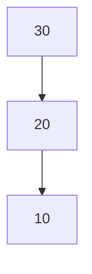
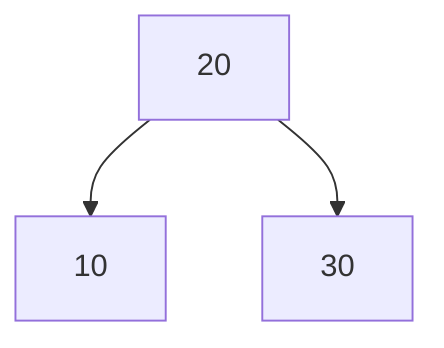
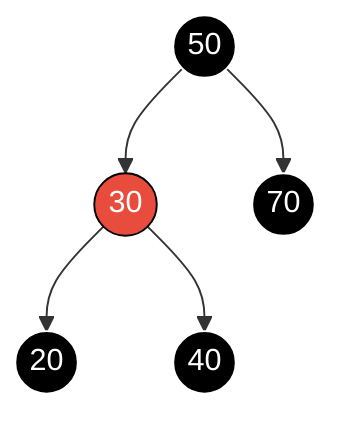

# Estructuras de Datos - Árboles de búsqueda balanceados

## 12.3 Algoritmos de inserción, remoción y recuperación de elementos conservando el balanceo.

---

### 1. Introducción

Los **árboles de búsqueda balanceados** permiten realizar las operaciones de búsqueda, inserción y eliminación en tiempo $O(\log n)$.  
El reto principal es **mantener el balance** después de cada operación.

Los árboles más utilizados en este contexto son:

- **Árboles AVL**
- **Árboles Rojo-Negro**

### 2. Inserción en Árboles Balanceados

#### 2.1 Proceso General

1. Insertar el nodo como en un **árbol binario de búsqueda (BST)**.
2. Verificar el **balance del árbol**.
3. Si el balance se rompe, realizar **rotaciones** (AVL) o **ajustes de color y rotaciones** (Rojo-Negro).

#### 2.2 Inserción en AVL

- Se inserta como en un BST.
- Si la diferencia de alturas excede $1$, se aplican rotaciones.

Casos de rotación:

- **Rotación simple a la derecha (LL)**
- **Rotación simple a la izquierda (RR)**
- **Rotación doble izquierda-derecha (LR)**
- **Rotación doble derecha-izquierda (RL)**

##### Fórmula de balanceo

$$ Balance(n) = h_{izq} - h_{der} $$

Si $|Balance(n)| > 1$, se requiere rotación.

#### 2.3 Inserción en Rojo-Negro

- El nodo se inserta como **rojo**.
- Si se viola alguna propiedad, se aplican:
  - **Recoloreos**
  - **Rotaciones**

### 3. Eliminación en Árboles Balanceados

#### 3.1 Proceso General

1. Eliminar el nodo como en un BST.
2. Ajustar el balance del árbol mediante rotaciones o recoloreos.

#### 3.2 Eliminación en AVL

- Tras eliminar, se recalcula la altura.
- Si el árbol queda desbalanceado, se aplican rotaciones.
- Puede requerir **múltiples rebalanceos** hasta llegar a la raíz.

#### 3.3 Eliminación en Rojo-Negro

- El proceso es más complejo debido a las propiedades de color.
- Si se elimina un nodo **negro**, puede romperse la propiedad de **igual número de nodos negros por camino**.
- Se aplican recoloreos y rotaciones para restaurar las reglas.

### 4. Recuperación (Búsqueda)

#### 4.1 Algoritmo

La búsqueda en un árbol balanceado sigue el mismo procedimiento que en un **BST**:

```python
def buscar(raiz, valor):
    if raiz is None or raiz.valor == valor:
        return raiz
    if valor < raiz.valor:
        return buscar(raiz.izq, valor)
    else:
        return buscar(raiz.der, valor)
```

#### 4.2 Complejidad

En un árbol balanceado, la altura es $O(\log n)$.

Por lo tanto, la búsqueda se realiza en:

$$ T(n)=O(\log n) $$

### 5. Ejemplo Visual en Mermaid

#### 5.1 Inserción en AVL (rotación)

Al insertar 30, 20 y 10, en ese orden, el nodo 30 queda con balance $+2$: es el caso LL.



Una rotación simple a la derecha sobre 30 sube a 20 como raíz y restablece el balance:



#### 5.2 Árbol Rojo-Negro válido

Cada camino de la raíz a una hoja nula tiene el mismo número de nodos negros: por ejemplo, 50, 30, 20 y 50, 70 pasan por dos nodos negros sin contar las hojas nulas. Si 70 fuera rojo, la rama derecha tendría un negro menos y el árbol no sería válido.



### 6. Código de Inserción y Rotaciones en AVL (Ejemplo)

```python
class NodoAVL:
    def __init__(self, valor):
        self.valor = valor
        self.izq = None
        self.der = None
        self.altura = 1

class AVL:
    def insertar(self, raiz, valor):
        if not raiz:
            return NodoAVL(valor)
        elif valor < raiz.valor:
            raiz.izq = self.insertar(raiz.izq, valor)
        else:
            raiz.der = self.insertar(raiz.der, valor)

        raiz.altura = 1 + max(self.obtener_altura(raiz.izq),
                              self.obtener_altura(raiz.der))

        balance = self.obtener_balance(raiz)

        # Casos de rotación
        if balance > 1 and valor < raiz.izq.valor:  # Rotación derecha
            return self.rotar_derecha(raiz)
        if balance < -1 and valor > raiz.der.valor:  # Rotación izquierda
            return self.rotar_izquierda(raiz)
        if balance > 1 and valor > raiz.izq.valor:  # Rotación doble izquierda-derecha
            raiz.izq = self.rotar_izquierda(raiz.izq)
            return self.rotar_derecha(raiz)
        if balance < -1 and valor < raiz.der.valor:  # Rotación doble derecha-izquierda
            raiz.der = self.rotar_derecha(raiz.der)
            return self.rotar_izquierda(raiz)

        return raiz

    def obtener_altura(self, nodo):
        return nodo.altura if nodo else 0

    def obtener_balance(self, nodo):
        return self.obtener_altura(nodo.izq) - self.obtener_altura(nodo.der)

    def rotar_izquierda(self, z):
        y = z.der
        T2 = y.izq
        y.izq = z
        z.der = T2
        z.altura = 1 + max(self.obtener_altura(z.izq), self.obtener_altura(z.der))
        y.altura = 1 + max(self.obtener_altura(y.izq), self.obtener_altura(y.der))
        return y

    def rotar_derecha(self, z):
        y = z.izq
        T3 = y.der
        y.der = z
        z.izq = T3
        z.altura = 1 + max(self.obtener_altura(z.izq), self.obtener_altura(z.der))
        y.altura = 1 + max(self.obtener_altura(y.izq), self.obtener_altura(y.der))
        return y
```

### 7. Conclusiones

- Los árboles AVL ofrecen búsquedas más rápidas pero requieren más rotaciones.
- Los árboles Rojo-Negro permiten inserciones y eliminaciones más eficientes.
- Todos garantizan operaciones en $O(\log n)$ gracias al balanceo automático.

### 8. Referencias

- Adelson-Velsky, G. M., & Landis, E. M. (1962). An algorithm for the organization of information.
- Cormen, T. H., Leiserson, C. E., Rivest, R. L., & Stein, C. (2009). Introduction to Algorithms. MIT Press.
- Goodrich, M. T., Tamassia, R., & Goldwasser, M. H. (2014). Data Structures and Algorithms in Python. Wiley.
- Weiss, M. A. (2013). Data Structures and Algorithm Analysis in Java. Pearson.
