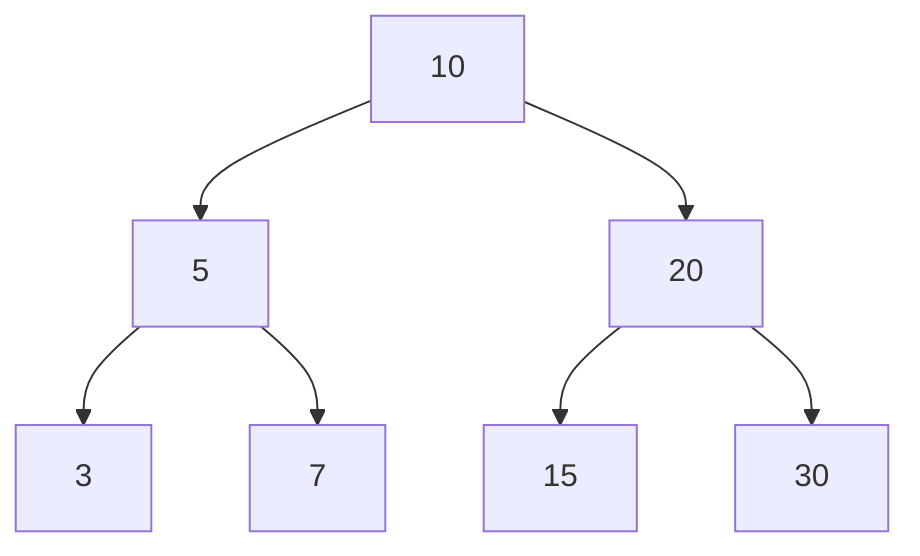

# Estructuras de Datos - Árboles de búsqueda balanceados

## 12.4 Análisis de complejidad.

---

### 1. Definición General

Un **árbol de búsqueda balanceado** es una estructura de datos que mantiene su altura lo más reducida posible después de operaciones de inserción, eliminación o búsqueda, con el fin de asegurar un tiempo de ejecución eficiente. El balanceo garantiza que el árbol no se degrade en una estructura similar a una lista enlazada.

La **altura de un árbol balanceado** se define como $O(\log n)$, donde $n$ es el número de nodos.

### 2. Complejidad de Operaciones Básicas

| Operación   | ABB sin balancear, peor caso | Árbol de Búsqueda Balanceado |
| ----------- | --------------------------- | ---------------------------- |
| Búsqueda    | $O(n)$                      | $O(\log n)$                  |
| Inserción   | $O(n)$                      | $O(\log n)$                  |
| Eliminación | $O(n)$                      | $O(\log n)$                  |

**Nota:** Estas complejidades se cumplen para estructuras como AVL, Red-Black Trees y B-Trees.

### 3. Ejemplo de Análisis de Complejidad

#### Caso de búsqueda en un árbol balanceado:

La búsqueda recorre un camino desde la raíz hasta una hoja.  
La cantidad máxima de comparaciones está limitada por la altura del árbol:

$$ T(n) = O(\log n) $$

### 4. Código de Ejemplo (AVL Tree en Python)

```python
class NodoAVL:
    def __init__(self, clave):
        self.clave = clave
        self.izq = None
        self.der = None
        self.altura = 1

def obtener_altura(nodo):
    if not nodo:
        return 0
    return nodo.altura

def rotacion_derecha(y):
    x = y.izq
    T2 = x.der

    x.der = y
    y.izq = T2

    y.altura = 1 + max(obtener_altura(y.izq), obtener_altura(y.der))
    x.altura = 1 + max(obtener_altura(x.izq), obtener_altura(x.der))

    return x

def rotacion_izquierda(x):
    y = x.der
    T2 = y.izq

    y.izq = x
    x.der = T2

    x.altura = 1 + max(obtener_altura(x.izq), obtener_altura(x.der))
    y.altura = 1 + max(obtener_altura(y.izq), obtener_altura(y.der))

    return y
```

Este fragmento muestra las rotaciones básicas, esenciales para mantener el **balanceo** del árbol.

### 5. Ejemplo Gráfico con Mermaid



Este diagrama muestra un árbol balanceado simple.

### 6. Comparación de Árboles Balanceados

| Tipo de Árbol | Complejidad | Característica Principal                                           |
| ------------- | ----------- | ------------------------------------------------------------------ |
| **AVL**       | $O(\log n)$ | Balanceo estricto (altura de subárboles difiere como máximo en 1). |
| **Red-Black** | $O(\log n)$ | Balanceo menos estricto, pero más eficiente en inserciones.        |
| **B-Trees**   | $O(\log n)$ | Usados en bases de datos y sistemas de archivos.                   |

### 7. Fórmulas Relevantes

- **Altura máxima de un árbol AVL:**

$$ h \leq 1.44 \cdot \log_2(n+2) - 0.328 $$

- **Número mínimo de nodos en un AVL de altura $h$:**

$$ N(h) = N(h-1) + N(h-2) + 1, \qquad N(0) = 1, \quad N(1) = 2 $$

contando la altura en aristas. Resolviendo, $N(h) = F_{h+3} - 1$, donde $F_k$ es el número de Fibonacci de índice $k$. Como $F_k$ crece como $\varphi^k$ con $\varphi \approx 1.618$, la altura de un AVL con $n$ nodos es $O(\log n)$, y de ahí sale la constante $\frac{1}{\log_2 \varphi} \approx 1.44$ de la cota anterior.

### 8. Referencias

- Cormen, T. H., Leiserson, C. E., Rivest, R. L., & Stein, C. (2009). _Introduction to Algorithms_ (3rd ed.). MIT Press.
- Weiss, M. A. (2014). _Data Structures and Algorithm Analysis in Java_. Pearson.
- Sedgewick, R., & Wayne, K. (2011). _Algorithms_. Addison-Wesley.

(✓) **Recomendación de estudio:** Practicar la implementación de inserciones y eliminaciones en árboles AVL y Red-Black, además de analizar su complejidad con casos prácticos.
