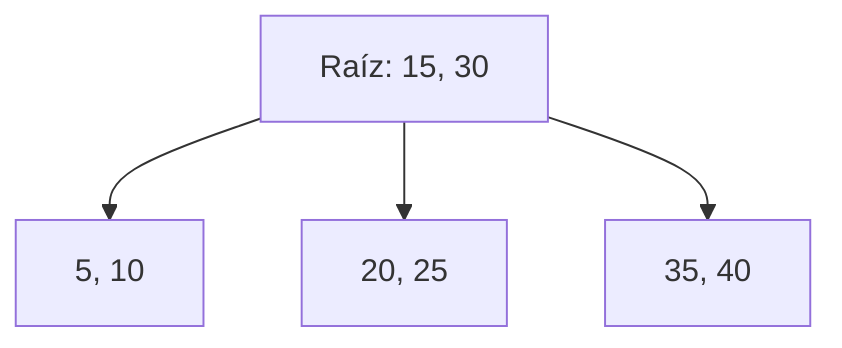

# Estructuras de Datos - Árboles de búsqueda balanceados

## 12.5 Aplicaciones.

---

### 1. Definición

Los **árboles de búsqueda balanceados** son estructuras de datos diseñadas para mantener el orden y la eficiencia en operaciones de búsqueda, inserción y eliminación. Su principal aplicación radica en situaciones donde se requiere un acceso rápido y ordenado a la información.

Un árbol balanceado garantiza que la altura se mantenga en $O(\log n)$, lo cual asegura eficiencia en operaciones frecuentes.

### 2. Aplicaciones Reales

1. **Bases de Datos Relacionales (B-Trees y B+ Trees):**
   - Se utilizan para índices que permiten búsquedas rápidas.
   - Ejemplo: Índices en SQL para acelerar consultas.

2. **Sistemas de Archivos:**
   - NTFS, HFS+ y Ext4 emplean B-Trees o variantes.
   - Permiten localizar archivos en discos grandes de manera eficiente.

3. **Compiladores:**
   - Los árboles balanceados almacenan tablas de símbolos para acceso rápido a variables y funciones.

4. **Redes y Sistemas Distribuidos:**
   - Usados para gestionar tablas de enrutamiento.
   - AVL y Red-Black Trees ofrecen rapidez en inserciones y consultas.

5. **Aplicaciones de Tiempo Real:**
   - Scheduling de procesos.
   - Sistemas embebidos donde la rapidez en la recuperación de datos es crítica.

### 3. Ejemplo Práctico: Índices en una Base de Datos

Un índice de base de datos puede implementarse como un **B+ Tree**.  
Esto permite búsquedas rápidas en registros:

```python
class NodoB:
    def __init__(self, es_hoja=True):
        self.claves = []
        self.hijos = []
        self.es_hoja = es_hoja

class BTree:
    def __init__(self, t):
        self.raiz = NodoB(True)
        self.t = t  # grado mínimo

    def buscar(self, k, x=None):
        if x is None:
            x = self.raiz
        i = 0
        while i < len(x.claves) and k > x.claves[i]:
            i += 1
        if i < len(x.claves) and k == x.claves[i]:
            return (x, i)
        elif x.es_hoja:
            return None
        else:
            return self.buscar(k, x.hijos[i])
```

Este código representa la búsqueda de una clave en un **B-Tree**, una base para entender cómo los motores de bases de datos encuentran información de forma eficiente.

### 4. Ejemplo Gráfico con Mermaid



Este diagrama representa un **B-Tree** simplificado donde cada nodo puede contener múltiples claves.

### 5. Análisis de Aplicaciones

| Aplicación                         | Tipo de Árbol        | Beneficio Principal                                         |
| ---------------------------------- | -------------------- | ----------------------------------------------------------- |
| Índices de Base de Datos           | B-Trees, B+ Trees    | Búsquedas rápidas, acceso en disco eficiente                |
| Sistemas de Archivos               | B-Trees              | Manejo de grandes cantidades de datos en memoria secundaria |
| Tablas de Símbolos en Compiladores | AVL, Red-Black Trees | Acceso eficiente a variables y funciones                    |
| Redes (Enrutamiento)               | AVL Trees            | Consultas rápidas en estructuras dinámicas                  |
| Scheduling de Procesos             | Red-Black Trees      | Garantiza tiempos de respuesta consistentes                 |

### 6. Fórmulas Relacionadas

- **Altura máxima de un árbol B de orden $m$ con $n$ claves:**

$$ h \leq \log_m (n+1) $$

- **Número mínimo de claves en un B-Tree de altura $h$:**

$$ N_{min} = 2^{h-1} - 1 $$

### 7. Ventajas en Aplicaciones

- Eficiencia en consultas masivas.
- Soporte en almacenamiento externo (discos duros, SSDs).
- Acceso ordenado y rápido.
- Balanceo automático tras inserciones y eliminaciones.

### 8. Referencias

- Cormen, T. H., Leiserson, C. E., Rivest, R. L., & Stein, C. (2009). _Introduction to Algorithms_. MIT Press.
- Comer, D. (1979). _Ubiquitous B-Tree_. ACM Computing Surveys.
- Knuth, D. (1998). _The Art of Computer Programming, Vol. 3: Sorting and Searching_. Addison-Wesley.

(✓) **Recomendación de estudio:** Implementar un B-Tree y un Red-Black Tree, y simular consultas de base de datos para entender cómo se aplican en escenarios reales.
