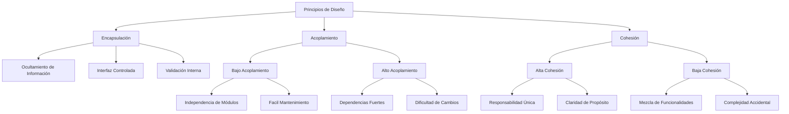

# Estructuras de Datos - Tipos de datos abstractos

## 1.3 Encapsulación, acoplamiento y cohesión.

---

### 1. Encapsulación

#### 1.1. Definición Formal

La **encapsulación** es el mecanismo que restringe el acceso directo a los componentes de un objeto, permitiendo solo operaciones definidas a través de una interfaz controlada.

**Principio fundamental:**

$$ \text{Encapsulación} = \text{Ocultamiento de información} + \text{Interfaz pública} $$

#### 1.2. Niveles de Acceso

- **Público (`public`):** Accesible desde cualquier clase
- **Protegido (`protected`):** Accesible desde la clase y sus subclases
- **Privado (`private`):** Accesible solo desde la propia clase

#### 1.3. Beneficios

- **Control de acceso:** Validación de operaciones
- **Independencia:** Cambios internos no afectan usuarios
- **Seguridad:** Prevención de modificaciones inválidas

### 2. Acoplamiento

#### 2.1. Definición

El **acoplamiento** mide el grado de interdependencia entre módulos o clases. Se busca **bajo acoplamiento** para mantener sistemas modulares y mantenibles.

**Tipos de acoplamiento (de peor a mejor):**

1. **Contenido:** Acceso directo a implementación interna
2. **Común:** Uso de datos globales compartidos
3. **Control:** Paso de flags de control
4. **Estampilla:** Paso de estructuras complejas
5. **Datos:** Paso solo de datos necesarios

#### 2.2. Métrica de Acoplamiento

Una medida ilustrativa, no estándar, es la densidad de dependencias; en la práctica se usan métricas como CBO o fan-in y fan-out (sección 7):

$$ \text{Acoplamiento} = \frac{\text{No. dependencias entre módulos}}{\text{No. total de módulos}} $$

### 3. Cohesión

#### 3.1. Definición

La **cohesión** mide cuán relacionadas están las responsabilidades dentro de un módulo. Se busca **alta cohesión** donde cada módulo tenga una única responsabilidad bien definida.

**Tipos de cohesión (de mejor a peor):**

1. **Funcional:** Todas las partes contribuyen a una sola tarea
2. **Secuencial:** Salida de una operación es entrada de la siguiente
3. **Comunicacional:** Operaciones usan los mismos datos
4. **Procedimental:** Operaciones relacionadas secuencialmente
5. **Temporal:** Operaciones ejecutadas en el mismo tiempo
6. **Lógica:** Operaciones relacionadas conceptualmente
7. **Coincidental:** Sin relación significativa

#### 3.2. Métrica de Cohesión

Una medida ilustrativa, no estándar; en la práctica se usan métricas como LCOM o TCC (sección 7):

$$\text{Cohesión} = 1 - \frac{\text{No. funciones no relacionadas}}{\text{No. total de funciones}}$$

### 4. Implementación Computacional

```python
from abc import ABC, abstractmethod
from typing import List
from dataclasses import dataclass

# ===== EJEMPLO DE BUENA ENCAPSULACIÓN =====
class PilaEncapsulada:
    """Ejemplo de encapsulación adecuada"""

    def __init__(self):
        self._elementos: List = []  # Atributo privado
        self._contador_operaciones: int = 0  # Estado interno encapsulado

    def apilar(self, elemento) -> None:
        """Interfaz pública controlada"""
        self._validar_elemento(elemento)  # Validación encapsulada
        self._elementos.append(elemento)
        self._contador_operaciones += 1
        self._notificar_cambio()  # Comportamiento interno

    def desapilar(self):
        if self.esta_vacia():
            raise ValueError("Pila vacía")
        elemento = self._elementos.pop()
        self._contador_operaciones += 1
        self._notificar_cambio()
        return elemento

    def esta_vacia(self) -> bool:
        return len(self._elementos) == 0

    # ===== MÉTODOS PRIVADOS =====
    def _validar_elemento(self, elemento) -> None:
        """Validación interna encapsulada"""
        if elemento is None:
            raise ValueError("Elemento no puede ser None")

    def _notificar_cambio(self) -> None:
        """Comportamiento interno encapsulado"""
        # Simulación de notificación o logging
        if self._contador_operaciones % 10 == 0:
            print(f"Operaciones realizadas: {self._contador_operaciones}")

# ===== EJEMPLO DE BAJO ACOPLAMIENTO =====
@dataclass
class DatosUsuario:
    """Estructura de datos para bajo acoplamiento"""
    id: int
    nombre: str
    email: str

class ServicioUsuarios:
    """Servicio con bajo acoplamiento"""

    def obtener_usuario(self, user_id: int) -> DatosUsuario:
        """Acoplamiento por datos (óptimo)"""
        # Simulación de obtención de datos
        return DatosUsuario(user_id, f"Usuario{user_id}", f"user{user_id}@ejemplo.com")

    def actualizar_email(self, user_data: DatosUsuario, nuevo_email: str) -> None:
        """Solo pasa los datos necesarios"""
        user_data.email = nuevo_email

# ===== EJEMPLO DE ALTA COHESIÓN =====
class CalculadoraEstadisticas:
    """Alta cohesión: todas las funciones relacionadas con estadísticas"""

    def calcular_promedio(self, datos: List[float]) -> float:
        return sum(datos) / len(datos) if datos else 0

    def calcular_mediana(self, datos: List[float]) -> float:
        sorted_data = sorted(datos)
        n = len(sorted_data)
        mid = n // 2
        if n % 2 == 0:
            return (sorted_data[mid-1] + sorted_data[mid]) / 2
        return sorted_data[mid]

    def calcular_desviacion_estandar(self, datos: List[float]) -> float:
        import math
        promedio = self.calcular_promedio(datos)
        varianza = sum((x - promedio) ** 2 for x in datos) / len(datos)
        return math.sqrt(varianza)

# ===== CONTRASTE: BUENA Y MALA PRÁCTICA =====
class ClaseConBajoAcoplamiento:
    """Ejemplo de bajo acoplamiento y alta cohesión"""
    def __init__(self):
        self.dato = None

    def procesar(self, entrada):
        # Solo depende de su propia implementación
        resultado = self._transformar(entrada)
        return self._filtrar(resultado)

    def _transformar(self, x):
        return x * 2

    def _filtrar(self, x):
        return x if x > 0 else 0

class ClaseConAltoAcoplamiento:
    """Ejemplo de alto acoplamiento (¡EVITAR!)"""
    def __init__(self, otra_clase):
        self.otra = otra_clase  # Acoplamiento fuerte
        self.otra.estado_interno = "modificado"  # Violación encapsulación

    def metodo_complejo(self):
        # Mezcla de responsabilidades (baja cohesión)
        resultado = self.otra.procesar_algo()
        self._hacer_otra_cosa(resultado)
        return self.otra.estado * 2  # Acoplamiento por contenido

def demostrar_principios():
    print("=== DEMOSTRACIÓN ENCAPSULACIÓN, ACOPLAMIENTO, COHESIÓN ===")

    # Encapsulación
    pila = PilaEncapsulada()
    pila.apilar(10)
    pila.apilar(20)
    print(f"Elemento desapilado: {pila.desapilar()}")

    # Bajo acoplamiento
    servicio = ServicioUsuarios()
    usuario = servicio.obtener_usuario(1)
    print(f"Usuario antes: {usuario}")
    servicio.actualizar_email(usuario, "nuevo@email.com")
    print(f"Usuario después: {usuario}")

    # Alta cohesión
    calc = CalculadoraEstadisticas()
    datos = [1, 2, 3, 4, 5]
    print(f"Promedio: {calc.calcular_promedio(datos)}")
    print(f"Mediana: {calc.calcular_mediana(datos)}")
    print(f"Desviación: {calc.calcular_desviacion_estandar(datos):.2f}")

if __name__ == "__main__":
    demostrar_principios()
```

### 5. Diagrama de Relaciones



### 6. Principios de Diseño Relacionados

#### 6.1. Principio de Responsabilidad Única (SRP)

Una clase debe tener una, y solo una, razón para cambiar.

#### 6.2. Principio de Abierto/Cerrado (OCP)

Las entidades deben estar abiertas para extensión pero cerradas para modificación.

#### 6.3. Principio de Sustitución de Liskov (LSP)

Los objetos de una superclase deben ser reemplazables por objetos de sus subclases.

#### 6.4. Principio de Segregación de Interfaces (ISP)

Muchas interfaces específicas son mejores que una interfaz general.

#### 6.5. Principio de Inversión de Dependencias (DIP)

Depender de abstracciones, no de implementaciones concretas.

### 7. Métricas y Evaluación

#### 7.1. Métricas de Acoplamiento

- **CBO (Coupling Between Objects):** Número de clases acopladas
- **RFC (Response For a Class):** Número de métodos potencialmente ejecutables
- **Fan-in/Fan-out:** Número de clases que usan/son usadas

#### 7.2. Métricas de Cohesión

- **LCOM (Lack of Cohesion in Methods):** Medida de cohesión de métodos
- **TCC (Tight Class Cohesion):** Porcentaje de pares de métodos que acceden a atributos comunes
- **LCC (Loose Class Cohesion):** Similar a TCC pero considera métodos indirectamente relacionados

#### 7.3. Herramientas de Análisis

- **SonarQube:** Análisis estático de código
- **Checkstyle:** Verificación de estándares
- **PMD:** Detección de malas prácticas
- **JDepend:** Métricas de diseño orientado a objetos

### 8. Ejercicios Prácticos

1. Refactorice una clase con baja cohesión para mejorar su diseño
2. Implemente un sistema con bajo acoplamiento entre módulos
3. Calcule métricas de acoplamiento y cohesión para un proyecto existente
4. Diseñe una interfaz bien encapsulada para un TDA complejo
5. Compare diferentes niveles de acoplamiento en implementaciones alternativas
6. Implemente el patrón Facade para reducir acoplamiento
7. Cree clases con alta cohesión para un sistema de procesamiento de datos
8. Analice violaciones de encapsulación en código legacy

### 9. Referencias

- Martin, R. C. (2002). _Agile Software Development, Principles, Patterns, and Practices_
- Meyer, B. (1997). _Object-Oriented Software Construction_
- McConnell, S. (2004). _Code Complete_
- Fowler, M. (1999). _Refactoring: Improving the Design of Existing Code_
- Larman, C. (2004). _Applying UML and Patterns_
