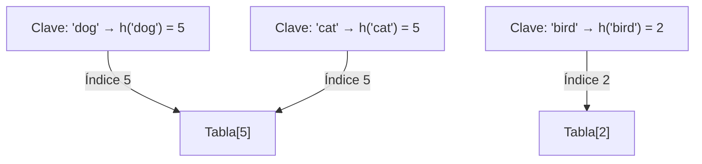

# Estructuras de Datos - Funciones y tablas de dispersión (hash)

## 13.1 Motivación, diseño de funciones de dispersión.

---

### 1. Motivación

En el estudio de **estructuras de datos**, una de las operaciones más frecuentes es la búsqueda.  
Aunque las estructuras como **árboles balanceados** permiten búsquedas eficientes en $O(\log n)$, las **tablas hash** logran, en promedio, búsquedas, inserciones y eliminaciones en **$O(1)$**.

La motivación principal del uso de funciones y tablas de dispersión es:

- **Eficiencia**: Acceso rápido a los datos sin necesidad de recorrer toda la estructura.
- **Escalabilidad**: Se mantiene un buen rendimiento incluso con grandes volúmenes de información.
- **Aplicaciones prácticas**: Implementación en compiladores, bases de datos, almacenamiento en caché, sistemas distribuidos, criptografía, entre otros.

### 2. Definición de Función de Dispersión

Una **función de dispersión** (hash function) es una función matemática que transforma una clave de entrada (string, número, etc.) en un índice dentro de un rango fijo de valores (generalmente $0 \dots m-1$, donde $m$ es el tamaño de la tabla).

$$ h(k) = \text{índice} $$

donde $k$ es la clave y $h$ la función hash.

El reto principal del diseño de funciones de dispersión es minimizar **colisiones**, es decir, cuando dos claves distintas se asignan al mismo índice.

### 3. Propiedades deseables de una función hash

1. **Determinística**: Una misma clave siempre debe producir el mismo hash.
2. **Uniformidad**: Los valores hash deben distribuirse lo más equitativamente posible en la tabla.
3. **Eficiencia computacional**: Debe calcularse en tiempo constante.
4. **Reducción de colisiones**: Aunque inevitables, deben minimizarse.

### 4. Métodos de diseño de funciones hash

#### 4.1 Método de la división

$$ h(k) = k \mod m $$

Donde $m$ es el tamaño de la tabla. Generalmente se elige $m$ como un número primo no muy cercano a una potencia de 2.

**Ejemplo en Python:**

```python
def hash_division(key, m):
    return key % m

print(hash_division(1234, 13))  # 1234 mod 13 = 12
```

#### 4.2 Método de la multiplicación

Se elige una constante $A$ con $0 < A < 1$.

$$ h(k) = \lfloor m (kA \mod 1) \rfloor $$

**Ejemplo en Python:**

```python
def hash_multiplication(key, m, A=0.6180339887):  # A = (sqrt(5)-1)/2
    return int(m * ((key * A) % 1))

print(hash_multiplication(1234, 13))
```

#### 4.3 Hashing para cadenas de texto (polinomial)

Se basa en tratar una cadena como un número en una base $b$.

$$ h(s) = \left(\sum_{i=0}^{|s|-1} s[i] \cdot b^i\right) \mod m $$

**Ejemplo en Python:**

```python
def hash_string(s, m, b=31):
    h = 0
    for char in s:
        h = (h * b + ord(char)) % m
    return h

print(hash_string("hash", 101))
```

### 5. Ejemplo ilustrativo de colisiones



En este ejemplo, **"dog"** y **"cat"** colisionan en la misma posición de la tabla hash.

### 6. Estrategias para manejar colisiones

- **Encadenamiento (chaining):** Cada posición de la tabla contiene una lista enlazada con las claves que colisionan.
- **Direcciones abiertas (open addressing):** Se busca otra celda libre en la tabla siguiendo una secuencia definida (lineal, cuadrática, doble hashing).

### 7. Ejemplo práctico

```python
class HashTable:
    def __init__(self, size=13):
        self.size = size
        self.table = [[] for _ in range(size)]

    def _hash(self, key):
        return key % self.size

    def insert(self, key, value):
        index = self._hash(key)
        self.table[index].append((key, value))

    def search(self, key):
        index = self._hash(key)
        for k, v in self.table[index]:
            if k == key:
                return v
        return None

# Uso
ht = HashTable()
ht.insert(10, "Juan")
ht.insert(23, "Ana")
ht.insert(36, "Luis")  # Colisiona con 23

print(ht.search(23))  # → "Ana"
```

### 8. Aplicaciones en la vida real

- Tablas de símbolos en compiladores.
- Almacenamiento en caché (memorias, bases de datos).
- Verificación de integridad de datos mediante funciones hash criptográficas (SHA, MD5).
- Sistemas distribuidos (ejemplo: **Consistent Hashing** en balanceadores de carga).

### 9. Referencias

- Cormen, T. H., Leiserson, C. E., Rivest, R. L., & Stein, C. (2009). _Introduction to Algorithms_ (3rd ed.). MIT Press.
- Weiss, M. A. (2014). _Data Structures and Algorithm Analysis in Java_. Pearson.
- Knuth, D. E. (1997). _The Art of Computer Programming, Volume 3: Sorting and Searching_. Addison-Wesley.

(✓) **Conclusión:** Las funciones de dispersión son fundamentales en el diseño de tablas hash. Su calidad determina la eficiencia de las operaciones de búsqueda, inserción y eliminación. Un buen diseño debe balancear eficiencia computacional, uniformidad en la distribución y simplicidad de implementación.
