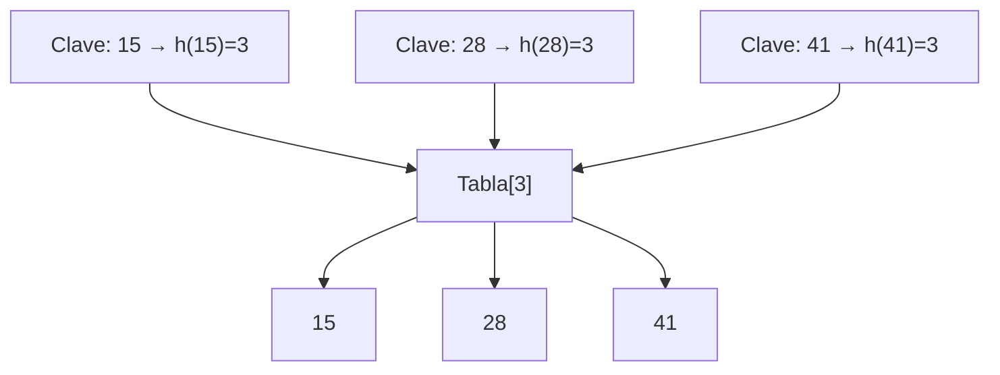

# Estructuras de Datos - Funciones y tablas de dispersión (hash)

## 13.2 Colisiones y su manejo.

---

### 1. Introducción

En las **tablas de dispersión (hash)**, una **colisión** ocurre cuando dos claves distintas son transformadas por la función de dispersión hacia el mismo índice de la tabla.

Ejemplo:  
Si $h("dog") = 5$ y $h("cat") = 5$, entonces ambas claves se asignan al mismo espacio.

Las colisiones son inevitables debido al **principio del palomar**:  
si hay más claves posibles que posiciones en la tabla, al menos dos claves colisionarán.

### 2. Estrategias para manejo de colisiones

Existen dos enfoques principales:

1. **Encadenamiento (chaining)**
2. **Direcciones abiertas (open addressing)**

### 3. Encadenamiento

Cada celda de la tabla almacena una lista enlazada de los elementos que colisionan en ese índice.

#### Ventajas

- Maneja eficientemente múltiples colisiones en un mismo índice.
- Sencillo de implementar.

#### Desventajas

- Requiere memoria adicional (listas enlazadas).

**Ejemplo con diagrama:**



**Ejemplo en Python:**

```python
class HashTableChaining:
    def __init__(self, size=7):
        self.size = size
        self.table = [[] for _ in range(size)]

    def _hash(self, key):
        return key % self.size

    def insert(self, key, value):
        index = self._hash(key)
        self.table[index].append((key, value))

    def search(self, key):
        index = self._hash(key)
        for k, v in self.table[index]:
            if k == key:
                return v
        return None

# Uso
ht = HashTableChaining()
ht.insert(15, "A")
ht.insert(28, "B")
ht.insert(41, "C")
print(ht.search(28))  # → "B"
```

### 4. Direcciones abiertas

En este método, si ocurre una colisión, se busca otra posición libre en la tabla de acuerdo con una secuencia predefinida.

#### 4.1 Sondeo lineal

Si la posición $h(k)$ está ocupada, se prueba la siguiente:

$ h(k,i) = (h(k)+i) \text{ mod } m $

```python
class HashTableLinearProbing:
    def __init__(self, size=7):
        self.size = size
        self.table = [None] * size

    def _hash(self, key, i=0):
        return (key + i) % self.size

    def insert(self, key, value):
        for i in range(self.size):
            index = self._hash(key, i)
            if self.table[index] is None:
                self.table[index] = (key, value)
                return
        raise Exception("Tabla llena")

    def search(self, key):
        for i in range(self.size):
            index = self._hash(key, i)
            if self.table[index] and self.table[index][0] == key:
                return self.table[index][1]
        return None

# Uso
ht = HashTableLinearProbing()
ht.insert(15, "A")
ht.insert(22, "B")  # Colisión con 15 → se guarda en la siguiente celda
print(ht.search(22))  # → "B"
```

#### 4.2 Sondeo cuadrático

El desplazamiento se calcula como:

$ h_i(k) = (h(k) + c_1 i + c_2 i^2) \text{ mod } m $

Esto reduce el problema de aglomeración primaria.

Ventaja: reduce la formación de clusters.
Desventaja: puede no cubrir todos los índices.

#### 4.3 Doble hashing

Se utilizan dos funciones hash:

$ h(k,i)=(h_1 (k)+i cdoth_2 (k)) \text{ mod }m $

Donde $h_2(k)$ debe estar diseñado para garantizar que todas las celdas se puedan visitar.

**Ventajas:**

- Reduce agrupamiento.
- Mejor distribución.

**Desventajas:**

- Más costoso computacionalmente.

### 3. Comparación de Métodos

| Método            | Ventajas                 | Desventajas                     |
| ----------------- | ------------------------ | ------------------------------- |
| Encadenamiento    | Maneja bien altas cargas | Usa memoria extra               |
| Sondeo lineal     | Simple                   | Clustering primario             |
| Sondeo cuadrático | Menos clustering         | Puede no explorar toda la tabla |
| Doble dispersión  | Buena distribución       | Requiere dos funciones hash     |

### 4. Ejemplo Numérico

Sea la tabla con tamaño $m = 7$ y la función $h(k) = k \mod 7$.
Claves a insertar: $10, 20, 15, 7$.

$h(10) = 3$ → índice 3.

$h(20) = 6$ → índice 6.

$h(15) = 1$ → índice 1.

$h(7) = 0$ → índice 0.

Si usamos sondeo lineal y el índice está ocupado, avanzamos hasta encontrar el siguiente libre.

### 5. Conclusiones

- Las colisiones son inevitables en tablas hash.
- Existen múltiples estrategias de resolución: encadenamiento, sondeo lineal, sondeo cuadrático y doble hash.
- La elección depende de la aplicación y de los recursos disponibles (memoria, tiempo).

### 6. Referencias

- Cormen, T. H., Leiserson, C. E., Rivest, R. L., & Stein, C. (2009). Introduction to Algorithms. MIT Press.
- Weiss, M. A. (2014). Data Structures and Algorithm Analysis in C++. Pearson.
- Knuth, D. E. (1998). The Art of Computer Programming, Volume 3: Sorting and Searching. Addison-Wesley.
