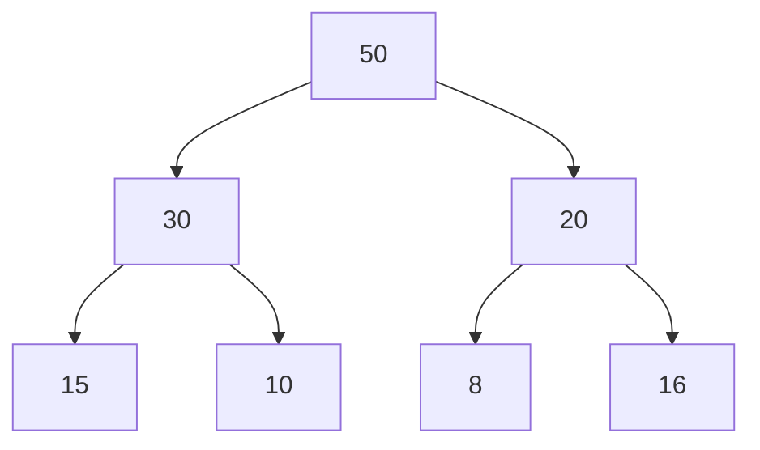
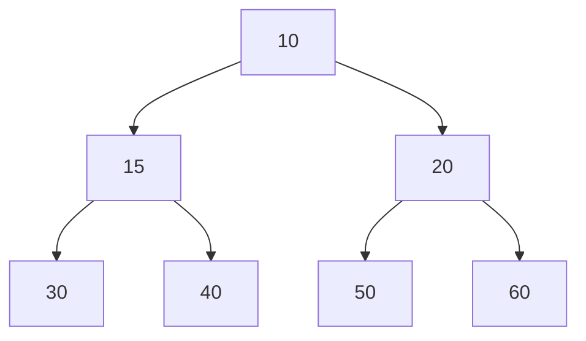

# Estructuras de Datos - Heaps

## 14.1 Definición, propiedades y TDA.

---

### 1. Definición de Heap

Un **Heap** (o montículo) es una **estructura de datos en forma de árbol binario completo** que satisface la **propiedad de heap**:

- En un **Max-Heap**, el valor de cada nodo es **mayor o igual** que el valor de sus hijos.
- En un **Min-Heap**, el valor de cada nodo es **menor o igual** que el valor de sus hijos.

Esto significa que, en un Max-Heap, la raíz contiene el valor máximo, mientras que en un Min-Heap, la raíz contiene el valor mínimo.

### 2. Propiedades de un Heap

1. **Árbol binario completo**  
   Todos los niveles están llenos excepto posiblemente el último, que se llena de izquierda a derecha.

2. **Propiedad de orden del Heap**
   - Max-Heap: $A[parent(i)] \geq A[i]$
   - Min-Heap: $A[parent(i)] \leq A[i]$

3. **Representación en arreglo**  
   Dado un nodo en el índice $i$ (comenzando desde 1):
   - Hijo izquierdo: $2i$
   - Hijo derecho: $2i + 1$
   - Padre: $\lfloor i/2 \rfloor$

### 3. Tipos de Heap

- **Max-Heap**: el valor máximo está en la raíz.
- **Min-Heap**: el valor mínimo está en la raíz.
- **Binary Heap**: Heap implementado con un árbol binario completo.
- **D-ary Heap**: Extensión del Heap binario, cada nodo puede tener hasta $d$ hijos.

### 4. TDA (Tipo de Dato Abstracto) Heap

Un **Heap** puede definirse como un **TDA** que soporta las siguientes operaciones fundamentales:

- `createHeap()`: Crear un heap vacío.
- `insert(element)`: Insertar un elemento en el heap.
- `extractMax()` / `extractMin()`: Extraer el valor máximo (o mínimo).
- `peek()`: Consultar el valor de la raíz sin eliminarlo.
- `heapify(array)`: Convertir un arreglo en un heap válido.
- `delete(index)`: Eliminar un nodo en un índice específico.

### 5. Ejemplo Gráfico

Ejemplo de un **Max-Heap**:



Ejemplo de un **Min-Heap**:



### 6. Implementación en Python

#### Max-Heap (usando `heapq` invertido)

```python
import heapq

# Python implementa Min-Heap por defecto, por lo que usamos valores negativos para simular Max-Heap

heap = []

# Insertar elementos (se usan negativos para simular Max-Heap)
heapq.heappush(heap, -50)
heapq.heappush(heap, -30)
heapq.heappush(heap, -20)
heapq.heappush(heap, -15)

print("Heap interno:", heap)

# Extraer máximo
max_value = -heapq.heappop(heap)
print("Máximo extraído:", max_value)
```

#### Min-Heap

```python
import heapq

heap = []

# Insertar elementos
heapq.heappush(heap, 10)
heapq.heappush(heap, 20)
heapq.heappush(heap, 5)
heapq.heappush(heap, 15)

print("Heap interno:", heap)

# Extraer mínimo
min_value = heapq.heappop(heap)
print("Mínimo extraído:", min_value)
```

### 7. Fórmulas Importantes

- Relación entre nodos:

  $$
  parent(i) = \left\lfloor \frac{i}{2} \right\rfloor, \quad left(i) = 2i, \quad right(i) = 2i + 1
  $$

- Complejidad:
  - Inserción: $O(\log n)$
  - Extracción: $O(\log n)$
  - Construcción (`heapify`): $O(n)$

### 8. Ejemplo de Uso (Ordenamiento HeapSort)

```python
import heapq

def heap_sort(iterable):
    h = []
    for value in iterable:
        heapq.heappush(h, value)
    return [heapq.heappop(h) for _ in range(len(h))]

print(heap_sort([20, 5, 15, 30, 10]))
```

Salida esperada:

```
[5, 10, 15, 20, 30]
```

**Conclusión:** Los **Heaps** son estructuras eficientes para manejar prioridades, ampliamente utilizados en **colas de prioridad** y algoritmos como **HeapSort** y **Dijkstra**.

### 9. Referencias

- Cormen, T. H., Leiserson, C. E., Rivest, R. L., & Stein, C. (2009). _Introduction to Algorithms_. MIT Press.
- Goodrich, M. T., Tamassia, R., & Goldwasser, M. H. (2014). _Data Structures and Algorithms in Python_. Wiley.
- Documentation of `heapq`: [Python Official Docs](https://docs.python.org/3/library/heapq.html)
