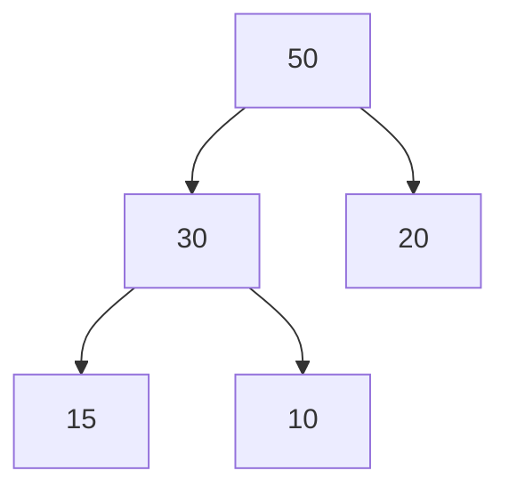
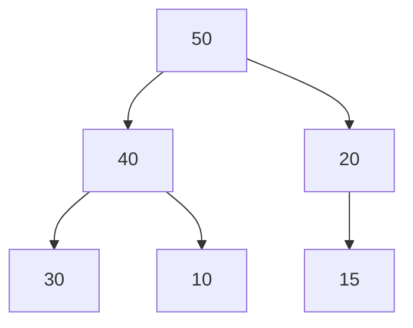
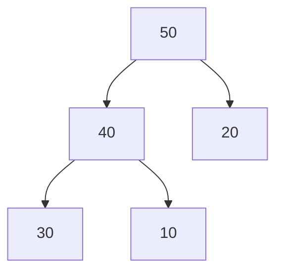
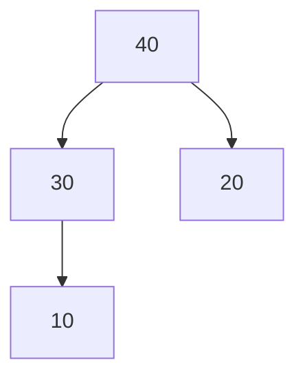

# Estructuras de Datos - Heaps

## 14.2 Algoritmos de inserción, remoción y recuperación de elementos.

---

### 1. Introducción

Los **Heaps** son estructuras de datos basadas en árboles binarios completos que permiten **acceder rápidamente al elemento máximo o mínimo**, dependiendo de si es un Max-Heap o Min-Heap. Para mantener la propiedad del Heap tras operaciones de inserción o remoción, se utilizan algoritmos específicos.

### 2. Inserción de elementos

Para insertar un elemento en un Heap:

1. Agregar el elemento al final del arreglo (última posición del árbol).
2. Aplicar el algoritmo **heapify-up** (o _sift-up_) para restaurar la propiedad del Heap.

#### 2.1 Pseudocódigo (Max-Heap)

```
function insert(heap, value):
    heap.append(value)
    i = heap.size - 1
    while i > 0 and heap[parent(i)] < heap[i]:
        swap(heap[i], heap[parent(i)])
        i = parent(i)
```

#### 2.2 Ejemplo (Max-Heap)



Insertamos `40`:



Se aplica heapify-up hasta que la propiedad de Heap se cumple.

### 3. Remoción de elementos

En un Heap, la remoción típica es la **raíz**, que contiene el valor máximo (Max-Heap) o mínimo (Min-Heap).

#### 3.1 Algoritmo heapify-down (sift-down)

1. Reemplazar la raíz con el último elemento del Heap.
2. Eliminar el último elemento (que ahora está en la raíz).
3. Aplicar **heapify-down**: intercambiar con el hijo más grande (Max-Heap) o más pequeño (Min-Heap) hasta restaurar la propiedad.

#### 3.2 Pseudocódigo

```
function extractMax(heap):
    if heap.size == 0:
        return null
    maxValue = heap[0]
    heap[0] = heap[heap.size - 1]
    heap.pop()
    heapifyDown(heap, 0)
    return maxValue

function heapifyDown(heap, i):
    left = 2*i + 1
    right = 2*i + 2
    largest = i
    if left < heap.size and heap[left] > heap[largest]:
        largest = left
    if right < heap.size and heap[right] > heap[largest]:
        largest = right
    if largest != i:
        swap(heap[i], heap[largest])
        heapifyDown(heap, largest)
```

#### 3.3 Ejemplo visual



Extraemos la raíz `50`:



### 4. Recuperación de elementos (Peek)

La recuperación del máximo (Max-Heap) o mínimo (Min-Heap) **sin eliminarlo** es trivial:

- **Complejidad:** $O(1)$
- **Implementación:** simplemente acceder a `heap[0]`.

```python
def peek(heap):
    if heap:
        return heap[0]
    return None
```

### 5. Implementación en Python

#### Inserción y extracción (Max-Heap)

```python
import heapq

class MaxHeap:
    def __init__(self):
        self.heap = []

    def insert(self, value):
        heapq.heappush(self.heap, -value)

    def extract_max(self):
        return -heapq.heappop(self.heap) if self.heap else None

    def peek(self):
        return -self.heap[0] if self.heap else None

# Ejemplo de uso
h = MaxHeap()
h.insert(50)
h.insert(30)
h.insert(40)
print("Máximo:", h.peek())
print("Extraído:", h.extract_max())
```

### 6. Complejidades de operaciones

| Operación         | Complejidad |
| ----------------- | ----------- |
| Insertar elemento | $O(\log n)$ |
| Extraer raíz      | $O(\log n)$ |
| Recuperar raíz    | $O(1)$      |
| Construir Heap    | $O(n)$      |

(✓) **Conclusión:** Los algoritmos de inserción, remoción y recuperación de Heaps permiten mantener la estructura del Heap, asegurando eficiencia en la manipulación de prioridades y su uso en algoritmos como HeapSort o colas de prioridad.

### 7. Referencias

- Cormen, T. H., Leiserson, C. E., Rivest, R. L., & Stein, C. (2009). _Introduction to Algorithms_. MIT Press.
- Goodrich, M. T., Tamassia, R., & Goldwasser, M. H. (2014). _Data Structures and Algorithms in Python_. Wiley.
- Python `heapq` Documentation: [https://docs.python.org/3/library/heapq.html](https://docs.python.org/3/library/heapq.html)
