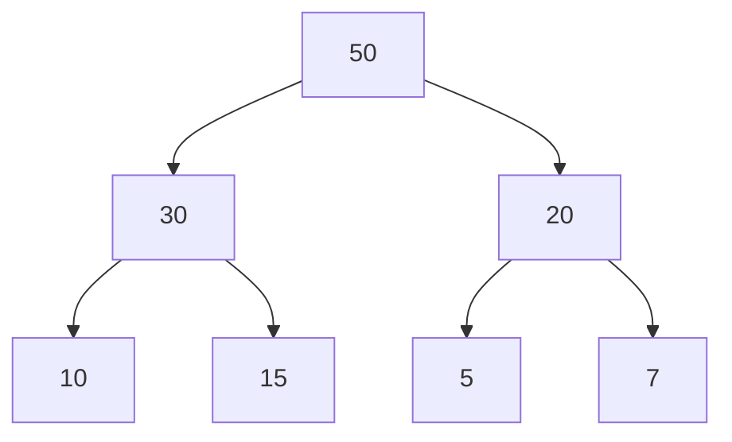

# Estructuras de Datos - Heaps

## 14.3 Análisis de complejidad.

---

### 1. Definición de Heap

Un **Heap** es una estructura de datos basada en un árbol binario completo que cumple con la propiedad de **Heap**:

- **Max-Heap:** El valor de cada nodo es mayor o igual que los valores de sus hijos.
- **Min-Heap:** El valor de cada nodo es menor o igual que los valores de sus hijos.

#### Representación:

- Se puede implementar mediante un arreglo.
- Para un nodo en el índice $i$:
  - Padre: $parent(i) = \lfloor \frac{i-1}{2} \rfloor$
  - Hijo izquierdo: $left(i) = 2i + 1$
  - Hijo derecho: $right(i) = 2i + 2$

### 2. Operaciones básicas y complejidad

#### 2.1 Inserción (`insert`)

**Algoritmo:**

1. Insertar el elemento al final del heap.
2. Aplicar **heapify-up** (burbujeo hacia arriba) para mantener la propiedad del heap.

**Código en Python:**

```python
def insert(heap, value):
    heap.append(value)
    i = len(heap) - 1
    while i > 0:
        parent = (i - 1) // 2
        if heap[i] > heap[parent]:
            heap[i], heap[parent] = heap[parent], heap[i]
            i = parent
        else:
            break
```

Complejidad:

- Mejor caso: $O(1)$ (el elemento ya cumple la propiedad de heap)
- Peor caso: $O(\log n)$ (sube desde la hoja hasta la raíz)

#### 2.2 Eliminación del máximo (`extract-max`) en Max-Heap

**Algoritmo:**

1. Guardar el valor máximo (raíz).
2. Reemplazar la raíz con el último elemento.
3. Aplicar heapify-down (hundimiento) para mantener la propiedad del heap.

**Código en Python:**

```python
def extract_max(heap):
    if len(heap) == 0:
        return None
    maximum = heap[0]
    heap[0] = heap[-1]
    heap.pop()
    i = 0
    while True:
        left = 2 * i + 1
        right = 2 * i + 2
        largest = i
        if left < len(heap) and heap[left] > heap[largest]:
            largest = left
        if right < len(heap) and heap[right] > heap[largest]:
            largest = right
        if largest != i:
            heap[i], heap[largest] = heap[largest], heap[i]
            i = largest
        else:
            break
    return maximum
```

**Complejidad:**

- Mejor caso: $O(1)$ (si la raíz ya es mayor que los hijos)
- Peor caso: $O(\log n)$ (el elemento baja hasta la hoja)

#### 2.3 Recuperar el máximo (peek)

- Retorna el elemento en la raíz sin modificar el heap.
- Complejidad: $O(1)$

### 3. Construcción de un Heap (`build-heap`)

**Método bottom-up:**

1. Comenzar desde el último nodo padre hasta la raíz.
2. Aplicar `heapify-down` en cada nodo.

**Complejidad:**

- Total: $O(n)$

**Código en Python:**

```python
def build_heap(arr):
    n = len(arr)
    for i in range(n//2 - 1, -1, -1):
        heapify(arr, n, i)

def heapify(arr, n, i):
    largest = i
    left = 2 * i + 1
    right = 2 * i + 2

    if left < n and arr[left] > arr[largest]:
        largest = left
    if right < n and arr[right] > arr[largest]:
        largest = right
    if largest != i:
        arr[i], arr[largest] = arr[largest], arr[i]
        heapify(arr, n, largest)
```

### 4. Resumen de complejidades

| Operación   | Mejor caso | Peor caso |
| ----------- | ---------- | --------- |
| insert      | O(1)       | O(log n)  |
| extract-max | O(1)       | O(log n)  |
| peek        | O(1)       | O(1)      |
| build-heap  | O(n)       | O(n)      |

### 5. Visualización de Heap (Mermaid)



### 6. Fórmulas útiles

- Altura de un heap completo con $n$ elementos: $h = \lfloor \log_2 n \rfloor$
- Número máximo de nodos en altura $h$: $2^{h+1} - 1$

### 7. Referencias

1. Cormen, T. H., Leiserson, C. E., Rivest, R. L., & Stein, C. (2009). _Introduction to Algorithms_ (3rd ed.). MIT Press.
2. Goodrich, M. T., Tamassia, R. (2014). _Data Structures and Algorithms in Python_. Wiley.
3. [https://www.geeksforgeeks.org/binary-heap/](https://www.geeksforgeeks.org/binary-heap/)
