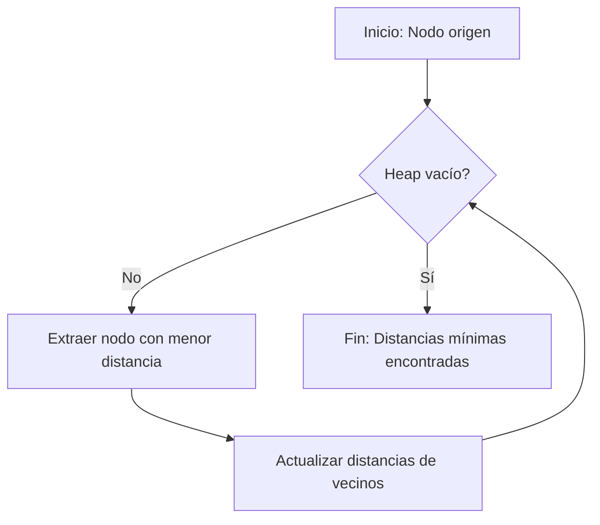

# Estructuras de Datos - Heaps

## 14.4 Aplicaciones.

---

### 1. Introducción

Un **Heap** es una estructura de datos basada en un **árbol binario completo** que satisface la propiedad de heap:

- **Max-Heap:** Cada nodo es mayor o igual que sus hijos.
- **Min-Heap:** Cada nodo es menor o igual que sus hijos.

Los heaps son ampliamente usados en algoritmos que requieren acceso rápido al **máximo o mínimo elemento**, como en **colas de prioridad**, **algoritmos de selección** y **estructuras de datos temporales**.

### 2. Propiedades Relevantes para Aplicaciones

1. **Acceso rápido al extremo:**
   - Max-Heap: acceder al elemento máximo en $O(1)$.
   - Min-Heap: acceder al elemento mínimo en $O(1)$.

2. **Inserción eficiente:**
   - Inserción de elementos en $O(\log n)$.

3. **Extracción eficiente:**
   - Eliminación del extremo (máximo o mínimo) en $O(\log n)$.

4. **Construcción de un heap:**
   - Construcción desde un arreglo en $O(n)$ mediante `heapify`.

### 3. Aplicaciones Comunes

#### 3.1 Colas de Prioridad

Las **colas de prioridad** permiten almacenar elementos con prioridades asociadas.

**Ejemplo en Python:**

```python
import heapq

# Min-Heap por defecto
pq = []
heapq.heappush(pq, (3, 'Tarea C'))
heapq.heappush(pq, (1, 'Tarea A'))
heapq.heappush(pq, (2, 'Tarea B'))

while pq:
    prioridad, tarea = heapq.heappop(pq)
    print(f"{tarea} con prioridad {prioridad}")
```

**Salida:**

```
Tarea A con prioridad 1
Tarea B con prioridad 2
Tarea C con prioridad 3
```

#### 3.2 Ordenamiento Parcial – Heapsort

**Heapsort** utiliza un heap para ordenar un arreglo:

1. Construir un Max-Heap a partir del arreglo.
2. Extraer el máximo repetidamente y colocarlo al final del arreglo.

**Código ejemplo:**

```python
def heapify(arr, n, i):
    largest = i
    left = 2*i + 1
    right = 2*i + 2

    if left < n and arr[left] > arr[largest]:
        largest = left
    if right < n and arr[right] > arr[largest]:
        largest = right

    if largest != i:
        arr[i], arr[largest] = arr[largest], arr[i]
        heapify(arr, n, largest)


def heapsort(arr):
    n = len(arr)
    for i in range(n//2 - 1, -1, -1):
        heapify(arr, n, i)

    for i in range(n-1, 0, -1):
        arr[i], arr[0] = arr[0], arr[i]
        heapify(arr, i, 0)

arr = [4, 10, 3, 5, 1]
heapsort(arr)
print(arr)  # [1, 3, 4, 5, 10]
```

#### 3.3 Selección de los k elementos más grandes o pequeños

El heap permite mantener los **k elementos más grandes** o más pequeños en tiempo eficiente:

- **Min-Heap** para los k más grandes.
- **Max-Heap** para los k más pequeños.

```python
import heapq

arr = [7, 2, 9, 4, 5, 6]
k = 3
largest_k = heapq.nlargest(k, arr)
smallest_k = heapq.nsmallest(k, arr)

print("Mayores:", largest_k)
print("Menores:", smallest_k)
```

#### 3.4 Algoritmos de Grafos – Dijkstra y Prim

- **Dijkstra:** Selecciona el nodo con la menor distancia usando un **Min-Heap**.
- **Prim:** Selecciona la arista mínima en cada paso usando un **Min-Heap**.

**Diagrama Mermaid de un flujo simplificado de Dijkstra:**



#### 3.5 Streaming de Datos – Median Maintenance

Para calcular la **mediana dinámica** de un flujo de datos:

- Se usan **dos heaps**:
  - Max-Heap para la mitad inferior.
  - Min-Heap para la mitad superior.
- La mediana es el máximo del Max-Heap o el promedio de ambos heaps según el tamaño.

### 4. Complejidad de las operaciones en aplicaciones

| Operación                     | Complejidad   |
| ----------------------------- | ------------- |
| Construcción de heap          | $O(n)$        |
| Inserción                     | $O(\log n)$   |
| Extracción del máximo/mínimo  | $O(\log n)$   |
| Obtener máximo/mínimo         | $O(1)$        |
| Heapsort completo             | $O(n \log n)$ |
| Mantener k elementos extremos | $O(n \log k)$ |

### 5. Referencias

1. Cormen, T. H., Leiserson, C. E., Rivest, R. L., & Stein, C. (2009). _Introduction to Algorithms_ (3rd ed.). MIT Press.
2. Sedgewick, R., & Wayne, K. (2011). _Algorithms_ (4th ed.). Addison-Wesley.
3. Python `heapq` module documentation: https://docs.python.org/3/library/heapq.html
4. Heapsort Algorithm: https://en.wikipedia.org/wiki/Heapsort
