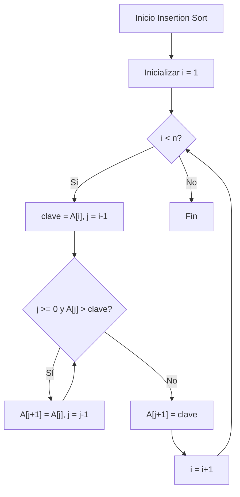
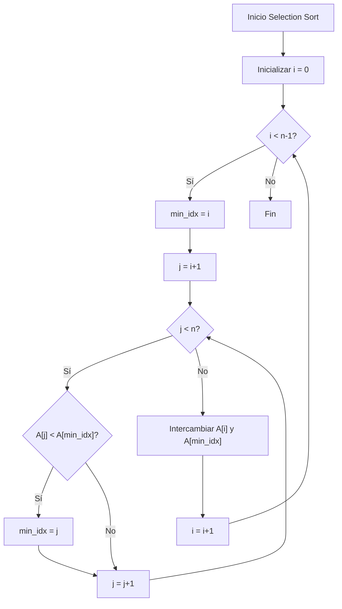
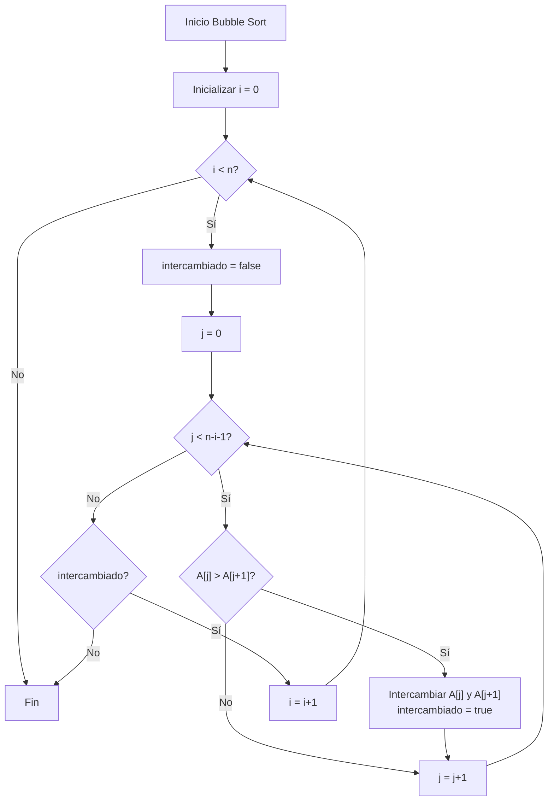

# Estructuras de Datos - Algoritmos de ordenamiento

## 15.1 Métodos elementales de complejidad cuadrática: inserción, selección, burbuja.

---

### 1. Introducción

Los algoritmos de ordenamiento son procedimientos fundamentales en ciencias de la computación que organizan elementos de una colección en un orden específico (ascendente o descendente). Los métodos elementales de complejidad cuadrática $(O(n²))$ son ideales para entender los conceptos básicos del ordenamiento.

### 2. Complejidad Computacional

La complejidad temporal de un algoritmo describe cómo crece el tiempo de ejecución con el tamaño de la entrada $(n)$.

- Peor caso: $O(n²)$
- Mejor caso: $O(n)$ (para inserción)
- Caso promedio: $O(n²)$

### 3. Algoritmo de Inserción (Insertion Sort)

#### 3.1 Definición

Ordena construyendo una secuencia ordenada gradualmente, insertando cada elemento en su posición correcta dentro de la porción ya ordenada.

#### 3.2 Pseudocódigo

```
para i desde 1 hasta n-1:
    clave = A[i]
    j = i - 1
    mientras j >= 0 y A[j] > clave:
        A[j+1] = A[j]
        j = j - 1
    A[j+1] = clave
```

#### 3.3 Implementación en Python

```python
def insertion_sort(arr):
    """
    Ordena un array usando el algoritmo de inserción
    """
    for i in range(1, len(arr)):
        clave = arr[i]
        j = i - 1

        # Mover elementos mayores que la clave una posición adelante
        while j >= 0 and arr[j] > clave:
            arr[j + 1] = arr[j]
            j -= 1

        # Insertar la clave en la posición correcta
        arr[j + 1] = clave
    return arr

# Ejemplo de uso
array = [64, 34, 25, 12, 22, 11, 90]
print("Array original:", array)
print("Array ordenado:", insertion_sort(array.copy()))
```

#### 3.4 Visualización del Proceso



#### 3.5 Ejemplo Paso a Paso

Array inicial: [5, 2, 4, 6, 1, 3]

| Iteración | Array Estado       | Comentario                     |
| --------- | ------------------ | ------------------------------ |
| i=1       | [2, 5, 4, 6, 1, 3] | Insertar 2 antes de 5          |
| i=2       | [2, 4, 5, 6, 1, 3] | Insertar 4 entre 2 y 5         |
| i=3       | [2, 4, 5, 6, 1, 3] | 6 ya está en posición correcta |
| i=4       | [1, 2, 4, 5, 6, 3] | Insertar 1 al inicio           |
| i=5       | [1, 2, 3, 4, 5, 6] | Insertar 3 entre 2 y 4         |

### 4. Algoritmo de Selección (Selection Sort)

Divide el array en dos partes: ordenada y no ordenada. En cada iteración, encuentra el elemento mínimo de la parte no ordenada y lo coloca al final de la parte ordenada.

#### 4.1 Pseudocódigo

```
para i desde 0 hasta n-2:
    min_idx = i
    para j desde i+1 hasta n-1:
        si A[j] < A[min_idx]:
            min_idx = j
    intercambiar A[i] y A[min_idx]
```

#### 4.2 Implementación en Python

```python
def selection_sort(arr):
    """
    Ordena un array usando el algoritmo de selección
    """
    n = len(arr)

    for i in range(n):
        # Encontrar el índice del elemento mínimo en el subarray no ordenado
        min_idx = i
        for j in range(i + 1, n):
            if arr[j] < arr[min_idx]:
                min_idx = j

        # Intercambiar el elemento mínimo con el primer elemento del subarray no ordenado
        arr[i], arr[min_idx] = arr[min_idx], arr[i]

    return arr

# Ejemplo de uso
array = [64, 25, 12, 22, 11]
print("Array original:", array)
print("Array ordenado:", selection_sort(array.copy()))
```

#### 4.3 Visualización del Proceso



#### 4.4 Análisis de Complejidad

- Comparaciones: $\sum_{i=0}^{n-2} (n-i-1) = \frac{n(n-1)}{2} = O(n²)$
- Intercambios: $n-1 = O(n)$

### 5. Algoritmo de Burbuja (Bubble Sort)

Recorre repetidamente el array, compara elementos adyacentes y los intercambia si están en el orden incorrecto. Este proceso se repite hasta que no se necesiten más intercambios.

#### 5.1 Pseudocódigo

```
para i desde 0 hasta n-2:
    intercambiado = falso
    para j desde 0 hasta n-i-2:
        si A[j] > A[j+1]:
            intercambiar A[j] y A[j+1]
            intercambiado = verdadero
    si no intercambiado:
        break
```

#### 5.2 Implementación en Python

```python
def bubble_sort(arr):
    """
    Ordena un array usando el algoritmo de burbuja
    """
    n = len(arr)

    for i in range(n):
        intercambiado = False

        # Los últimos i elementos ya están en su lugar
        for j in range(0, n - i - 1):
            if arr[j] > arr[j + 1]:
                # Intercambiar elementos
                arr[j], arr[j + 1] = arr[j + 1], arr[j]
                intercambiado = True

        # Si no hubo intercambios, el array está ordenado
        if not intercambiado:
            break

    return arr

# Ejemplo de uso
array = [64, 34, 25, 12, 22, 11, 90]
print("Array original:", array)
print("Array ordenado:", bubble_sort(array.copy()))
```

#### 5.3 Optimización con Bandera

La versión optimizada incluye una bandera que detecta cuando no se realizan intercambios, indicando que el array está ordenado.

```python
def bubble_sort_optimized(arr):
    n = len(arr)

    for i in range(n):
        swapped = False
        for j in range(0, n - i - 1):
            if arr[j] > arr[j + 1]:
                arr[j], arr[j + 1] = arr[j + 1], arr[j]
                swapped = True

        if not swapped:
            break

    return arr
```



### 6. Comparativa de los Algoritmos

#### 6.1 Tabla Comparativa

| Algoritmo | Mejor Caso | Peor Caso | Caso Promedio | Estable | In-place |
| --------- | ---------- | --------- | ------------- | ------- | -------- |
| Inserción | $O(n)$     | $O(n²)$   | $O(n²)$       | Sí      | Sí       |
| Selección | $O(n²)$    | $O(n²)$   | $O(n²)$       | No      | Sí       |
| Burbuja   | $O(n)$     | $O(n²)$   | $O(n²)$       | Sí      | Sí       |

#### 6.2 Ventajas y Desventajas

**Inserción:**

- (✓) Eficiente para arrays pequeños o casi ordenados
- (✓) Estable y in-place
- (X) Ineficiente para arrays grandes

**Selección:**

- (✓) Pocos intercambios $(O(n))$
- (X) Siempre realiza $O(n²)$ comparaciones
- (X) No estable

**Burbuja:**

- (✓) Simple de implementar
- (X) Generalmente el menos eficiente
- (✓) Fácil de entender

### 7. Aplicaciones Prácticas

#### 7.1 Cuándo usar cada algoritmo

**Inserción:**

- Arrays pequeños (n < 50)
- Arrays casi ordenados
- Como parte de algoritmos más complejos (Timsort)

**Selección:**

- Cuando el costo de intercambiar es alto
- Memoria limitada

**Burbuja:**

- Principalmente con fines educativos
- Arrays muy pequeños y simples

### 8. Ejercicios Prácticos

#### 8.1 Ejercicio 1: Implementación Comparada

```python
import time
import random

def comparar_algoritmos(tamano=1000):
    # Generar array aleatorio
    arr = [random.randint(1, 10000) for _ in range(tamano)]

    algoritmos = {
        'Inserción': insertion_sort,
        'Selección': selection_sort,
        'Burbuja': bubble_sort
    }

    resultados = {}

    for nombre, algoritmo in algoritmos.items():
        arr_copia = arr.copy()
        inicio = time.time()
        algoritmo(arr_copia)
        fin = time.time()
        resultados[nombre] = fin - inicio

    return resultados

# Ejecutar comparación
print("Tiempos de ejecución (segundos):")
print(comparar_algoritmos(1000))
```

#### 8.2 Ejercicio 2: Análisis de Estabilidad

```python
def test_estabilidad():
    # Array con elementos que tienen el mismo valor en una clave
    elementos = [
        ('A', 3), ('B', 2), ('C', 3), ('D', 1), ('E', 2)
    ]

    # Función de ordenamiento por el segundo elemento
    def ordenar_por_valor(arr):
        return sorted(arr, key=lambda x: x[1])

    print("Array original:", elementos)
    print("Array ordenado (estable):", ordenar_por_valor(elementos))
```

### 9. Referencias y Bibliografía

1. Introduction to Algorithms - Cormen, Leiserson, Rivest, Stein
2. The Art of Computer Programming - Donald Knuth (Vol. 3)
3. Data Structures and Algorithm Analysis in Java - Mark Allen Weiss

### 10. Conclusión

Los algoritmos de ordenamiento cuadráticos, aunque no son los más eficientes para grandes volúmenes de datos, son fundamentales para entender los principios básicos del ordenamiento. Cada algoritmo tiene sus características particulares que lo hacen adecuado para diferentes escenarios, y su estudio sienta las bases para comprender algoritmos más complejos y eficientes.
