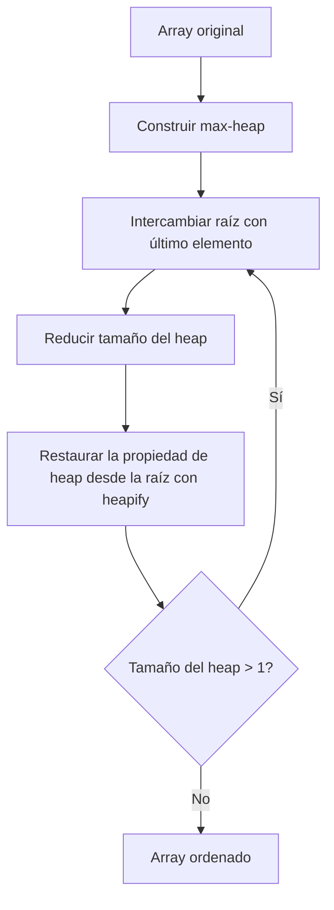
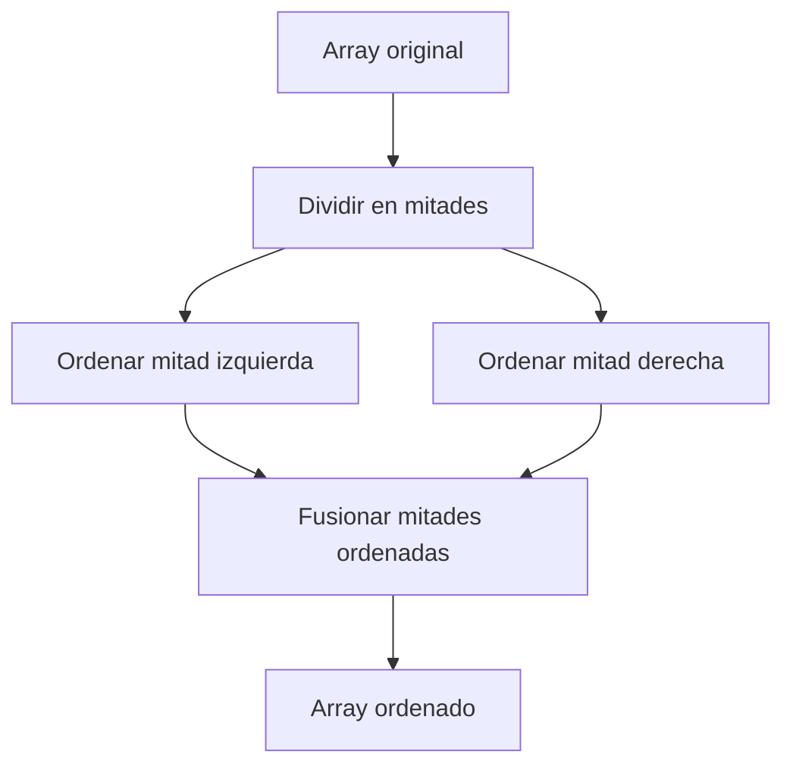

# Estructuras de Datos - Algoritmos de ordenamiento

## 15.2 Métodos eficientes: Shellsort, Heapsort, Quicksort y Mergesort.

---

Los algoritmos de ordenamiento eficientes son aquellos que tienen una complejidad temporal mejor que $O(n^2)$ en el caso promedio. Shellsort queda en un punto intermedio: su eficiencia depende de la secuencia de gaps. En este documento exploraremos cuatro métodos fundamentales: Shellsort, Heapsort, Quicksort y Mergesort.

### Shellsort

#### Definición

El Shellsort es una generalización del algoritmo de inserción que permite el intercambio de elementos que están separados por una distancia. Fue desarrollado por Donald Shell en 1959.

#### Concepto Clave

- Divide la lista original en sublistas más pequeñas
- Ordena las sublistas usando inserción
- Reduce gradualmente el espacio entre elementos comparados
- La eficiencia depende de la secuencia de espacios (gaps) utilizada

#### Complejidad

- **Peor caso**: depende de la secuencia de gaps; con la secuencia original de Shell, $n/2, n/4, \ldots, 1$, es $O(n^2)$. Con la de Pratt, $2^p 3^q$, es $O(n \log^2 n)$, y con la de Sedgewick, $O(n^{4/3})$.
- **Caso promedio**: no se conoce una fórmula general; con buenas secuencias de gaps se observa empíricamente un crecimiento cercano a $O(n^{1.25})$.
- **Mejor caso**: $O(n \log n)$, con el arreglo ya ordenado, pues cada una de las $O(\log n)$ pasadas cuesta $O(n)$.

#### Implementación

```python
def shellsort(arr):
    n = len(arr)
    gap = n // 2

    while gap > 0:
        for i in range(gap, n):
            temp = arr[i]
            j = i
            while j >= gap and arr[j - gap] > temp:
                arr[j] = arr[j - gap]
                j -= gap
            arr[j] = temp
        gap //= 2
    return arr
```

#### Ejemplo

- Lista original: [64, 34, 25, 12, 22, 11, 90]
- Después de gap=3: [12, 22, 11, 64, 34, 25, 90]
- Después de gap=1: [11, 12, 22, 25, 34, 64, 90]

### Heapsort

#### Definición

Heapsort es un algoritmo de ordenamiento basado en la estructura de datos heap. Utiliza un heap binario para organizar los elementos.

#### Concepto Clave

- Construye un max-heap a partir de los datos
- El elemento más grande (raíz) se intercambia con el último elemento
- Reduce el tamaño del heap y reestructura
- Repite el proceso hasta que el heap tenga un solo elemento

#### Complejidad

- **Peor caso**: $O(n \log n)$
- **Caso promedio**: $O(n \log n)$
- **Mejor caso**: $O(n \log n)$

#### Implementación

```python
def heapify(arr, n, i):
    largest = i
    left = 2 * i + 1
    right = 2 * i + 2

    if left < n and arr[i] < arr[left]:
        largest = left

    if right < n and arr[largest] < arr[right]:
        largest = right

    if largest != i:
        arr[i], arr[largest] = arr[largest], arr[i]
        heapify(arr, n, largest)

def heapsort(arr):
    n = len(arr)

    # Construir max-heap
    for i in range(n // 2 - 1, -1, -1):
        heapify(arr, n, i)

    # Extraer elementos uno por uno
    for i in range(n - 1, 0, -1):
        arr[i], arr[0] = arr[0], arr[i]
        heapify(arr, i, 0)

    return arr
```

#### Visualización del Proceso



### Quicksort

#### Definición

Quicksort es un algoritmo de divide y vencerás que selecciona un elemento como pivote y particiona el array alrededor de este pivote.

#### Concepto Clave

- Selecciona un elemento como pivote
- Reorganiza el array: elementos menores al pivote a la izquierda, mayores a la derecha
- Aplica recursivamente el mismo proceso a las sublistas

#### Complejidad

- Peor caso: $O(n^2)$ (cuando el pivote es siempre el menor o mayor elemento)
- Caso promedio: $O(n \log n)$
- Mejor caso: $O(n \log n)$

#### Implementación

```python
def partition(arr, low, high):
    pivot = arr[high]
    i = low - 1

    for j in range(low, high):
        if arr[j] <= pivot:
            i += 1
            arr[i], arr[j] = arr[j], arr[i]

    arr[i + 1], arr[high] = arr[high], arr[i + 1]
    return i + 1

def quicksort(arr, low, high):
    if low < high:
        pi = partition(arr, low, high)
        quicksort(arr, low, pi - 1)
        quicksort(arr, pi + 1, high)
    return arr
```

#### Ejemplo

- Array original: [10, 80, 30, 90, 40, 50, 70]
- Pivote: 70
- Partición: [10, 30, 40, 50, 70, 90, 80]
- Aplicar recursivamente a subarrays
- Resultado: [10, 30, 40, 50, 70, 80, 90]

### Mergesort

#### Definición

Mergesort es un algoritmo de divide y vencerás que divide repetidamente la lista en mitades, ordena cada mitad y luego las fusiona.

#### Concepto Clave

- Divide la lista en dos mitades
- Ordena recursivamente cada mitad
- Fusiona las dos mitades ordenadas

#### Complejidad

- Peor caso: $O(n \log n)$
- Caso promedio: $O(n \log n)$
- Mejor caso: $O(n \log n)$

#### Implementación

```python
def merge(left, right):
    result = []
    i = j = 0
    while i < len(left) and j < len(right):
        if left[i] <= right[j]:   # <= conserva el orden de los iguales: estable
            result.append(left[i])
            i += 1
        else:
            result.append(right[j])
            j += 1

    result.extend(left[i:])
    result.extend(right[j:])
    return result

def mergesort(arr):
    if len(arr) <= 1:
        return arr

    mid = len(arr) // 2
    left = mergesort(arr[:mid])
    right = mergesort(arr[mid:])

    return merge(left, right)

```



### Comparativa de Algoritmos

| Algoritmo | Complejidad Temporal     | Complejidad Espacial | Estable | In-place |
| --------- | ------------------------ | -------------------- | ------- | -------- |
| Shellsort | $O(n \log n)$ - $O(n^2)$, según los gaps | $O(1)$               | No      | Sí       |
| Heapsort  | $O(n \log n)$            | $O(1)$               | No      | Sí       |
| Quicksort | $O(n \log n)$ - $O(n^2)$ | $O(\log n)$ en promedio, $O(n)$ en el peor caso | No en la versión in-place | Sí       |
| Mergesort | $O(n \log n)$            | $O(n)$               | Sí      | No       |

### Consideraciones de Selección

- Quicksort: Generalmente el más rápido en la práctica para arrays en memoria
- Mergesort: Ideal para datos externos (que no caben en memoria)
- Heapsort: Garantiza $O(n \log n)$ en todos los casos
- Shellsort: Bueno para arrays medianos o cuando se necesita código simple

### Conclusión

Cada algoritmo tiene sus ventajas y desventajas dependiendo del contexto de uso. La selección del algoritmo adecuado depende de factores como el tamaño de los datos, la disponibilidad de memoria, la necesidad de estabilidad y la distribución de los datos.
