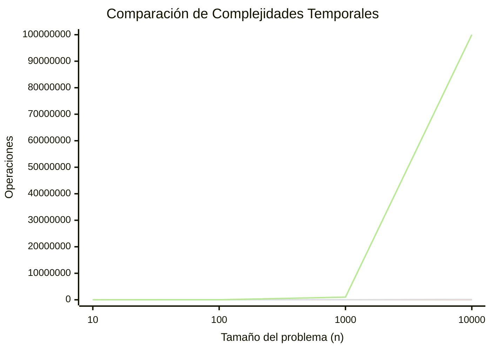

# Estructuras de Datos - Algoritmos de ordenamiento

## 15.3 Análisis de complejidad.

---

El análisis de complejidad es una herramienta fundamental para evaluar la eficiencia de los algoritmos. Nos permite comparar diferentes enfoques y predecir cómo se comportarán con conjuntos de datos de distintos tamaños.

### Notación Asintótica

#### Notación Big-O $(O)$

Define el límite superior del crecimiento de una función. Representa el peor caso de ejecución del algoritmo.

$O(g(n)) = \{ f(n): \text{existen constantes } c > 0 \text{ y } n_0 > 0 \text{ tales que } 0 \leq f(n) \leq c \cdot g(n) \text{ para todo } n \geq n_0 \}$

#### Notación Omega $(Omega)$

Define el límite inferior del crecimiento de una función. Representa el mejor caso de ejecución del algoritmo.

$\Omega(g(n)) = \{ f(n): \text{existen constantes } c > 0 \text{ y } n_0 > 0 \text{ tales que } 0 \leq c \cdot g(n) \leq f(n) \text{ para todo } n \geq n_0 \}$

#### Notación Theta $(\Theta)$

Define límites ajustados tanto superiores como inferiores. Representa el caso promedio del algoritmo.

$\Theta(g(n)) = \{ f(n): \text{existen constantes } c_1 > 0, c_2 > 0 \text{ y } n_0 > 0 \text{ tales que } 0 \leq c_1 \cdot g(n) \leq f(n) \leq c_2 \cdot g(n) \text{ para todo } n \geq n_0 \}$

### Complejidades Comunes

```python
# O(1) - Tiempo constante
def acceso_directo(arr, indice):
    return arr[indice]

# O(n) - Tiempo lineal
def busqueda_lineal(arr, objetivo):
    for elemento in arr:
        if elemento == objetivo:
            return True
    return False

# O(n²) - Tiempo cuadrático
def bubble_sort(arr):
    n = len(arr)
    for i in range(n):
        for j in range(0, n-i-1):
            if arr[j] > arr[j+1]:
                arr[j], arr[j+1] = arr[j+1], arr[j]

# O(log n) - Tiempo logarítmico
def busqueda_binaria(arr, objetivo):
    izquierda, derecha = 0, len(arr)-1
    while izquierda <= derecha:
        medio = (izquierda + derecha) // 2
        if arr[medio] == objetivo:
            return medio
        elif arr[medio] < objetivo:
            izquierda = medio + 1
        else:
            derecha = medio - 1
    return -1

# O(n log n) - Tiempo linealítmico
def mergesort(arr):
    if len(arr) <= 1:
        return arr

    medio = len(arr) // 2
    izquierda = mergesort(arr[:medio])
    derecha = mergesort(arr[medio:])

    return merge(izquierda, derecha)
```

### Análisis de Algoritmos de Ordenamiento

#### Bubble Sort

```python
def bubble_sort(arr):
    n = len(arr)
    comparaciones = 0
    intercambios = 0

    for i in range(n):
        comparaciones += 1  # Comparación del bucle externo
        for j in range(0, n-i-1):
            comparaciones += 1  # Comparación del bucle interno
            if arr[j] > arr[j+1]:
                arr[j], arr[j+1] = arr[j+1], arr[j]
                intercambios += 1

    return comparaciones, intercambios
```

**Complejidad:**

- Peor caso: $O(n^2)$
- Mejor caso: $O(n)$ (cuando ya está ordenado)
- Caso promedio: $O(n^2)$

#### Quick Sort

```python
def quicksort(arr, bajo, alto, nivel=0):
    if bajo < alto:
        pi = particion(arr, bajo, alto)

        # Llamadas recursivas
        quicksort(arr, bajo, pi-1, nivel+1)
        quicksort(arr, pi+1, alto, nivel+1)

def particion(arr, bajo, alto):
    pivote = arr[alto]
    i = bajo - 1

    for j in range(bajo, alto):
        if arr[j] <= pivote:
            i += 1
            arr[i], arr[j] = arr[j], arr[i]

    arr[i+1], arr[alto] = arr[alto], arr[i+1]
    return i+1
```

**Complejidad:**

- Peor caso: $O(n^2)$ (pivote siempre mínimo/máximo)
- Mejor caso: $O(n \log n)$ (pivote siempre la mediana)
- Caso promedio: $O(n \log n)$

#### Merge Sort

```python
def mergesort(arr, nivel=0):
    if len(arr) > 1:
        medio = len(arr) // 2
        izquierda = arr[:medio]
        derecha = arr[medio:]

        # Llamadas recursivas
        mergesort(izquierda, nivel+1)
        mergesort(derecha, nivel+1)

        i = j = k = 0

        # Fusionar las mitades
        while i < len(izquierda) and j < len(derecha):
            if izquierda[i] < derecha[j]:
                arr[k] = izquierda[i]
                i += 1
            else:
                arr[k] = derecha[j]
                j += 1
            k += 1

        # Copiar elementos restantes
        while i < len(izquierda):
            arr[k] = izquierda[i]
            i += 1
            k += 1

        while j < len(derecha):
            arr[k] = derecha[j]
            j += 1
            k += 1
```

**Complejidad:**

- Todos los casos: $O(n \log n)$

### Análisis de Espacio

#### Complejidad Espacial

- **Espacio auxiliar**: Memoria adicional utilizada por el algoritmo
- **Espacio total**: Memoria total utilizada (incluyendo entrada)

```python
# O(1) - Espacio constante
def bubble_sort(arr):  # Solo usa variables temporales
    n = len(arr)
    for i in range(n):
        for j in range(0, n-i-1):
            if arr[j] > arr[j+1]:
                arr[j], arr[j+1] = arr[j+1], arr[j]

# O(n) - Espacio lineal
def mergesort(arr):  # Necesita arrays temporales
    if len(arr) > 1:
        medio = len(arr) // 2
        izquierda = arr[:medio]  # O(n/2) espacio
        derecha = arr[medio:]    # O(n/2) espacio
        # ...
```

### Ejemplo Práctico de Análisis

#### Comparación Empírica

```python
import time
import random

def medir_tiempo(func, arr):
    inicio = time.time()
    func(arr)
    fin = time.time()
    return fin - inicio

# Generar array de prueba
tamanos = [100, 500, 1000, 5000]
resultados = {}

for tamano in tamanos:
    arr = [random.randint(0, 1000) for _ in range(tamano)]

    # Bubble Sort
    tiempo_bubble = medir_tiempo(bubble_sort, arr.copy())

    # Quick Sort
    tiempo_quick = medir_tiempo(lambda a: quicksort(a, 0, len(a)-1), arr.copy())

    # Merge Sort
    tiempo_merge = medir_tiempo(mergesort, arr.copy())

    resultados[tamano] = {
        'bubble': tiempo_bubble,
        'quick': tiempo_quick,
        'merge': tiempo_merge
    }
```

### Visualización de Complejidades



### Reglas para el Análisis de Complejidad

1. Regla del producto: Si $T_1(n) = O(f(n))$ y $T_2(n) = O(g(n))$, entonces $T_1(n) \times T_2(n) = O(f(n) \times g(n))$
2. Regla de la suma: Si $T_1(n) = O(f(n))$ y $T_2(n) = O(g(n))$, entonces $T_1(n) + T_2(n) = O(\max(f(n), g(n)))$
3. Regla de la constante: $O(c \times f(n)) = O(f(n))$ para cualquier constante $c > 0$

### Conclusión

El análisis de complejidad nos permite:

- Predecir el comportamiento de algoritmos con grandes volúmenes de datos
- Comparar diferentes enfoques de solución
- Seleccionar el algoritmo más adecuado para cada problema
- Optimizar el uso de recursos computacionales

La notación asintótica $(O, \Omega, \Theta)$ proporciona un lenguaje común para describir la eficiencia de los algoritmos, permitiendo tomar decisiones informadas sobre qué algoritmo utilizar en cada situación.
