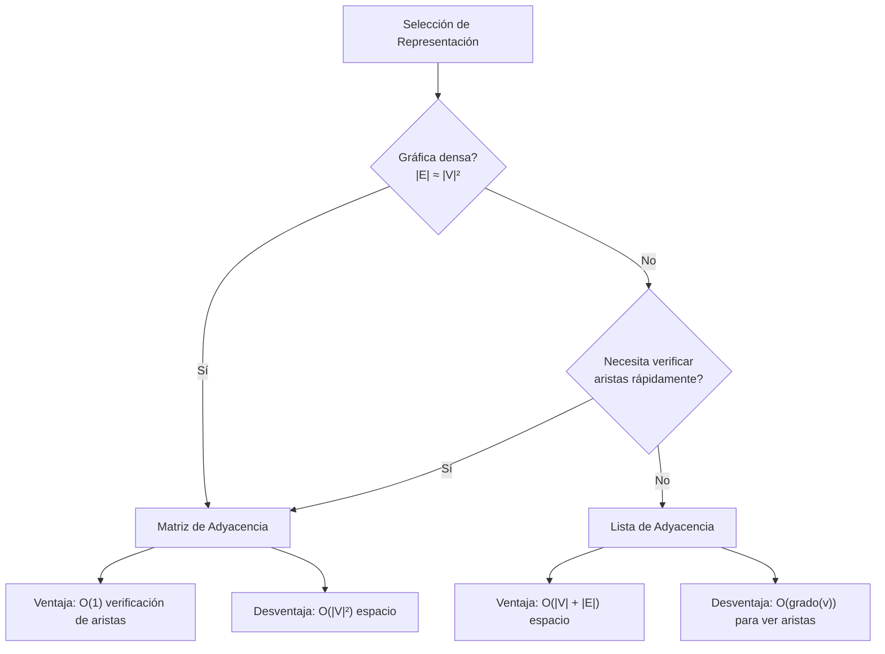

# Estructuras de Datos - Algoritmos en gráficas

## 16.1 Representación de gráficas, complejidad de espacio.

---

### Introducción a las Gráficas

Una gráfica $G$ es una estructura de datos que consiste en un conjunto de vértices $V$ (también llamados nodos) y un conjunto de aristas $E$ que conectan pares de vértices.

Formalmente: $G = (V, E)$ donde:

- $V = \{v_1, v_2, ..., v_n\}$ es el conjunto de vértices
- $E = \{(u, v) \mid u, v \in V\}$ es el conjunto de aristas

### Tipos de Gráficas

#### Gráficas Dirigidas vs No Dirigidas

- **No dirigida**: $(u, v) = (v, u)$ (simétrica)
- **Dirigida**: $(u, v) \neq (v, u)$ (asimetrica)

#### Gráficas Ponderadas vs No Ponderadas

- **No ponderada**: Todas las aristas tienen el mismo peso
- **Ponderada**: Cada arista tiene un peso o costo asociado

### Representación de Gráficas

#### 1. Matriz de Adyacencia

Una matriz bidimensional $n \times n$ donde:

- $n = |V|$ (número de vértices)
- $A[i][j] = 1$ si existe arista de $i$ a $j$, $0$ en caso contrario
- Para gráficas ponderadas: $A[i][j] = peso$ o $\infty$ si no hay arista

```python
class GraficaMatriz:
    def __init__(self, num_vertices, dirigida=False):
        self.num_vertices = num_vertices
        self.dirigida = dirigida
        self.matriz = [[0] * num_vertices for _ in range(num_vertices)]

    def agregar_arista(self, u, v, peso=1):
        self.matriz[u][v] = peso
        if not self.dirigida:
            self.matriz[v][u] = peso

    def remover_arista(self, u, v):
        self.matriz[u][v] = 0
        if not self.dirigida:
            self.matriz[v][u] = 0

    def existe_arista(self, u, v):
        return self.matriz[u][v] != 0

    def obtener_vecinos(self, u):
        vecinos = []
        for v in range(self.num_vertices):
            if self.matriz[u][v] != 0:
                vecinos.append(v)
        return vecinos
```

**Complejidad de espacio**: $O(|V|^2)$

#### 2. Lista de Adyacencia

Un arreglo de listas donde cada posición $i$ contiene una lista de vértices adyacentes a $i$.

```python
class GraficaLista:
    def __init__(self, num_vertices, dirigida=False):
        self.num_vertices = num_vertices
        self.dirigida = dirigida
        self.lista = [[] for _ in range(num_vertices)]

    def agregar_arista(self, u, v, peso=None):
        if peso is None:
            self.lista[u].append(v)
        else:
            self.lista[u].append((v, peso))

        if not self.dirigida:
            if peso is None:
                self.lista[v].append(u)
            else:
                self.lista[v].append((u, peso))

    def remover_arista(self, u, v):
        # Para aristas sin peso
        if v in self.lista[u]:
            self.lista[u].remove(v)

        if not self.dirigida:
            if u in self.lista[v]:
                self.lista[v].remove(u)

    def existe_arista(self, u, v):
        for vecino in self.lista[u]:
            if isinstance(vecino, tuple):
                if vecino[0] == v:
                    return True
            else:
                if vecino == v:
                    return True
        return False

    def obtener_vecinos(self, u):
        return self.lista[u]
```

**Complejidad de espacio**: $O(|V| + |E|)$

#### 3. Lista de Aristas

Una simple lista que almacena todas las aristas de la gráfica.

```python
class GraficaListaAristas:
    def __init__(self, dirigida=False):
        self.dirigida = dirigida
        self.aristas = []
        self.vertices = set()

    def agregar_arista(self, u, v, peso=None):
        if peso is None:
            self.aristas.append((u, v))
        else:
            self.aristas.append((u, v, peso))

        self.vertices.add(u)
        self.vertices.add(v)

        if not self.dirigida:
            if peso is None:
                self.aristas.append((v, u))
            else:
                self.aristas.append((v, u, peso))

    def obtener_aristas(self):
        return self.aristas

    def obtener_vertices(self):
        return list(self.vertices)
```

**Complejidad de espacio**: $O(|E|)$

### Comparación de Representaciones



### Complejidad de Espacio

#### Matriz de Adyacencia

- **Espacio**: $O(|V|^2)$
- **Ventaja**: Acceso rápido a existencia de aristas $(O(1))$
- **Desventaja**: Ineficiente en memoria para gráficas dispersas

#### Lista de Adyacencia

- **Espacio**: $O(|V| + |E|)$
- **Para gráficas dirigidas**: $O(|V| + |E|)$
- **Para gráficas no dirigidas**: $O(|V| + 2|E|)$ (cada arista aparece dos veces)

#### Lista de Aristas

- **Espacio**: $O(|E|)$
- **Ventaja**: Muy compacta para gráficas muy dispersas
- **Desventaja**: Búsqueda ineficiente de aristas $(O(|E|))$

### Ejemplo Práctico

Consideremos una gráfica con 5 vértices y 7 aristas:

```python
# Crear gráfica con matriz de adyacencia
g_matriz = GraficaMatriz(5, dirigida=False)
g_matriz.agregar_arista(0, 1)
g_matriz.agregar_arista(0, 4)
g_matriz.agregar_arista(1, 2)
g_matriz.agregar_arista(1, 3)
g_matriz.agregar_arista(1, 4)
g_matriz.agregar_arista(2, 3)
g_matriz.agregar_arista(3, 4)

# Espacio utilizado: 5x5 = 25 elementos

# Crear la misma gráfica con lista de adyacencia
g_lista = GraficaLista(5, dirigida=False)
g_lista.agregar_arista(0, 1)
g_lista.agregar_arista(0, 4)
g_lista.agregar_arista(1, 2)
g_lista.agregar_arista(1, 3)
g_lista.agregar_arista(1, 4)
g_lista.agregar_arista(2, 3)
g_lista.agregar_arista(3, 4)

# Espacio utilizado: 5 listas con un total de 14 referencias (7 aristas × 2)
```

### Gráficas Ponderadas

Para gráficas ponderadas, el espacio requerido aumenta:

- **Matriz de adyacencia**: $O(|V|^2)$ (almacena pesos en lugar de booleanos)
- **Lista de adyacencia**: $O(|V| + |E|)$ (cada elemento de la lista es una tupla (vértice, peso))

### Optimizaciones de Espacio

#### Matriz de Adyacencia para Gráficas No Dirigidas

Para gráficas no dirigidas, la matriz es simétrica, por lo que podemos almacenar solo la mitad:

- **Espacio**: $O\left(\frac{|V|(|V| + 1)}{2}\right)$ en lugar de $O(|V|^2)$

#### Listas de Adyacencia Compactas

Podemos usar arreglos en lugar de listas enlazadas para reducir overhead:

```python
class GraficaListaCompacta:
    def __init__(self, num_vertices, dirigida=False):
        self.num_vertices = num_vertices
        self.dirigida = dirigida
        self.vecinos = []  # Lista plana de vecinos
        self.offset = [0] * (num_vertices + 1)  # Puntos de inicio para cada vértice

    def construir_desde_aristas(self, aristas):
        # Contar grado de cada vértice
        grado = [0] * self.num_vertices
        for u, v in aristas:
            grado[u] += 1
            if not self.dirigida:
                grado[v] += 1

        # Calcular offsets
        for i in range(self.num_vertices):
            self.offset[i+1] = self.offset[i] + grado[i]

        # Llenar lista de vecinos
        self.vecinos = [0] * self.offset[self.num_vertices]
        temp_grado = [0] * self.num_vertices

        for u, v in aristas:
            pos_u = self.offset[u] + temp_grado[u]
            self.vecinos[pos_u] = v
            temp_grado[u] += 1

            if not self.dirigida:
                pos_v = self.offset[v] + temp_grado[v]
                self.vecinos[pos_v] = u
                temp_grado[v] += 1
```

### Consideraciones de Implementación

1. **Selección de estructura**: Depende de la densidad de la gráfica y las operaciones frecuentes
2. **Gráficas dinámicas**: Las listas de adyacencia son mejores para gráficas que cambian frecuentemente
3. **Cache efficiency**: Las matrices tienen mejor localidad espacial
4. **Memoria**: Para gráficas grandes, la lista de adyacencia suele ser más eficiente en espacio

### Conclusión

La elección de la representación adecuada depende del problema específico:

- **Matriz de adyacencia**: Ideal para gráficas densas y cuando se necesita verificar aristas rápidamente
- **Lista de adyacencia**: Mejor para gráficas dispersas y cuando se necesita iterar sobre vecinos
- **Lista de aristas**: Útil para algoritmos que procesan todas las aristas sin importar los vértices

La complejidad de espacio es un factor crítico en la selección de la representación, especialmente para gráficas de gran tamaño.
