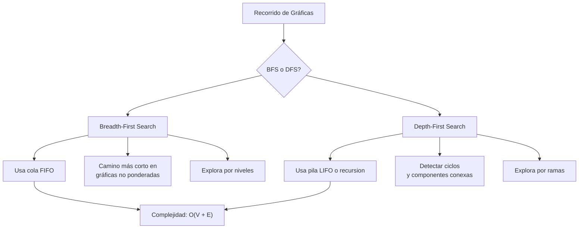
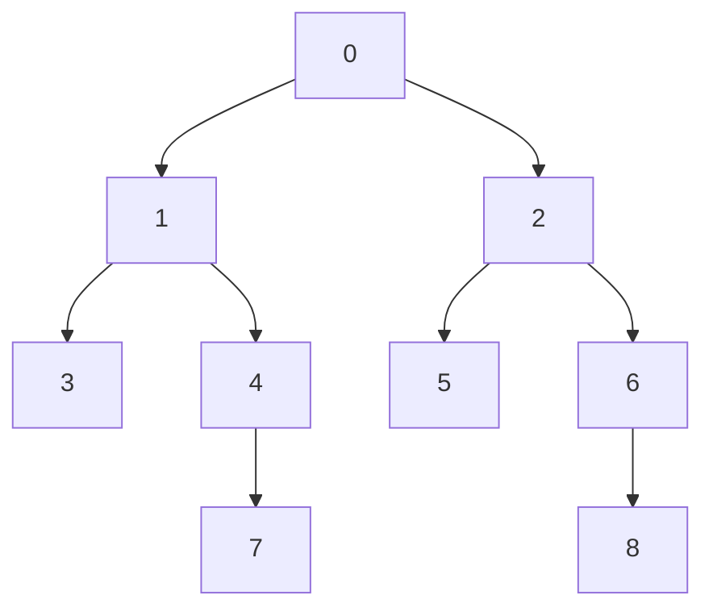

# Estructuras de Datos - Algoritmos en gráficas

## 16.2 Recorridos elementales: en amplitud (BFS) y a profundidad (DFS).

---

Los recorridos de gráficas son algoritmos fundamentales que permiten visitar todos los vértices de una gráfica de manera sistemática. Los dos métodos principales son:

- **BFS (Breadth-First Search)**: Recorrido en amplitud
- **DFS (Depth-First Search)**: Recorrido en profundidad

### Breadth-First Search (BFS)

#### Definición

BFS explora todos los vértices a una distancia $k$ del vértice origen antes de moverse a vértices a distancia $k+1$. Utiliza una cola (FIFO) para gestionar el orden de visita.

#### Algoritmo

1. Marcar todos los vértices como no visitados
2. Seleccionar un vértice origen $s$ y marcarlo como visitado
3. Encolar $s$
4. Mientras la cola no esté vacía:
   - Desencolar un vértice $v$
   - Procesar $v$
   - Encolar todos los vecinos no visitados de $v$ y marcarlos como visitados

#### Implementación

```python
from collections import deque

def bfs(grafica, inicio):
    # Inicializar estructuras
    visitado = [False] * len(grafica)
    distancia = [-1] * len(grafica)  # Distancia desde el origen
    padre = [-1] * len(grafica)      # Padre en el árbol BFS

    # Configurar vértice inicial
    visitado[inicio] = True
    distancia[inicio] = 0
    cola = deque([inicio])

    while cola:
        vertice_actual = cola.popleft()
        print(f"Visitando vértice: {vertice_actual}")

        # Explorar vecinos
        for vecino in grafica[vertice_actual]:
            if not visitado[vecino]:
                visitado[vecino] = True
                distancia[vecino] = distancia[vertice_actual] + 1
                padre[vecino] = vertice_actual
                cola.append(vecino)

    return distancia, padre
```

#### Complejidad

- **Tiempo**: $O(|V| + |E|)$ donde $|V|$ es el número de vértices y $|E|$ el número de aristas
- **Espacio**: $O(|V|)$ para almacenar las estructuras de datos

#### Aplicaciones

- Encontrar el camino más corto en gráficas no ponderadas
- Probar si una gráfica es bipartita
- Encontrar componentes conexas

### Depth-First Search (DFS)

#### Definición

DFS explora tan lejos como sea posible a lo largo de cada rama antes de retroceder. Utiliza una pila (LIFO) o recursión para gestionar el orden de visita.

#### Algoritmo

1. Marcar todos los vértices como no visitados
2. Seleccionar un vértice origen $s$
3. Para cada vértice $v$ no visitado, llamar a $\text{DFS-VISIT}(v)$

$\text{DFS-VISIT}(v)$:

1. Marcar $v$ como visitado
2. Procesar $v$
3. Para cada vecino $u$ de $v$:
   - Si $u$ no está visitado, llamar a $\text{DFS-VISIT}(u)$

#### Implementación Iterativa

```python
def dfs_iterativo(grafica, inicio):
    visitado = [False] * len(grafica)
    pila = [inicio]

    while pila:
        vertice_actual = pila.pop()

        if not visitado[vertice_actual]:
            visitado[vertice_actual] = True
            print(f"Visitando vértice: {vertice_actual}")

            # Agregar vecinos en orden inverso para procesar en orden natural
            for vecino in reversed(grafica[vertice_actual]):
                if not visitado[vecino]:
                    pila.append(vecino)
```

#### Implementación Recursiva

```python
def dfs_recursivo(grafica, inicio, visitado=None):
    if visitado is None:
        visitado = [False] * len(grafica)

    visitado[inicio] = True
    print(f"Visitando vértice: {inicio}")

    for vecino in grafica[inicio]:
        if not visitado[vecino]:
            dfs_recursivo(grafica, vecino, visitado)
```

#### DFS con Marcas de Tiempo

```python
def dfs_completo(grafica):
    tiempo = 0
    visitado = [False] * len(grafica)
    tiempo_descubrimiento = [-1] * len(grafica)
    tiempo_finalizacion = [-1] * len(grafica)
    padre = [-1] * len(grafica)

    def dfs_visit(v):
        nonlocal tiempo
        tiempo += 1
        tiempo_descubrimiento[v] = tiempo
        visitado[v] = True
        print(f"Descubierto vértice {v} en tiempo {tiempo}")

        for u in grafica[v]:
            if not visitado[u]:
                padre[u] = v
                dfs_visit(u)

        tiempo += 1
        tiempo_finalizacion[v] = tiempo
        print(f"Finalizado vértice {v} en tiempo {tiempo}")

    for v in range(len(grafica)):
        if not visitado[v]:
            dfs_visit(v)

    return tiempo_descubrimiento, tiempo_finalizacion, padre
```

#### Complejidad

- **Tiempo**: $O(|V| + |E|)$
- **Espacio**: $O(|V|)$ (para la pila de recursión en el peor caso)

#### Aplicaciones

- Detectar ciclos en gráficas
- Ordenamiento topológico
- Encontrar componentes fuertemente conexas
- Resolver laberintos y problemas de backtracking

### Comparación BFS vs DFS



### Ejemplo Práctico

Consideremos la siguiente gráfica no dirigida:

```python
# Representación por lista de adyacencia
grafica = [
    [1, 2],     # Vértice 0
    [0, 3, 4],   # Vértice 1
    [0, 5, 6],   # Vértice 2
    [1],         # Vértice 3
    [1, 7],      # Vértice 4
    [2],         # Vértice 5
    [2, 8],      # Vértice 6
    [4],         # Vértice 7
    [6]          # Vértice 8
]

# Ejecutar BFS desde el vértice 0
print("BFS desde vértice 0:")
distancias, padres = bfs(grafica, 0)

# Ejecutar DFS desde el vértice 0
print("\nDFS iterativo desde vértice 0:")
dfs_iterativo(grafica, 0)

print("\nDFS recursivo desde vértice 0:")
dfs_recursivo(grafica, 0)
```

#### Visualización del Recorrido



**Leyenda**:

- Rojo: Nivel 0 (origen)
- Verde: Nivel 1
- Azul: Nivel 2
- Rosa: Nivel 3

### Propiedades de los Recorridos

#### Propiedades de BFS

- Encuentra el camino más corto en términos de número de aristas
- Crea un árbol de expansión con la mínima profundidad
- Los vértices se visitan en orden creciente de distancia

#### Propiedades de DFS

- Puede encontrar ciclos fácilmente
- Útil para problemas de backtracking
- Puede implementarse de forma recursiva o iterativa
- Los tiempos de descubrimiento y finalización tienen propiedades importantes

### Algoritmos Derivados

#### BFS para Componentes Conexas

```python
def componentes_conexas_bfs(grafica):
    visitado = [False] * len(grafica)
    componentes = []

    for v in range(len(grafica)):
        if not visitado[v]:
            componente_actual = []
            cola = deque([v])
            visitado[v] = True

            while cola:
                actual = cola.popleft()
                componente_actual.append(actual)

                for vecino in grafica[actual]:
                    if not visitado[vecino]:
                        visitado[vecino] = True
                        cola.append(vecino)

            componentes.append(componente_actual)

    return componentes
```

#### DFS para Detección de Ciclos

```python
def tiene_ciclos_dfs(grafica):
    visitado = [False] * len(grafica)

    def dfs_ciclo(v, padre):
        visitado[v] = True

        for u in grafica[v]:
            if not visitado[u]:
                if dfs_ciclo(u, v):
                    return True
            elif u != padre:  # Encontró un vértice visitado que no es el padre
                return True

        return False

    for v in range(len(grafica)):
        if not visitado[v]:
            if dfs_ciclo(v, -1):
                return True

    return False
```

### Consideraciones de Implementación

1. **Representación de la gráfica**: Ambos algoritmos funcionan con matriz de adyacencia o lista de adyacencia
2. **Gráficas dirigidas vs no dirigidas**: Los algoritmos se aplican a ambos tipos
3. **Gráficas desconectadas**: Es necesario iterar sobre todos los vértices
4. **Espacio adicional**: BFS requiere una cola, DFS requiere una pila o stack de recursión

### Conclusión

BFS y DFS son algoritmos fundamentales con aplicaciones diversas:

- **BFS** es ideal para encontrar caminos mínimos y por niveles
- **DFS** es mejor para exploración exhaustiva y detección de ciclos

La elección entre ellos depende del problema específico y las propiedades de la gráfica que se esté analizando.
