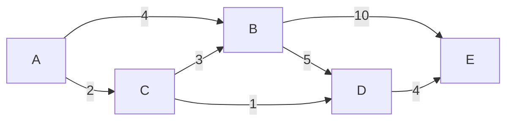
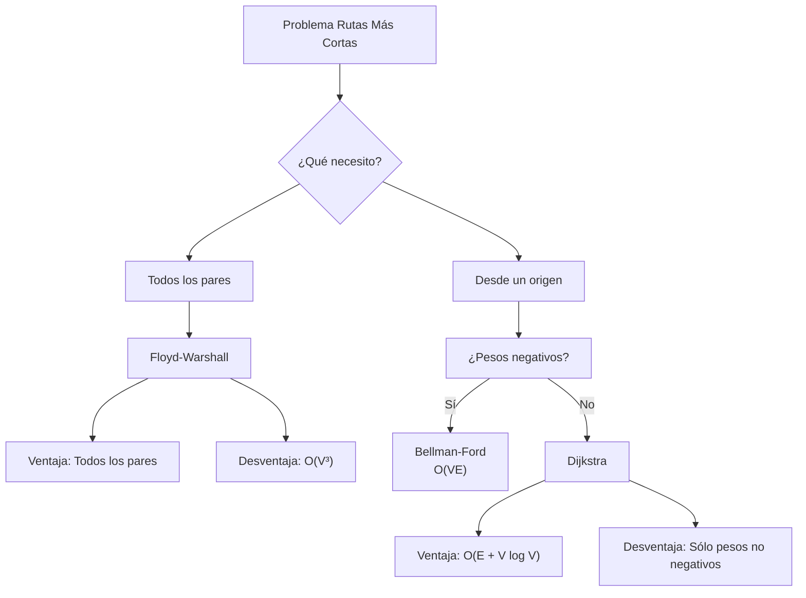

# Estructuras de Datos - Algoritmos en gráficas

## 16.3 Rutas más cortas: algoritmo de Dijkstra y Floyd.

---

### Introducción a las Rutas Más Cortas

El problema de encontrar la ruta más corta entre vértices en una gráfica ponderada es fundamental en ciencia de la computación. Dada una gráfica $G = (V, E)$ con función de peso $w: E \rightarrow \mathbb{R}$, queremos encontrar el camino de menor peso desde un vértice origen a todos los demás vértices.

### Algoritmo de Dijkstra

#### Definición

El algoritmo de Dijkstra encuentra las rutas más cortas desde un vértice origen a todos los demás vértices en una gráfica con pesos **no negativos**. Utiliza una estrategia voraz (greedy) que expande el vértice con la distancia mínima conocida.

#### Algoritmo

1. Inicializar distancias: $distancia[s] = 0$, $distancia[v] = \infty$ para $v \neq s$
2. Crear un conjunto de vértices no visitados $Q$
3. Mientras $Q$ no esté vacío:
   - Seleccionar $u$ con la mínima $distancia[u]$ en $Q$
   - Remover $u$ de $Q$
   - Para cada vecino $v$ de $u$:
     - $nueva\_distancia = distancia[u] + w(u, v)$
     - Si $nueva\_distancia < distancia[v]$:
       - $distancia[v] = nueva\_distancia$
       - $predecesor[v] = u$

#### Implementación con Cola de Prioridad

```python
import heapq

def dijkstra(grafica, pesos, inicio):
    n = len(grafica)
    distancia = [float('inf')] * n
    predecesor = [-1] * n
    visitado = [False] * n

    distancia[inicio] = 0
    # Cola de prioridad: (distancia, vértice)
    cola = [(0, inicio)]

    while cola:
        dist_actual, vertice_actual = heapq.heappop(cola)

        if visitado[vertice_actual]:
            continue

        visitado[vertice_actual] = True

        for vecino in grafica[vertice_actual]:
            peso = pesos[(vertice_actual, vecino)]
            nueva_distancia = dist_actual + peso

            if nueva_distancia < distancia[vecino]:
                distancia[vecino] = nueva_distancia
                predecesor[vecino] = vertice_actual
                heapq.heappush(cola, (nueva_distancia, vecino))

    return distancia, predecesor
```

#### Complejidad

- Con cola de prioridad (heap binario): $O((|V| + |E|) \log |V|)$
- Con arreglo simple: $O(|V|^2)$
- Con heap de Fibonacci: $O(|E| + |V| \log |V|)$

#### Ejemplo



**Desde A**:

- A → B: 4
- A → C: 2
- A → C → B: 2 + 3 = 5
- A → C → D: 2 + 1 = 3
- A → C → D → E: 2 + 1 + 4 = 7

### Algoritmo de Floyd-Warshall

#### Definición

El algoritmo de Floyd-Warshall encuentra las rutas más cortas entre **todos los pares** de vértices. Funciona con pesos negativos (pero sin ciclos negativos) y utiliza programación dinámica.

#### Formulación

Sea $d_{ij}^{(k)}$ la distancia más corta de $i$ a $j$ usando sólo vértices intermedios del conjunto $\{1, 2, ..., k\}$.

$$ d_{ij}^{(k)} = \begin{cases} w(i, j) & \text{si } k = 0 \\\ \min(d_{ij}^{(k-1)}, d_{ik}^{(k-1)} + d_{kj}^{(k-1)}) & \text{si } k \geq 1 \end{cases} $$

#### Algoritmo

1. Inicializar matriz de distancias $D$ con $D[i][j] = w(i, j)$
2. Inicializar matriz de predecesores $P$
3. Para $k$ desde 0 hasta $n-1$:
   - Para $i$ desde 0 hasta $n-1$:
     - Para $j$ desde 0 hasta $n-1$:
       - Si $D[i][j] > D[i][k] + D[k][j]$:
         - $D[i][j] = D[i][k] + D[k][j]$
         - $P[i][j] = P[k][j]$

#### Implementación

```python
def floyd_warshall(grafica, pesos):
    n = len(grafica)

    # Inicializar matriz de distancias
    dist = [[float('inf')] * n for _ in range(n)]
    # Matriz de predecesores
    pred = [[-1] * n for _ in range(n)]

    # Inicialización
    for i in range(n):
        dist[i][i] = 0
        for j in grafica[i]:
            dist[i][j] = pesos[(i, j)]
            pred[i][j] = i

    # Algoritmo principal
    for k in range(n):
        for i in range(n):
            if dist[i][k] == float('inf'):
                continue
            for j in range(n):
                if dist[i][j] > dist[i][k] + dist[k][j]:
                    dist[i][j] = dist[i][k] + dist[k][j]
                    pred[i][j] = pred[k][j]

    return dist, pred
```

#### Complejidad

- **Tiempo**: $O(|V|^3)$
- **Espacio**: $O(|V|^2)$

#### Detección de Ciclos Negativos

```python
def detectar_ciclos_negativos_floyd(dist):
    n = len(dist)
    for i in range(n):
        if dist[i][i] < 0:
            return True
    return False
```

### Comparación de Algoritmos



### Ejemplo Práctico

#### Grafica de Ejemplo

```python
# Grafica dirigida con pesos
grafica = {
    0: [1, 2],
    1: [2, 3],
    2: [1, 3, 4],
    3: [4],
    4: [0, 3]
}

pesos = {
    (0, 1): 3, (0, 2): 8,
    (1, 2): 1, (1, 3): 4,
    (2, 1): 2, (2, 3): 5, (2, 4): 2,
    (3, 4): 6,
    (4, 0): 2, (4, 3): 1
}

# Ejecutar Dijkstra desde el vértice 0
print("Dijkstra desde vértice 0:")
distancias_dijkstra, predecesores_dijkstra = dijkstra(grafica, pesos, 0)
print("Distancias:", distancias_dijkstra)
print("Predecesores:", predecesores_dijkstra)

# Ejecutar Floyd-Warshall
print("\nFloyd-Warshall:")
distancias_floyd, predecesores_floyd = floyd_warshall(grafica, pesos)
print("Matriz de distancias:")
for fila in distancias_floyd:
    print(fila)
```

#### Reconstrucción de Caminos

```python
def reconstruir_camino(pred, inicio, fin):
    camino = []
    actual = fin
    while actual != inicio:
        camino.append(actual)
        actual = pred[actual]
        if actual == -1:  # No hay camino
            return None
    camino.append(inicio)
    camino.reverse()
    return camino

# Reconstruir camino de 0 a 4 usando Dijkstra
camino_0_a_4 = reconstruir_camino(predecesores_dijkstra, 0, 4)
print(f"Camino de 0 a 4: {camino_0_a_4}")
```

### Aplicaciones

#### Dijkstra

- Sistemas de navegación y mapas
- Redes de telecomunicaciones
- Planificación de rutas en logística

#### Floyd-Warshall

- Cierre transitivo de gráficas
- Análisis de redes sociales (distancias entre usuarios)
- Sistemas de recomendación
- Análisis de redes de transporte

### Limitaciones y Consideraciones

#### Dijkstra

- No funciona con pesos negativos
- Puede ser ineficiente para gráficas muy grandes

#### Floyd-Warshall

- Complejidad cúbica lo hace prohibitivo para gráficas grandes
- Consume mucha memoria $(O(|V|^2))$

### Optimizaciones

#### Dijkstra con Heap de Fibonacci

```python
# Implementación conceptual con heap de Fibonacci
def dijkstra_fibonacci_heap(grafica, pesos, inicio):
    # En la práctica, se usaría una librería especializada
    # La implementación real es más compleja
    n = len(grafica)
    dist = [float('inf')] * n
    dist[inicio] = 0

    # Heap de Fibonacci (implementación simplificada)
    heap = FibonacciHeap()
    nodos_heap = [None] * n

    for i in range(n):
        if i == inicio:
            nodos_heap[i] = heap.insert(0, i)
        else:
            nodos_heap[i] = heap.insert(float('inf'), i)

    while not heap.is_empty():
        u = heap.extract_min().value
        for v in grafica[u]:
            nueva_dist = dist[u] + pesos[(u, v)]
            if nueva_dist < dist[v]:
                dist[v] = nueva_dist
                heap.decrease_key(nodos_heap[v], nueva_dist)

    return dist
```

### Conclusión

- **Dijkstra**: Ideal para rutas desde un origen con pesos no negativos
- **Floyd-Warshall**: Útil para todos los pares de vértices, incluso con pesos negativos (sin ciclos negativos)

La elección del algoritmo depende del problema específico, el tamaño de la gráfica y las características de los pesos de las aristas.
