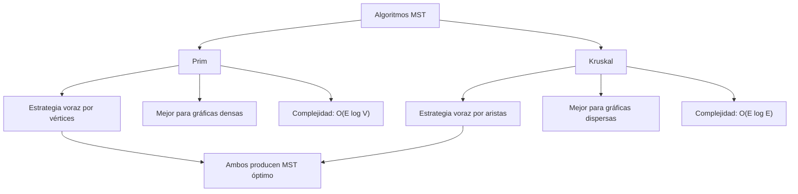
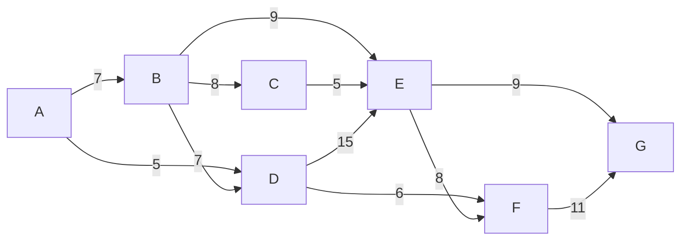

# Estructuras de Datos - Algoritmos en gráficas

## 16.4 Árbol generador de peso mínimo, algoritmos de Prim y Kruskal.

---

### Introducción al Árbol Generador de Peso Mínimo

Un **Árbol Generador de Peso Mínimo** (Minimum Spanning Tree - MST) de una gráfica conexa no dirigida con pesos es un subconjunto de aristas que conecta todos los vértices sin ciclos y con el peso total mínimo.

Formalmente, dado $G = (V, E)$ con función de peso $w: E \rightarrow \mathbb{R}$, un MST es un árbol $T = (V, E')$ donde $E' \subseteq E$ y el peso total $w(T) = \sum_{e \in E'} w(e)$ es minimizado.

### Propiedades del MST

#### Propiedad del Ciclo

Para cualquier ciclo $C$ en $G$, si $e$ es una arista de máximo peso en $C$, entonces $e$ no pertenece a ningún MST de $G$.

#### Propiedad de Corte

Para cualquier corte $(S, V-S)$ de $G$, si $e$ es una arista de mínimo peso que cruza el corte, entonces $e$ pertenece a algún MST de $G$.

### Algoritmo de Prim

#### Definición

El algoritmo de Prim construye el MST agregando vértices uno por uno, comenzando desde un vértice arbitrario. En cada paso, agrega la arista de peso mínimo que conecta un vértice en el MST con un vértice fuera del MST.

#### Algoritmo

1. Inicializar un árbol con un vértice arbitrario
2. Crear un conjunto de vértices incluidos en el MST
3. Mientras haya vértices fuera del MST:
   - Encontrar la arista de peso mínimo que conecte un vértice en el MST con uno fuera
   - Agregar esta arista y el vértice al MST

#### Implementación con Cola de Prioridad

```python
import heapq

def prim(grafica, pesos, inicio):
    n = len(grafica)
    mst = []  # Almacena las aristas del MST
    visitado = [False] * n
    # Cola de prioridad: (peso, vértice_actual, vértice_predecesor)
    cola = [(0, inicio, -1)]

    while cola:
        peso, vertice_actual, predecesor = heapq.heappop(cola)

        if visitado[vertice_actual]:
            continue

        visitado[vertice_actual] = True

        if predecesor != -1:  # No es el vértice inicial
            mst.append((predecesor, vertice_actual, peso))

        for vecino in grafica[vertice_actual]:
            if not visitado[vecino]:
                peso_arista = pesos[(vertice_actual, vecino)]
                heapq.heappush(cola, (peso_arista, vecino, vertice_actual))

    return mst
```

#### Complejidad

- Con heap binario: $O(|E| \log |V|)$
- Con heap de Fibonacci: $O(|E| + |V| \log |V|)$

### Algoritmo de Kruskal

#### Definición

El algoritmo de Kruskal construye el MST agregando aristas en orden creciente de peso, evitando la formación de ciclos. Utiliza la estructura de datos Union-Find para verificar conectividad.

#### Algoritmo

1. Ordenar todas las aristas por peso no decreciente
2. Inicializar un bosque donde cada vértice es un árbol separado
3. Para cada arista en orden ascendente de peso:
   - Si conecta dos árboles diferentes, agregarla al MST
   - Unir los dos árboles

#### Implementación con Union-Find

```python
class UnionFind:
    def __init__(self, n):
        self.padre = list(range(n))
        self.rango = [0] * n

    def find(self, x):
        if self.padre[x] != x:
            self.padre[x] = self.find(self.padre[x])
        return self.padre[x]

    def union(self, x, y):
        raiz_x = self.find(x)
        raiz_y = self.find(y)

        if raiz_x == raiz_y:
            return False

        if self.rango[raiz_x] < self.rango[raiz_y]:
            self.padre[raiz_x] = raiz_y
        elif self.rango[raiz_x] > self.rango[raiz_y]:
            self.padre[raiz_y] = raiz_x
        else:
            self.padre[raiz_y] = raiz_x
            self.rango[raiz_x] += 1

        return True

def kruskal(grafica, pesos):
    n = len(grafica)
    mst = []
    uf = UnionFind(n)

    # Crear lista de aristas con pesos
    aristas = []
    for u in range(n):
        for v in grafica[u]:
            if u < v:  # Evitar duplicados en gráficas no dirigidas
                aristas.append((pesos[(u, v)], u, v))

    # Ordenar aristas por peso
    aristas.sort()

    for peso, u, v in aristas:
        if uf.union(u, v):
            mst.append((u, v, peso))
            if len(mst) == n - 1:  # MST completo
                break

    return mst
```

#### Complejidad

- Ordenamiento: $O(|E| \log |E|)$
- Operaciones Union-Find: $O(|E| \alpha(|V|))$ donde $\alpha$ es la función inversa de Ackermann
- Total: $O(|E| \log |E|) = O(|E| \log |V|)$ ( puesto que $|E| \leq |V|^2$ )

### Comparación de Algoritmos



### Ejemplo Práctico

#### Gráfica de Ejemplo



#### Implementación de la Gráfica

```python
# Gráfica no dirigida con pesos
grafica = {
    0: [1, 3],    # A: B, D
    1: [0, 2, 3, 4],  # B: A, C, D, E
    2: [1, 4],    # C: B, E
    3: [0, 1, 4, 5],  # D: A, B, E, F
    4: [1, 2, 3, 5, 6],  # E: B, C, D, F, G
    5: [3, 4, 6],  # F: D, E, G
    6: [4, 5]     # G: E, F
}

pesos = {
    (0, 1): 7, (1, 0): 7,
    (0, 3): 5, (3, 0): 5,
    (1, 2): 8, (2, 1): 8,
    (1, 3): 7, (3, 1): 7,
    (1, 4): 9, (4, 1): 9,
    (2, 4): 5, (4, 2): 5,
    (3, 4): 15, (4, 3): 15,
    (3, 5): 6, (5, 3): 6,
    (4, 5): 8, (5, 4): 8,
    (4, 6): 9, (6, 4): 9,
    (5, 6): 11, (6, 5): 11
}

# Ejecutar Prim desde el vértice 0 (A)
print("Prim desde vértice A (0):")
mst_prim = prim(grafica, pesos, 0)
for u, v, peso in mst_prim:
    print(f"{chr(65+u)} - {chr(65+v)}: {peso}")

print("\nPeso total:", sum(peso for _, _, peso in mst_prim))

# Ejecutar Kruskal
print("\nKruskal:")
mst_kruskal = kruskal(grafica, pesos)
for u, v, peso in mst_kruskal:
    print(f"{chr(65+u)} - {chr(65+v)}: {peso}")

print("\nPeso total:", sum(peso for _, _, peso in mst_kruskal))
```

#### Solución del MST

Ambos algoritmos deben encontrar el mismo MST con peso total mínimo:

- A - D: 5
- D - F: 6
- A - B: 7
- B - E: 9
- E - C: 5
- E - G: 9

**Peso total**: 5 + 6 + 7 + 9 + 5 + 9 = 41

### Aplicaciones de MST

#### Redes de Comunicación

Diseño de redes de telecomunicaciones con costo mínimo de cableado.

#### Transporte

Planificación de rutas de transporte para conectar ciudades con costo mínimo.

#### Clusterización

Agrupamiento de datos donde el MST ayuda a identificar clusters naturales.

#### Redes Eléctricas

Diseño de redes eléctricas para conectar subestaciones con costo mínimo.

### Optimizaciones y Variantes

#### Algoritmo de Prim con Heap de Fibonacci

```python
# Implementación conceptual con heap de Fibonacci
def prim_fibonacci_heap(grafica, pesos, inicio):
    n = len(grafica)
    clave = [float('inf')] * n  # Peso mínimo para conectar a cada vértice
    predecesor = [-1] * n
    en_mst = [False] * n

    clave[inicio] = 0
    # Heap de Fibonacci (implementación simplificada)
    heap = FibonacciHeap()
    nodos_heap = [None] * n

    for i in range(n):
        nodos_heap[i] = heap.insert(clave[i], i)

    while not heap.is_empty():
        u = heap.extract_min().value
        en_mst[u] = True

        for v in grafica[u]:
            peso = pesos[(u, v)]
            if not en_mst[v] and peso < clave[v]:
                clave[v] = peso
                predecesor[v] = u
                heap.decrease_key(nodos_heap[v], clave[v])

    # Construir MST
    mst = []
    for i in range(n):
        if predecesor[i] != -1:
            mst.append((predecesor[i], i, clave[i]))

    return mst
```

### Verificación de Optimalidad

#### Teorema del Corte

Para verificar que un árbol $T$ es un MST, podemos usar el teorema del corte: para cada arista $e \notin T$, $e$ es la arista más pesada en el ciclo formado al agregar $e$ a $T$.

#### Algoritmo de Verificación

```python
def es_mst(grafica, pesos, candidato_mst):
    # Verificar que es árbol (conexo y sin ciclos)
    n = len(grafica)
    if len(candidato_mst) != n - 1:
        return False

    # Verificar propiedad del ciclo
    # Crear el árbol y verificar para cada arista no incluida
    # Implementación compleja, requiere DFS/BFS para verificar ciclos
    pass
```

### Conclusión

- **Prim**: Mejor para gráficas densas, usa estrategia por vértices
- **Kruskal**: Mejor para gráficas dispersas, usa estrategia por aristas
- Ambos producen el MST óptimo con complejidad $O(|E| \log |V|)$
- La elección depende de la densidad de la gráfica y la implementación específica

Los algoritmos de MST son fundamentales en el diseño de redes y tienen aplicaciones en diversos campos de la informática y la ingeniería.
