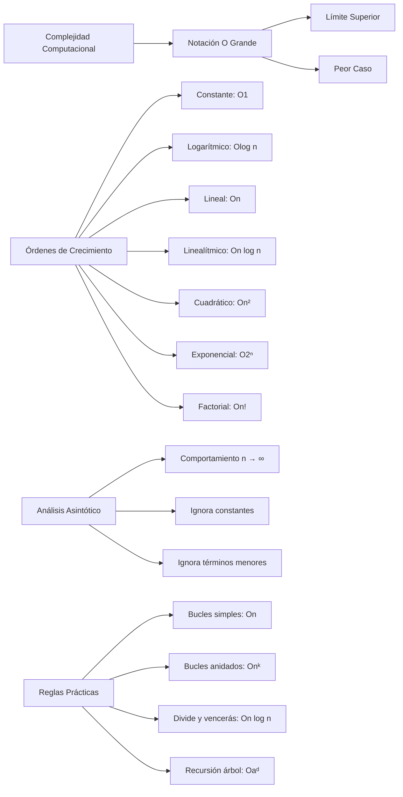

# Estructuras de Datos - Elementos de complejidad algorítmica

## 2.1 Análisis asintótico, notación O().

---

### 1. Conceptos Fundamentales

#### 1.1. Análisis Asintótico

El **análisis asintótico** estudia el comportamiento de funciones cuando el tamaño de entrada tiende a infinito. Se enfoca en la **tasa de crecimiento** de los recursos computacionales (tiempo y espacio).

#### 1.2. Notación O Grande (O())

La **notación O()** describe el límite superior del crecimiento de una función. Formalmente:

$$ f(n) = O(g(n)) \iff \exists c > 0, n_0 \in \mathbb{N} \mid 0 \leq f(n) \leq c \cdot g(n) \quad \forall n \geq n_0 $$

#### 1.3. Propiedades de la Notación O

- **Reflexividad:** $f(n) = O(f(n))$
- **Transitividad:** $f(n) = O(g(n))$ y $g(n) = O(h(n)) \Rightarrow f(n) = O(h(n))$
- **Producto:** $O(f(n)) \cdot O(g(n)) = O(f(n) \cdot g(n))$
- **Suma:** $O(f(n)) + O(g(n)) = O(\max(f(n), g(n)))$

### 2. Clases de Complejidad Comunes

#### 2.1. Órdenes de Crecimiento Principales

1. **Constante:** $O(1)$ - Tiempo independiente del input
2. **Logarítmico:** $O(\log n)$ - División del problema
3. **Lineal:** $O(n)$ - Procesamiento secuencial
4. **Linealítmico:** $O(n \log n)$ - Algoritmos de divide y vencerás
5. **Cuadrático:** $O(n^2)$ - Bucles anidados
6. **Exponencial:** $O(2^n)$ - Problemas NP-completos
7. **Factorial:** $O(n!)$ - Permutaciones

#### 2.2. Comparación Visual de Crecimientos

$$ \begin{align*} O(1) &< O(\log n) < O(n) < O(n \log n) < \\\ O(n^2) &< O(n^3) < O(2^n) < O(n!) \end{align*} $$

### 3. Implementación y Análisis de Algoritmos

```python
import time
import math
import matplotlib.pyplot as plt
import numpy as np
from typing import Callable, List

class AnalisisComplejidad:
    """Clase para demostrar análisis de complejidad"""

    # ===== ALGORITMOS CON DIFERENTES COMPLEJIDADES =====

    def constante(self, n: int) -> int:
        """O(1) - Tiempo constante"""
        return n * 0 + 1  # Siempre misma operación

    def logaritmico(self, n: int) -> int:
        """O(log n) - Búsqueda binaria"""
        contador = 0
        i = n
        while i > 1:
            i //= 2
            contador += 1
        return contador

    def lineal(self, n: int) -> int:
        """O(n) - Recorrido simple"""
        suma = 0
        for i in range(n):
            suma += i
        return suma

    def lineal_log(self, n: int) -> int:
        """O(n log n) - Merge Sort style"""
        contador = 0
        for i in range(n):      # O(n)
            j = n
            while j > 1:        # O(log n)
                j //= 2
                contador += 1
        return contador

    def cuadratico(self, n: int) -> int:
        """O(n²) - Bucles anidados"""
        contador = 0
        for i in range(n):
            for j in range(n):
                contador += i * j
        return contador

    def exponencial(self, n: int) -> int:
        """O(2ⁿ) - Fibonacci naive"""
        if n <= 1:
            return n
        return self.exponencial(n-1) + self.exponencial(n-2)

    # ===== ANÁLISIS EMPÍRICO =====

    def medir_tiempo(self, funcion: Callable, n: int) -> float:
        """Mide el tiempo de ejecución de una función"""
        inicio = time.time()
        funcion(n)
        return time.time() - inicio

    def analizar_crecimiento(self, funcion: Callable, tamanos: List[int]) -> List[float]:
        """Analiza el crecimiento para diferentes tamaños de entrada"""
        tiempos = []
        for n in tamanos:
            tiempo = self.medir_tiempo(funcion, n)
            tiempos.append(tiempo)
        return tiempos

    def graficar_complejidad(self):
        """Genera gráficas comparativas de complejidades"""
        tamanos = [10, 50, 100, 500, 1000, 2000]
        funciones = {
            'O(1)': self.constante,
            'O(log n)': self.logaritmico,
            'O(n)': self.lineal,
            'O(n log n)': self.lineal_log,
            'O(n²)': self.cuadratico
        }

        plt.figure(figsize=(12, 8))

        for nombre, funcion in funciones.items():
            tiempos = self.analizar_crecimiento(funcion, tamanos)
            plt.plot(tamanos, tiempos, 'o-', label=nombre, markersize=8)

        plt.xlabel('Tamaño de entrada (n)')
        plt.ylabel('Tiempo de ejecución (segundos)')
        plt.title('Comparación de Complejidades Asintóticas')
        plt.legend()
        plt.grid(True, alpha=0.3)
        plt.xscale('log')
        plt.yscale('log')
        plt.show()

# ===== ANÁLISIS MATEMÁTICO =====
def demostrar_notacion_o():
    """Demostración matemática de la notación O"""
    print("=== DEMOSTRACIÓN NOTACIÓN O() ===")

    # Ejemplo: f(n) = 3n² + 2n + 1 = O(n²)
    n_valores = [10, 100, 1000, 10000]

    for n in n_valores:
        f_n = 3*n**2 + 2*n + 1
        c = 4  # Constante c = 4
        g_n = c * n**2

        print(f"n = {n}:")
        print(f"  f(n) = 3n² + 2n + 1 = {f_n}")
        print(f"  c·g(n) = 4·n² = {g_n}")
        print(f"  ¿f(n) ≤ c·g(n)? {f_n <= g_n}")
        print()

# ===== EJEMPLOS PRÁCTICOS =====
def ejemplos_complejidad():
    """Ejemplos comunes de complejidad en algoritmos"""
    print("=== EJEMPLOS PRÁCTICOS ===")

    ejemplos = [
        ("Acceso a array por índice", "O(1)"),
        ("Búsqueda binaria", "O(log n)"),
        ("Recorrer array", "O(n)"),
        ("Merge Sort, Quick Sort", "O(n log n)"),
        ("Bubble Sort, Selection Sort", "O(n²)"),
        ("Fibonacci recursivo", "O(2ⁿ)"),
        ("Problema del viajante", "O(n!)")
    ]

    for algoritmo, complejidad in ejemplos:
        print(f"{algoritmo:.<30} {complejidad}")

if __name__ == "__main__":
    analizador = AnalisisComplejidad()

    # Demostraciones
    demostrar_notacion_o()
    ejemplos_complejidad()

    # Análisis empírico (descomentar para ejecutar)
    # analizador.graficar_complejidad()

    # Ejemplos de cálculo
    print("\n=== CÁLCULOS DE COMPLEJIDAD ===")
    n = 1000
    print(f"O(1) para n={n}: {analizador.constante(n)} operaciones")
    print(f"O(log n) para n={n}: {analizador.logaritmico(n)} operaciones")
    print(f"O(n) para n={n}: {analizador.lineal(n)} operaciones")
    print(f"O(n log n) para n={n}: {analizador.lineal_log(n)} operaciones")
    print(f"O(n²) para n={n}: {analizador.cuadratico(n)} operaciones")
```

### 4. Diagrama de Crecimientos Asintóticos



### 5. Reglas para el Análisis de Complejidad

#### 5.1. Reglas Básicas

1. **Instrucciones simples:** $O(1)$
2. **Bucles:** $O(n) \times \text{complejidad del cuerpo}$
3. **Bucles anidados:** Producto de complejidades
4. **Llamadas recursivas:** Depende del árbol de recursión

#### 5.2. Análisis de Bucles

```python
# O(n) - Loop simple
for i in range(n):
    operacion_constante()  # O(1)

# O(n²) - Bucles anidados
for i in range(n):         # O(n)
    for j in range(n):     # O(n)
        operacion_constante()  # O(1)

# O(n log n) - Loop con división
i = n
while i > 0:              # O(log n)
    for j in range(n):    # O(n)
        operacion_constante()
    i //= 2

```

#### 5.3. Análisis de Recursión

- Recursión simple: $O(n)$ (factorial)
- Recursión múltiple: $O(2^n)$ (Fibonacci)
- Recursión con división: $O(\log n)$ (búsqueda binaria)
- Recursión con múltiples llamadas: $O(a^d)$ (donde $a$ es el factor de ramificación y $d$ la profundidad)

### 6. Ejemplos de Análisis Detallado

#### 6.1. Ejemplo 1: Suma de Array

```python
def suma_array(arr):           # arr size = n
    total = 0                  # O(1)
    for num in arr:            # O(n)
        total += num           # O(1)
    return total               # O(1)
```

Complejidad total: $O(1) + O(n) \times O(1) + O(1) = O(n)$

#### 6.2. Ejemplo 2: Buscar Pares

```python
def encontrar_pares(arr):      # arr size = n
    pares = []                 # O(1)
    for i in range(len(arr)):  # O(n)
        for j in range(i+1, len(arr)):  # O(n)
            pares.append((arr[i], arr[j]))  # O(1)
    return pares               # O(1)
```

Complejidad total: $O(1) + O(n^2) + O(1) = O(n^2)$

#### 6.3. Ejemplo 3: Búsqueda Binaria

```python
def busqueda_binaria(arr, objetivo):  # arr size = n
    izquierda, derecha = 0, len(arr)-1  # O(1)
    while izquierda <= derecha:       # O(log n)
        medio = (izquierda + derecha) // 2  # O(1)
        if arr[medio] == objetivo:    # O(1)
            return medio
        elif arr[medio] < objetivo:   # O(1)
            izquierda = medio + 1
        else:                         # O(1)
            derecha = medio - 1
    return -1                         # O(1)
```

Complejidad total: $O(\log n)$

### 7. Ejercicios Prácticos

1. Analice la complejidad de un algoritmo de ordenamiento por inserción
2. Calcule la complejidad de una función recursiva que calcula potencias
3. Compare empíricamente $O(n^2)$ vs $O(n \log n)$ para diferentes tamaños de entrada
4. Demuestre matemáticamente que $3n^3 + 2n^2 + n = O(n^3)$
5. Implemente y analice un algoritmo con complejidad $O(n \sqrt{n})$
6. Estudie la complejidad del algoritmo de Dijkstra
7. Analice algoritmos con diferentes casos (mejor, promedio, peor)
8. Investigue la notación Ω (omega) y Θ (theta)

### 8. Referencias

- Cormen, T. H., et al. (2009). Introduction to Algorithms
- Knuth, D. E. (1997). The Art of Computer Programming
- Sedgewick, R., & Wayne, K. (2011). Algorithms
- Kleinberg, J., & Tardos, É. (2006). Algorithm Design
- Dasgupta, S., Papadimitriou, C., & Vazirani, U. (2008). Algorithms
