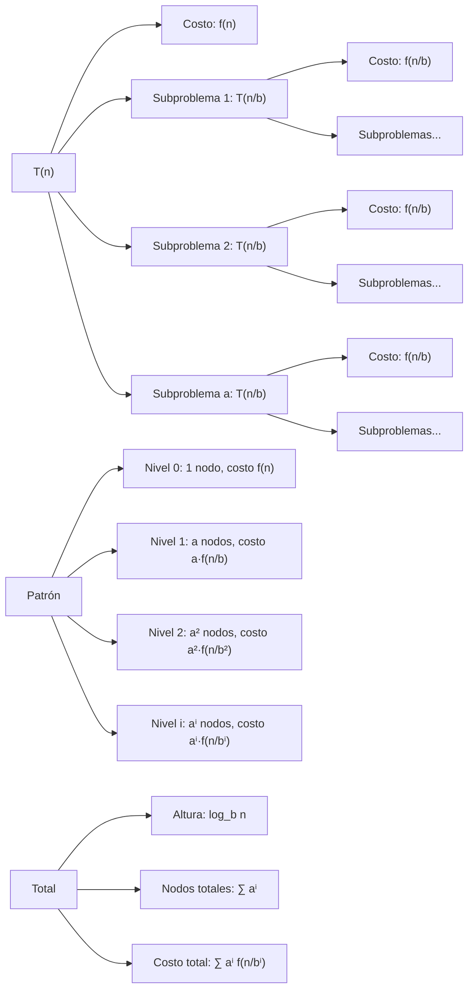

# Estructuras de Datos - Elementos de complejidad algorítmica

## 2.2 Recurrencias.

---

# Guía de Estudio: Recurrencias en Análisis de Algoritmos

### 1. Definición de Recurrencias

#### 1.1. Concepto Fundamental

Una **recurrencia** es una ecuación o desigualdad que describe una función en términos de sus valores con entradas más pequeñas. Se utilizan para analizar algoritmos recursivos.

**Forma general:**

$$T(n) = a \cdot T\left(\frac{n}{b}\right) + f(n)$$

donde:

- $a \geq 1$: número de subproblemas
- $b > 1$: factor de división
- $f(n)$: costo de combinar resultados

#### 1.2. Tipos de Recurrencias

1. **Lineales homogéneas:** $T(n) = aT(n-1) + bT(n-2)$
2. **No homogéneas:** $T(n) = aT(n-1) + f(n)$
3. **Divide y vencerás:** $T(n) = aT(n/b) + f(n)$

### 2. Métodos de Resolución

#### 2.1. Método de Sustitución

1. Adivinar la forma de la solución
2. Verificar por inducción matemática
3. Resolver constantes

#### 2.2. Método del Árbol de Recursión

- Visualizar la expansión de la recurrencia
- Sumar costos en cada nivel
- Calcular altura y número de nodos

#### 2.3. Teorema Maestro

Para recurrencias de la forma:

$$ T(n) = aT\left(\frac{n}{b}\right) + f(n) $$

**Casos:**

1. Si $f(n) = O(n^{\log_b a - \epsilon})$: $T(n) = \Theta(n^{\log_b a})$
2. Si $f(n) = \Theta(n^{\log_b a})$: $T(n) = \Theta(n^{\log_b a} \log n)$
3. Si $f(n) = \Omega(n^{\log_b a + \epsilon})$: $T(n) = \Theta(f(n))$

### 3. Implementación Computacional

```python
import math
import matplotlib.pyplot as plt
from typing import Callable, Dict, List

class AnalisisRecurrencias:
    """Clase para analizar y resolver recurrencias"""

    # ===== MÉTODO DEL ÁRBOL DE RECURSIÓN =====
    def arbol_recursion(self, a: int, b: int, f: Callable, n: int, nivel: int = 0) -> Dict:
        """Simula la expansión de un árbol de recursión"""
        if n <= 1:
            return {
                'costo': f(1),
                'nodos': 1,
                'nivel': nivel
            }

        # Nodo actual
        costo_actual = f(n)
        subproblemas = []

        # Expandir subproblemas
        for i in range(a):
            subproblema = self.arbol_recursion(a, b, f, n // b, nivel + 1)
            subproblemas.append(subproblema)

        # Calcular totales
        total_nodos = 1 + sum(sp['nodos'] for sp in subproblemas)
        total_costo = costo_actual + sum(sp['costo'] for sp in subproblemas)

        return {
            'costo': total_costo,
            'nodos': total_nodos,
            'nivel': nivel,
            'subproblemas': subproblemas
        }

    # ===== MÉTODO DE SUSTITUCIÓN =====
    def resolver_sustitucion(self, T: Callable, n: int, suposicion: Callable) -> bool:
        """Intenta verificar una suposición por sustitución"""
        try:
            # Calcular valor real
            valor_real = T(n)

            # Calcular valor supuesto
            valor_supuesto = suposicion(n)

            # Verificar relación
            return abs(valor_real - valor_supuesto) / valor_real < 0.1  # 10% de tolerancia

        except RecursionError:
            return False

    # ===== TEOREMA MAESTRO =====
    def teorema_maestro(self, a: int, b: int, f: Callable, n: int) -> str:
        """Aplica el teorema maestro para predecir complejidad"""
        log_ba = math.log(a, b)
        f_n = f(n)

        # Caso 1: f(n) = O(n^{log_b a - ε})
        if f_n < n**log_ba:
            return f"Θ(n^{log_ba})"

        # Caso 2: f(n) = Θ(n^{log_b a})
        elif abs(f_n - n**log_ba) / n**log_ba < 0.1:
            return f"Θ(n^{log_ba} log n)"

        # Caso 3: f(n) = Ω(n^{log_b a + ε})
        else:
            return f"Θ({f_n})"

    # ===== FUNCIONES DE COSTO COMUNES =====
    @staticmethod
    def costo_constante(n: int) -> int:
        return 1

    @staticmethod
    def costo_lineal(n: int) -> int:
        return n

    @staticmethod
    def costo_cuadratico(n: int) -> int:
        return n * n

# ===== EJEMPLOS DE RECURRENCIAS COMUNES =====
def recurrencia_fibonacci(n: int) -> int:
    """T(n) = T(n-1) + T(n-2) + O(1)"""
    if n <= 1:
        return n
    return recurrencia_fibonacci(n-1) + recurrencia_fibonacci(n-2)

def recurrencia_busqueda_binaria(n: int) -> int:
    """T(n) = T(n/2) + O(1)"""
    if n <= 1:
        return 1
    return recurrencia_busqueda_binaria(n//2) + 1

def recurrencia_merge_sort(n: int) -> int:
    """T(n) = 2T(n/2) + O(n)"""
    if n <= 1:
        return 0
    return recurrencia_merge_sort(n//2) + recurrencia_merge_sort(n//2) + n

def recurrencia_quick_sort_promedio(n: int) -> int:
    """T(n) = 2T(n/2) + O(n)"""
    if n <= 1:
        return 0
    return 2 * recurrencia_quick_sort_promedio(n//2) + n

# ===== VISUALIZACIÓN =====
def visualizar_arbol_recursion():
    """Genera visualización de árbol de recursión"""
    analizador = AnalisisRecurrencias()

    # Ejemplo: Merge Sort T(n) = 2T(n/2) + n
    resultado = analizador.arbol_recursion(a=2, b=2, f=analizador.costo_lineal, n=8)

    print("=== ÁRBOL DE RECURSIÓN - MERGE SORT ===")
    print(f"Total nodos: {resultado['nodos']}")
    print(f"Costo total: {resultado['costo']}")
    print(f"Altura máxima: {resultado['nivel']}")

def demostrar_teorema_maestro():
    """Demuestra la aplicación del teorema maestro"""
    analizador = AnalisisRecurrencias()

    ejemplos = [
        (2, 2, analizador.costo_lineal),    # Merge Sort: Θ(n log n)
        (1, 2, analizador.costo_constante), # Búsqueda binaria: Θ(log n)
        (3, 2, analizador.costo_lineal),    # Θ(n^{log_2 3}) ≈ Θ(n^1.585)
        (4, 2, analizador.costo_cuadratico) # Θ(n²)
    ]

    print("=== TEOREMA MAESTRO ===")
    for a, b, f in ejemplos:
        complejidad = analizador.teorema_maestro(a, b, f, 1000)
        print(f"T(n) = {a}T(n/{b}) + f(n) → {complejidad}")

if __name__ == "__main__":
    visualizar_arbol_recursion()
    demostrar_teorema_maestro()

    # Análisis de recurrencias comunes
    print("\n=== ANÁLISIS DE RECURRENCIAS ===")
    print(f"Fibonacci T(10) = {recurrencia_fibonacci(10)}")
    print(f"Búsqueda binaria T(100) = {recurrencia_busqueda_binaria(100)}")
    print(f"Merge Sort T(16) = {recurrencia_merge_sort(16)}")
```

### 4. Diagrama de Árbol de Recursión



### 5. Método de Sustitución Detallado

#### 5.1. Ejemplo: $T(n) = 2T(n/2) + n$

**Paso 1: Suposición**
Supongamos $T(n) = O(n \log n)$

**Paso 2: Hipótesis Inductiva**
Asumimos $T(k) \leq c k \log k$ para $k < n$

**Paso 3: Demostración**
$$ \begin{align*} T(n) &= 2T(n/2) + n \\\ &\leq 2c(n/2) \log(n/2) + n \\\ &= cn \log(n/2) + n \\\ &= cn \log n - cn \log 2 + n \\\ &= cn \log n - cn + n \\\ &\leq cn \log n \quad \text{para } c \geq 1 \end{align*} $$

#### 5.2. Ejemplo: $T(n) = T(n-1) + n$

**Solución:**
$$ \begin{align*} T(n) &= T(n-1) + n \\\ &= T(n-2) + (n-1) + n \\\ &= T(n-3) + (n-2) + (n-1) + n \\\ &\vdots \\\ &= T(0) + 1 + 2 + \cdots + n \\\ &= \frac{n(n+1)}{2} = O(n^2) \end{align*} $$

### 6. Casos Especiales y Transformaciones

#### 6.1. Recurrencias Lineales

Para $T(n) = aT(n-1) + bT(n-2)$:

- Ecuación característica: $r^2 - ar - b = 0$
- Solución: $T(n) = \alpha r_1^n + \beta r_2^n$

#### 6.2. Cambio de Variable

Para $T(n) = T(\sqrt{n}) + 1$:

- Hacer $n = 2^m$
- $T(2^m) = T(2^{m/2}) + 1$
- Hacer $S(m) = T(2^m)$
- $S(m) = S(m/2) + 1 = O(\log m)$
- $T(n) = O(\log \log n)$

#### 6.3. Recurrencias No Uniformes

$$T(n) = T(n/2) + T(n/4) + n$$
Requieren métodos avanzados como:

- Árbol de recursión extendido
- Método de Akra-Bazzi
- Análisis de amortización

### 7. Ejercicios Prácticos

1. Resuelva $T(n) = 3T(n/2) + n^2$ usando el teorema maestro
2. Demuestre por sustitución que $T(n) = 4T(n/2) + n = \Theta(n^2)$
3. Dibuje el árbol de recursión para $T(n) = T(n-1) + T(n-2) + n$
4. Resuelva $T(n) = T(\sqrt{n}) + 1$ usando cambio de variable
5. Analice la recurrencia del algoritmo de Strassen: $T(n) = 7T(n/2) + \Theta(n^2)$
6. Encuentre una cota superior para $T(n) = T(n-1) + T(n-2) + 1$
7. Resuelva $T(n) = 2T(n/4) + \sqrt{n}$ usando todos los métodos
8. Investigue el método de funciones generadoras para recurrencias

### 8. Referencias

- Cormen, T. H., et al. (2009). _Introduction to Algorithms_
- Knuth, D. E. (1997). _The Art of Computer Programming_
- Sedgewick, R., & Flajolet, P. (2013). _An Introduction to the Analysis of Algorithms_
- Graham, R. L., Knuth, D. E., & Patashnik, O. (1994). _Concrete Mathematics_
- Akra, M., & Bazzi, L. (1998). _On the solution of linear recurrence equations_
