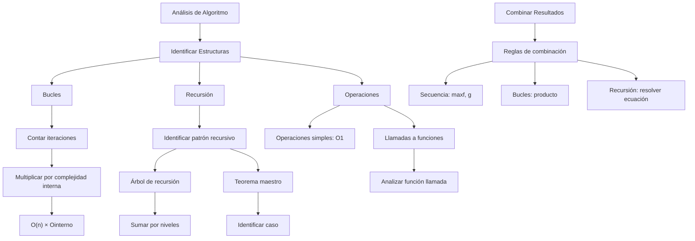

# Estructuras de Datos - Elementos de complejidad algorítmica

## 2.3 Ejemplos de cálculo de complejidad.

---

### 1. Fundamentos de Cálculo de Complejidad

#### 1.1. Reglas Básicas

El cálculo de complejidad sigue reglas específicas para combinar operaciones:

1. **Secuencia:** $O(f(n)) + O(g(n)) = O(\max(f(n), g(n)))$
2. **Bucles:** $O(n) \times O(\text{cuerpo})$
3. **Bucles anidados:** $\prod O(\text{límites de bucles})$
4. **Recursión:** Analizar árbol de recursión o usar teorema maestro

#### 1.2. Notaciones Asintóticas

- **O():** Límite superior (peor caso)
- **Ω():** Límite inferior (mejor caso)
- **Θ():** Límite ajustado (caso promedio)
- **o():** Límite superior estricto
- **ω():** Límite inferior estricto

### 2. Implementación de Ejemplos de Complejidad

```python
import time
import random
import matplotlib.pyplot as plt
import numpy as np
from typing import List, Callable

class CalculadorComplejidad:
    """Clase para demostrar cálculo de complejidad con ejemplos concretos"""

    # ===== EJEMPLO 1: COMPLEJIDAD CONSTANTE O(1) =====
    def acceso_array(self, arr: List[int], index: int) -> int:
        """Acceso directo a array - O(1)"""
        return arr[index] if 0 <= index < len(arr) else -1

    # ===== EJEMPLO 2: COMPLEJIDAD LINEAL O(n) =====
    def suma_elementos(self, arr: List[int]) -> int:
        """Suma de elementos - O(n)"""
        total = 0
        for num in arr:          # O(n)
            total += num         # O(1)
        return total             # Total: O(n) * O(1) = O(n)

    # ===== EJEMPLO 3: COMPLEJIDAD CUADRÁTICA O(n²) =====
    def encontrar_pares(self, arr: List[int]) -> List[tuple]:
        """Encontrar todos los pares - O(n²)"""
        pares = []
        for i in range(len(arr)):            # O(n)
            for j in range(i + 1, len(arr)): # O(n)
                pares.append((arr[i], arr[j])) # O(1)
        return pares                         # Total: O(n) * O(n) * O(1) = O(n²)

    # ===== EJEMPLO 4: COMPLEJIDAD LOGARÍTMICA O(log n) =====
    def busqueda_binaria(self, arr: List[int], objetivo: int) -> int:
        """Búsqueda binaria - O(log n)"""
        izquierda, derecha = 0, len(arr) - 1
        while izquierda <= derecha:          # O(log n)
            medio = (izquierda + derecha) // 2
            if arr[medio] == objetivo:
                return medio
            elif arr[medio] < objetivo:
                izquierda = medio + 1
            else:
                derecha = medio - 1
        return -1

    # ===== EJEMPLO 5: COMPLEJIDAD O(n log n) =====
    def mergesort_simulado(self, arr: List[int]) -> List[int]:
        """Simulación de Merge Sort - O(n log n)"""
        if len(arr) <= 1:
            return arr

        medio = len(arr) // 2
        izquierda = self.mergesort_simulado(arr[:medio])   # T(n/2)
        derecha = self.mergesort_simulado(arr[medio:])     # T(n/2)

        # Fusionar - O(n)
        return self._fusionar(izquierda, derecha)          # Total: 2T(n/2) + O(n) = O(n log n)

    def _fusionar(self, izquierda: List[int], derecha: List[int]) -> List[int]:
        """Fusión de arrays ordenados - O(n)"""
        resultado = []
        i = j = 0
        while i < len(izquierda) and j < len(derecha):
            if izquierda[i] < derecha[j]:
                resultado.append(izquierda[i])
                i += 1
            else:
                resultado.append(derecha[j])
                j += 1
        resultado.extend(izquierda[i:])
        resultado.extend(derecha[j:])
        return resultado

    # ===== EJEMPLO 6: COMPLEJIDAD EXPONENCIAL O(2ⁿ) =====
    def fibonacci_naive(self, n: int) -> int:
        """Fibonacci recursivo naive - O(2ⁿ)"""
        if n <= 1:
            return n
        return self.fibonacci_naive(n-1) + self.fibonacci_naive(n-2)  # T(n) = T(n-1) + T(n-2) + O(1)

    # ===== ANÁLISIS EMPÍRICO =====
    def medir_tiempo(self, funcion: Callable, *args) -> float:
        """Mide el tiempo de ejecución de una función"""
        inicio = time.time()
        funcion(*args)
        return time.time() - inicio

    def analizar_crecimiento(self, funcion: Callable, generador_datos: Callable,
                           tamanos: List[int]) -> List[float]:
        """Analiza el crecimiento del tiempo de ejecución"""
        tiempos = []
        for n in tamanos:
            datos = generador_datos(n)
            tiempo = self.medir_tiempo(funcion, datos)
            tiempos.append(tiempo)
        return tiempos

    def generar_datos_aleatorios(self, n: int) -> List[int]:
        """Genera lista de n enteros aleatorios"""
        return [random.randint(1, 1000) for _ in range(n)]

    def generar_datos_ordenados(self, n: int) -> List[int]:
        """Genera lista ordenada de n enteros"""
        return list(range(n))

# ===== VISUALIZACIÓN DE COMPLEJIDADES =====
def visualizar_complejidades():
    """Genera gráficas comparativas de complejidades"""
    calc = CalculadorComplejidad()
    tamanos = [10, 50, 100, 500, 1000, 2000, 5000]

    # Configurar gráfica
    plt.figure(figsize=(12, 8))

    # O(1) - Acceso a array
    tiempos_constante = []
    for n in tamanos:
        arr = list(range(n))
        tiempo = calc.medir_tiempo(calc.acceso_array, arr, n//2)
        tiempos_constante.append(tiempo)
    plt.plot(tamanos, tiempos_constante, 'o-', label='O(1) - Constante')

    # O(n) - Suma de elementos
    tiempos_lineal = calc.analizar_crecimiento(calc.suma_elementos, calc.generar_datos_aleatorios, tamanos)
    plt.plot(tamanos, tiempos_lineal, 's-', label='O(n) - Lineal')

    # O(log n) - Búsqueda binaria (solo para datos ordenados)
    tiempos_log = []
    for n in tamanos:
        if n > 0:
            arr_ordenado = list(range(n))
            objetivo = n // 2
            tiempo = calc.medir_tiempo(calc.busqueda_binaria, arr_ordenado, objetivo)
            tiempos_log.append(tiempo)
    plt.plot(tamanos[:len(tiempos_log)], tiempos_log, '^-', label='O(log n) - Logarítmico')

    # O(n log n) - Merge Sort
    tiempos_nlogn = calc.analizar_cregrowth(calc.mergesort_simulado, calc.generar_datos_aleatorios, tamanos[:5])  # Limitado por recursión
    plt.plot(tamanos[:len(tiempos_nlogn)], tiempos_nlogn, 'd-', label='O(n log n) - Linealítmico')

    # O(n²) - Encontrar pares
    tiempos_cuadratico = calc.analizar_crecimiento(calc.encontrar_pares, calc.generar_datos_aleatorios, tamanos[:4])  # Limitado por complejidad
    plt.plot(tamanos[:len(tiempos_cuadratico)], tiempos_cuadratico, 'v-', label='O(n²) - Cuadrático')

    plt.xlabel('Tamaño de entrada (n)')
    plt.ylabel('Tiempo de ejecución (segundos)')
    plt.title('Comparación de Complejidades Computacionales')
    plt.legend()
    plt.grid(True, alpha=0.3)
    plt.xscale('log')
    plt.yscale('log')
    plt.show()

# ===== EJEMPLOS DETALLADOS DE ANÁLISIS =====
def demostrar_analisis_detallado():
    """Muestra análisis detallado de cada ejemplo"""
    calc = CalculadorComplejidad()

    print("=== ANÁLISIS DETALLADO DE COMPLEJIDAD ===")

    # Ejemplo 1: O(1)
    print("\n1. ACCESO A ARRAY - O(1)")
    print("   Una sola operación independiente de n")
    print("   T(n) = 1 = O(1)")

    # Ejemplo 2: O(n)
    print("\n2. SUMA DE ELEMENTOS - O(n)")
    print("   for i in range(n):     # O(n)")
    print("       total += arr[i]    # O(1)")
    print("   T(n) = O(n) × O(1) = O(n)")

    # Ejemplo 3: O(n²)
    print("\n3. ENCONTRAR PARES - O(n²)")
    print("   for i in range(n):         # O(n)")
    print("       for j in range(i+1, n): # O(n)")
    print("           pares.append(...)   # O(1)")
    print("   T(n) = O(n) × O(n) × O(1) = O(n²)")

    # Ejemplo 4: O(log n)
    print("\n4. BÚSQUEDA BINARIA - O(log n)")
    print("   while izquierda <= derecha:  # O(log n)")
    print("       medio = (izq + der) // 2 # O(1)")
    print("       comparaciones            # O(1)")
    print("   T(n) = O(log n) × O(1) = O(log n)")

    # Ejemplo 5: O(n log n)
    print("\n5. MERGE SORT - O(n log n)")
    print("   T(n) = 2T(n/2) + O(n)")
    print("   Por teorema maestro: caso 2")
    print("   f(n) = Θ(n¹) = Θ(n^{log₂2})")
    print("   ∴ T(n) = Θ(n log n)")

if __name__ == "__main__":
    demostrar_analisis_detallado()
    visualizar_complejidades()

    # Demostración práctica
    calc = CalculadorComplejidad()
    datos = [1, 2, 3, 4, 5]

    print("\n=== DEMOSTRACIÓN PRÁCTICA ===")
    print(f"Suma de {datos}: {calc.suma_elementos(datos)}")
    print(f"Pares de {datos}: {calc.encontrar_pares(datos)}")
    print(f"Búsqueda binaria de 3: {calc.busqueda_binaria(sorted(datos), 3)}")
```

### 4. Diagrama de Flujo para Cálculo de Complejidad



### 5. Análisis de Casos: Mejor, Promedio, Peor

#### 5.1. Análisis de QuickSort

**QuickSort:** $T(n) = T(k) + T(n-k-1) + O(n)$

- **Mejor caso:** $k = n/2$ → $O(n \log n)$
- **Peor caso:** $k = 0$ o $k = n-1$ → $O(n^2)$
- **Caso promedio:** $O(n \log n)$

#### 5.2. Análisis de Búsqueda en Árbol BST

**Búsqueda en BST:** Depende de la altura

- **Mejor caso:** árbol balanceado → $O(\log n)$
- **Peor caso:** árbol degenerado → $O(n)$
- **Caso promedio:** $O(\log n)$ para árboles aleatorios

#### 5.3. Análisis de Hashing

**Operaciones en tabla hash:**

- **Mejor caso:** sin colisiones → $O(1)$
- **Peor caso:** todas las claves colisionan → $O(n)$
- **Caso promedio:** $O(1)$ con buen factor de carga

### 6. Ejercicios de Cálculo de Complejidad

#### 6.1. Ejercicio 1: Análisis de Bucles

```python
def ejercicio1(n: int) -> int:
    suma = 0
    for i in range(n):      # O(n)
        for j in range(i):  # O(i)
            suma += i * j   # O(1)
    return suma
```

Solución: $ T(n) = \textstyle\sum_{i=0}^{n-1} \textstyle\sum_{j=0}^{i-1} O(1) = \textstyle\sum_{i=0}^{n-1} O(i) = O(n^2) $

#### 6.2. Ejercicio 2: Análisis de Recursion

```python
def ejercicio2(n: int) -> int:
    if n <= 1:
        return 1
    return ejercicio2(n-1) + ejercicio2(n-2)  # T(n) = T(n-1) + T(n-2) + O(1)
```

Solución: $ T(n) = O(2^n) $ (sucesión de Fibonacci)

#### 6.3. Ejercicio 3: Análisis Mixto

```python
def ejercicio3(n: int) -> int:
    total = 0
    i = 1
    while i < n:           # O(log n)
        for j in range(n): # O(n)
            total += 1     # O(1)
        i *= 2             # O(1)
    return total
```

Solución: $T(n) = O(\log n) \times O(n) \times O(1) = O(n \log n)$

### 7. Herramientas para Análisis de Complejidad

#### 7.1. Análisis Estático

- Notación Big O: Manual/matemático
- Herramientas: PyLint, Flake8 (detección básica)
- Pruebas de rendimiento: timeit, cProfile

#### 7.2. Análisis Dinámico

- Profiling: cProfile, line_profiler
- Visualización: snakeviz, py-spy
- Benchmarking: pytest-benchmark

#### 7.3. Análisis Teórico

- Teorema maestro: Para recurrencias divide y vencerás
- Árbol de recursión: Visualización de recurrencias
- Análisis amortizado: Para operaciones con costo variable

### 8. Ejercicios Prácticos

1. Analice la complejidad de un algoritmo de ordenamiento por inserción
2. Calcule la complejidad de una función que encuentra el máximo en una matriz
3. Compare la complejidad de diferentes implementaciones de Fibonacci
4. Analice un algoritmo con múltiples bucles anidados
5. Resuelva la recurrencia de un algoritmo de divide y vencerás
6. Compare complejidades teóricas con mediciones empíricas
7. Analice la complejidad de operaciones en diferentes estructuras de datos
8. Estudie el análisis amortizado de operaciones en listas dinámicas

### 9. Referencias

- Cormen, T. H., et al. (2009). Introduction to Algorithms
- Sedgewick, R., & Wayne, K. (2011). Algorithms
- Knuth, D. E. (1997). The Art of Computer Programming
- Skiena, S. S. (2008). The Algorithm Design Manual
- Kleinberg, J., & Tardos, É. (2006). Algorithm Design
