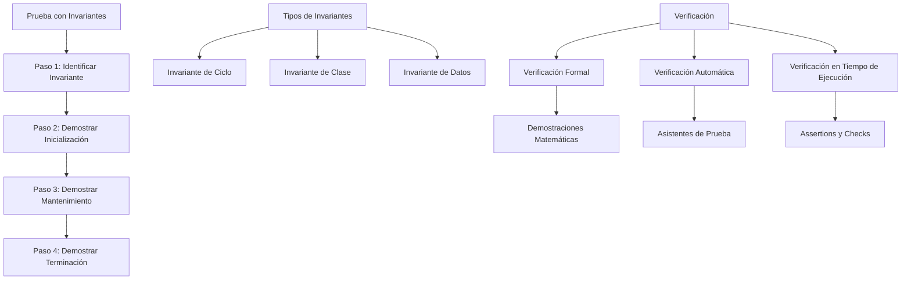

# Estructuras de Datos - Elementos de corrección de algoritmos

## 3.1 Pruebas basadas en invariantes

---

### 1. Concepto de Invariante

#### 1.1. Definición Formal

Un **invariante** es una propiedad que se mantiene verdadera durante toda la ejecución de un algoritmo o durante un ciclo específico. Formalmente, para un ciclo `while (condición) { cuerpo }`, un invariante $I$ debe satisfacer:

1. **Inicialización:** $I$ es verdadero antes de la primera iteración
2. **Mantenimiento:** Si $I$ es verdadero antes de una iteración, permanece verdadero después de la iteración
3. **Terminación:** Cuando el ciclo termina, el invariante ayuda a demostrar la corrección del algoritmo

#### 1.2. Tipos de Invariantes

- **Invariante de ciclo:** Mantenido durante la ejecución de un ciclo
- **Invariante de clase:** Propiedad que siempre es verdadera para instancias de una clase
- **Invariante de datos:** Propiedad consistente de una estructura de datos

### 2. Metodología de Pruebas con Invariantes

#### 2.1. Esquema General

Para probar la corrección de un algoritmo usando invariantes:

1. **Identificar** el invariante apropiado
2. **Demostrar** inicialización
3. **Demostrar** mantenimiento
4. **Usar** el invariante para demostrar corrección al terminar

#### 2.2. Notación Formal

Dado un ciclo `while (C) { S }` con invariante $I$, debemos demostrar:

- $\{I \land C\} S \{I\}$ (Mantenimiento)
- $I \land \neg C \Rightarrow Q$, donde $Q$ es la postcondición: al salir del ciclo se obtiene el resultado correcto
- Además, para garantizar que el ciclo **termina**, se exhibe una **función de cota**: una expresión entera no negativa que disminuye estrictamente en cada iteración, como $der - izq + 1$ en la búsqueda binaria

### 3. Implementación de Ejemplos con Invariantes

```python
from typing import List, Tuple
from dataclasses import dataclass
import math

class InvariantesDemo:
    """Clase para demostrar el uso de invariantes en algoritmos"""

    # ===== EJEMPLO 1: BÚSQUEDA BINARIA =====
    def busqueda_binaria(self, arr: List[int], objetivo: int) -> int:
        """
        Búsqueda binaria con invariante demostrado
        Invariante: Si objetivo está en arr, entonces está en arr[izq..der]
        """
        izq, der = 0, len(arr) - 1

        # Invariante: objetivo ∈ arr[izq..der] si existe
        while izq <= der:
            medio = (izq + der) // 2

            # Mantenimiento del invariante
            if arr[medio] == objetivo:
                return medio
            elif arr[medio] < objetivo:
                izq = medio + 1  # Objetivo está en arr[medio+1..der]
            else:
                der = medio - 1  # Objetivo está en arr[izq..medio-1]

        return -1  # Objetivo no encontrado

    # ===== EJEMPLO 2: ORDENAMIENTO POR INSERCIÓN =====
    def insertion_sort(self, arr: List[int]) -> List[int]:
        """
        Ordenamiento por inserción con invariante
        Invariante: arr[0..i-1] está ordenado en cada iteración
        """
        arr = arr.copy()

        for i in range(1, len(arr)):
            clave = arr[i]
            j = i - 1

            # Invariante: arr[0..i-1] está ordenado
            while j >= 0 and arr[j] > clave:
                arr[j + 1] = arr[j]
                j -= 1
            arr[j + 1] = clave

            # El invariante se mantiene: arr[0..i] está ordenado

        return arr

    # ===== EJEMPLO 3: ALGORITMO DE EUCLIDES =====
    def mcd_euclides(self, a: int, b: int) -> int:
        """
        Algoritmo de Euclides para máximo común divisor
        Invariante: mcd(a, b) = mcd(x, y) en cada paso
        """
        x, y = a, b
        while y != 0:
            # Invariante: mcd(a, b) = mcd(x, y)
            x, y = y, x % y
        return x

    # ===== EJEMPLO 4: INVARIANTE DE SUMA =====
    def suma_array(self, arr: List[int]) -> int:
        """
        Suma de elementos con invariante
        Invariante: suma = arr[0] + arr[1] + ... + arr[i-1]
        """
        suma = 0
        i = 0

        # Invariante: suma contiene la suma de los primeros i elementos
        while i < len(arr):
            suma += arr[i]
            i += 1
            # El invariante se mantiene: suma = suma de primeros i elementos

        return suma

# ===== ESTRUCTURA PARA PRUEBAS FORMALES =====
@dataclass
class PruebaInvariante:
    """Estructura para demostrar pruebas formales con invariantes"""

    @staticmethod
    def demostrar_busqueda_binaria():
        """Demostración formal del invariante de búsqueda binaria"""
        print("=== DEMOSTRACIÓN INVARIANTE BÚSQUEDA BINARIA ===")
        print("Invariante I: Si objetivo está en arr, entonces está en arr[izq..der]")
        print()
        print("1. INICIALIZACIÓN:")
        print("   izq = 0, der = n-1 ⇒ arr[izq..der] = arr completo")
        print("   ∴ I es verdadero al inicio")
        print()
        print("2. MANTENIMIENTO:")
        print("   Si arr[medio] == objetivo: encontrado, ciclo termina")
        print("   Si arr[medio] < objetivo: objetivo debe estar en arr[medio+1..der]")
        print("   Si arr[medio] > objetivo: objetivo debe estar en arr[izq..medio-1]")
        print("   ∴ I se mantiene en cada iteración")
        print()
        print("3. TERMINACIÓN:")
        print("   Cuando izq > der, arr[izq..der] está vacío")
        print("   ∴ objetivo no está en el array")

    @staticmethod
    def demostrar_insertion_sort():
        """Demostración formal del invariante de insertion sort"""
        print("=== DEMOSTRACIÓN INVARIANTE INSERTION SORT ===")
        print("Invariante I: arr[0..i-1] está ordenado en cada iteración")
        print()
        print("1. INICIALIZACIÓN:")
        print("   i = 1 ⇒ arr[0..0] tiene 1 elemento, siempre ordenado")
        print("   ∴ I es verdadero al inicio")
        print()
        print("2. MANTENIMIENTO:")
        print("   Insertamos arr[i] en la posición correcta en arr[0..i-1]")
        print("   Después de insertar, arr[0..i] está ordenado")
        print("   ∴ I se mantiene para i+1")
        print()
        print("3. TERMINACIÓN:")
        print("   Cuando i = n, arr[0..n-1] está ordenado")
        print("   ∴ El array completo está ordenado")

# ===== HERRAMIENTAS DE VERIFICACIÓN =====
class VerificadorInvariantes:
    """Clase para verificar invariantes automáticamente"""

    def verificar_invariante_suma(self, arr: List[int]) -> bool:
        """Verifica el invariante de suma durante la ejecución"""
        suma = 0
        invariantes_cumplidos = []

        for i, valor in enumerate(arr):
            suma_prev = suma
            suma += valor

            # Invariante: suma = suma de los primeros i+1 elementos
            suma_esperada = sum(arr[:i+1])
            cumple_invariante = (suma == suma_esperada)
            invariantes_cumplidos.append(cumple_invariante)

            print(f"i={i}: suma={suma}, esperado={suma_esperada}, invariante={cumple_invariante}")

        return all(invariantes_cumplidos)

    def verificar_invariante_ordenamiento(self, arr: List[int]) -> bool:
        """Verifica el invariante de ordenamiento durante insertion sort"""
        arr = arr.copy()
        invariantes_cumplidos = []

        for i in range(1, len(arr)):
            # Invariante: arr[0..i-1] debe estar ordenado
            subarray = arr[:i]
            esta_ordenado = all(subarray[j] <= subarray[j+1] for j in range(len(subarray)-1))
            invariantes_cumplidos.append(esta_ordenado)

            # Realizar inserción
            clave = arr[i]
            j = i - 1
            while j >= 0 and arr[j] > clave:
                arr[j + 1] = arr[j]
                j -= 1
            arr[j + 1] = clave

            print(f"i={i}: subarray ordenado={esta_ordenado}")

        return all(invariantes_cumplidos)

if __name__ == "__main__":
    # Demostraciones formales
    PruebaInvariante.demostrar_busqueda_binaria()
    print()
    PruebaInvariante.demostrar_insertion_sort()

    # Verificación práctica
    print("\n=== VERIFICACIÓN PRÁCTICA ===")
    verificador = VerificadorInvariantes()

    # Verificar invariante de suma
    print("\nVerificación invariante de suma:")
    arr = [1, 2, 3, 4, 5]
    resultado = verificador.verificar_invariante_suma(arr)
    print(f"Todos los invariantes cumplidos: {resultado}")

    # Verificar invariante de ordenamiento
    print("\nVerificación invariante de ordenamiento:")
    arr_desordenado = [5, 2, 4, 6, 1, 3]
    resultado = verificador.verificar_invariante_ordenamiento(arr_desordenado)
    print(f"Todos los invariantes cumplidos: {resultado}")
```

### 4. Diagrama de Metodología de Invariantes



### 5. Técnicas Avanzadas de Invariantes

#### 5.1. Invariantes para Algoritmos Concurrentes

En programación concurrente, los invariantes deben mantenerse a través de operaciones atómicas:

```python
import threading

class ContadorSeguro:
    def __init__(self):
        self._valor = 0
        self._lock = threading.Lock()

    def incrementar(self):
        with self._lock:
            # Invariante: _valor siempre es consistente
            self._valor += 1

    def get_valor(self):
        with self._lock:
            return self._valor
```

#### 5.2. Invariantes para Estructuras de Datos

Las estructuras de datos complejas a menudo mantienen múltiples invariantes:

```python
class MaxHeap:
    def __init__(self):
        self.heap = []

    # Invariante: Propiedad de heap máximo
    # Para todo i: heap[i] >= heap[2*i+1] y heap[i] >= heap[2*i+2]

    def insertar(self, valor):
        self.heap.append(valor)
        self._flotar(len(self.heap)-1)  # Mantener invariante

    def _flotar(self, indice):
        # Restaurar invariante del heap
        while indice > 0:
            padre = (indice - 1) // 2
            if self.heap[padre] >= self.heap[indice]:
                break
            self.heap[padre], self.heap[indice] = self.heap[indice], self.heap[padre]
            indice = padre
```

#### 5.3. Invariantes en Algoritmos de Grafos

Para algoritmos como Dijkstra o BFS, los invariantes son cruciales:

```python
def dijkstra(grafo, inicio):
    distancias = {nodo: float('inf') for nodo in grafo}
    distancias[inicio] = 0
    visitados = set()

    # Invariante, válido si todos los pesos son no negativos:
    # distancias contiene la distancia mínima conocida a cada nodo,
    # y para los nodos en visitados esa distancia ya es la definitiva

    while visitados != set(distancias.keys()):
        nodo_actual = min(
            (nodo for nodo in distancias if nodo not in visitados),
            key=distancias.get
        )
        visitados.add(nodo_actual)

        for vecino, peso in grafo[nodo_actual].items():
            nueva_dist = distancias[nodo_actual] + peso
            if nueva_dist < distancias[vecino]:
                distancias[vecino] = nueva_dist  # Mantener invariante

    return distancias
```

### 6. Ejercicios Prácticos

1. Identifique y demuestre el invariante para el algoritmo de Bubble Sort
2. Diseñe un invariante para el algoritmo de QuickSort y demuestre su corrección
3. Implemente y verifique el invariante para una búsqueda por interpolación
4. Cree invariantes para una estructura de datos de árbol binario de búsqueda
5. Demuestre el invariante para el algoritmo de Kruskal para MST
6. Implemente verificaciones en tiempo de ejecución para invariantes complejos
7. Diseñe invariantes para un algoritmo de programación dinámica
8. Estudie el uso de invariantes en proof assistants como Coq o Agda

### 7. Herramientas y Técnicas de Verificación

#### 7.1. Verificación en Tiempo de Ejecución

```python
def funcion_con_invariante(arr, objetivo):
    # Precondición
    assert len(arr) > 0, "Array no puede estar vacío"

    resultado = None
    # ... algoritmo ...

    # Postcondición
    assert resultado is None or 0 <= resultado < len(arr)
    return resultado
```

#### 7.2. Contract Programming

```python
# Pseudocódigo: Python no trae un módulo estándar de contratos;
# bibliotecas como icontract o deal ofrecen decoradores parecidos.
from contract import requires, ensures

@requires("len(arr) > 0")
@requires("arr está ordenado")
@ensures("resultado == -1 or arr[resultado] == objetivo")
def busqueda_binaria_contratos(arr, objetivo):
    # Implementación con contratos
    pass
```

#### 7.3. Verificación Estática

Los verificadores de tipos como MyPy o Pyright solo comprueban tipos, no invariantes. Para verificar invariantes estáticamente se usan herramientas de verificación formal como Dafny, Why3 o Frama-C, que exigen escribir las precondiciones, poscondiciones e invariantes de ciclo como anotaciones.

### 8. Referencias

- Gries, D. (1981). The Science of Programming
- Meyer, B. (1997). Object-Oriented Software Construction
- Leino, K. R. M. (2010). Dafny: An Automatic Program Verifier
- Cormen, T. H., et al. (2009). Introduction to Algorithms
- Dijkstra, E. W. (1976). A Discipline of Programming
