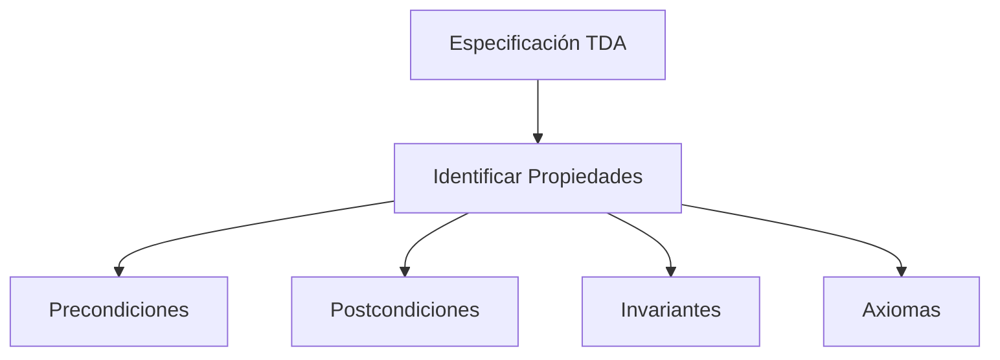
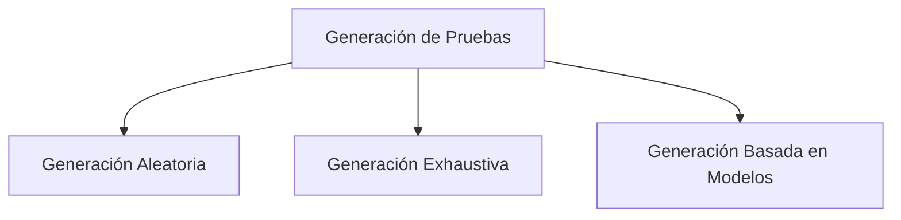
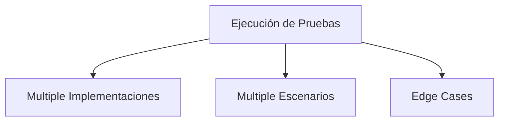
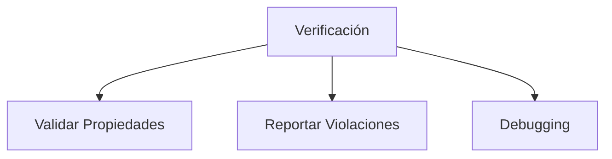
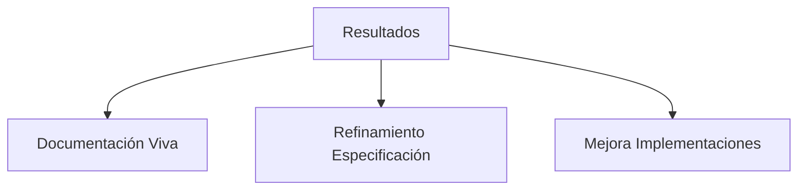

# Estructuras de Datos - Elementos de corrección de algoritmos

## 3.2 Pruebas basadas en las propiedades de un TDA.

---

### 1. Concepto de Pruebas Basadas en Propiedades

#### 1.1. Definición Formal

Las **pruebas basadas en propiedades** de un TDA verifican que las operaciones del tipo de dato abstracto cumplen con las propiedades y axiomas definidos en su especificación, independientemente de la implementación concreta.

Para un TDA $T$ con operaciones $O_1, O_2, \ldots, O_n$, las propiedades deben satisfacer:

$$ \forall \text{estados válidos } S, P(S, O_i(S)) = \text{true} $$

donde $P$ es una propiedad que debe mantenerse.

#### 1.2. Ventajas sobre Pruebas Unitarias Tradicionales

- **Cobertura amplia:** Cada propiedad se prueba con cientos de entradas generadas, aunque nunca con todas las posibles: no sustituyen a una demostración
- **Mantenibilidad:** Las pruebas no dependen de la implementación
- **Descubrimiento de bugs:** Encuentran casos edge no considerados
- **Documentación viva:** Las propiedades documentan el comportamiento esperado

### 2. Metodología para Pruebas Basadas en Propiedades

#### 2.1. Identificación de Propiedades

Para cada operación del TDA, identificar:

1. **Precondiciones:** Condiciones que deben cumplirse antes de la operación
2. **Postcondiciones:** Condiciones que deben cumplirse después de la operación
3. **Invariantes:** Propiedades que siempre se mantienen
4. **Axiomas:** Relaciones entre diferentes operaciones

#### 2.2. Estrategias de Generación de Datos

- **Generación aleatoria:** Datos que satisfacen las precondiciones
- **Generación exhaustiva:** Para dominios pequeños
- **Generación basada en modelos:** Según el estado actual del TDA

### 3. Implementación de Pruebas Basadas en Propiedades

```python
from abc import ABC, abstractmethod
from typing import TypeVar, Generic, List
import random
from hypothesis import given, strategies as st
import pytest

T = TypeVar('T')

# ===== TDA PILA - ESPECIFICACIÓN =====
class TDA_Pila(ABC, Generic[T]):
    """Especificación del TDA Pila con propiedades"""

    @abstractmethod
    def apilar(self, elemento: T) -> None:
        """Apila un elemento en la cima"""
        pass

    @abstractmethod
    def desapilar(self) -> T:
        """Desapila el elemento de la cima"""
        pass

    @abstractmethod
    def cima(self) -> T:
        """Consulta el elemento de la cima sin desapilar"""
        pass

    @abstractmethod
    def esta_vacia(self) -> bool:
        """Verifica si la pila está vacía"""
        pass

    @abstractmethod
    def tamaño(self) -> int:
        """Retorna el número de elementos"""
        pass

# ===== PROPIEDADES DEL TDA PILA =====
class PropiedadesPila:
    """Clase que contiene las propiedades del TDA Pila"""

    @staticmethod
    def propiedad_apilar_desapilar(pila: TDA_Pila, elemento: T) -> bool:
        """Propiedad: desapilar después de apilar devuelve el mismo elemento"""
        if pila.esta_vacia():
            pila.apilar(elemento)
            return pila.desapilar() == elemento
        return True

    @staticmethod
    def propiedad_cima_consistente(pila: TDA_Pila, elemento: T) -> bool:
        """Propiedad: cima después de apilar devuelve el elemento apilado"""
        tamaño_inicial = pila.tamaño()
        pila.apilar(elemento)
        return pila.cima() == elemento and pila.tamaño() == tamaño_inicial + 1

    @staticmethod
    def propiedad_tamaño_consistente(pila: TDA_Pila, elemento: T) -> bool:
        """Propiedad: el tamaño cambia correctamente al apilar/desapilar"""
        tamaño_inicial = pila.tamaño()
        pila.apilar(elemento)
        tamaño_despues_apilar = pila.tamaño()
        pila.desapilar()
        tamaño_despues_desapilar = pila.tamaño()

        return (tamaño_despues_apilar == tamaño_inicial + 1 and
                tamaño_despues_desapilar == tamaño_inicial)

    @staticmethod
    def propiedad_vacia_consistente(pila: TDA_Pila) -> bool:
        """Propiedad: esta_vacia es consistente con el tamaño"""
        return pila.esta_vacia() == (pila.tamaño() == 0)

    @staticmethod
    def propiedad_orden_lifo(pila: TDA_Pila, elementos: List[T]) -> bool:
        """Propiedad LIFO: el último en entrar es el primero en salir"""
        # Apilar todos los elementos
        for elem in elementos:
            pila.apilar(elem)

        # Desapilar debería devolverlos en orden inverso
        for elem in reversed(elementos):
            if pila.desapilar() != elem:
                return False
        return True

# ===== IMPLEMENTACIÓN DE PRUEBAS CON HYPOTHESIS =====
class TestPilaProperties:
    """Tests basados en propiedades del TDA Pila"""

    @given(st.lists(st.integers(), max_size=50))
    def test_propiedad_lifo(self, elementos):
        """Test de la propiedad LIFO con datos generados aleatoriamente"""
        pila = PilaLista()  # Implementación concreta
        propiedad = PropiedadesPila.propiedad_orden_lifo(pila, elementos)
        assert propiedad, "Violación de propiedad LIFO"

    @given(st.integers())
    def test_propiedad_apilar_desapilar(self, elemento):
        """Test de la propiedad apilar/desapilar"""
        pila = PilaLista()
        propiedad = PropiedadesPila.propiedad_apilar_desapilar(pila, elemento)
        assert propiedad, "Violación de propiedad apilar/desapilar"

    @given(st.lists(st.integers(), max_size=20))
    def test_propiedad_tamaño_consistente(self, elementos):
        """Test de consistencia del tamaño"""
        pila = PilaLista()
        tamaño_inicial = pila.tamaño()

        for elem in elementos:
            pila.apilar(elem)
            assert pila.tamaño() == tamaño_inicial + 1
            tamaño_inicial = pila.tamaño()

        for _ in elementos:
            pila.desapilar()
            tamaño_inicial -= 1
            assert pila.tamaño() == tamaño_inicial

    def test_propiedad_vacia_consistente(self):
        """Test de consistencia de vacío"""
        pila = PilaLista()
        assert pila.esta_vacia() == (pila.tamaño() == 0)

        pila.apilar(1)
        assert not pila.esta_vacia()
        assert pila.tamaño() > 0

        pila.desapilar()
        assert pila.esta_vacia()
        assert pila.tamaño() == 0

# ===== IMPLEMENTACIÓN CONCRETA PARA PRUEBAS =====
class PilaLista(TDA_Pila[int]):
    """Implementación concreta del TDA Pila usando lista"""

    def __init__(self):
        self._elementos: List[int] = []

    def apilar(self, elemento: int) -> None:
        self._elementos.append(elemento)

    def desapilar(self) -> int:
        if self.esta_vacia():
            raise ValueError("Pila vacía")
        return self._elementos.pop()

    def cima(self) -> int:
        if self.esta_vacia():
            raise ValueError("Pila vacía")
        return self._elementos[-1]

    def esta_vacia(self) -> bool:
        return len(self._elementos) == 0

    def tamaño(self) -> int:
        return len(self._elementos)

# ===== HERRAMIENTAS DE VERIFICACIÓN =====
class VerificadorTDA:
    """Verificador automático de propiedades de TDA"""

    def __init__(self, implementaciones: List[TDA_Pila]):
        self.implementaciones = implementaciones

    def verificar_propiedades(self, propiedad_func, *args) -> dict:
        """Verifica una propiedad en todas las implementaciones"""
        resultados = {}
        for impl in self.implementaciones:
            nombre = impl.__class__.__name__
            try:
                resultado = propiedad_func(impl, *args)
                resultados[nombre] = resultado
            except Exception as e:
                resultados[nombre] = f"Error: {e}"
        return resultados

    def ejecutar_todas_las_pruebas(self, elementos_prueba: List[int]):
        """Ejecuta todas las propiedades con datos de prueba"""
        print("=== VERIFICACIÓN COMPLETA DE PROPIEDADES ===")

        propiedades = [
            ("LIFO", PropiedadesPila.propiedad_orden_lifo),
            ("Apilar/Desapilar", lambda p, e: PropiedadesPila.propiedad_apilar_desapilar(p, e)),
            ("Tamaño consistente", lambda p, e: PropiedadesPila.propiedad_tamaño_consistente(p, e)),
        ]

        for nombre, propiedad in propiedades:
            print(f"\nPropiedad: {nombre}")
            resultados = self.verificar_propiedades(propiedad, elementos_prueba)
            for impl_name, resultado in resultados.items():
                estado = "✓" if resultado is True else "✗"
                print(f"  {impl_name}: {estado} {resultado}")

if __name__ == "__main__":
    # Crear verificador con múltiples implementaciones
    implementaciones = [PilaLista()]  # Pueden añadirse más implementaciones
    verificador = VerificadorTDA(implementaciones)

    # Generar datos de prueba
    datos_prueba = [1, 2, 3, 4, 5]

    # Ejecutar verificación completa
    verificador.ejecutar_todas_las_pruebas(datos_prueba)

    # Ejecutar tests con pytest (descomentar para ejecutar)
    # import pytest
    # pytest.main([__file__, "-v"])
```

### 4. Diagrama de Metodología de Pruebas











### 5. Propiedades para Diferentes TDAs

#### 5.1. TDA Cola (FIFO)

```python
class PropiedadesCola:
    """Propiedades del TDA Cola (FIFO)"""

    @staticmethod
    def propiedad_fifo(cola: TDA_Cola, elementos: List[T]) -> bool:
        """Propiedad FIFO: primero en entrar, primero en salir"""
        for elem in elementos:
            cola.encolar(elem)

        for elem in elementos:
            if cola.desencolar() != elem:
                return False
        return True

    @staticmethod
    def propiedad_tamaño_consistente(cola: TDA_Cola) -> bool:
        """El tamaño aumenta al encolar y disminuye al desencolar"""
        tamaño_inicial = cola.tamaño()
        cola.encolar(1)
        assert cola.tamaño() == tamaño_inicial + 1
        cola.desencolar()
        assert cola.tamaño() == tamaño_inicial
```

#### 5.2. TDA Conjunto

```python
class PropiedadesConjunto:
    """Propiedades del TDA Conjunto"""

    @staticmethod
    def propiedad_idempotencia(conjunto: TDA_Conjunto, elemento: T) -> bool:
        """Añadir el mismo elemento múltiples veces no cambia el conjunto"""
        tamaño_inicial = conjunto.tamaño()
        conjunto.añadir(elemento)
        tamaño_despues = conjunto.tamaño()
        conjunto.añadir(elemento)  # Debería ser idempotente
        return tamaño_despues == conjunto.tamaño()

    @staticmethod
    def propiedad_containment(conjunto: TDA_Conjunto, elemento: T) -> bool:
        """Si un elemento fue añadido, debe estar contenido"""
        conjunto.añadir(elemento)
        return conjunto.contiene(elemento)
```

#### 5.3. TDA Mapa/Diccionario

```python
class PropiedadesMapa:
    """Propiedades del TDA Mapa"""

    @staticmethod
    def propiedad_consistencia_insercion(mapa: TDA_Mapa, clave: T, valor: T) -> bool:
        """Insertar y luego obtener debe devolver el valor insertado"""
        mapa.insertar(clave, valor)
        return mapa.obtener(clave) == valor

    @staticmethod
    def propiedad_sobreescritura(mapa: TDA_Mapa, clave: T, val1: T, val2: T) -> bool:
        """Sobreescribir una clave debe actualizar el valor"""
        mapa.insertar(clave, val1)
        mapa.insertar(clave, val2)  # Sobreescribir
        return mapa.obtener(clave) == val2
```

### 6. Estrategias Avanzadas de Pruebas

#### 6.1. Property-Based Testing con Hypothesis

```python
from hypothesis import given, strategies as st

class TestMapaProperties:
    @given(st.dictionaries(st.text(), st.integers(), max_size=10))
    def test_propiedad_insercion_masiva(self, datos):
        """Test de inserción masiva con datos generados"""
        mapa = MapaHash()
        for clave, valor in datos.items():
            mapa.insertar(clave, valor)
            assert mapa.obtener(clave) == valor
```

#### 6.2. Stateful Testing

```python
from hypothesis.stateful import RuleBasedStateMachine, rule, precondition

class MapaStateMachine(RuleBasedStateMachine):
    def __init__(self):
        super().__init__()
        self.mapa = MapaHash()
        self.modelo = {}

    @rule(clave=st.text(), valor=st.integers())
    def insertar(self, clave, valor):
        self.mapa.insertar(clave, valor)
        self.modelo[clave] = valor
        assert self.mapa.obtener(clave) == valor

    @rule(clave=st.text())
    @precondition(lambda self: self.modelo)
    def obtener(self, clave):
        resultado_real = self.mapa.obtener(clave)
        resultado_esperado = self.modelo.get(clave)
        assert resultado_real == resultado_esperado
```

#### 6.3. Verificación de Invariantes Complejos

```python
def verificar_invariante_arbol(arbol: TDA_ArbolBinario) -> bool:
    """Verifica el invariante de orden de un árbol binario de búsqueda"""
    def _verificar_nodo(nodo, min_val=float('-inf'), max_val=float('inf')):
        if nodo is None:
            return True
        if not (min_val < nodo.valor < max_val):
            return False
        return (_verificar_nodo(nodo.izquierdo, min_val, nodo.valor) and
                _verificar_nodo(nodo.derecho, nodo.valor, max_val))

    return _verificar_nodo(arbol.raiz)
```

### 7. Ejercicios Prácticos

1. Implemente propiedades para el TDA Cola y verifique múltiples implementaciones
2. Diseñe pruebas basadas en propiedades para un TDA Grafo no dirigido
3. Cree un stateful test para un TDA Cache con política LRU
4. Implemente propiedades para verificar la consistencia de un TDA Árbol AVL
5. Diseñe pruebas para un TDA Sistema de Archivos con operaciones atómicas
6. Implemente verificadores de invariantes para estructuras de datos persistentes
7. Cree propiedades para un TDA Cola de Prioridad (Heap)
8. Diseñe pruebas que verifiquen propiedades de concurrencia en TDAs thread-safe

### 8. Referencias

- Claessen, K., & Hughes, J. (2000). QuickCheck: A Lightweight Tool for Random Testing of Haskell Programs
- Hughes, J. (2019). How to specify it! A guide to writing properties of pure functions
- Newcombe, C., et al. (2015). Use of Formal Methods at Amazon Web Services
- MacIver, D. R., et al. (2019). Hypothesis: A new approach to property-based testing. _Journal of Open Source Software_, 4(43)
