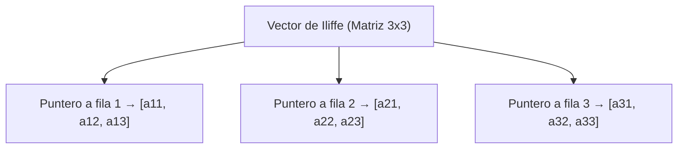

# Estructuras de Datos - Arreglos

## 4.1 Instrumentación de arreglos: polinomios de direccionamiento vectores de Iliffe.

---

### 1. Definición de Arreglos

Un **arreglo** es una estructura de datos lineal que almacena elementos del mismo tipo en posiciones contiguas de memoria. El acceso a los elementos se realiza mediante un **índice**, que representa su desplazamiento con respecto a la dirección base.

### 2. Polinomios de Direccionamiento

El **polinomio de direccionamiento** es la fórmula matemática que permite calcular la dirección de un elemento dentro de un arreglo multidimensional.

#### Fórmula general:

Si $A$ es un arreglo de dimensión $n$, con límites inferiores $L_i$ y superiores $U_i$, y $d_i = U_i - L_i + 1$ es la longitud en la dimensión $i$, entonces la dirección de un elemento $A[i_1, i_2, ..., i_n]$ se calcula como:

$$ ext{Dir}(A[i_1, ..., i_n]) =    ext{Base}(A) + \sum_{k=1}^{n} (i_k - L_k) \cdot C_k $$

donde los **coeficientes de direccionamiento** $C_k$ se calculan recursivamente:

$$ C_n = 1, \quad C_k = \prod_{j=k+1}^{n} d_j \quad (1 \leq k < n) $$

#### Ejemplo en 2D:

Para una matriz $A[m][n]$, con índices desde 0:

$$ ext{Dir}(A[i][j]) =     ext{Base}(A) + (i \cdot n + j) $$

### 3. Vectores de Iliffe

Un **vector de Iliffe** es una técnica alternativa para representar arreglos multidimensionales. En lugar de almacenar la matriz como un bloque contiguo de memoria, se almacena un arreglo de **punteros a arreglos**, permitiendo más flexibilidad en dimensiones irregulares (_arreglos jagged_).

#### Representación gráfica:



### 4. Ejemplo en Código

#### Ejemplo en C: Polinomio de Direccionamiento

```c
#include \<stdio.h\> #define COLS 4

int main() {
    int A[3][4] = { {1, 2, 3, 4}, {5, 6, 7, 8}, {9, 10, 11, 12} };

    int i = 2, j = 3; // Acceder a A[2][3]

    // Polinomio de direccionamiento en filas
    int direccion = (i * COLS) + j;
    printf("Elemento A[2][3] = %d\n", A[i][j]);
    printf("Posición calculada: %d\n", direccion);

    return 0;
}
```

#### Ejemplo en Java: Vectores de Iliffe

```java
public class IliffeDemo { public static void main(String[] args)
{ int[][] A = { {1, 2, 3}, {4, 5}, {6, 7, 8, 9} };

        for (int i = 0; i < A.length; i++) {
            for (int j = 0; j < A[i].length; j++) {
                System.out.print(A[i][j] + " ");
            }
            System.out.println();
        }
    }

}
```

### 5. Conclusiones

- Los **polinomios de direccionamiento** son eficientes en términos de acceso a memoria, pero requieren que el arreglo sea rectangular y contiguo en memoria.
- Los **vectores de Iliffe** ofrecen flexibilidad y permiten arreglos irregulares, aunque con un costo adicional en el acceso (indirección por punteros).

### 6. Referencias

- Horowitz, E., Sahni, S., & Anderson-Freed, S. (2008). _Fundamentals of Data Structures in C_.
- Knuth, D. E. (1997). _The Art of Computer Programming, Vol. 1_.
