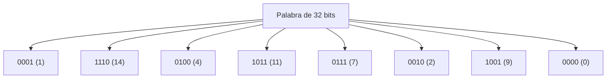

# Estructuras de Datos - Arreglos

## 4.2 Arreglos empacados.

---

### 1. Definición de Arreglos Empacados

Un **arreglo empacado** es una técnica de almacenamiento en memoria donde se aprovecha al máximo el espacio al **reducir el número de bits usados para representar cada elemento**, en lugar de reservar el tamaño completo de una palabra de memoria.

Se utilizan principalmente cuando los elementos ocupan un rango de valores reducido, permitiendo almacenar más datos en la misma cantidad de memoria.

### 2. Concepto Básico

En un arreglo tradicional, cada elemento suele ocupar una **palabra completa** de memoria (por ejemplo, 32 bits en un sistema de 32 bits), aunque el rango de valores no lo requiera.

En un arreglo empacado:

- Se calcula el **número mínimo de bits** necesarios para representar un valor.
- Se "empaquetan" múltiples elementos dentro de una misma palabra de memoria.

#### Fórmula para determinar el número de bits necesarios

Si los elementos de un arreglo toman valores en un rango de $0$ a $M$, el número de bits necesarios $(b)$ se obtiene como:

$$ b = \lceil \log_2(M+1) \rceil $$

### 3. Ejemplo Numérico

Si tenemos un arreglo que almacena **valores entre 0 y 15**:

- $M = 15$
- $b = \lceil \log_2(15+1) \rceil = \lceil 4 \rceil = 4$ bits

Esto significa que **cada valor puede representarse en solo 4 bits**, en lugar de 32 bits.

En una palabra de 32 bits, se pueden almacenar:

$$ \frac{32}{4} = 8 \quad \text{valores} $$

### 4. Representación Gráfica



### 5. Ejemplo en Código

#### Ejemplo en C: Empaquetamiento de 4 bits por valor

```c
#include <stdio.h>
#include <stdint.h>

#define WORD_SIZE 32
#define BITS_PER_ELEMENT 4
#define ELEMENTS_PER_WORD (WORD_SIZE / BITS_PER_ELEMENT)

int main() { uint32_t word = 0; // palabra de 32 bits

    // Insertar 8 valores en la palabra
    int values[ELEMENTS_PER_WORD] = {1, 14, 4, 11, 7, 2, 9, 0};

    for (int i = 0; i < ELEMENTS_PER_WORD; i++) {
        word |= (values[i] & 0xF) << (i * BITS_PER_ELEMENT);
    }

    // Mostrar valores extraídos
    for (int i = 0; i < ELEMENTS_PER_WORD; i++) {
        int extracted = (word >> (i * BITS_PER_ELEMENT)) & 0xF;
        printf("Valor %d: %d\n", i, extracted);
    }

    return 0;

}
```

#### Ejemplo en Python: Empaquetamiento y Desempaquetamiento

```python
def pack(values, bits):
    word = 0
    for i, v in enumerate(values):
        word |= (v & ((1 << bits) - 1)) << (i * bits)   # el elemento i ocupa los bits i·b .. i·b + b - 1
    return word

def unpack(word, bits, count):
    return [(word >> (i * bits)) & ((1 << bits) - 1) for i in range(count)]

values = [1, 14, 4, 11, 7, 2, 9, 0]
bits = 4

packed = pack(values, bits)
print("Palabra empacada:", bin(packed))

unpacked = unpack(packed, bits, len(values))
print("Valores desempaquetados:", unpacked)
```

### 6. Ventajas y Desventajas

#### Ventajas:

- **Ahorro de memoria**, especialmente útil en arreglos grandes con valores pequeños.
- Permite almacenar más datos en caché, mejorando el rendimiento.

#### Desventajas:

- Mayor **complejidad de acceso** (requiere operaciones de corrimiento y máscaras).
- El tiempo de acceso puede aumentar en comparación con un arreglo convencional.

### 7. Conclusiones

- Los **arreglos empacados** son una técnica fundamental en optimización de memoria.
- Son usados en **compiladores, bases de datos, sistemas de compresión y lenguajes de programación** para representar de manera más eficiente los datos.

### 8. Referencias

- Horowitz, E., Sahni, S., & Anderson-Freed, S. (2008). _Fundamentals of Data Structures in C_.
- Knuth, D. E. (1997). _The Art of Computer Programming, Vol. 1_.
