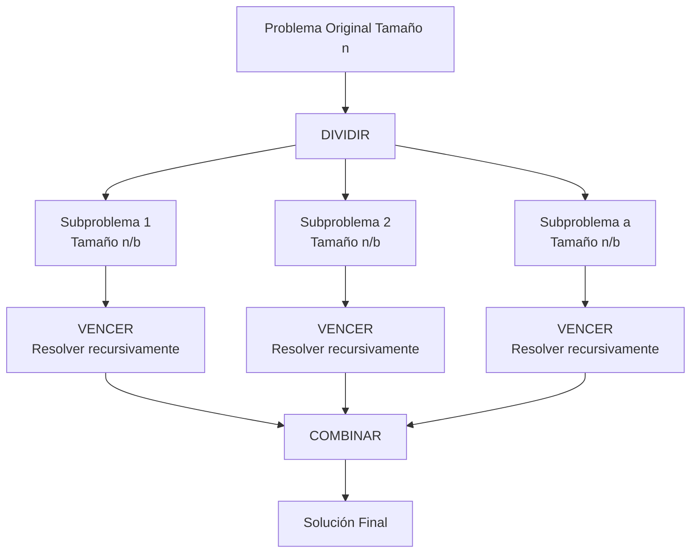
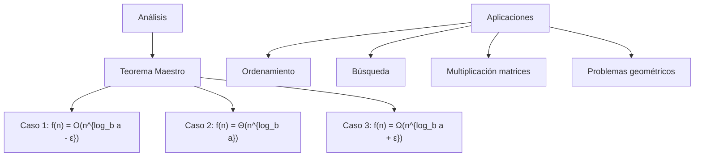

# Estructuras de Datos - Recursion

## 5.1 Estrategia divide y vencerás, solución de problemas mediante recursion.

---

### 1. Concepto de Divide y Vencerás

#### 1.1. Definición Formal

La estrategia **divide y vencerás** es un paradigma algorítmico que resuelve problemas dividiéndolos en subproblemas más pequeños del mismo tipo, resolviendo recursivamente estos subproblemas, y combinando sus soluciones para obtener la solución al problema original.

**Estructura general:**
$$T(n) = a \cdot T\left(\frac{n}{b}\right) + f(n)$$

donde:

- $a \geq 1$: número de subproblemas
- $b > 1$: factor de división
- $f(n)$: costo de dividir y combinar

#### 1.2. Tres Pasos Fundamentales

1. **Dividir:** Descomponer el problema en subproblemas más pequeños
2. **Vencer:** Resolver recursivamente los subproblemas
3. **Combinar:** Integrar las soluciones de los subproblemas

### 2. Implementación de Algoritmos Divide y Vencerás

```python
from typing import List, Tuple
import math
import random
from collections import deque

class DivideVenceras:
    """Clase con implementaciones de algoritmos divide y vencerás"""

    # ===== MERGE SORT =====
    def merge_sort(self, arr: List[int]) -> List[int]:
        """
        Merge Sort: Clásico algoritmo divide y vencerás
        T(n) = 2T(n/2) + O(n) = O(n log n)
        """
        # Caso base: array de tamaño 0 o 1
        if len(arr) <= 1:
            return arr

        # Dividir: partir el array en dos mitades
        medio = len(arr) // 2
        izquierda = self.merge_sort(arr[:medio])
        derecha = self.merge_sort(arr[medio:])

        # Vencer y combinar: fusionar las mitades ordenadas
        return self._fusionar(izquierda, derecha)

    def _fusionar(self, izq: List[int], der: List[int]) -> List[int]:
        """Fusión de dos arrays ordenados - O(n)"""
        resultado = []
        i = j = 0

        while i < len(izq) and j < len(der):
            if izq[i] < der[j]:
                resultado.append(izq[i])
                i += 1
            else:
                resultado.append(der[j])
                j += 1

        # Añadir elementos restantes
        resultado.extend(izq[i:])
        resultado.extend(der[j:])
        return resultado

    # ===== BÚSQUEDA BINARIA =====
    def busqueda_binaria(self, arr: List[int], objetivo: int) -> int:
        """
        Búsqueda binaria en array ordenado
        T(n) = T(n/2) + O(1) = O(log n)
        """
        def _buscar(izq: int, der: int) -> int:
            # Caso base: subarray vacío
            if izq > der:
                return -1

            # Dividir: calcular punto medio
            medio = (izq + der) // 2

            # Vencer: decidir en qué mitad buscar
            if arr[medio] == objetivo:
                return medio
            elif arr[medio] < objetivo:
                return _buscar(medio + 1, der)  # Buscar en mitad derecha
            else:
                return _buscar(izq, medio - 1)   # Buscar en mitad izquierda

        return _buscar(0, len(arr) - 1)

    # ===== MULTIPLICACIÓN DE MATRICES STRASSEN =====
    def multiplicar_matrices(self, A: List[List[int]], B: List[List[int]]) -> List[List[int]]:
        """
        Multiplicación de matrices usando Strassen (divide y vencerás)
        T(n) = 7T(n/2) + O(n²) = O(n^log₂7) ≈ O(n^2.81)
        Esta versión requiere matrices cuadradas de tamaño potencia de 2;
        en otro caso se rellenan con ceros hasta la siguiente potencia de 2.
        """
        n = len(A)
        if n & (n - 1):
            raise ValueError("El tamaño debe ser una potencia de 2")

        # Caso base: matrices 1x1
        if n == 1:
            return [[A[0][0] * B[0][0]]]

        # Dividir: partir matrices en submatrices 2x2
        nuevo_tam = n // 2
        A11, A12, A21, A22 = self._dividir_matriz(A, nuevo_tam)
        B11, B12, B21, B22 = self._dividir_matriz(B, nuevo_tam)

        # Vencer: calcular productos de Strassen recursivamente
        M1 = self.multiplicar_matrices(self._sumar_matrices(A11, A22),
                                      self._sumar_matrices(B11, B22))
        M2 = self.multiplicar_matrices(self._sumar_matrices(A21, A22), B11)
        M3 = self.multiplicar_matrices(A11, self._restar_matrices(B12, B22))
        M4 = self.multiplicar_matrices(A22, self._restar_matrices(B21, B11))
        M5 = self.multiplicar_matrices(self._sumar_matrices(A11, A12), B22)
        M6 = self.multiplicar_matrices(self._restar_matrices(A21, A11),
                                      self._sumar_matrices(B11, B12))
        M7 = self.multiplicar_matrices(self._restar_matrices(A12, A22),
                                      self._sumar_matrices(B21, B22))

        # Combinar: calcular submatrices resultantes
        C11 = self._sumar_matrices(self._restar_matrices(self._sumar_matrices(M1, M4), M5), M7)
        C12 = self._sumar_matrices(M3, M5)
        C21 = self._sumar_matrices(M2, M4)
        C22 = self._sumar_matrices(self._restar_matrices(self._sumar_matrices(M1, M3), M2), M6)

        # Combinar submatrices en matriz resultante
        return self._combinar_matrices(C11, C12, C21, C22, nuevo_tam)

    def _dividir_matriz(self, M: List[List[int]], tam: int) -> Tuple:
        """Divide una matriz en 4 submatrices"""
        return (
            [fila[:tam] for fila in M[:tam]],
            [fila[tam:] for fila in M[:tam]],
            [fila[:tam] for fila in M[tam:]],
            [fila[tam:] for fila in M[tam:]]
        )

    def _combinar_matrices(self, C11, C12, C21, C22, tam: int) -> List[List[int]]:
        """Combina 4 submatrices en una matriz"""
        resultado = []
        for i in range(tam):
            resultado.append(C11[i] + C12[i])
        for i in range(tam):
            resultado.append(C21[i] + C22[i])
        return resultado

    def _sumar_matrices(self, A: List[List[int]], B: List[List[int]]) -> List[List[int]]:
        """Suma de matrices"""
        n = len(A)
        return [[A[i][j] + B[i][j] for j in range(n)] for i in range(n)]

    def _restar_matrices(self, A: List[List[int]], B: List[List[int]]) -> List[List[int]]:
        """Resta de matrices"""
        n = len(A)
        return [[A[i][j] - B[i][j] for j in range(n)] for i in range(n)]

    # ===== TORRES DE HANOI =====
    def torres_hanoi(self, n: int, origen: str, auxiliar: str, destino: str) -> List[str]:
        """
        Resuelve el problema de las Torres de Hanoi
        T(n) = 2T(n-1) + O(1) = O(2^n)
        """
        movimientos = []

        def _mover(discos: int, orig: str, aux: str, dest: str):
            if discos == 1:
                movimientos.append(f"Mover disco 1 de {orig} a {dest}")
                return

            # Mover n-1 discos de origen a auxiliar
            _mover(discos - 1, orig, dest, aux)

            # Mover el disco más grande a destino
            movimientos.append(f"Mover disco {discos} de {orig} a {dest}")

            # Mover n-1 discos de auxiliar a destino
            _mover(discos - 1, aux, orig, dest)

        _mover(n, origen, auxiliar, destino)
        return movimientos

# ===== ANÁLISIS DE COMPLEJIDAD =====
class AnalizadorComplejidad:
    """Analiza la complejidad de algoritmos divide y vencerás"""

    @staticmethod
    def teorema_maestro(a: int, b: int, f: callable, n: int) -> str:
        """Aplica el teorema maestro para predecir complejidad"""
        log_ba = math.log(a) / math.log(b)
        f_n = f(n)

        if f_n < n**log_ba:  # Caso 1
            return f"Θ(n^{log_ba:.2f})"
        elif f_n == n**log_ba:  # Caso 2
            return f"Θ(n^{log_ba:.2f} log n)"
        else:  # Caso 3
            return f"Θ({f_n})"

    @staticmethod
    def analizar_algoritmo(nombre: str, a: int, b: int, f: callable):
        """Analiza y muestra la complejidad de un algoritmo"""
        complejidad = AnalizadorComplejidad.teorema_maestro(a, b, f, 1000)
        print(f"{nombre}: T(n) = {a}T(n/{b}) + O({f.__name__}) = {complejidad}")

# ===== EJEMPLOS DE USO =====
def demostrar_algoritmos():
    """Demostración práctica de algoritmos divide y vencerás"""
    dv = DivideVenceras()

    print("=== MERGE SORT ===")
    arr = [3, 1, 4, 1, 5, 9, 2, 6, 5, 3, 5]
    print(f"Original: {arr}")
    ordenado = dv.merge_sort(arr)
    print(f"Ordenado: {ordenado}")

    print("\n=== BÚSQUEDA BINARIA ===")
    arr_ordenado = sorted(arr)
    objetivo = 5
    indice = dv.busqueda_binaria(arr_ordenado, objetivo)
    print(f"Array: {arr_ordenado}")
    print(f"Objetivo {objetivo} encontrado en índice: {indice}")

    print("\n=== TORRES DE HANOI ===")
    movimientos = dv.torres_hanoi(3, 'A', 'B', 'C')
    for i, movimiento in enumerate(movimientos, 1):
        print(f"{i:2d}. {movimiento}")

    print("\n=== ANÁLISIS DE COMPLEJIDAD ===")
    AnalizadorComplejidad.analizar_algoritmo("Merge Sort", 2, 2, lambda n: n)
    AnalizadorComplejidad.analizar_algoritmo("Binary Search", 1, 2, lambda n: 1)
    AnalizadorComplejidad.analizar_algoritmo("Strassen", 7, 2, lambda n: n**2)

if __name__ == "__main__":
    demostrar_algoritmos()
```

### 4. Diagrama de Divide y Vencerás





### 5. Estrategias y Técnicas Avanzadas

#### 5.1. Optimización de Recursion

```python
def fibonacci_optimizado(n: int, memo: dict = None) -> int:
    """Fibonacci con memoization para evitar recálculos"""
    if memo is None:
        memo = {}

    if n in memo:
        return memo[n]

    if n <= 1:
        return n

    memo[n] = fibonacci_optimizado(n-1, memo) + fibonacci_optimizado(n-2, memo)
    return memo[n]
```

#### 5.2. Recursion con Tail Call Optimization

```python
def factorial_tail_recursion(n: int, acumulador: int = 1) -> int:
    """Factorial con recursión de cola.
    Ojo: Python no optimiza la recursión de cola, así que aun así
    usa un marco de pila por llamada; lenguajes como Scheme sí la optimizan."""
    if n == 0:
        return acumulador
    return factorial_tail_recursion(n-1, n * acumulador)
```

#### 5.3. Divide y Vencerás con Poda

```python
def busqueda_binaria_poda(arr: List[int], objetivo: int, izq: int, der: int) -> int:
    """Búsqueda binaria con poda de búsqueda"""
    if izq > der:
        return -1

    medio = (izq + der) // 2

    # Poda: si encontramos el objetivo, retornar inmediatamente
    if arr[medio] == objetivo:
        return medio

    # Decidir en qué mitad continuar la búsqueda
    if arr[medio] < objetivo:
        return busqueda_binaria_poda(arr, objetivo, medio + 1, der)
    else:
        return busqueda_binaria_poda(arr, objetivo, izq, medio - 1)
```

### 6. Aplicaciones en Problemas del Mundo Real

#### 6.1. Problema del Máximo Sub-array

```python
def max_subarray_sum(arr: List[int]) -> int:
    """
    Encuentra la suma máxima de un subarray contiguo
    usando divide y vencerás - O(n log n)
    """
    def _max_crossing_sum(l: int, m: int, r: int) -> int:
        # Suma máxima en la mitad izquierda
        suma = 0
        izquierda_sum = float('-inf')
        for i in range(m, l-1, -1):
            suma += arr[i]
            izquierda_sum = max(izquierda_sum, suma)

        # Suma máxima en la mitad derecha
        suma = 0
        derecha_sum = float('-inf')
        for i in range(m+1, r+1):
            suma += arr[i]
            derecha_sum = max(derecha_sum, suma)

        return izquierda_sum + derecha_sum

    def _max_subarray(l: int, r: int) -> int:
        if l == r:
            return arr[l]

        m = (l + r) // 2

        return max(
            _max_subarray(l, m),
            _max_subarray(m+1, r),
            _max_crossing_sum(l, m, r)
        )

    return _max_subarray(0, len(arr)-1)
```

#### 6.2. Multiplicación de Polinomios

```python
def multiplicar_polinomios(A: List[int], B: List[int]) -> List[int]:
    """
    Multiplica dos polinomios, dados por sus coeficientes de menor a mayor grado,
    con la técnica de Karatsuba: 3 productos recursivos en lugar de 4 - O(n^log₂3) ≈ O(n^1.585)
    """
    n = max(len(A), len(B))
    A = A + [0] * (n - len(A))
    B = B + [0] * (n - len(B))

    # Caso base: polinomios constantes
    if n == 1:
        return [A[0] * B[0]]

    # Dividir: A = A_low + x^m · A_high
    m = n // 2
    A_low, A_high = A[:m], A[m:]
    B_low, B_high = B[:m], B[m:]

    def sumar(P, Q):
        k = max(len(P), len(Q))
        return [(P[i] if i < len(P) else 0) + (Q[i] if i < len(Q) else 0) for i in range(k)]

    # Vencer: tres productos recursivos
    P1 = multiplicar_polinomios(A_low, B_low)                             # A_low · B_low
    P2 = multiplicar_polinomios(A_high, B_high)                           # A_high · B_high
    P3 = multiplicar_polinomios(sumar(A_low, A_high), sumar(B_low, B_high))

    # Combinar: A·B = P1 + x^m (P3 - P1 - P2) + x^(2m) P2
    resultado = [0] * (2 * n - 1)
    for i, c in enumerate(P1):
        resultado[i] += c
        resultado[i + m] -= c
    for i, c in enumerate(P2):
        resultado[i + 2 * m] += c
        resultado[i + m] -= c
    for i, c in enumerate(P3):
        resultado[i + m] += c
    return resultado

print(multiplicar_polinomios([1, 2, 3], [4, 5, 6]))   # [4, 13, 28, 27, 18]
```

### 7. Ejercicios Prácticos

1. Implemente el algoritmo QuickSort usando divide y vencerás
2. Resuelva el problema de las Torres de Hanoi para n discos
3. Implemente la multiplicación de matrices de Strassen
4. Cree un algoritmo para encontrar el par de puntos más cercano
5. Implemente la transformada rápida de Fourier (FFT)
6. Resuelva el problema de la mochila usando divide y vencerás
7. Implemente el algoritmo de Karatsuba para multiplicación de grandes números
8. Diseñe un algoritmo para buscar el elemento mayoritario en un array

### 8. Referencias

- Cormen, T. H., et al. (2009). Introduction to Algorithms
- Knuth, D. E. (1997). The Art of Computer Programming
- Karatsuba, A., & Ofman, Y. (1962). Multiplication of Many-Digital Numbers by Automatic Computers
- Strassen, V. (1969). Gaussian Elimination is Not Optimal
- Bentley, J. L. (1980). Programming Pearls: Algorithm Design Techniques
