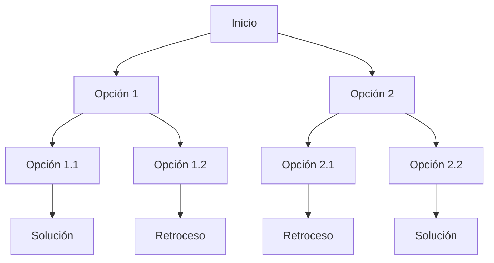

# Estructuras de Datos - Recursion

## 5.2 Búsqueda con retroceso mínimo (backtrack).

---

### 1. Definición de Backtracking

El **backtracking** o **búsqueda con retroceso mínimo** es una técnica algorítmica basada en **recursión** que explora todas las posibles soluciones a un problema, construyendo soluciones paso a paso y retrocediendo (backtrack) cuando se determina que una decisión no conduce a una solución válida.

En esencia, es una **búsqueda en árbol de decisiones** en la que se descartan ramas innecesarias.

### 2. Esquema General de Backtracking

Un algoritmo de backtracking sigue este esquema recursivo:

$$ \text{Backtrack}(estado) = \begin{cases} \text{Solución encontrada, procesar} & \text{si estado es solución} \\\ \text{Para cada opción válida:} & \\\ \quad \text{Hacer movimiento} \\\ \quad \text{Llamar recursivamente a Backtrack} \\\ \quad \text{Deshacer movimiento (retroceso)} \end{cases} $$

### 3. Representación en Árbol de Decisión



### 4. Ejemplo Clásico: Problema de las N-Reinas

El problema consiste en colocar $N$ reinas en un tablero de ajedrez $N \\times N$ de modo que ninguna se ataque entre sí.

#### Fórmula de restricción

Una reina en posición $(i, j)$ **ataca** a otra en posición $(x, y)$ si:

$$ i = x \\quad \\lor \\quad j = y \\quad \\lor \\quad |i-x| = |j-y| $$

### 5. Código de Ejemplo

#### Implementación en Python: N-Reinas con Backtracking

```python
def es_valido(tablero, fila, col):
    for i in range(fila):
        if tablero[i] == col or abs(tablero[i] - col) == abs(i - fila):
            return False
    return True

def n_reinas(tablero, fila, N):
    if fila == N:
        print("Solución:", tablero)
        return True
    for col in range(N):
        if es_valido(tablero, fila, col):
            tablero[fila] = col
            if n_reinas(tablero, fila + 1, N):
                return True
            tablero[fila] = -1  # retroceso
    return False

N = 4
tablero = [-1] * N
n_reinas(tablero, 0, N)
```

#### Implementación en C: Backtracking genérico

```c
#include <stdio.h>

#define N 4

int es_valido(int tablero[], int fila, int col) {
    for (int i = 0; i < fila; i++) {
        if (tablero[i] == col || (fila - i) == abs(tablero[i] - col)) {
            return 0;
        }
    }
    return 1;
}

int resolver(int tablero[], int fila) {
    if (fila == N) {
        printf("Solución: ");
        for (int i = 0; i < N; i++) printf("%d ", tablero[i]);
        printf("\\n");
        return 1;
    }
    for (int col = 0; col < N; col++) {
        if (es_valido(tablero, fila, col)) {
            tablero[fila] = col;
            if (resolver(tablero, fila + 1)) return 1;
            tablero[fila] = -1; // retroceso
        }
    }
    return 0;
}

int main() {
    int tablero[N];
    for (int i = 0; i < N; i++) tablero[i] = -1;
    resolver(tablero, 0);
    return 0;
}
```

### 6. Aplicaciones del Backtracking

- Problema de las **N-Reinas**
- Resolución de **laberintos**
- Juegos de tablero (Sudoku, ajedrez, etc.)
- Generación de **permutaciones y combinaciones**
- Optimización de búsquedas en **inteligencia artificial**

### 7. Conclusiones

- El **backtracking** es una técnica general que explora soluciones mediante **recursión y retroceso**.
- Permite resolver problemas complejos de forma sistemática.
- Aunque puede tener **alto costo computacional** en el peor caso, es una base fundamental para optimizaciones más avanzadas como **poda de búsqueda (branch and bound)**.

### 8. Referencias

- Horowitz, E., Sahni, S., & Anderson-Freed, S. (2008). _Fundamentals of Data Structures in C_.
- Knuth, D. E. (1997). _The Art of Computer Programming, Vol. 1_.
