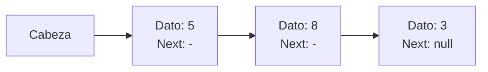

# Estructuras de Datos - Listas

## 6.1 TDA Lista, definición, alternativas de instrumentación.

---

### 1. Definición del TDA Lista

Una Lista es un Tipo de Dato Abstracto (TDA) que representa una secuencia ordenada de elementos donde cada elemento tiene una posición específica. Es una de las estructuras de datos fundamentales en informática.

Matemáticamente, una lista de n elementos puede representarse como:

$L = (a_0, a_1, a_2, \ldots, a_{n-1})$

Donde:

$a_i$ representa el elemento en la posición i-ésima

$n$ es el tamaño o longitud de la lista

El índice del primer elemento es 0 (en la mayoría de lenguajes de programación)

#### 1.1 Operaciones Fundamentales del TDA Lista

1. Crear: Construye una lista vacía
2. Insertar: Añade un elemento en una posición específica
3. Eliminar: Remueve un elemento de una posición específica
4. Obtener: Accede al elemento en una posición dada
5. Longitud: Devuelve el número de elementos
6. Vacía: Verifica si la lista no contiene elementos
7. Buscar: Encuentra la posición de un elemento específico
8. Modificar: Cambia el valor de un elemento en una posición

#### 1.2 Alternativas de Instrumentación

**Implementación con Arreglos**

Los arreglos almacenan elementos en posiciones contiguas de memoria.

```c
#define MAX_SIZE 100

typedef struct {
    int data[MAX_SIZE];
    int size;
} ArrayList;

void initList(ArrayList *list) {
    list->size = 0;
}

int insert(ArrayList *list, int position, int value) {
    if (list->size >= MAX_SIZE || position < 0 || position > list->size) {
        return 0; // Error
    }

    for (int i = list->size; i > position; i--) {
        list->data[i] = list->data[i-1];
    }

    list->data[position] = value;
    list->size++;
    return 1; // Éxito
}
```

**Ventajas:**

- Acceso rápido a cualquier elemento en tiempo $O(1)$
- Bajo overhead de memoria

**Desventajas:**

- Tamaño fijo (a menos que sea dinámico)
- Inserción/eliminación en $O(n)$

### 2. Implementación con Listas Enlazadas

Cada elemento (nodo) contiene el dato y una referencia al siguiente elemento.

```c
typedef struct Node {
    int data;
    struct Node *next;
} Node;

typedef struct {
    Node *head;
    int size;
} LinkedList;

Node* createNode(int value) {
    Node *newNode = (Node*)malloc(sizeof(Node));
    newNode->data = value;
    newNode->next = NULL;
    return newNode;
}

int insert(LinkedList *list, int position, int value) {
    if (position < 0 || position > list->size) {
        return 0; // Error
    }

    Node *newNode = createNode(value);

    if (position == 0) {
        newNode->next = list->head;
        list->head = newNode;
    } else {
        Node *current = list->head;
        for (int i = 0; i < position - 1; i++) {
            current = current->next;
        }
        newNode->next = current->next;
        current->next = newNode;
    }

    list->size++;
    return 1; // Éxito
}
```

**Ventajas:**

- Tamaño dinámico
- Inserción y eliminación en $O(1)$ al inicio de la lista; al final, la inserción es $O(1)$ si se mantiene un apuntador al último nodo, pero la eliminación sigue siendo $O(n)$, porque hay que recorrer la lista para encontrar al penúltimo

**Desventajas:**

- Acceso secuencial (tiempo $O(n)$ para acceso por índice)
- Mayor overhead de memoria por los punteros

### 3. Implementación con Listas Doblemente Enlazadas

Similar a la lista enlazada simple, pero cada nodo tiene referencias al anterior y siguiente.

```c
typedef struct DNode {
    int data;
    struct DNode *prev;
    struct DNode *next;
} DNode;

typedef struct {
    DNode *head;
    DNode *tail;
    int size;
} DoublyLinkedList;
```

**Ventajas:**

- Navegación en ambas direcciones
- Eliminación más eficiente desde ambos extremos

**Desventajas:**

- Mayor overhead de memoria (dos punteros por nodo)
- Mayor complejidad en la manipulación

### 4. Comparación de Complejidades

| Operación             | Arreglo   | Lista Enlazada | Lista Doblemente Enlazada |
| --------------------- | --------- | -------------- | ------------------------- |
| Acceso por índice     | $O(1)$    | $O(n)$         | $O(n)$                    |
| Inserción al inicio   | $O(n)$    | $O(1)$         | $O(1)$                    |
| Inserción al final    | $ O(1)* $ | $ O(1)** $     | $O(1)$                    |
| Eliminación al inicio | $O(n)$    | $O(1)$         | $O(1)$                    |
| Eliminación al final  | $O(1)$    | $O(n)$         | $O(1)$                    |
| Búsqueda              | $O(n)$    | $O(n)$         | $O(n)$                    |

*Asumiendo que hay espacio disponible\
**Si se mantiene referencia al último nodo



### 5. Ejemplo de Uso

```c
#include <stdio.h>
#include <stdlib.h>

// Ejemplo de lista enlazada simple
int main() {
    LinkedList list;
    list.head = NULL;
    list.size = 0;

    // Insertar elementos
    insert(&list, 0, 10); // [10]
    insert(&list, 1, 20); // [10, 20]
    insert(&list, 1, 15); // [10, 15, 20]

    // Recorrer la lista
    Node *current = list.head;
    while (current != NULL) {
        printf("%d -> ", current->data);
        current = current->next;
    }
    printf("NULL\n");

    return 0;
}
```

### 6. Aplicaciones de las Listas

1. Implementación de pilas y colas
2. Gestión de memoria
3. Sistemas de archivos
4. Navegación en navegadores web (historial)
5. Listas de reproducción en multimedia

### 7. Consideraciones de Diseño

Al implementar un TDA Lista, debemos considerar:

1. Interfaz uniforme: Definir operaciones consistentes
2. Manejo de errores: Comportamiento en casos límite
3. Eficiencia: Elegir la implementación según el uso previsto
4. Mantenibilidad: Código claro y documentado

### 8. Referencias

- Weiss, M. A. (2013). Data Structures and Algorithm Analysis in C.
- Cormen, T. H., et al. (2009). Introduction to Algorithms.
- Sedgewick, R. (2011). Algorithms in C.
