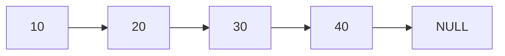
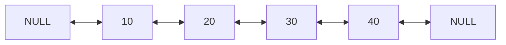
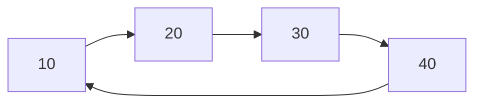

# Estructuras de Datos - Listas

## 6.3 Variantes de lista: ligadura doble, circular, etc.

---

### 1. Introducción

Una lista es una estructura de datos dinámica y lineal que permite organizar elementos (nodos) conectados mediante referencias o punteros.
Existen variantes de listas que ofrecen diferentes ventajas según el tipo de operaciones requeridas.

### 2. Tipos de Listas y sus Variantes

#### 2.1 Lista Simplemente Ligada

Cada nodo contiene:

- Dato
- Puntero al siguiente nodo



**Ventajas:** inserción y eliminación rápidas al inicio.\
**Desventajas:** búsqueda lenta ( $O(n)$ ), no se puede retroceder.

#### 2.2 Lista Doblemente Ligada

Cada nodo contiene:

- Puntero al nodo anterior
- Dato
- Puntero al siguiente nodo



**Ventajas:** recorrido en ambas direcciones.\
**Desventajas:** requiere más memoria por puntero extra.

Ejemplo en C

```c
typedef struct Nodo {
int dato;
struct Nodo* anterior;
struct Nodo* siguiente;
} Nodo;
```

#### 2.3 Lista Circular

El último nodo apunta nuevamente al primero, formando un ciclo.



Puede ser simplemente ligada circular o doblemente ligada circular.

**Ventajas:** no existe nodo nulo, se puede recorrer infinitamente.\
**Aplicaciones:** sistemas operativos (planificación de procesos con Round-Robin).

#### 2.4 Lista de Cabeza (con nodo centinela)

Incluye un nodo especial (cabeza) que no almacena datos, solo referencia al primer y/o último nodo.
Facilita operaciones de inserción y eliminación evitando casos especiales.

### 3. Operaciones Principales en Variantes

Inserción en Lista Circular (ejemplo en C)

```c
void insertarCircular(Nodo** cabeza, int valor) {
Nodo* nuevo = (Nodo*)malloc(sizeof(Nodo));
nuevo->dato = valor;
if (*cabeza == NULL) {
*cabeza = nuevo;
nuevo->siguiente = cabeza;
} else {
Nodo temp = *cabeza;
while (temp->siguiente != *cabeza) {
temp = temp->siguiente;
}
temp->siguiente = nuevo;
nuevo->siguiente = *cabeza;
}
}
```

### 4. Complejidad de las Variantes

| Operación             | Lista Simple | Lista Doble                | Lista Circular |
| --------------------- | ------------ | -------------------------- | -------------- |
| Inserción al inicio   | $O(1)$       | $O(1)$                     | $O(1)$         |
| Inserción al final    | $O(n)$       | $O(1)$ (si se guarda cola) | $O(n)$         |
| Eliminación al inicio | $O(1)$       | $O(1)$                     | $O(1)$         |
| Eliminación al final  | $O(n)$       | $O(1)$                     | $O(n)$         |
| Búsqueda por índice   | $O(n)$       | $O(n)$                     | $O(n)$         |

### 5. Aplicaciones Comunes

- Listas dobles: editores de texto, navegadores (botón atrás/adelante).
- Listas circulares: planificación de procesos, colas circulares en buffers.
- Listas con centinela: algoritmos de manipulación de grandes estructuras dinámicas.

### 6. Conclusiones

- La elección de variante depende de la frecuencia de operaciones.
- Listas doblemente ligadas mejoran la navegación, a costa de más memoria.
- Listas circulares son útiles cuando el recorrido repetitivo es necesario.

### 7. Referencias

- Horowitz, E., Sahni, S., & Anderson-Freed, S. (2008). Fundamentals of Data Structures in C.
- Cormen, T. H., Leiserson, C. E., Rivest, R. L., & Stein, C. (2009). Introduction to Algorithms.
