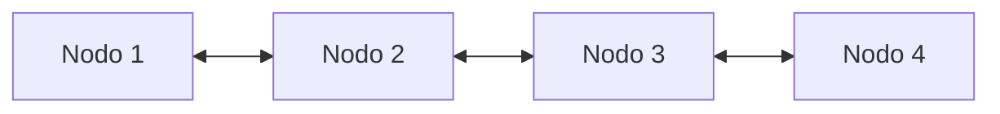

# Estructuras de Datos - Listas

## 6.4 Complejidad de operaciones, iterador.

---

### 1. Introducción

Las **listas** son estructuras dinámicas de datos que permiten almacenar y manipular colecciones de elementos conectados mediante punteros o referencias.

Al analizarlas, dos aspectos fundamentales son:

1. **Complejidad de operaciones**: mide el costo computacional (tiempo o memoria) de realizar inserciones, eliminaciones, búsquedas, etc.
2. **Iteradores**: objetos que permiten recorrer los elementos de la lista de manera secuencial y controlada, sin exponer los detalles internos de la implementación.

### 2. Complejidad de operaciones en Listas

#### 2.1 Lista Simplemente Ligada

| Operación             | Complejidad |
| --------------------- | ----------- |
| Inserción al inicio   | $O(1)$      |
| Inserción al final    | $O(n)$      |
| Eliminación al inicio | $O(1)$      |
| Eliminación al final  | $O(n)$      |
| Búsqueda de elemento  | $O(n)$      |
| Acceso por índice     | $O(n)$      |

#### 2.2 Lista Doblemente Ligada

| Operación             | Complejidad                                |
| --------------------- | ------------------------------------------ |
| Inserción al inicio   | $O(1)$                                     |
| Inserción al final    | $O(1)$ (si se guarda referencia a la cola) |
| Eliminación al inicio | $O(1)$                                     |
| Eliminación al final  | $O(1)$                                     |
| Búsqueda de elemento  | $O(n)$                                     |
| Acceso por índice     | $O(n)$                                     |

#### 2.3 Lista Circular

La complejidad es similar a la lista simple/doble, pero con la ventaja de que no existen nodos nulos.

**Aplicación:** recorridos cíclicos (planificación de procesos, buffers circulares).

### 3. Iteradores en Listas

Un **iterador** es un objeto o mecanismo que permite:

- Recorrer los elementos de una lista de manera secuencial.
- Acceder al "siguiente" (y en listas dobles, también al "anterior").
- Abstraerse de los detalles de implementación interna.

#### 3.1 Ejemplo de Iterador en C (lista simplemente ligada)

```c
typedef struct Nodo {
    int dato;
    struct Nodo* siguiente;
} Nodo;

typedef struct {
    Nodo* actual;
} Iterador;

Iterador crearIterador(Nodo* cabeza) {
    Iterador it;
    it.actual = cabeza;
    return it;
}

int haySiguiente(Iterador* it) {
    return it->actual != NULL;
}

int siguiente(Iterador* it) {
    int valor = it->actual->dato;
    it->actual = it->actual->siguiente;
    return valor;
}
```

#### 3.2 Ejemplo de Iterador en Python

```python
class Nodo:
    def __init__(self, dato):
        self.dato = dato
        self.siguiente = None

class Lista:
    def __init__(self):
        self.cabeza = None

    def __iter__(self):
        nodo = self.cabeza
        while nodo:
            yield nodo.dato
            nodo = nodo.siguiente

# Ejemplo de uso
l = Lista()
l.cabeza = Nodo(10)
l.cabeza.siguiente = Nodo(20)
l.cabeza.siguiente.siguiente = Nodo(30)

for valor in l:
    print(valor)  # Imprime 10, 20, 30
```

### 4. Iteradores Bidireccionales

En listas doblemente ligadas se pueden implementar **iteradores bidireccionales**, que permiten recorrer hacia adelante y hacia atrás.

**Diagrama de un iterador en lista doblemente ligada**



Aquí el iterador apunta al nodo 2, pero puede avanzar al nodo 3 o retroceder al nodo 1.

### 5. Conclusiones

- La **complejidad** depende de la variante de lista: simplemente ligada, doble o circular.
- Los **iteradores** permiten recorrer listas sin exponer punteros ni estructuras internas.
- En lenguajes modernos (como Python, Java, C++), los iteradores son parte esencial para manipular colecciones de datos de forma elegante y segura.

### 6. Referencias

- Horowitz, Ellis & Sahni, Sartaj. _Fundamentals of Data Structures_.
- Cormen, Thomas H. et al. _Introduction to Algorithms_.
- Goodrich, M. T., Tamassia, R. (2015). _Data Structures and Algorithms in Java_.
