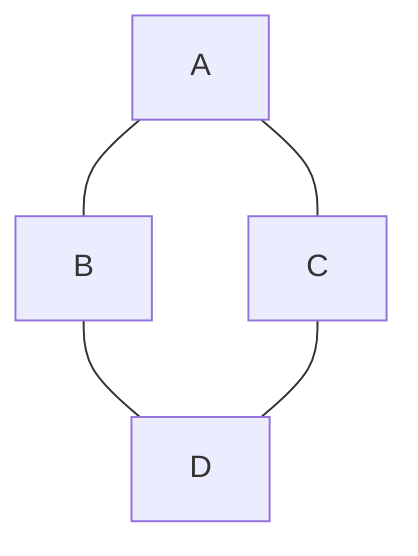

# Estructuras de Datos - Listas

## 6.5 Aplicaciones.

---

Las **listas** son estructuras de datos dinámicas que permiten almacenar y manipular colecciones de elementos.\
Son muy utilizadas en distintos ámbitos de la programación debido a su flexibilidad para representar información secuencial.

### Aplicaciones de las Listas

#### 1. Representación de Colas y Pilas

Las listas permiten implementar **estructuras abstractas** como:

- **Pilas (Stack):** modelo LIFO (Last In, First Out).
- **Colas (Queue):** modelo FIFO (First In, First Out).

**Ejemplo en Python (Pila con lista):**

```python
pila = []
pila.append(10)
pila.append(20)
pila.append(30)
print(pila.pop())  # 30
```

**Ejemplo en Python (Cola con lista):**

```python
from collections import deque

cola = deque()
cola.append(1)
cola.append(2)
cola.append(3)
print(cola.popleft())  # 1
```

#### 2. Listas como Tablas de Búsqueda

Las listas permiten almacenar registros de información para búsquedas
lineales.

**Ejemplo:**

```python
nombres = ["Ana", "Luis", "Pedro", "Marta"]
buscado = "Luis"

if buscado in nombres:
    print("Elemento encontrado")
```

La complejidad de la **búsqueda lineal** es:\
$$ O(n) $$

#### 3. Representación de Grafos

Un grafo puede representarse mediante **listas de adyacencia**.

**Ejemplo en Python:**

```python
grafo = {
    "A": ["B", "C"],
    "B": ["A", "D"],
    "C": ["A", "D"],
    "D": ["B", "C"]
}
```

**Diagrama (grafo no dirigido):**



#### 4. Manejo de Polinomios

Un polinomio puede representarse con una lista donde cada nodo almacena coeficiente y exponente.

**Ejemplo:** $$ P(x) = 5x^3 + 2x^2 + 7x + 4 $$

Representación con lista en Python:

```python
polinomio = [(5,3), (2,2), (7,1), (4,0)]
```

#### 5. Listas en Memoria Dinámica

Se usan en aplicaciones que requieren asignación flexible de memoria, como:

- Sistemas operativos (manejo de procesos).
- Aplicaciones gráficas (objetos en pantalla).
- Programación de simulaciones.

### Conclusión

Las listas son estructuras muy versátiles.\
Su capacidad de crecer y reducirse dinámicamente las convierte en una base esencial para construir estructuras más complejas como árboles, grafos, pilas y colas.
