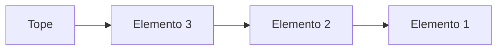

# Estructuras de Datos - Pilas

## 7.1 TDA Pila, definición, alternativas de instrumentación.

---

Las **pilas** son una **estructura de datos abstracta (TDA)** que almacena elementos de manera secuencial pero con acceso restringido: solo se puede **insertar** o **eliminar** elementos por un extremo llamado **tope** (top). Esta característica se conoce como **LIFO (Last In, First Out)**.

### Definición de TDA Pila

Un TDA Pila se define por:

- Un **conjunto de elementos** que se pueden almacenar.
- Dos operaciones fundamentales:
  - **push(e):** inserta el elemento $e$ en la pila.
  - **pop():** elimina y devuelve el elemento del tope de la pila.
- Operación auxiliar **peek() o top()** para consultar el elemento del
  tope sin eliminarlo.
- Función de verificación **isEmpty()** para determinar si la pila
  está vacía.

**Formalmente:**\

Sea $P$ una pila y $e$ un elemento:

$$ push(P, e) \rightarrow P' = P + e $$

$$ pop(P) \rightarrow (P', e) \text{ donde } e \text{ es el elemento removido del tope} $$

### Alternativas de Instrumentación

#### 1. Pila con Lista Enlazada

Cada nodo contiene un **valor** y un **puntero al siguiente**.

**Python:**

```python
class Nodo:
    def __init__(self, valor):
        self.valor = valor
        self.siguiente = None

class Pila:
    def __init__(self):
        self.tope = None

    def push(self, valor):
        nuevo = Nodo(valor)
        nuevo.siguiente = self.tope
        self.tope = nuevo

    def pop(self):
        if self.tope is None:
            return None
        valor = self.tope.valor
        self.tope = self.tope.siguiente
        return valor

    def is_empty(self):
        return self.tope is None
```

**Diagrama Mermaid:**



#### 2. Pila con Arreglo o Lista

Se utiliza una lista o arreglo de tamaño fijo o dinámico.

**Python:**

```python
pila = []
pila.append(10)  # push
pila.append(20)
pila.append(30)

print(pila.pop())  # 30
```

**Complejidad de operaciones:**\

- **Push:** $O(1)$ amortizado - **Pop:** $O(1)$ - **Peek:** $O(1)$

#### 3. Pila Circular (para memoria fija)

- Usada en sistemas embebidos o cuando el tamaño es limitado.
- Permite optimizar memoria y evitar desplazamientos innecesarios.

**Estructura básica:**

```python
class PilaCircular:
    def __init__(self, capacidad):
        self.datos = [None] * capacidad
        self.tope = -1
        self.capacidad = capacidad

    def push(self, valor):
        if self.tope < self.capacidad - 1:
            self.tope += 1
            self.datos[self.tope] = valor

    def pop(self):
        if self.tope == -1:
            return None
        valor = self.datos[self.tope]
        self.tope -= 1
        return valor
```

### Aplicaciones de las Pilas

1.  **Evaluación de expresiones aritméticas:** Notación infija, prefija
    y postfija.\
2.  **Deshacer/rehacer en editores de texto.**\
3.  **Recorridos de árboles y grafos (DFS).**\
4.  **Verificación de paréntesis balanceados.**

**Ejemplo de expresión postfija:**

$$ 3 \ 4 + 2 \ * $$

**Código en Python:**

```python
def evaluar_postfija(expresion):
    pila = []
    for token in expresion.split():
        if token.isdigit():
            pila.append(int(token))
        else:
            b = pila.pop()
            a = pila.pop()
            if token == '+':
                pila.append(a+b)
            elif token == '*':
                pila.append(a*b)
    return pila.pop()

print(evaluar_postfija("3 4 + 2 *"))  # 14
```

### Conclusión

El TDA Pila es una estructura simple pero extremadamente útil.\
Las alternativas de instrumentación permiten adaptarla a distintos entornos: **listas enlazadas, arreglos dinámicos o pilas circulares**.\
Su naturaleza **LIFO** es ideal para problemas donde el último elemento ingresado es el primero en ser procesado.
