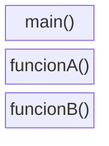
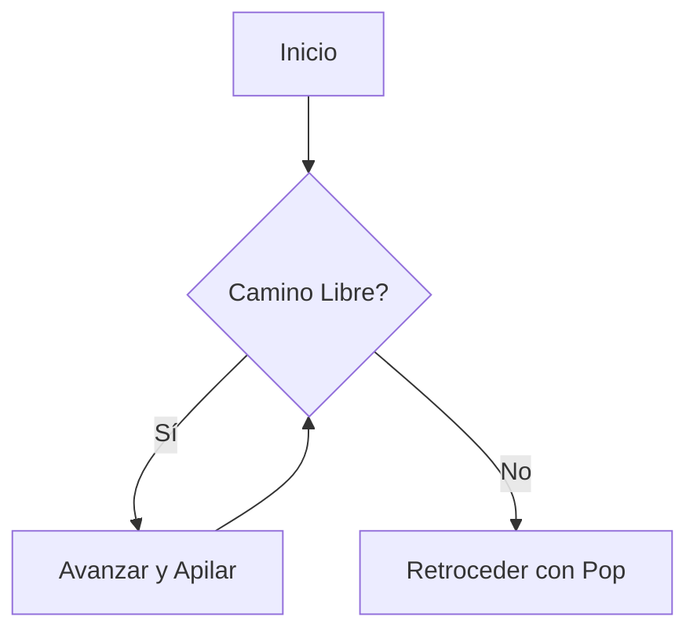
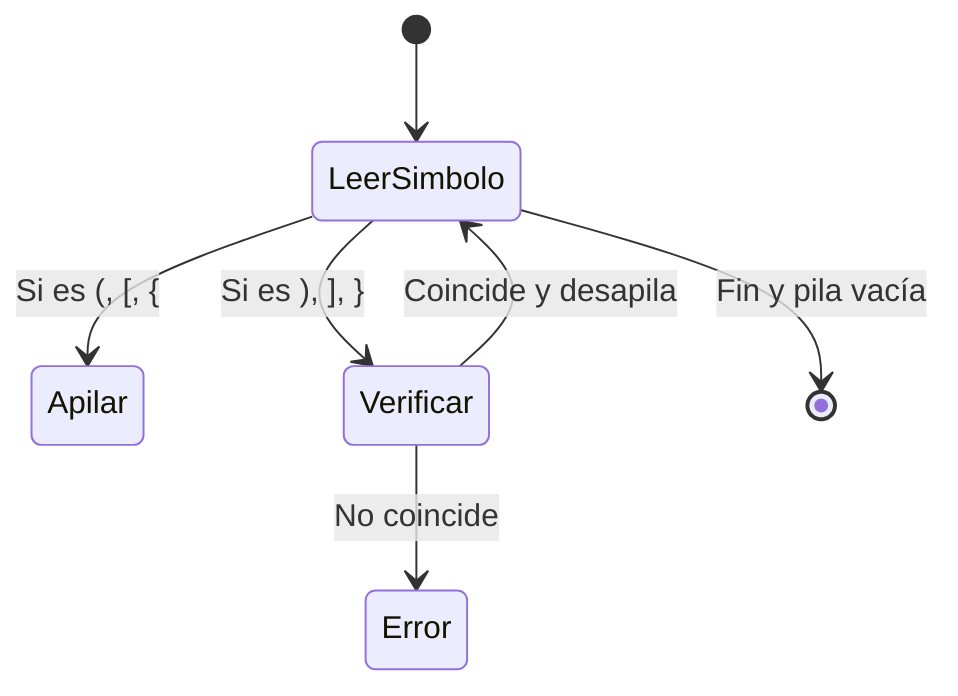

# Estructuras de Datos - Pilas

## 7.3 Aplicaciones

---

### 1. Introducción

Las **pilas** son una de las estructuras de datos fundamentales en ciencias de la computación. Gracias a su naturaleza **LIFO (Last In, First Out)**, resultan útiles en múltiples problemas computacionales, especialmente aquellos que requieren deshacer acciones, evaluar expresiones o gestionar recursividad.

### 2. Aplicaciones principales de las pilas

#### 2.1 Manejo de llamadas de funciones (Stack de ejecución)

En casi todos los lenguajes de programación, el sistema utiliza una **pila de ejecución** para manejar:

- Llamadas de funciones.
- Retornos de funciones.
- Variables locales y contexto.

**Ejemplo en C:**

```c
#include <stdio.h>

void funcionB() {
    printf("Dentro de B\n");
}

void funcionA() {
    funcionB();
    printf("Dentro de A\n");
}

int main() {
    funcionA();
    return 0;
}
```

En este ejemplo, el compilador utiliza una pila:

1. `main()` se coloca en la pila.
2. Llama a `funcionA()`, que se apila sobre `main()`.
3. `funcionA()` llama a `funcionB()`, que se apila sobre `funcionA()`.
4. Al terminar cada función, se desapila en orden inverso.

**Diagrama (Pila de ejecución):**



#### 2.2 Evaluación de expresiones aritméticas

Las pilas son fundamentales para evaluar expresiones en notación:

- **Infija:** `(3 + 5) * 2`
- **Postfija (Polaca inversa):** `3 5 + 2 *`
- **Prefija (Polaca):** `* + 3 5 2`

**Ejemplo en Python para evaluar postfija:**

```python
def evaluar_postfija(expresion):
    pila = []
    for token in expresion.split():
        if token.isdigit():
            pila.append(int(token))
        else:
            b = pila.pop()
            a = pila.pop()
            if token == '+':
                pila.append(a + b)
            elif token == '*':
                pila.append(a * b)
    return pila.pop()

print(evaluar_postfija("3 5 + 2 *"))  # Salida: 16
```

**Notación formal:**

$$ E = Operando_1 \; Operando_2 \; Operador $$

#### 2.3 Algoritmos de Backtracking

La técnica de **backtracking** (retroceso) se basa en pilas para recordar decisiones anteriores y revertirlas cuando se llega a un punto muerto.

Ejemplos:

- Resolver un **laberinto**.
- Resolver el problema de las **N-reinas**.
- Juegos de rompecabezas como el **Sudoku**.

**Diagrama Mermaid (ejemplo de laberinto):**



#### 2.4 Manejo de historial (Navegadores, editores)

Los navegadores y editores de texto utilizan pilas para implementar:

- **Historial de navegación (Back/Forward).**
- **Operaciones de deshacer/rehacer (Undo/Redo).**

**Ejemplo en Python:**

```python
historial = []
redo = []

# Usuario visita páginas
historial.append("google.com")
historial.append("openai.com")
historial.append("github.com")

print("Historial:", historial)

# Retrocede
redo.append(historial.pop())
print("Después de retroceder:", historial)
print("Redo:", redo)
```

#### 2.5 Validación de expresiones balanceadas

Las pilas se usan para verificar si los paréntesis, corchetes o llaves están correctamente balanceados en una expresión.

**Ejemplo en Python:**

```python
def expresion_balanceada(expresion):
    pila = []
    pares = {')':'(', ']':'[', '}':'{'}
    for simbolo in expresion:
        if simbolo in "([{":
            pila.append(simbolo)
        elif simbolo in ")]}":
            if not pila or pila[-1] != pares[simbolo]:
                return False
            pila.pop()
    return not pila

print(expresion_balanceada("{[()]}"))  # True
print(expresion_balanceada("{[(])}"))  # False
```

**Diagrama Mermaid:**



### 3. Complejidad

En todas estas aplicaciones, las operaciones sobre la pila se realizan en **tiempo constante**:

| Operación | Complejidad |
| --------- | ----------- |
| push      | $O(1)$      |
| pop       | $O(1)$      |
| top       | $O(1)$      |

### 4. Conclusiones

- Las pilas son una estructura simple pero extremadamente útil.
- Permiten implementar **historiales, recursividad, validaciones y retroceso** de manera eficiente.
- Son base para el **compilador**, el **intérprete de expresiones**, y diversas aplicaciones prácticas.

### 5. Referencias

- Cormen, T. H., Leiserson, C. E., Rivest, R. L., & Stein, C. (2009). _Introduction to Algorithms_ (3rd ed.). MIT Press.
- Goodrich, M. T., Tamassia, R., & Goldwasser, M. H. (2014). _Data Structures and Algorithms in Python_. Wiley.
- Weiss, M. A. (2013). _Data Structures and Algorithm Analysis in C++_. Pearson.
