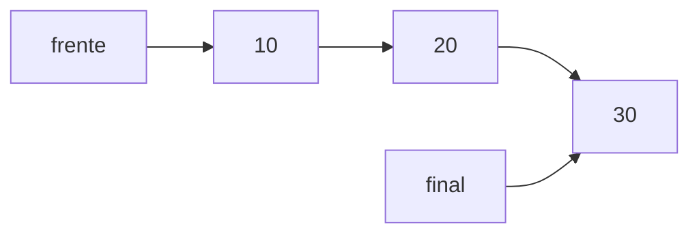

# Estructuras de Datos - Colas

## 8.1 TDA Cola, definición, alternativas de instrumentación.

---

### 1. Definición de Cola

Una **cola** es una estructura de datos lineal que sigue el principio **FIFO (First In, First Out)**, es decir, el primer elemento en entrar es el primero en salir. Se puede imaginar como una fila en un banco: la persona que llega primero es atendida primero.

**Notación formal:**
$$ cola = [e_1, e_2, ..., e_n] $$
Donde $e_1$ es el primer elemento (frente) y $e_n$ es el último (final).

### 2. TDA Cola (Tipo Abstracto de Datos)

El **TDA Cola** define un conjunto de operaciones que cualquier implementación de cola debe proporcionar:

| Operación  | Descripción                                  |
| ---------- | -------------------------------------------- |
| enqueue(e) | Inserta el elemento `e` al final de la cola. |
| dequeue()  | Remueve y retorna el elemento al frente.     |
| front()    | Retorna el elemento al frente sin removerlo. |
| is_empty() | Verifica si la cola está vacía.              |
| size()     | Retorna el número de elementos en la cola.   |

### 3. Alternativas de instrumentación

#### 3.1 Implementación con arreglos

- Se utiliza un arreglo fijo o dinámico para almacenar los elementos.
- **Problema potencial:** el desplazamiento de elementos al desencolar puede ser costoso ( $O(n)$ ).
- **Solución:** uso de **cola circular**.

**Ejemplo en Python:**

```python
class ColaArreglo:
    def __init__(self, capacidad=10):
        self.items = [None]*capacidad
        self.frente = 0
        self.final = 0
        self.size = 0
        self.capacidad = capacidad

    def enqueue(self, elemento):
        if self.size == self.capacidad:
            raise Exception("Cola llena")
        self.items[self.final] = elemento
        self.final = (self.final + 1) % self.capacidad
        self.size += 1

    def dequeue(self):
        if self.size == 0:
            return None
        elemento = self.items[self.frente]
        self.frente = (self.frente + 1) % self.capacidad
        self.size -= 1
        return elemento

    def front(self):
        if self.size == 0:
            return None
        return self.items[self.frente]
```

#### 3.2 Implementación con listas enlazadas

- Se utiliza un **nodo** con referencia al siguiente.
- Permite tamaño dinámico y operaciones eficientes ( $O(1)$ ) para encolar y desencolar.

**Ejemplo en Python:**

```python
class Nodo:
    def __init__(self, valor):
        self.valor = valor
        self.siguiente = None

class ColaEnlazada:
    def __init__(self):
        self.frente = None
        self.final = None

    def enqueue(self, valor):
        nodo = Nodo(valor)
        if self.final:
            self.final.siguiente = nodo
        self.final = nodo
        if not self.frente:
            self.frente = nodo

    def dequeue(self):
        if not self.frente:
            return None
        valor = self.frente.valor
        self.frente = self.frente.siguiente
        if not self.frente:
            self.final = None
        return valor

    def front(self):
        if self.frente:
            return self.frente.valor
        return None
```

**Diagrama (Lista enlazada):**



### 4. Complejidad de las operaciones

| Implementación | enqueue | dequeue | front |
| -------------- | ------- | ------- | ----- |
| Arreglo        | O(1)*   | O(1)*   | O(1)  |
| Lista enlazada | O(1)    | O(1)    | O(1)  |

\*Para arreglos se asume **cola circular**.

### 5. Conclusiones

- El **TDA Cola** es útil para procesos en **orden de llegada**.
- Las alternativas de instrumentación dependen de las necesidades de **eficiencia y tamaño dinámico**.
- La **cola circular** y la **lista enlazada** son las implementaciones más comunes.

### 6. Referencias

- Cormen, T. H., Leiserson, C. E., Rivest, R. L., & Stein, C. (2009). _Introduction to Algorithms_ (3rd ed.). MIT Press.
- Goodrich, M. T., Tamassia, R., & Goldwasser, M. H. (2014). _Data Structures and Algorithms in Python_. Wiley.
- Weiss, M. A. (2013). _Data Structures and Algorithm Analysis in C++_. Pearson.
