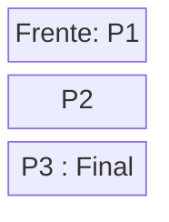
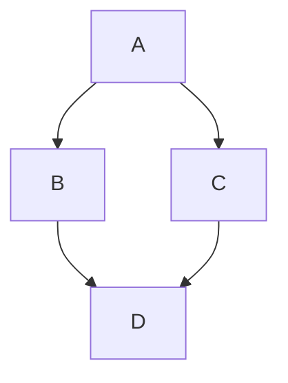

# Estructuras de Datos - Colas

## 8.3 Aplicaciones.

---

### 1. Introducción

Las **colas** son estructuras de datos lineales que siguen el principio **FIFO (First In, First Out)**. Son ampliamente utilizadas para gestionar elementos en orden de llegada y en situaciones donde se requiere procesamiento secuencial.

### 2. Aplicaciones principales de las colas

#### 2.1 Gestión de procesos en sistemas operativos

- Las colas se utilizan para planificar la ejecución de procesos.
- **Cola de CPU:** Procesos esperando por tiempo de CPU.
- **Cola de impresión:** Documentos en espera de impresión.

**Ejemplo conceptual:**

Cola de procesos: [P1, P2, P3]\
Dequeue -> P1 ejecuta, luego P2, luego P3

**Diagrama (Cola de procesos):**



#### 2.2 Simulación de colas en la vida real

- Bancos, supermercados y aeropuertos utilizan colas para atención secuencial.
- Se puede modelar cada cliente como un nodo en la cola.

**Diagrama Mermaid (supermercado):**


#### 2.3 Manejo de buffers y colas de datos

- **Colas de mensajes (Message Queues):** Comunicación entre procesos.
- **Buffers circulares:** Gestión de streaming de datos y redes.

**Ejemplo en Python (Buffer simple):**

```python
from collections import deque
buffer = deque(maxlen=5)

buffer.append(1)
buffer.append(2)
buffer.append(3)
print(buffer)  # deque([1,2,3], maxlen=5)
```

#### 2.4 Algoritmos de búsqueda y recorrido de grafos

- Las **colas** son esenciales en el algoritmo **BFS (Breadth-First Search)**.
- Permiten explorar nodos por niveles.

**Ejemplo BFS en Python:**

```python
from collections import deque

def bfs(grafo, inicio):
    visitados = set()
    cola = deque([inicio])

    while cola:
        nodo = cola.popleft()
        if nodo not in visitados:
            visitados.add(nodo)
            cola.extend(grafo[nodo] - visitados)
    return visitados
```

**Diagrama Mermaid BFS:**



#### 2.5 Sistemas de atención y simulación de eventos

- Colas para **simulación discreta de eventos**.
- Modelan eventos que se procesan en orden temporal.
- Se aplican en logística, tráfico y telecomunicaciones.

### 3. Complejidad de operaciones

| Operación | Cola enlazada | Cola circular (arreglo) |
| --------- | ------------- | ----------------------- |
| enqueue   | O(1)          | O(1)                    |
| dequeue   | O(1)          | O(1)                    |
| front     | O(1)          | O(1)                    |
| is_empty  | O(1)          | O(1)                    |

### 4. Conclusiones

- Las colas son fundamentales en **planificación, comunicación y procesamiento secuencial**.
- Se aplican tanto en sistemas informáticos como en la vida real para modelar flujos de trabajo.
- Su eficiencia y simplicidad hacen que sean ideales para **procesos ordenados y estructuras temporales de datos**.

### 5. Referencias

- Cormen, T. H., Leiserson, C. E., Rivest, R. L., & Stein, C. (2009). _Introduction to Algorithms_ (3rd ed.). MIT Press.
- Goodrich, M. T., Tamassia, R., & Goldwasser, M. H. (2014). _Data Structures and Algorithms in Python_. Wiley.
- Weiss, M. A. (2013). _Data Structures and Algorithm Analysis in C++_. Pearson.
