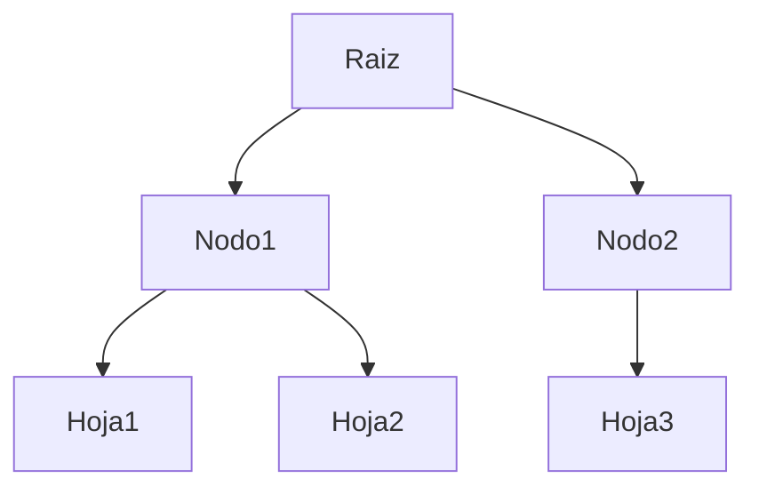
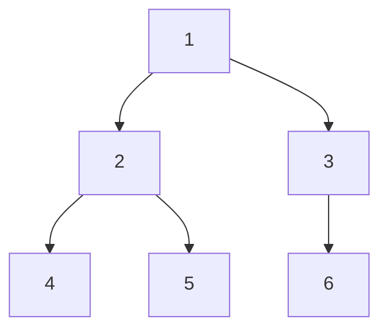
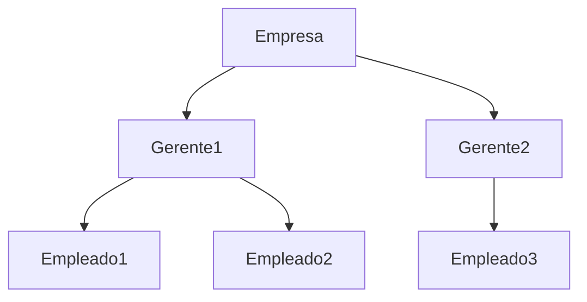

# Estructuras de Datos - Árboles

## 9.1 Concepto de Árbol, conceptos relacionados, TDA, instrumentación y aplicaciones.

---

### 1. Concepto de Árbol

Un **árbol** es una estructura de datos jerárquica que consta de nodos conectados mediante aristas. Se caracteriza por tener un nodo raíz y subárboles conectados a cada nodo. Los árboles son usados para representar relaciones de tipo jerárquico.

- **Nodo:** Unidad básica que contiene un valor y referencias a sus hijos.
- **Raíz (Root):** Nodo superior del árbol.
- **Hojas (Leaf):** Nodos sin hijos.
- **Padre:** Nodo que tiene hijos.
- **Hijo:** Nodo descendiente directo de otro nodo.
- **Subárbol:** Árbol contenido dentro de otro nodo.
- **Altura del árbol:** Longitud del camino más largo desde la raíz a una hoja.

**Diagrama Mermaid (ejemplo de árbol simple):**



### 2. Conceptos Relacionados

- **Grado de un nodo:** Número de hijos de un nodo.
- **Nivel de un nodo:** Profundidad desde la raíz.
- **Altura de un nodo:** Longitud del camino más largo desde ese nodo hasta una hoja.
- **Ancestro/Descendiente:** Relación entre nodos en diferentes niveles.
- **Árbol binario:** Cada nodo tiene como máximo dos hijos (izquierdo y derecho).
- **Árbol n-ario:** Cada nodo puede tener hasta n hijos.

**Ejemplo en Python (nodo básico):**

```python
class Nodo:
    def __init__(self, valor):
        self.valor = valor
        self.hijos = []  # Lista de hijos

raiz = Nodo(10)
raiz.hijos.append(Nodo(20))
raiz.hijos.append(Nodo(30))
```

### 3. TDA Árbol (Tipo Abstracto de Datos)

El **TDA Árbol** define operaciones fundamentales que toda implementación de árbol debe proporcionar:

| Operación              | Descripción                                                        |
| ---------------------- | ------------------------------------------------------------------ |
| insertar(valor, padre) | Inserta un nodo con valor bajo un nodo padre.                      |
| eliminar(valor)        | Elimina un nodo y sus subárboles.                                  |
| buscar(valor)          | Devuelve referencia al nodo con el valor buscado.                  |
| recorrido_preorden()   | Visita raíz, luego hijos recursivamente.                           |
| recorrido_inorden()    | Visita hijo izquierdo, raíz, hijo derecho (solo árboles binarios). |
| recorrido_postorden()  | Visita hijos, luego raíz.                                          |
| altura()               | Devuelve la altura del árbol.                                      |

### 4. Instrumentación / Implementación

#### 4.1 Árbol binario

**Ejemplo en Python:**

```python
class NodoBinario:
    def __init__(self, valor):
        self.valor = valor
        self.izquierdo = None
        self.derecho = None

raiz = NodoBinario(10)
raiz.izquierdo = NodoBinario(5)
raiz.derecho = NodoBinario(15)
```

#### 4.2 Árbol n-ario

**Ejemplo en Python:**

```python
class NodoNA:
    def __init__(self, valor):
        self.valor = valor
        self.hijos = []

raiz = NodoNA(1)
raiz.hijos.append(NodoNA(2))
raiz.hijos.append(NodoNA(3))
```

**Diagrama Mermaid (Árbol n-ario):**



### 5. Aplicaciones de los Árboles

1. **Sistemas de archivos:** Directorios y subdirectorios.
2. **Bases de datos:** Árboles B y B+ para indexación.
3. **Compiladores:** Árboles de sintaxis abstracta (AST).
4. **Algoritmos de búsqueda:** Árboles de decisión, búsqueda binaria.
5. **Redes y jerarquías organizacionales:** Representación jerárquica.
6. **Expresiones matemáticas:** Evaluación mediante árboles binarios de expresiones.

**Diagrama Mermaid (ejemplo jerárquico):**



### 6. Complejidad de Operaciones en Árboles Binarios

| Operación | Árbol Binario (balanceado) | Árbol Binario (desbalanceado) |
| --------- | -------------------------- | ----------------------------- |
| insertar  | O(log n)                   | O(n)                          |
| buscar    | O(log n)                   | O(n)                          |
| eliminar  | O(log n)                   | O(n)                          |
| recorrido | O(n)                       | O(n)                          |

### 7. Conclusiones

- Los árboles permiten **estructurar datos jerárquicamente**, facilitando búsquedas y recorridos eficientes.
- La instrumentación varía entre **binarios y n-arios**, dependiendo de la aplicación.
- Se aplican en **bases de datos, compiladores, sistemas de archivos y simulaciones jerárquicas**.

### 8. Referencias

- Cormen, T. H., Leiserson, C. E., Rivest, R. L., & Stein, C. (2009). _Introduction to Algorithms_ (3rd ed.). MIT Press.
- Goodrich, M. T., Tamassia, R., & Goldwasser, M. H. (2014). _Data Structures and Algorithms in Python_. Wiley.
- Weiss, M. A. (2013). _Data Structures and Algorithm Analysis in C++_. Pearson.
