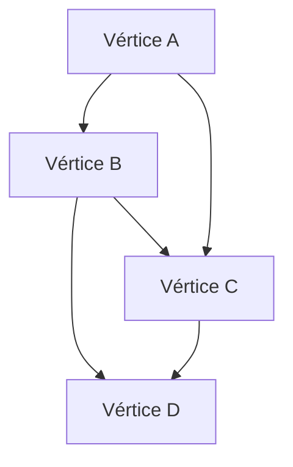

# Gráficas y Juegos - Gráficas

## 1.1 Conceptos básicos.

---

### Definición Fundamental

Una **gráfica** $G$ es un par ordenado $(V, E)$ donde:

- $V$ es un conjunto no vacío de **vértices** (nodos)
- $E$ es un conjunto de **aristas** (edges) que conectan pares de vértices

$$G = (V, E)$$

### Tipos de Gráficas

#### 1. Gráfica No Dirigida

Las aristas no tienen dirección. Si $(u, v) \in E$, entonces $u$ y $v$ están conectados.

**Ejemplo:** Redes sociales, mapas de carreteras

#### 2. Gráfica Dirigida (Digráfica)

Las aristas tienen dirección. $(u, v)$ significa arista de $u$ a $v$.

**Ejemplo:** Redes de seguimiento, flujos de datos

### Representaciones Computacionales

#### 1. Matriz de Adyacencia

```python
class GraphMatrix:
    def __init__(self, num_vertices):
        self.num_vertices = num_vertices
        self.matrix = [[0] * num_vertices for _ in range(num_vertices)]

    def add_edge(self, u, v, directed=False):
        self.matrix[u][v] = 1
        if not directed:
            self.matrix[v][u] = 1

# Ejemplo de uso
g = GraphMatrix(4)
g.add_edge(0, 1)
g.add_edge(1, 2)
g.add_edge(2, 3)
```

#### 2. Lista de Adyacencia

```python
class GraphList:
    def __init__(self, num_vertices):
        self.num_vertices = num_vertices
        self.adj_list = [[] for _ in range(num_vertices)]

    def add_edge(self, u, v, directed=False):
        self.adj_list[u].append(v)
        if not directed:
            self.adj_list[v].append(u)

# Ejemplo de uso
g = GraphList(4)
g.add_edge(0, 1)
g.add_edge(1, 2)
g.add_edge(2, 3)
```

### Conceptos Importantes

#### Grado de un Vértice

- **Grado**: Número de aristas incidentes a un vértice
- En gráficas dirigidas: **grado de entrada** y **grado de salida**

$$\text{grado}(v) = \sum_{u \in V} A[v][u]$$
donde $A$ es la matriz de adyacencia

#### Camino y Ciclo

- **Camino**: Secuencia de vértices donde cada par consecutivo está conectado
- **Ciclo**: Camino que comienza y termina en el mismo vértice

#### Gráfica Conexa

Una gráfica es conexa si existe un camino entre cualquier par de vértices.

### Diagrama de Ejemplo



### Ejemplo Práctico: Red Social

```python
class SocialNetwork:
    def __init__(self):
        self.graph = {}

    def add_user(self, user):
        if user not in self.graph:
            self.graph[user] = []

    def add_friendship(self, user1, user2):
        self.add_user(user1)
        self.add_user(user2)
        self.graph[user1].append(user2)
        self.graph[user2].append(user1)

    def get_friends(self, user):
        return self.graph.get(user, [])

    def are_friends(self, user1, user2):
        return user2 in self.graph.get(user1, [])

# Ejemplo de uso
red = SocialNetwork()
red.add_friendship("Ana", "Carlos")
red.add_friendship("Ana", "Beatriz")
red.add_friendship("Carlos", "David")

print("Amigos de Ana:", red.get_friends("Ana"))
print("¿Son amigos Ana y Carlos?", red.are_friends("Ana", "Carlos"))
```

### Complejidad Computacional

| Operación        | Matriz       | Lista              |
| ---------------- | ------------ | ------------------ |
| Verificar arista | $O(1)$       | $O(degree(v))$     |
| Listar vecinos   | $O(\|V\|)$   | $O(degree(v))$     |
| Espacio          | $O(\|V\|^2)$ | $O(\|V\| + \|E\|)$ |

### Aplicaciones en Juegos

- Pathfinding (A* algorithm)
- Detección de colisiones
- Representación de mundos virtuales
- Sistemas de navegación NPC
- Redes de influencia entre personajes

### Ejercicio Propuesto

Implementa una función que determine si una gráfica es conexa usando BFS (Breadth-First Search).

```python
def is_connected(graph):
    if not graph:
        return True

    visited = set()
    queue = collections.deque([next(iter(graph.keys()))])

    while queue:
        node = queue.popleft()
        if node not in visited:
            visited.add(node)
            for neighbor in graph[node]:
                if neighbor not in visited:
                    queue.append(neighbor)

    return len(visited) == len(graph)
```
