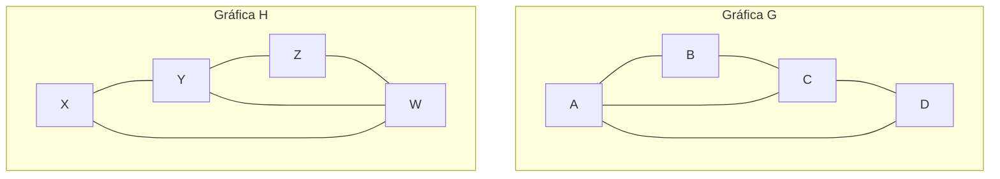
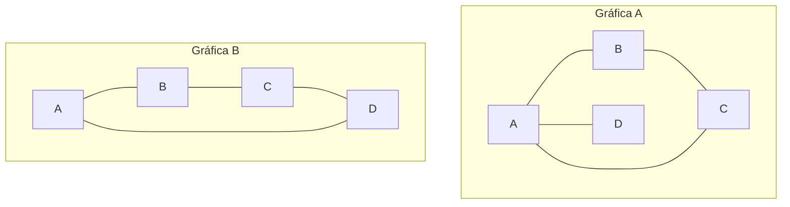
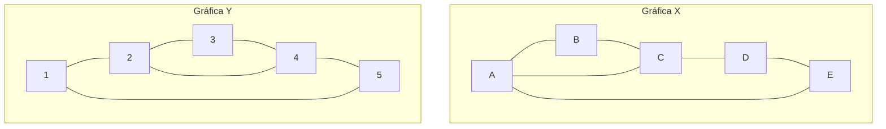

# Gráficas y Juegos - Gráficas

## 1.2 Isomorfismo.

---

### Definición de Isomorfismo

Dos gráficas $G_1 = (V_1, E_1)$ y $G_2 = (V_2, E_2)$ son **isomorfas** si existe una función biyectiva $f: V_1 \rightarrow V_2$ tal que para todo par de vértices $u, v \in V_1$:

$$(u, v) \in E_1 \iff (f(u), f(v)) \in E_2$$

Esto significa que las dos gráficas tienen la misma estructura de conexiones, aunque puedan verse diferentes.

### Condiciones Necesarias para el Isomorfismo

Para que dos gráficas sean isomorfas, deben cumplir:

1. Mismo número de vértices: $|V_1| = |V_2|$
2. Mismo número de aristas: $|E_1| = |E_2|$
3. Misma secuencia de grados (lista ordenada de grados de vértices)
4. Mismo número de ciclos de cada longitud

### Ejemplo Visual de Gráficas Isomorfas

La gráfica H es isomorfa a G



Aunque los vértices tienen nombres diferentes, ambas gráficas son isomorfas porque tienen la misma estructura.

### Algoritmo para Verificar Isomorfismo

```python
def son_isomorfas(grafica1, grafica2):
    # Verificar condiciones básicas
    if len(grafica1) != len(grafica2):
        return False

    if numero_aristas(grafica1) != numero_aristas(grafica2):
        return False

    # Verificar secuencia de grados
    grados1 = sorted([grado(v, grafica1) for v in grafica1])
    grados2 = sorted([grado(v, grafica2) for v in grafica2])

    if grados1 != grados2:
        return False

    # Generar todas las posibles biyecciones y verificar
    from itertools import permutations
    vertices1 = list(grafica1.keys())
    vertices2 = list(grafica2.keys())

    for perm in permutations(vertices2):
        mapping = dict(zip(vertices1, perm))
        if preserva_aristas(grafica1, grafica2, mapping):
            return True

    return False

def preserva_aristas(g1, g2, mapping):
    for u in g1:
        for v in g1[u]:
            if mapping[v] not in g2[mapping[u]]:
                return False
    return True
```

### Invariantes de Gráficas

Los invariantes son propiedades que se mantienen igual en gráficas isomorfas:

1. **Número cromático**: Mínimo número de colores necesarios para colorear la gráfica
2. **Número de ciclos** de cada longitud
3. **Autovalores** de la matriz de adyacencia
4. **Número de independencia**: tamaño de un conjunto independiente máximo

### Ejemplo de Invariante: Secuencia de Grados

Para las gráficas:

- $G$ con vértices de grados: [3, 3, 2, 2]
- $H$ con vértices de grados: [3, 2, 3, 2]

Ambas tienen la misma secuencia cuando se ordena: [2, 2, 3, 3]

### Gráficas No Isomorfas

La gráfica B no es isomorfa a A



Estas gráficas no son isomorfas porque:

- Ambas tienen 4 vértices y 4 aristas
- Pero la Gráfica A tiene secuencia de grados [1, 2, 2, 3]: A tiene grado 3, B y C grado 2, y D grado 1
- La Gráfica B tiene todos los vértices de grado 2, con secuencia [2, 2, 2, 2]

### Aplicación en Química: Isómeros

En química, los compuestos con la misma fórmula molecular pero diferente estructura son análogos a gráficas isomorfas:

- C₄H₁₀ tiene dos isómeros: butano y metilpropano
- Ambos tienen la misma fórmula pero diferente conectividad atómica

### Complejidad Computacional

El problema de determinar si dos gráficas son isomorfas es:

- No se sabe si está en P (tiempo polinomial)
- No se sabe si es NP-completo, y se cree que no lo es
- Babai (2015) dio un algoritmo de tiempo cuasipolinomial, $2^{O((\log n)^c)}$
- En la práctica, existen algoritmos eficientes para muchos casos

### Algoritmo de Weisfeiler-Lehman

Un método más eficiente que la fuerza bruta, pero **incompleto**: si responde `False`, las gráficas no son isomorfas; si responde `True`, solo son posiblemente isomorfas, pues hay gráficas no isomorfas que no distingue, como dos gráficas regulares del mismo grado y número de vértices.

```python
def weisfeiler_lehman(g1, g2, iteraciones=3):
    # Inicializar etiquetas
    etiquetas1 = {v: str(grado(v, g1)) for v in g1}
    etiquetas2 = {v: str(grado(v, g2)) for v in g2}

    for _ in range(iteraciones):
        # Refinar etiquetas
        nuevas_etiquetas1 = {}
        for v in g1:
            vecinos_etiquetas = sorted([etiquetas1[n] for n in g1[v]])
            nuevas_etiquetas1[v] = etiquetas1[v] + ''.join(vecinos_etiquetas)

        nuevas_etiquetas2 = {}
        for v in g2:
            vecinos_etiquetas = sorted([etiquetas2[n] for n in g2[v]])
            nuevas_etiquetas2[v] = etiquetas2[v] + ''.join(vecinos_etiquetas)

        # Verificar multiconjunto de etiquetas
        if sorted(nuevas_etiquetas1.values()) != sorted(nuevas_etiquetas2.values()):
            return False

        etiquetas1, etiquetas2 = nuevas_etiquetas1, nuevas_etiquetas2

    return True   # posiblemente isomorfas; no es una prueba
```

### Ejercicio de Práctica

Determina si las siguientes gráficas son isomorfas:



**Pista**: Ambas tienen 5 vértices y 6 aristas. Calcula la secuencia de grados de cada una.
