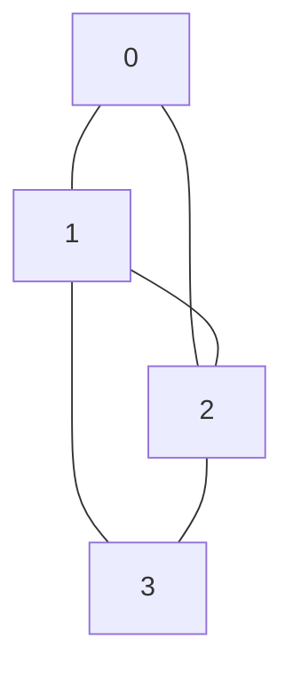
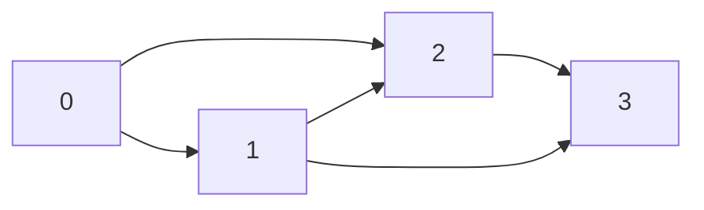

# Gráficas y Juegos - Gráficas

## 1.3 Matriz de adyacencia.

---

### Definición

La **matriz de adyacencia** de una gráfica $G = (V, E)$ con $n$ vértices es una matriz cuadrada $A$ de tamaño $n \times n$ donde:

$$ A[i][j] = \begin{cases} 1 & \text{si existe una arista entre } v_i \text{ y } v_j \\\ 0 & \text{en caso contrario} \end{cases} $$

Para gráficas ponderadas, los valores 1 se reemplazan por los pesos de las aristas.

### Propiedades

1. **Simetría**: Para gráficas no dirigidas, $A$ es simétrica $(A = A^T)$
2. **Diagonal principal**: $A[i][i] = 0$ para gráficas sin bucles
3. **Grado de un vértice**: $\text{grado}(v_i) = \sum_{j=1}^{n} A[i][j]$

### Ejemplo Visual

Consideremos la siguiente gráfica no dirigida:



Su matriz de adyacencia sería:

$$ A = \begin{bmatrix} 0 & 1 & 1 & 0 \\\ 1 & 0 & 1 & 1 \\\ 1 & 1 & 0 & 1 \\\ 0 & 1 & 1 & 0 \\\ \end{bmatrix} $$

### Implementación en C++

```cpp
#include <iostream>
#include <vector>
using namespace std;

class Grafica {
private:
    int n; // número de vértices
    vector<vector<int>> matriz;

public:
    // Constructor
    Grafica(int numVertices) : n(numVertices) {
        matriz.resize(n, vector<int>(n, 0));
    }

    // Agregar arista
    void agregarArista(int i, int j, bool dirigida = false) {
        if (i >= 0 && i < n && j >= 0 && j < n) {
            matriz[i][j] = 1;
            if (!dirigida) {
                matriz[j][i] = 1;
            }
        }
    }

    // Eliminar arista
    void eliminarArista(int i, int j, bool dirigida = false) {
        if (i >= 0 && i < n && j >= 0 && j < n) {
            matriz[i][j] = 0;
            if (!dirigida) {
                matriz[j][i] = 0;
            }
        }
    }

    // Verificar si existe arista
    bool existeArista(int i, int j) {
        return (i >= 0 && i < n && j >= 0 && j < n) ? matriz[i][j] != 0 : false;
    }

    // Obtener grado de un vértice (para no dirigidas)
    int obtenerGrado(int vertice) {
        if (vertice < 0 || vertice >= n) return -1;

        int grado = 0;
        for (int j = 0; j < n; j++) {
            grado += matriz[vertice][j];
        }
        return grado;
    }

    // Imprimir matriz
    void imprimir() {
        cout << "Matriz de adyacencia:" << endl;
        for (int i = 0; i < n; i++) {
            for (int j = 0; j < n; j++) {
                cout << matriz[i][j] << " ";
            }
            cout << endl;
        }
    }
};

// Ejemplo de uso
int main() {
    Grafica g(4); // Gráfica con 4 vértices

    // Agregar aristas (no dirigidas)
    g.agregarArista(0, 1);
    g.agregarArista(0, 2);
    g.agregarArista(1, 2);
    g.agregarArista(1, 3);
    g.agregarArista(2, 3);

    g.imprimir();

    cout << "Grado del vértice 1: " << g.obtenerGrado(1) << endl;
    cout << "¿Existe arista entre 0 y 3? " << (g.existeArista(0, 3) ? "Sí" : "No") << endl;

    return 0;
}
```

### Gráficas Dirigidas

Para gráficas dirigidas, la matriz no es necesariamente simétrica:



Matriz de adyacencia correspondiente:

$$ A = \begin{bmatrix} 0 & 1 & 1 & 0 \\\ 0 & 0 & 1 & 1 \\\ 0 & 0 & 0 & 1 \\\ 0 & 0 & 0 & 0 \\\ \end{bmatrix} $$

### Gráficas Ponderadas

Para gráficas con pesos en las aristas, almacenamos los pesos en lugar de 1's:

```cpp
class GraficaPonderada {
private:
    int n;
    vector<vector<double>> matriz;

public:
    GraficaPonderada(int numVertices) : n(numVertices) {
        // Inicializar con un valor que represente "sin conexión"
        matriz.resize(n, vector<double>(n, numeric_limits<double>::infinity()));

        // La diagonal en 0 (distancia de un vértice a sí mismo)
        for (int i = 0; i < n; i++) {
            matriz[i][i] = 0;
        }
    }

    void agregarArista(int i, int j, double peso, bool dirigida = false) {
        if (i >= 0 && i < n && j >= 0 && j < n) {
            matriz[i][j] = peso;
            if (!dirigida) {
                matriz[j][i] = peso;
            }
        }
    }
};
```

### Operaciones con Matrices de Adyacencia

#### Potencias de la Matriz de Adyacencia

La entrada $A^k[i][j]$ representa el número de caminos de longitud $k$ del vértice $i$ al vértice $j$.

$$ A^2[i][j] = \sum_{k=1}^{n} A[i][k] \cdot A[k][j] $$

#### Caminos y Conectividad

- $A^n[i][j] > 0$ indica que existe un camino de longitud $n$ de $i$ a $j$
- La gráfica es conexa si para todo par $(i, j)$, existe algún $k$ tal que $A^k[i][j] > 0$

### Ventajas y Desventajas

#### Ventajas:

- Verificar si existe una arista es $O(1)$
- Fácil implementación
- Permite operaciones matriciales para análisis

#### Desventajas:

- Consumo de memoria: $O(n^2)$
- Ineficiente para gráficas dispersas (pocas aristas)
- Listar todos los vecinos de un vértice es $O(n)$

### Aplicación: Detección de Triángulos

Podemos usar la matriz de adyacencia para detectar triángulos en una gráfica:

```cpp
int contarTriangulos(const vector<vector<int>>& A) {
    int n = A.size();
    int count = 0;

    // Calcular A^3
    vector<vector<int>> A2(n, vector<int>(n, 0));
    vector<vector<int>> A3(n, vector<int>(n, 0));

    // Multiplicar matrices: A^2 = A × A
    for (int i = 0; i < n; i++) {
        for (int j = 0; j < n; j++) {
            for (int k = 0; k < n; k++) {
                A2[i][j] += A[i][k] * A[k][j];
            }
        }
    }

    // Multiplicar matrices: A^3 = A^2 × A
    for (int i = 0; i < n; i++) {
        for (int j = 0; j < n; j++) {
            for (int k = 0; k < n; k++) {
                A3[i][j] += A2[i][k] * A[k][j];
            }
        }
    }

    // Traza de A^3 / 6 da el número de triángulos
    int traza = 0;
    for (int i = 0; i < n; i++) {
        traza += A3[i][i];
    }

    return traza / 6;
}
```

### Ejercicio Práctico

Dada la siguiente matriz de adyacencia:

$$ A = \begin{bmatrix} 0 & 1 & 0 & 1 \\\ 1 & 0 & 1 & 1 \\\ 0 & 1 & 0 & 1 \\\ 1 & 1 & 1 & 0 \\\ \end{bmatrix} $$

1. Dibuja la gráfica correspondiente
2. Calcula los grados de cada vértice
3. Determina si la gráfica es completa
4. Encuentra el número de triángulos en la gráfica
