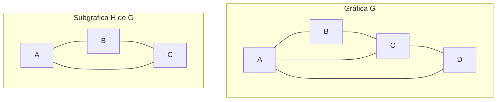
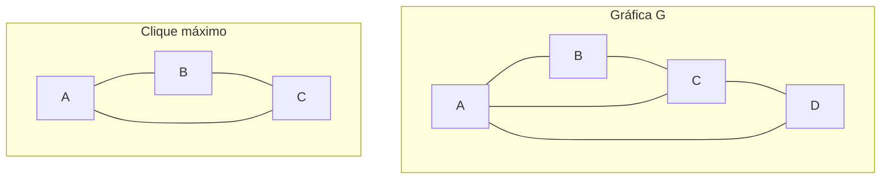
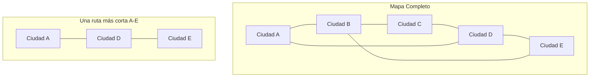

# Gráficas y Juegos - Gráficas

## 1.4 Subgráficas.

---

### Definición Formal

Una **subgráfica** $H$ de una gráfica $G = (V, E)$ es una gráfica $H = (V', E')$ tal que:

- $V' \subseteq V$
- $E' \subseteq E \cap (V' \times V')$

Es decir, todos los vértices de $H$ están en $G$ y todas las aristas de $H$ son aristas de $G$ que conectan vértices de $H$.

### Tipos de Subgráficas

#### 1. Subgráfica Inducida

Una subgráfica $H = (V', E')$ de $G$ donde $E'$ contiene **todas** las aristas de $G$ que conectan vértices en $V'$.

$$E' = \{ (u,v) \in E \mid u,v \in V' \}$$

#### 2. Subgráfica Generadora

Una subgráfica $H = (V', E')$ de $G$ donde $V' = V$ pero $E' \subseteq E$.

### Representación Visual



En este ejemplo, $H$ es una subgráfica inducida de $G$ con $V' = \{A, B, C\}$.

### Implementación de Subgráficas

```python
class Grafica:
    def __init__(self, vertices):
        self.vertices = set(vertices)
        self.adyacencia = {v: set() for v in vertices}

    def agregar_arista(self, u, v):
        if u in self.vertices and v in self.vertices:
            self.adyacencia[u].add(v)
            self.adyacencia[v].add(u)

    def obtener_subgrafica_inducida(self, vertices_subset):
        """Obtiene la subgráfica inducida por un subconjunto de vértices"""
        if not vertices_subset.issubset(self.vertices):
            raise ValueError("Los vértices deben estar en la gráfica original")

        subgrafica = Grafica(vertices_subset)

        # Agregar todas las aristas que conecten vértices en el subconjunto
        for u in vertices_subset:
            for v in self.adyacencia[u]:
                if v in vertices_subset:
                    subgrafica.agregar_arista(u, v)

        return subgrafica

    def obtener_subgrafica_generadora(self, aristas_subset):
        """Obtiene una subgráfica generadora con un subconjunto de aristas"""
        subgrafica = Grafica(self.vertices)

        for u, v in aristas_subset:
            if u in self.vertices and v in self.vertices and v in self.adyacencia[u]:
                subgrafica.agregar_arista(u, v)

        return subgrafica

    def es_subgrafica_de(self, otra_grafica):
        """Verifica si esta gráfica es subgráfica de otra"""
        if not self.vertices.issubset(otra_grafica.vertices):
            return False

        for u in self.vertices:
            for v in self.adyacencia[u]:
                if v not in otra_grafica.adyacencia[u]:
                    return False

        return True

# Ejemplo de uso
vertices_g = ['A', 'B', 'C', 'D']
g = Grafica(vertices_g)
g.agregar_arista('A', 'B')
g.agregar_arista('B', 'C')
g.agregar_arista('C', 'D')
g.agregar_arista('D', 'A')
g.agregar_arista('A', 'C')

# Subgráfica inducida
vertices_h = ['A', 'B', 'C']
h = g.obtener_subgrafica_inducida(set(vertices_h))

# Subgráfica generadora
aristas_k = [('A', 'B'), ('B', 'C'), ('C', 'D')]
k = g.obtener_subgrafica_generadora(aristas_k)
```

### Propiedades de las Subgráficas

#### Teorema de Subgráfica

Si $H$ es subgráfica de $G$, entonces:

- $|V(H)| \leq |V(G)|$
- $|E(H)| \leq |E(G)|$
- Para todo vértice $v \in V(H)$, $grado_H(v) \leq grado_G(v)$

#### Cliques como Subgráficas

Un **clique** es una subgráfica completa inducida.



En esta $G$, los triángulos $\{A, B, C\}$ y $\{A, C, D\}$ son cliques máximos: no hay cuatro vértices mutuamente adyacentes porque falta la arista $B - D$.

### Algoritmo para Encontrar Cliques

```python
def encontrar_cliques(grafica):
    """Algoritmo de Bron-Kerbosch para encontrar todos los cliques maximales,
    es decir, los que no se pueden extender con otro vértice"""
    def bron_kerbosch(r, p, x):
        if not p and not x:
            cliques.append(r)
            return

        for v in list(p):
            bron_kerbosch(r | {v},
                         p & grafica.adyacencia[v],
                         x & grafica.adyacencia[v])
            p.remove(v)
            x.add(v)

    cliques = []
    bron_kerbosch(set(), set(grafica.vertices), set())
    return cliques

# Ejemplo de uso
cliques = encontrar_cliques(g)
print(f"Cliques encontrados: {cliques}")
```

### Subgráficas Isomorfas

Dos subgráficas $H_1$ y $H_2$ son isomorfas si existe una biyección $f: V(H_1) \rightarrow V(H_2)$ que preserva las aristas.

#### Problema de Subgráfica Isomorfa

Dadas dos gráficas $G$ y $H$, determinar si $G$ contiene una subgráfica isomorfa a $H$.

```python
def contiene_subgrafica_isomorfa(grafica_grande, grafica_pequena):
    """Verifica si grafica_grande contiene una subgráfica INDUCIDA isomorfa a grafica_pequena.
    Para subgráficas no inducidas habría que probar también subconjuntos de aristas."""
    from itertools import combinations, permutations

    n = len(grafica_pequena.vertices)

    # Para cada combinación de n vértices en la gráfica grande
    for vertices_sub in combinations(grafica_grande.vertices, n):
        subgrafica = grafica_grande.obtener_subgrafica_inducida(set(vertices_sub))

        # Verificar isomorfismo
        if son_isomorfas(subgrafica, grafica_pequena):
            return True

    return False
```

### Aplicaciones en Juegos

#### 1. Detección de Patrones

En juegos de estrategia, buscar subgráficas que representen formaciones específicas.

#### 2. Optimización de Rutas

Subgráficas que representan caminos óptimos en mapas de juego.

#### 3. Análisis de Redes Sociales

En juegos multijugador, identificar comunidades (subgráficas densas).

### Ejemplo: Subgráfica en un Mapa de Juego



### Complejidad Computacional

- Encontrar subgráficas isomorfas: NP-completo
- Encontrar un clique máximo: NP-difícil; decidir si existe un clique de tamaño $k$ es NP-completo
- Verificar si una gráfica es subgráfica: $O(|E|)$

### Ejercicios Prácticos

1. Dada la gráfica $G$ con vértices $\{1,2,3,4,5\}$ y aristas $\{(1,2), (2,3), (3,4), (4,5), (5,1), (1,3)\}$:
   - Encuentra todas las subgráficas inducidas de tamaño 3
   - Identifica los cliques máximos
   - ¿Contiene $G$ una subgráfica isomorfa a $K_3$?

2. Implementa un algoritmo que encuentre la subgráfica conexa más grande de una gráfica dada.

```python
def subgrafica_conexa_mas_grande(grafica):
    """Encuentra la subgráfica conexa más grande usando BFS"""
    import collections
    visitados = set()
    mayor_componente = set()

    for vertice in grafica.vertices:
        if vertice not in visitados:
            componente_actual = set()
            cola = collections.deque([vertice])

            while cola:
                actual = cola.popleft()
                if actual not in visitados:
                    visitados.add(actual)
                    componente_actual.add(actual)
                    for vecino in grafica.adyacencia[actual]:
                        if vecino not in visitados:
                            cola.append(vecino)

            if len(componente_actual) > len(mayor_componente):
                mayor_componente = componente_actual

    return grafica.obtener_subgrafica_inducida(mayor_componente)
```
