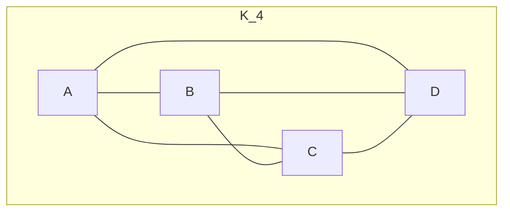
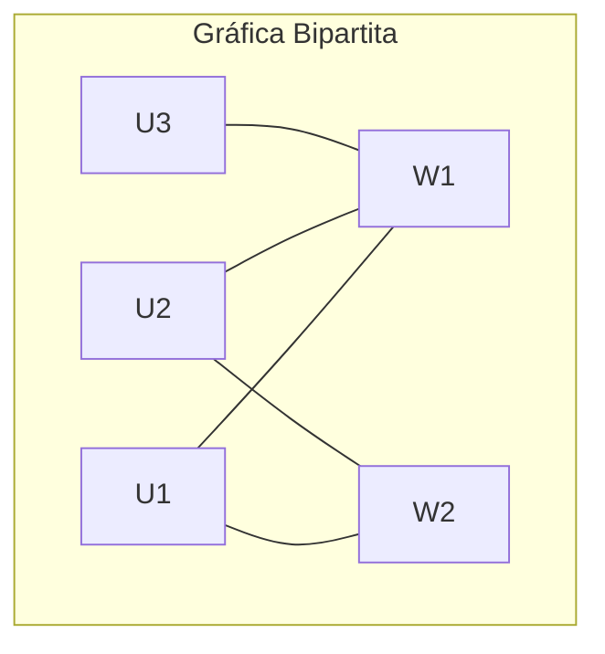
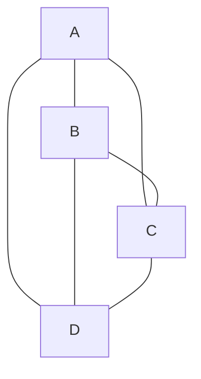
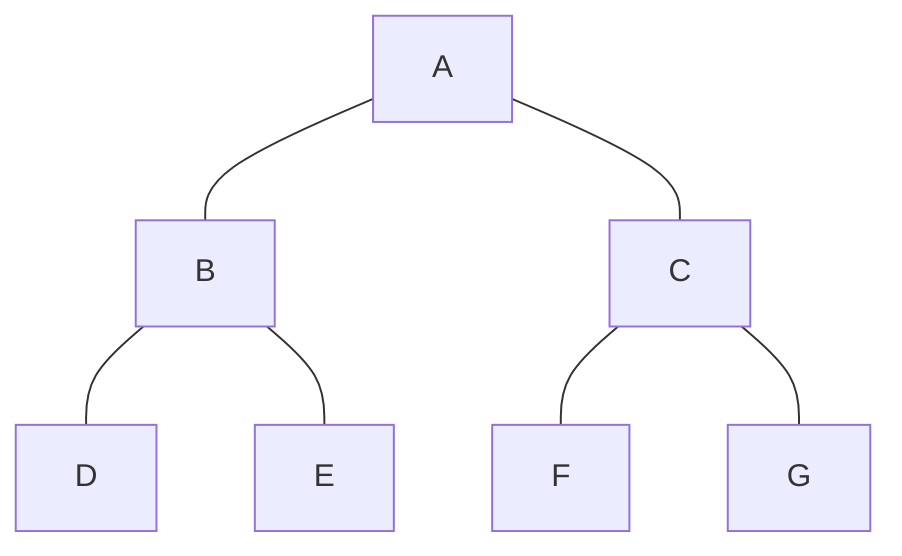
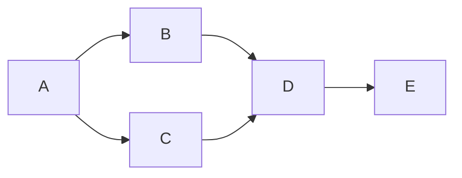
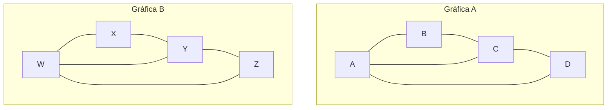

# Gráficas y Juegos - Gráficas

## 1.5 Clases de gráficas.

---

### Definición e Importancia

Las **clases de gráficas** son categorías de gráficas que comparten propiedades estructurales específicas. El estudio de estas clases permite:

- Desarrollar algoritmos especializados más eficientes
- Establecer teoremas y propiedades generales
- Aplicar modelos matemáticos a problemas específicos

### 1. Gráficas Completas $(K_n)$

Una gráfica completa $K_n$ tiene $n$ vértices donde cada par de vértices distintos está conectado por una arista.

**Propiedades:**

- Número de aristas: $|E| = \frac{n(n-1)}{2}$
- Grado de cada vértice: $n-1$
- Es regular (todos los vértices tienen el mismo grado)



### 2. Gráficas Bipartitas

Una gráfica $G = (V, E)$ es bipartita si $V$ puede dividirse en dos conjuntos disjuntos $U$ y $W$ tal que cada arista conecta un vértice de $U$ con uno de $W$.

**Teorema:** Una gráfica es bipartita si y solo si no contiene ciclos de longitud impar.



### 3. Gráficas Planas

Una gráfica es plana si puede dibujarse en el plano sin que sus aristas se crucen.

**Fórmula de Euler:** Para toda gráfica plana conexa:
$$V - E + F = 2$$
donde $F$ es el número de caras.



### 4. Gráficas Regulares

Una gráfica es k-regular si todos sus vértices tienen grado $k$.

**Ejemplos:**

- Gráficas completas $K_n: (n-1)\text{-regulares}$
- Ciclos $C_n$: 2-regulares
- Hipercubos: regulares

### 5. Gráficas Árbol

Un árbol es una gráfica conexa sin ciclos.

**Propiedades:**

- $|E| = |V| - 1$
- Existe exactamente un camino entre cualquier par de vértices
- La eliminación de cualquier arista desconecta la gráfica



### 6. Gráficas Ponderadas

Gráficas donde cada arista tiene un valor numérico (peso) asociado.

```python
class GraficaPonderada:
    def __init__(self):
        self.vertices = set()
        self.aristas = {}  # Diccionario: (u, v) -> peso

    def agregar_arista(self, u, v, peso):
        self.vertices.add(u)
        self.vertices.add(v)
        self.aristas[(u, v)] = peso
        self.aristas[(v, u)] = peso  # Para no dirigidas

    def obtener_vecinos(self, vertice):
        return [v for (u, v), peso in self.aristas.items()
                if u == vertice]

    def dijkstra(self, inicio):
        # Algoritmo de Dijkstra para caminos más cortos
        distancias = {v: float('inf') for v in self.vertices}
        distancias[inicio] = 0
        visitados = set()

        while len(visitados) < len(self.vertices):
            # Encontrar vértice no visitado con menor distancia
            actual = min([v for v in self.vertices if v not in visitados],
                        key=lambda v: distancias[v])

            visitados.add(actual)

            for vecino in self.obtener_vecinos(actual):
                if vecino not in visitados:
                    peso = self.aristas[(actual, vecino)]
                    nueva_distancia = distancias[actual] + peso
                    if nueva_distancia < distancias[vecino]:
                        distancias[vecino] = nueva_distancia

        return distancias
```

### 7. Gráficas Dirigidas (Digráficas)

Gráficas donde las aristas tienen dirección.

**Aplicaciones:** Redes de flujo, dependencias, autómatas.



### 8. Gráficas Conexas y Fuertemente Conexas

- **Conexa:** Existe camino entre cualquier par de vértices (no dirigidas)
- **Fuertemente conexa:** Existe camino dirigido entre cualquier par de vértices (dirigidas)

```python
def es_conexa(grafica):
    if not grafica.vertices:
        return True

    visitados = set()
    cola = collections.deque([next(iter(grafica.vertices))])

    while cola:
        actual = cola.popleft()
        if actual not in visitados:
            visitados.add(actual)
            for vecino in grafica.obtener_vecinos(actual):
                if vecino not in visitados:
                    cola.append(vecino)

    return len(visitados) == len(grafica.vertices)

def es_fuertemente_conexa(digrafica):
    # Para gráficas dirigidas
    for vertice in digrafica.vertices:
        alcanzables = busqueda_profundidad(digrafica, vertice)
        if len(alcanzables) != len(digrafica.vertices):
            return False
    return True
```

### 9. Gráficas Eulerianas y Hamiltonianas

- **Euleriana:** Contiene un ciclo que usa cada arista exactamente una vez
- **Hamiltoniana:** Contiene un ciclo que visita cada vértice exactamente una vez

**Teorema de Euler:** Una gráfica conexa es euleriana si y solo si todos sus vértices tienen grado par.

### 10. Gráficas de Intervalos

Gráficas que representan intersecciones de intervalos en la recta real.

**Aplicaciones:** Planificación de tareas, asignación de recursos.

### Implementación de Verificación de Clases

```python
class VerificadorClases:
    @staticmethod
    def es_completa(grafica):
        n = len(grafica.vertices)
        max_aristas = n * (n - 1) // 2
        return len(grafica.aristas) == max_aristas

    @staticmethod
    def es_bipartita(grafica):
        color = {}
        for vertice in grafica.vertices:
            if vertice not in color:
                cola = collections.deque([vertice])
                color[vertice] = 0
                while cola:
                    actual = cola.popleft()
                    for vecino in grafica.obtener_vecinos(actual):
                        if vecino not in color:
                            color[vecino] = 1 - color[actual]
                            cola.append(vecino)
                        elif color[vecino] == color[actual]:
                            return False
        return True

    @staticmethod
    def es_arbol(grafica):
        return (es_conexa(grafica) and
                len(grafica.aristas) == len(grafica.vertices) - 1)

    @staticmethod
    def es_regular(grafica, k=None):
        grados = [len(grafica.obtener_vecinos(v)) for v in grafica.vertices]
        if all(grado == grados[0] for grado in grados):
            return (True, grados[0]) if k is None else (grados[0] == k)
        return False
```

### Aplicaciones en Juegos

#### 1. Generación de Niveles

Las gráficas planas se utilizan para diseñar mapas y niveles de juego.

#### 2. IA y Pathfinding

Las gráficas ponderadas son esenciales para algoritmos de búsqueda de caminos.

#### 3. Sistemas de Misiones

Las gráficas dirigidas modelan dependencias entre misiones.

#### 4. Redes Sociales en Juegos

Las gráficas bipartitas modelan relaciones entre jugadores y grupos.

### Ejercicios de Identificación

Dadas las siguientes gráficas, identifica a qué clases pertenecen:



**Preguntas:**

1. ¿Cuál es bipartita?
2. ¿Cuál es completa?
3. ¿Cuál es plana?
4. ¿Cuál es regular?

### Teoremas Importantes

#### Teorema de Kuratowski

Una gráfica es plana si y solo si no contiene una subdivisión de $K_5$ o $K_{3,3}$.

#### Teorema de los Cuatro Colores

Cualquier gráfica plana puede colorearse con a lo más 4 colores.

### Complejidad Computacional

- Verificar si una gráfica es bipartita: $O(V + E)$
- Verificar si es plana: $O(V)$ (algoritmos lineales)
- Verificar si es euleriana: $O(V)$
- Verificar si es hamiltoniana: NP-completo

### Implementación de Coloreado

```python
def colorear_grafica(grafica):
    # Algoritmo greedy para colorear gráficas
    colores = {}
    colores_disponibles = set(range(len(grafica.vertices)))

    for vertice in grafica.vertices:
        colores_vecinos = {colores[vecino] for vecino in grafica.obtener_vecinos(vertice)
                          if vecino in colores}
        color_elegido = min(colores_disponibles - colores_vecinos)
        colores[vertice] = color_elegido

    return colores

# Para el teorema de los cuatro colores en gráficas planas
def verificar_4_colores(grafica):
    if not es_plana(grafica):
        return True  # No aplica el teorema
    colores = colorear_grafica(grafica)
    return max(colores.values()) < 4
```
