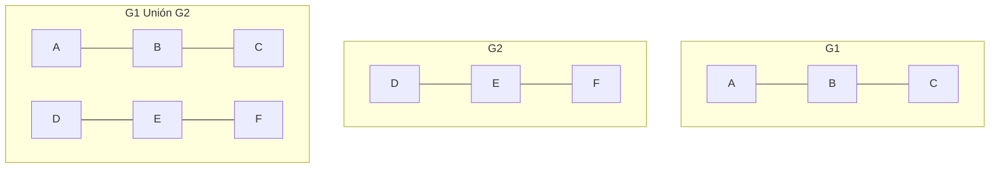
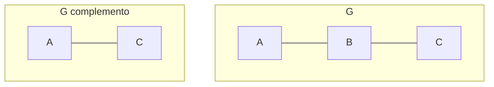
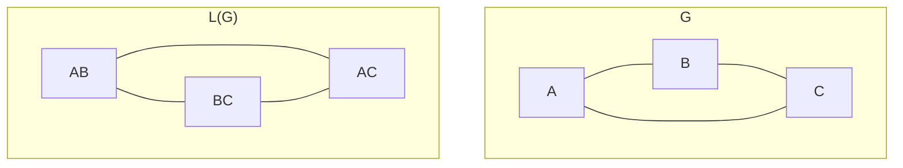

# Gráficas y Juegos - Gráficas

## 1.6 Operaciones.

---

Las operaciones con gráficas permiten construir nuevas gráficas a partir de existentes, lo cual es fundamental en el diseño de algoritmos y estructuras de datos para juegos y aplicaciones gráficas.

### 1. Unión de Gráficas

Dadas dos gráficas $G_1 = (V_1, E_1)$ y $G_2 = (V_2, E_2)$, su unión $G_1 \cup G_2$ es la gráfica:

$$ G = (V_1 \cup V_2, E_1 \cup E_2) $$



### 2. Intersección de Gráficas

Dadas dos gráficas $G_1 = (V_1, E_1)$ y $G_2 = (V_2, E_2)$, su intersección $G_1 \cap G_2$ es la gráfica:

$$G = (V_1 \cap V_2, E_1 \cap E_2)$$

### 3. Complemento de una Gráfica

El complemento $\overline{G}$ de una gráfica $G = (V, E)$ tiene los mismos vértices pero las aristas que faltan en $G$:

$$\overline{G} = (V, \overline{E}) \quad \text{donde} \quad \overline{E} = \{(u,v) \mid u \neq v \text{ y } (u,v) \notin E\}$$



### 4. Producto de Gráficas

#### Producto Cartesiano $G \square H$

El producto cartesiano de $G$ y $H$ tiene:

- Vértices: $V(G) \times V(H)$
- Aristas: $(u,v)$ es adyacente a $(u',v')$ si $u = u'$ y $(v,v') \in E(H)$, o bien $v = v'$ y $(u,u') \in E(G)$

#### Producto Tensor $G \times H$

También llamado producto directo, donde $(u,v)$ es adyacente a $(u',v')$ si $(u,u') \in E(G)$ y $(v,v') \in E(H)$.

### 5. Subdivisión de Aristas

La subdivisión de una arista $(u,v)$ consiste en:

1. Eliminar la arista $(u,v)$
2. Añadir un nuevo vértice $w$
3. Añadir aristas $(u,w)$ y $(w,v)$

### Implementación de Operaciones Básicas

```python
class OperacionesGraficas:
    @staticmethod
    def union(g1, g2):
        """Devuelve la unión de dos gráficas"""
        nueva_grafica = Grafica(g1.vertices.union(g2.vertices))

        # Agregar aristas de g1
        for u, v in g1.aristas:
            nueva_grafica.agregar_arista(u, v)

        # Agregar aristas de g2
        for u, v in g2.aristas:
            nueva_grafica.agregar_arista(u, v)

        return nueva_grafica

    @staticmethod
    def interseccion(g1, g2):
        """Devuelve la intersección de dos gráficas"""
        vertices_comunes = g1.vertices.intersection(g2.vertices)
        nueva_grafica = Grafica(vertices_comunes)

        # Solo agregar aristas que estén en ambas gráficas
        for u, v in g1.aristas:
            if (u in vertices_comunes and v in vertices_comunes and
                g2.existe_arista(u, v)):
                nueva_grafica.agregar_arista(u, v)

        return nueva_grafica

    @staticmethod
    def complemento(g):
        """Devuelve el complemento de una gráfica"""
        complemento = Grafica(g.vertices)

        # Agregar todas las aristas posibles excepto las existentes
        for u in g.vertices:
            for v in g.vertices:
                if u != v and not g.existe_arista(u, v):
                    complemento.agregar_arista(u, v)

        return complemento

    @staticmethod
    def producto_cartesiano(g, h):
        """Producto cartesiano G □ H"""
        producto = Grafica()

        # Crear vértices del producto
        for u in g.vertices:
            for v in h.vertices:
                producto.agregar_vertice((u, v))

        # Agregar aristas horizontales (mismo vértice de G, aristas de H)
        for u in g.vertices:
            for v1, v2 in h.aristas:
                producto.agregar_arista((u, v1), (u, v2))

        # Agregar aristas verticales (aristas de G, mismo vértice de H)
        for v in h.vertices:
            for u1, u2 in g.aristas:
                producto.agregar_arista((u1, v), (u2, v))

        return producto
```

### 6. Contracción de Aristas

La contracción de una arista $(u,v)$ consiste en:

1. Fusionar los vértices $u$ y $v$ en un nuevo vértice $w$
2. Eliminar la arista $(u,v)$
3. Reemplazar todas las aristas incidentes a $u$ o $v$ por aristas incidentes a $w$

```python
class OperacionesAvanzadas:
    @staticmethod
    def subdividir_arista(g, u, v):
        """Subdivide una arista añadiendo un vértice nuevo"""
        if not g.existe_arista(u, v):
            return g

        nueva_grafica = g.copiar()
        nueva_grafica.eliminar_arista(u, v)

        # Crear nuevo vértice
        w = f"subdiv_{u}_{v}"
        nueva_grafica.agregar_vertice(w)

        # Agregar nuevas aristas
        nueva_grafica.agregar_arista(u, w)
        nueva_grafica.agregar_arista(w, v)

        return nueva_grafica

    @staticmethod
    def contraer_arista(g, u, v):
        """Contrae una arista fusionando dos vértices"""
        if not g.existe_arista(u, v):
            return g

        nueva_grafica = Grafica()
        vertice_contraido = f"contraccion_{u}_{v}"

        # Agregar todos los vértices excepto u y v, más el nuevo vértice
        for vertice in g.vertices:
            if vertice != u and vertice != v:
                nueva_grafica.agregar_vertice(vertice)
        nueva_grafica.agregar_vertice(vertice_contraido)

        # Agregar aristas
        for a, b in g.aristas:
            if a != u and a != v and b != u and b != v:
                nueva_grafica.agregar_arista(a, b)
            else:
                # Reemplazar u o v por el vértice contraído
                nuevo_a = a if a != u and a != v else vertice_contraido
                nuevo_b = b if b != u and b != v else vertice_contraido
                if nuevo_a != nuevo_b:  # Evitar bucles
                    nueva_grafica.agregar_arista(nuevo_a, nuevo_b)

        return nueva_grafica
```

### 7. Eliminación de Vértices

La eliminación de un vértice $v$ de $G$ produce la gráfica $G - v$ con:

- $V(G - v) = V(G) \setminus \{v\}$
- $E(G - v) = E(G) \setminus \{\text{aristas incidentes a } v\}$

### 8. Eliminación de Aristas

La eliminación de una arista $e$ de $G$ produce la gráfica $G - e$ con:

- $V(G - e) = V(G)$
- $E(G - e) = E(G) \setminus \{e\}$

### 9. Gráfica Lineal $L(G)$

La gráfica lineal de $G$ tiene:

- Vértices: las aristas de $G$
- Aristas: dos vértices son adyacentes si las aristas correspondientes comparten un vértice en $G$



### Implementación de Gráfica Lineal

```python
class GraficaLineal:
    @staticmethod
    def construir(grafica_original):
        """Construye la gráfica lineal L(G)"""
        lineal = Grafica()

        # Crear vértices (cada arista se convierte en vértice)
        for arista in grafica_original.aristas:
            u, v = arista
            nombre_vertice = f"{u}-{v}"
            lineal.agregar_vertice(nombre_vertice)

        # Crear aristas: conectar vértices que comparten un vértice en G
        for i, arista1 in enumerate(grafica_original.aristas):
            u1, v1 = arista1
            nombre1 = f"{u1}-{v1}"

            for j, arista2 in enumerate(grafica_original.aristas):
                if i >= j:  # Evitar duplicados
                    continue

                u2, v2 = arista2
                nombre2 = f"{u2}-{v2}"

                # Verificar si comparten algún vértice
                if (u1 == u2 or u1 == v2 or v1 == u2 or v1 == v2):
                    lineal.agregar_arista(nombre1, nombre2)

        return lineal
```

### 10. Operaciones de Conectividad

#### Bloque y Componentes 2-conexas

Un bloque es una subgráfica maximal 2-conexa o un puente.

```python
class ComponentesConexas:
    @staticmethod
    def encontrar_bloques(grafica):
        """Algoritmo para encontrar bloques y puntos de articulación"""
        tiempo = 0
        profundidad = {}
        low = {}
        padre = {}
        puntos_articulacion = set()
        bloques = []
        stack = []

        def dfs(vertice):
            nonlocal tiempo
            profundidad[vertice] = tiempo
            low[vertice] = tiempo
            tiempo += 1
            hijos = 0

            for vecino in grafica.obtener_vecinos(vertice):
                if vecino not in profundidad:
                    padre[vecino] = vertice
                    hijos += 1
                    stack.append((vertice, vecino))
                    dfs(vecino)

                    low[vertice] = min(low[vertice], low[vecino])

                    # Verificar si es punto de articulación
                    if (padre.get(vertice) is None and hijos > 1) or \
                       (padre.get(vertice) is not None and low[vecino] >= profundidad[vertice]):
                        puntos_articulacion.add(vertice)
                        # Extraer bloque
                        bloque = set()
                        while True:
                            u, v = stack.pop()
                            bloque.add(u)
                            bloque.add(v)
                            if (u, v) == (vertice, vecino) or (v, u) == (vertice, vecino):
                                break
                        bloques.append(bloque)

                elif vecino != padre.get(vertice):
                    low[vertice] = min(low[vertice], profundidad[vecino])
                    if profundidad[vecino] < profundidad[vertice]:
                        stack.append((vertice, vecino))

        for vertice in grafica.vertices:
            if vertice not in profundidad:
                dfs(vertice)
                # Procesar el último bloque
                if stack:
                    bloque = set()
                    while stack:
                        u, v = stack.pop()
                        bloque.add(u)
                        bloque.add(v)
                    bloques.append(bloque)

        return bloques, puntos_articulacion
```

### Aplicaciones en Juegos

#### 1. Generación Procedural de Niveles

Las operaciones de unión e intersección permiten combinar elementos de niveles.

#### 2. Optimización de Mallas 3D

La contracción de aristas se usa en simplificación de mallas.

#### 3. Análisis de Redes de Colisión

Las gráficas lineales ayudan a analizar relaciones entre objetos.

#### 4. Sistemas de Navegación

Las operaciones de eliminación simulan obstáculos o caminos bloqueados.

### Ejemplo: Sistema de Navegación con Obstáculos

```python
class SistemaNavegacion:
    def __init__(self, grafica_mapa):
        self.mapa_original = grafica_mapa
        self.mapa_actual = grafica_mapa.copiar()

    def agregar_obstaculo(self, vertice):
        """Elimina un vértice (simula un obstáculo)"""
        self.mapa_actual = OperacionesAvanzadas.eliminar_vertice(
            self.mapa_actual, vertice)

    def quitar_obstaculo(self, vertice):
        """Restaura un vértice eliminado"""
        if vertice in self.mapa_original.vertices:
            self.mapa_actual.agregar_vertice(vertice)
            # Restaurar aristas incidentes
            for vecino in self.mapa_original.obtener_vecinos(vertice):
                if vecino in self.mapa_actual.vertices:
                    self.mapa_actual.agregar_arista(vertice, vecino)

    def encontrar_ruta(self, inicio, destino):
        """Encuentra ruta evitando obstáculos"""
        from algoritmos import bfs
        return bfs(self.mapa_actual, inicio, destino)
```

### Teoremas Relacionados

#### Teorema de Whitney (1932)

Dos gráficas conexas son isomorfas si y solo si sus gráficas lineales son isomorfas, excepto para $K_3$ y $K_{1,3}$.

#### Teorema de la Contracción

Si $G$ es una gráfica plana, entonces cualquier gráfica obtenida por contracción de aristas también es plana.

### Ejercicios Prácticos

1. Dadas $G$ y $H$ con:
   - $V(G) = \{1,2,3\}$, $E(G) = \{(1,2), (2,3)\}$
   - $V(H) = \{3,4,5\}$, $E(H) = \{(3,4), (4,5)\}$

   Calcula:
   - $G \cup H$
   - $G \cap H$
   - $\overline{G}$

2. Implementa la operación de producto tensor $G \times H$

3. Demuestra que $L(K_4)$ es isomorfa al grafo octaédrico
