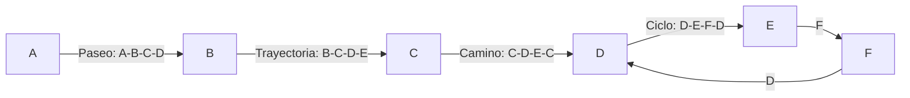
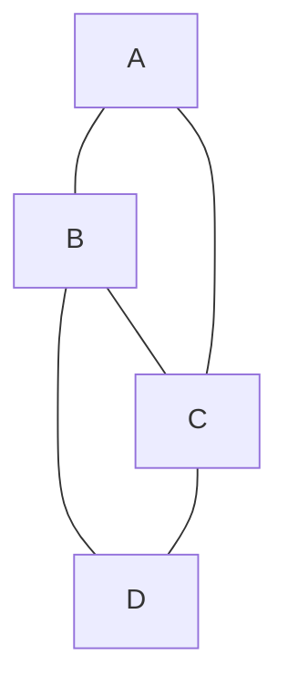

# Gráficas y Juegos - Gráficas

## 1.7 Caminos, paseos, trayectorias y ciclos.

---

### Definiciones Fundamentales

#### 1. Paseo (Walk)

Secuencia alternada de vértices y aristas $v_0, e_1, v_1, e_2, ..., e_k, v_k$ donde $e_i = (v_{i-1}, v_i)$.

**Longitud del paseo:** Número de aristas $(k)$

#### 2. Trayectoria (Path)

Paseo donde **todos los vértices son distintos**.

#### 3. Ciclo (Cycle)

Paseo cerrado, con $v_0 = v_k$, de longitud al menos 3, cuyos vértices $v_0, \ldots, v_{k-1}$ son todos distintos. No es una trayectoria, porque repite $v_0$, pero es lo más parecido: una trayectoria $v_0, \ldots, v_{k-1}$ más la arista que regresa a $v_0$.

#### 4. Camino (Trail)

Paseo donde **todas las aristas son distintas**.

### Relaciones entre Conceptos

$$ \text{Trayectoria} \subset \text{Camino} \subset \text{Paseo} $$

$$ \text{Ciclo} \subset \text{Camino cerrado (circuito)} \subset \text{Paseo cerrado} $$

### Representación Visual



### Implementación de Estructuras

```python
class Paseo:
    def __init__(self):
        self.vertices = []
        self.aristas = []
        self.longitud = 0

    def agregar_vertice(self, vertice, arista=None):
        if self.vertices:
            if arista is None:
                raise ValueError("Se requiere arista para conectar vértices")
            self.aristas.append(arista)
        self.vertices.append(vertice)
        self.longitud = len(self.aristas)

    def es_trayectoria(self):
        """Verifica si es una trayectoria (vértices distintos)"""
        return len(self.vertices) == len(set(self.vertices))

    def es_camino(self):
        """Verifica si es un camino (aristas distintas)"""
        return len(self.aristas) == len(set(self.aristas))

    def es_ciclo(self):
        """Verifica si es un ciclo"""
        internos = self.vertices[:-1]   # sin repetir el vértice final
        return (self.longitud >= 3 and
                self.vertices[0] == self.vertices[-1] and
                len(internos) == len(set(internos)))

    def __str__(self):
        return f"Paseo: {'-'.join(map(str, self.vertices))} (Longitud: {self.longitud})"
```

### Algoritmos de Búsqueda

#### Búsqueda de Todas las Trayectorias

```python
def encontrar_trayectorias(grafica, inicio, fin, longitud_maxima=10):
    """Encuentra todas las trayectorias entre dos vértices"""
    def dfs(vertice_actual, camino_actual, visitados, resultados):
        if vertice_actual == fin:
            resultados.append(camino_actual.copy())
            return

        if len(camino_actual) >= longitud_maxima:
            return

        for vecino in grafica.obtener_vecinos(vertice_actual):
            if vecino not in visitados:
                visitados.add(vecino)
                camino_actual.append(vecino)
                dfs(vecino, camino_actual, visitados, resultados)
                camino_actual.pop()
                visitados.remove(vecino)

    resultados = []
    visitados = {inicio}
    dfs(inicio, [inicio], visitados, resultados)
    return resultados
```

#### Detección de Ciclos

```python
def detectar_ciclos(grafica):
    """Detecta ciclos en una gráfica no dirigida usando DFS: encuentra un ciclo
    por cada arista de retroceso, no necesariamente todos los ciclos de la gráfica"""
    ciclos = set()
    visitados = set()
    en_recorrido = set()
    padre = {}

    def dfs(vertice):
        visitados.add(vertice)
        en_recorrido.add(vertice)

        for vecino in grafica.obtener_vecinos(vertice):
            if vecino not in visitados:
                padre[vecino] = vertice
                dfs(vecino)
            elif vecino in en_recorrido and vecino != padre.get(vertice):
                # Ciclo detectado
                ciclo = reconstruir_ciclo(vertice, vecino, padre)
                ciclos.add(tuple(sorted(ciclo)))

        en_recorrido.remove(vertice)

    def reconstruir_ciclo(actual, objetivo, padre):
        ciclo = [objetivo]
        while actual != objetivo:
            ciclo.append(actual)
            actual = padre[actual]
        return ciclo   # vértices del ciclo, sin repetir el inicial

    for vertice in grafica.vertices:
        if vertice not in visitados:
            dfs(vertice)

    return ciclos
```

### Propiedades Matemáticas

#### Distancia entre Vértices

La **distancia** $d(u,v)$ entre dos vértices es la longitud de la trayectoria más corta entre ellos.

#### Diámetro de una Gráfica

El **diámetro** es la máxima distancia entre cualquier par de vértices:

$$\text{diam}(G) = \max\{d(u,v) \mid u,v \in V\}$$

#### Excentricidad de un Vértice

La **excentricidad** $\epsilon(v)$ de un vértice es la máxima distancia desde $v$ a cualquier otro vértice:

$$\epsilon(v) = \max\{d(v,u) \mid u \in V\}$$

### Algoritmo de Dijkstra para Caminos Más Cortos

```python
def dijkstra(grafica, inicio):
    """Algoritmo de Dijkstra para encontrar caminos más cortos"""
    import heapq

    distancias = {v: float('inf') for v in grafica.vertices}
    distancias[inicio] = 0
    previo = {v: None for v in grafica.vertices}
    cola = [(0, inicio)]

    while cola:
        dist_actual, vertice_actual = heapq.heappop(cola)

        if dist_actual > distancias[vertice_actual]:
            continue

        for vecino, peso in grafica.obtener_vecinos_con_peso(vertice_actual):
            nueva_distancia = dist_actual + peso
            if nueva_distancia < distancias[vecino]:
                distancias[vecino] = nueva_distancia
                previo[vecino] = vertice_actual
                heapq.heappush(cola, (nueva_distancia, vecino))

    return distancias, previo

def reconstruir_camino(previo, destino):
    """Reconstruye el camino más corto desde el inicio al destino"""
    camino = []
    actual = destino
    while actual is not None:
        camino.append(actual)
        actual = previo[actual]
    return camino[::-1]
```

### Tipos Especiales de Caminos

#### Camino Euleriano

Camino que usa **cada arista exactamente una vez**.

**Teorema de Euler:** Una gráfica conexa tiene un camino euleriano si y solo si tiene 0 o 2 vértices de grado impar.

#### Camino Hamiltoniano

Camino que visita **cada vértice exactamente una vez**.

#### Implementación de Verificación Euleriana

```python
def es_euleriana(grafica):
    """Verifica si una gráfica tiene un camino euleriano: 0 vértices de grado
    impar dan un ciclo euleriano, 2 dan un camino euleriano abierto"""
    if not es_conexa(grafica):
        return False

    grados_impares = 0
    for vertice in grafica.vertices:
        grado = len(grafica.obtener_vecinos(vertice))
        if grado % 2 != 0:
            grados_impares += 1

    return grados_impares == 0 or grados_impares == 2

def encontrar_camino_euleriano(grafica):
    """Algoritmo de Hierholzer para encontrar camino euleriano"""
    if not es_euleriana(grafica):
        return None

    # Encontrar vértice inicial (de grado impar si existe)
    inicio = next(iter(grafica.vertices))
    for v in grafica.vertices:
        if len(grafica.obtener_vecinos(v)) % 2 != 0:
            inicio = v
            break

    pila = [inicio]
    camino = []
    aristas_restantes = grafica.aristas.copy()

    while pila:
        actual = pila[-1]
        vecinos = grafica.obtener_vecinos(actual)

        # Buscar arista disponible
        encontrado = False
        for vecino in vecinos:
            arista = (min(actual, vecino), max(actual, vecino))
            if arista in aristas_restantes:
                aristas_restantes.remove(arista)
                pila.append(vecino)
                encontrado = True
                break

        if not encontrado:
            camino.append(pila.pop())

    return camino[::-1]
```

### Aplicaciones en Juegos

#### 1. Sistemas de Navegación y Pathfinding

```python
class SistemaNavegacion:
    def __init__(self, grafica_mapa):
        self.mapa = grafica_mapa

    def encontrar_ruta_optima(self, inicio, destino):
        """Encuentra la ruta más corta usando Dijkstra"""
        distancias, previo = dijkstra(self.mapa, inicio)
        if distancias[destino] == float('inf'):
            return None  # No hay camino
        return reconstruir_camino(previo, destino)

    def generar_ruta_patrulla(self, puntos_interes):
        """Genera una ruta que visite todos los puntos de interés"""
        # Problema del vendedor ambulante aproximado
        ruta = [puntos_interes[0]]
        por_visitar = set(puntos_interes[1:])

        while por_visitar:
            actual = ruta[-1]
            mas_cercano = min(por_visitar,
                            key=lambda x: self.calcular_distancia(actual, x))
            ruta.extend(self.encontrar_ruta_optima(actual, mas_cercano)[1:])
            por_visitar.remove(mas_cercano)

        return ruta
```

#### 2. Detección de Ciclos en Mecánicas de Juego

```python
class VerificadorCiclosJuego:
    def __init__(self, grafica_dependencias):
        self.dependencias = grafica_dependencias

    def verificar_ciclos_misiones(self):
        """Verifica ciclos en dependencias de misiones"""
        ciclos = detectar_ciclos(self.dependencias)
        if ciclos:
            raise ValueError(f"Ciclos detectados en dependencias: {ciclos}")

    def orden_topologico_misiones(self):
        """Orden topológico para dependencias de misiones"""
        return orden_topologico(self.dependencias)
```

### Teoremas Importantes

#### Teorema del Camino Más Largo

Encontrar el camino más largo entre dos vértices en una gráfica general es un problema NP-duro.

#### Seis Grados de Separación

No es un teorema sino una observación empírica: en redes sociales, la **distancia promedio** entre dos personas es pequeña, alrededor de 6 en el experimento de Milgram (1967) y cerca de 4.6 en Facebook (2016). El diámetro, la distancia máxima, es bastante mayor.

### Ejercicios Prácticos

1. Dada la siguiente gráfica, encuentra:
   - Todas las trayectorias de A a D
   - Todos los ciclos
   - ¿Es euleriana?



2. Implementa un algoritmo que encuentre el camino hamiltoniano más corto (aproximado).

3. Demuestra que en toda gráfica con $n \geq 3$ vértices y grado mínimo $\delta(G) \geq \frac{n}{2}$ existe un camino hamiltoniano. El teorema de Dirac asegura incluso un ciclo hamiltoniano.

### Complejidad Computacional

- Encontrar camino más corto: $O((V+E)\log V)$ (Dijkstra con heap)
- Encontrar todos los ciclos: $O((V+E)(C+1))$ con el algoritmo de Johnson, donde $C$ es el número de ciclos
- Problema del camino hamiltoniano: NP-completo
- Problema del camino euleriano: $O(V+E)$
