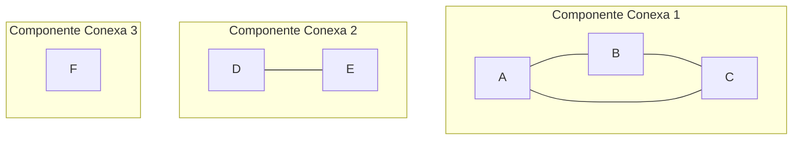
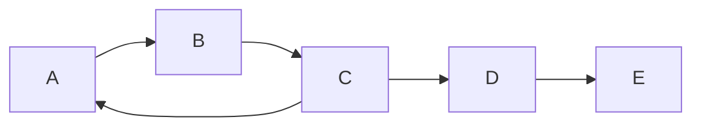
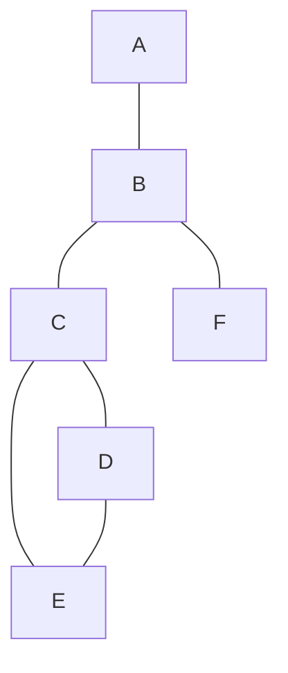
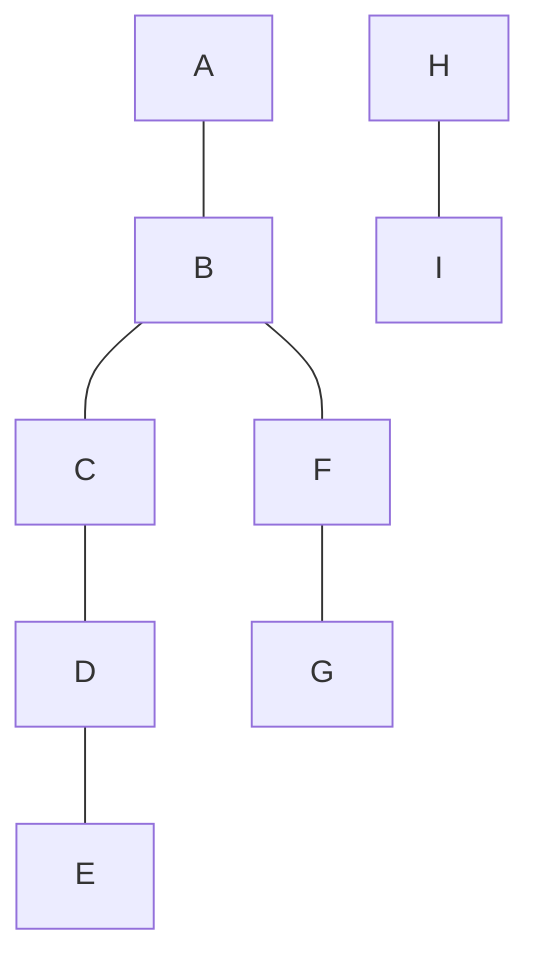

# Gráficas y Juegos - Gráficas

## 1.8 Gráficas conexas.

---

### Definición Fundamental

Una gráfica $G = (V, E)$ es **conexa** si para todo par de vértices $u, v \in V$, existe un camino entre $u$ y $v$ en $G$.

Formalmente:

$$G \text{ es conexa} \iff \forall u,v \in V, \exists \text{ camino } P = (v_0, v_1, ..., v_k) \text{ con } v_0 = u, v_k = v$$

### Componentes Conexas

Una **componente conexa** es una subgráfica conexa maximal. Toda gráfica puede particionarse en componentes conexas disjuntas.

Si $G$ tiene $k$ componentes conexas, entonces:

$$V = V_1 \cup V_2 \cup \cdots \cup V_k \quad \text{(unión disjunta)}$$

### Ejemplo Visual



Esta gráfica tiene 3 componentes conexas.

### Algoritmos para Verificar Conexidad

#### Búsqueda en Profundidad (DFS)

```python
def es_conexa(grafica):
    """Verifica si una gráfica es conexa usando DFS"""
    if not grafica.vertices:
        return True

    visitados = set()
    pila = [next(iter(grafica.vertices))]

    while pila:
        vertice = pila.pop()
        if vertice not in visitados:
            visitados.add(vertice)
            for vecino in grafica.obtener_vecinos(vertice):
                if vecino not in visitados:
                    pila.append(vecino)

    return len(visitados) == len(grafica.vertices)

def componentes_conexas(grafica):
    """Encuentra todas las componentes conexas usando DFS"""
    visitados = set()
    componentes = []

    for vertice in grafica.vertices:
        if vertice not in visitados:
            componente_actual = set()
            pila = [vertice]

            while pila:
                actual = pila.pop()
                if actual not in visitados:
                    visitados.add(actual)
                    componente_actual.add(actual)
                    for vecino in grafica.obtener_vecinos(actual):
                        if vecino not in visitados:
                            pila.append(vecino)

            componentes.append(componente_actual)

    return componentes
```

#### Búsqueda en Amplitud (BFS)

```python
import collections

def es_conexa_bfs(grafica):
    """Verifica conexidad usando BFS"""
    if not grafica.vertices:
        return True

    visitados = set()
    cola = collections.deque([next(iter(grafica.vertices))])

    while cola:
        vertice = cola.popleft()
        if vertice not in visitados:
            visitados.add(vertice)
            for vecino in grafica.obtener_vecinos(vertice):
                if vecino not in visitados:
                    cola.append(vecino)

    return len(visitados) == len(grafica.vertices)
```

### Gráficas Fuertemente Conexas (Dirigidas)

Para gráficas dirigidas, definimos:

- **Fuertemente conexa**: Existe camino dirigido de $u$ a $v$ y de $v$ a $u$ para todo par $u,v$
- **Débilmente conexa**: La gráfica subyacente (no dirigida) es conexa



Esta gráfica dirigida no es fuertemente conexa: desde D no se puede volver a C. Sus componentes fuertemente conexas son $\{A, B, C\}$, $\{D\}$ y $\{E\}$. Sí es débilmente conexa.

### Algoritmo de Kosaraju para Componentes Fuertemente Conexas

```python
def kosaraju(grafica_dirigida):
    """Algoritmo de Kosaraju para componentes fuertemente conexas"""
    # Paso 1: Primera DFS para ordenamiento
    visitados = set()
    orden = []

    def dfs_primera(vertice):
        visitados.add(vertice)
        for vecino in grafica_dirigida.obtener_vecinos(vertice):
            if vecino not in visitados:
                dfs_primera(vecino)
        orden.append(vertice)

    for vertice in grafica_dirigida.vertices:
        if vertice not in visitados:
            dfs_primera(vertice)

    # Paso 2: Gráfica transpuesta
    grafica_transpuesta = grafica_dirigida.transponer()

    # Paso 3: Segunda DFS en orden inverso
    visitados.clear()
    componentes = []

    def dfs_segunda(vertice, componente):
        visitados.add(vertice)
        componente.add(vertice)
        for vecino in grafica_transpuesta.obtener_vecinos(vertice):
            if vecino not in visitados:
                dfs_segunda(vecino, componente)

    while orden:
        vertice = orden.pop()
        if vertice not in visitados:
            componente_actual = set()
            dfs_segunda(vertice, componente_actual)
            componentes.append(componente_actual)

    return componentes
```

### Puntos de Articulación y Puentes

#### Punto de Articulación

Vértice cuya eliminación desconecta la gráfica.

#### Puente

Arista cuya eliminación desconecta la gráfica.



Los vértices B y C son puntos de articulación: quitar B aísla A y F, y quitar C separa D y E del resto. Las aristas A-B, B-C y B-F son puentes; C-D, C-E y D-E no lo son porque forman un ciclo.

### Algoritmo de Tarjan para Puntos de Articulación

```python
def tarjan_puntos_articulacion(grafica):
    """Algoritmo de Tarjan para encontrar puntos de articulación"""
    tiempo = 0
    profundidad = {}
    low = {}
    padre = {}
    puntos_articulacion = set()

    def dfs(vertice):
        nonlocal tiempo
        profundidad[vertice] = tiempo
        low[vertice] = tiempo
        tiempo += 1
        hijos = 0

        for vecino in grafica.obtener_vecinos(vertice):
            if vecino not in profundidad:
                padre[vecino] = vertice
                hijos += 1
                dfs(vecino)

                low[vertice] = min(low[vertice], low[vecino])

                # Verificar si es punto de articulación
                if (padre.get(vertice) is None and hijos > 1) or \
                   (padre.get(vertice) is not None and low[vecino] >= profundidad[vertice]):
                    puntos_articulacion.add(vertice)

            elif vecino != padre.get(vertice):
                low[vertice] = min(low[vertice], profundidad[vecino])

    for vertice in grafica.vertices:
        if vertice not in profundidad:
            padre[vertice] = None
            dfs(vertice)

    return puntos_articulacion
```

### k-Conexidad

#### k-Vértice-Conexa

Una gráfica con más de $k$ vértices es **k-vértice-conexa** si no existe un conjunto de a lo más $k-1$ vértices cuya eliminación desconecta la gráfica.

#### k-Arista-Conexa

Una gráfica es **k-arista-conexa** si no existe un conjunto de a lo más $k-1$ aristas cuya eliminación desconecta la gráfica.

### Teorema de Menger

**Teorema**: Una gráfica con más de $k$ vértices es k-vértice-conexa si y solo si existen k caminos internamente disjuntos entre cualquier par de vértices. La versión para aristas dice que es k-arista-conexa si y solo si existen k caminos sin aristas en común entre cualquier par de vértices.

### Aplicaciones en Juegos

#### 1. Generación de Mundos Conectados

```python
class GeneradorMundo:
    def __init__(self, ancho, alto):
        self.ancho = ancho
        self.alto = alto
        self.grafica = Grafica()

    def generar_mundo_conexo(self):
        """Genera un mundo de juego conexo"""
        # Crear vértices (habitaciones)
        for x in range(self.ancho):
            for y in range(self.alto):
                self.grafica.agregar_vertice((x, y))

        # Conectar habitaciones adyacentes
        for x in range(self.ancho):
            for y in range(self.alto):
                if x > 0:
                    self.grafica.agregar_arista((x, y), (x-1, y))
                if y > 0:
                    self.grafica.agregar_arista((x, y), (x, y-1))

        # Verificar conexidad
        if not es_conexa(self.grafica):
            self._reparar_conexidad()

        return self.grafica

    def _reparar_conexidad(self):
        """Repara la conexidad agregando aristas adicionales"""
        componentes = componentes_conexas(self.grafica)
        while len(componentes) > 1:
            # Conectar dos componentes diferentes
            comp1, comp2 = componentes[0], componentes[1]
            v1 = next(iter(comp1))
            v2 = next(iter(comp2))
            self.grafica.agregar_arista(v1, v2)
            componentes = componentes_conexas(self.grafica)
```

#### 2. Análisis de Redes de Navegación

```python
class AnalizadorNavegacion:
    def __init__(self, grafica_mapa):
        self.mapa = grafica_mapa

    def encontrar_cuellos_botella(self):
        """Encuentra puntos críticos en la navegación"""
        return tarjan_puntos_articulacion(self.mapa)

    def robustez_mapa(self):
        """Distingue conexidad 0, 1 o al menos 2; no calcula la k-conexidad exacta"""
        if not es_conexa(self.mapa):
            return 0
        puntos_articulacion = self.encontrar_cuellos_botella()
        if not puntos_articulacion:
            return 2  # al menos 2-conexo, si tiene 3 o más vértices
        return 1  # 1-conexo pero no 2-conexo

    def alternativas_navegacion(self, inicio, destino):
        """Encuentra rutas alternativas evitando puntos críticos"""
        puntos_criticos = self.encontrar_cuellos_botella()
        rutas_alternativas = []

        # Buscar rutas que eviten puntos críticos
        def dfs_evitando(actual, camino, evitados):
            if actual == destino:
                rutas_alternativas.append(camino.copy())
                return

            for vecino in self.mapa.obtener_vecinos(actual):
                if vecino not in camino and vecino not in evitados:
                    camino.append(vecino)
                    dfs_evitando(vecino, camino, evitados)
                    camino.pop()

        dfs_evitando(inicio, [inicio], puntos_criticos)
        return rutas_alternativas
```

### Teoremas Importantes

#### Teorema de Whitney (1932)

Una gráfica con al menos 3 vértices es 2-conexa si y solo si puede construirse a partir de un ciclo agregando sucesivamente **orejas**: caminos cuyos extremos son dos vértices distintos ya presentes y cuyos vértices internos son nuevos.

#### Teorema de Robbins (1939)

Una gráfica tiene una orientación fuertemente conexa si y solo si es 2-arista-conexa.

### Ejercicios Prácticos

1. Dada la siguiente gráfica, determina:
   - ¿Es conexa?
   - Componentes conexas
   - Puntos de articulación
   - Puentes



2. Implementa un algoritmo que determine si una gráfica es 2-conexa.

3. Demuestra que en toda gráfica conexa con $n$ vértices, existen al menos $n-1$ aristas.

### Complejidad Computacional

- Verificar conexidad: $O(V + E)$
- Encontrar componentes conexas: $O(V + E)$
- Encontrar puntos de articulación: $O(V + E)$
- Verificar k-conexidad: $O(k \cdot V \cdot (V + E))$
