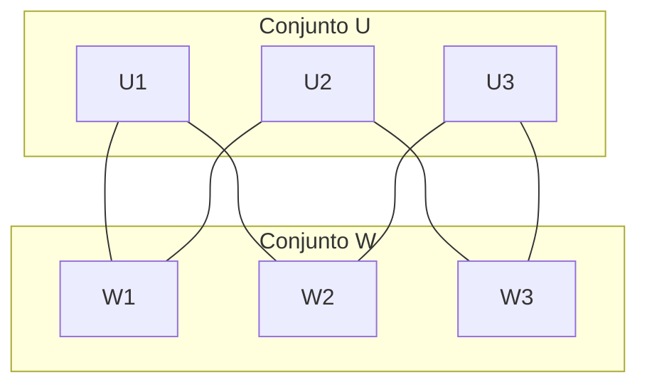
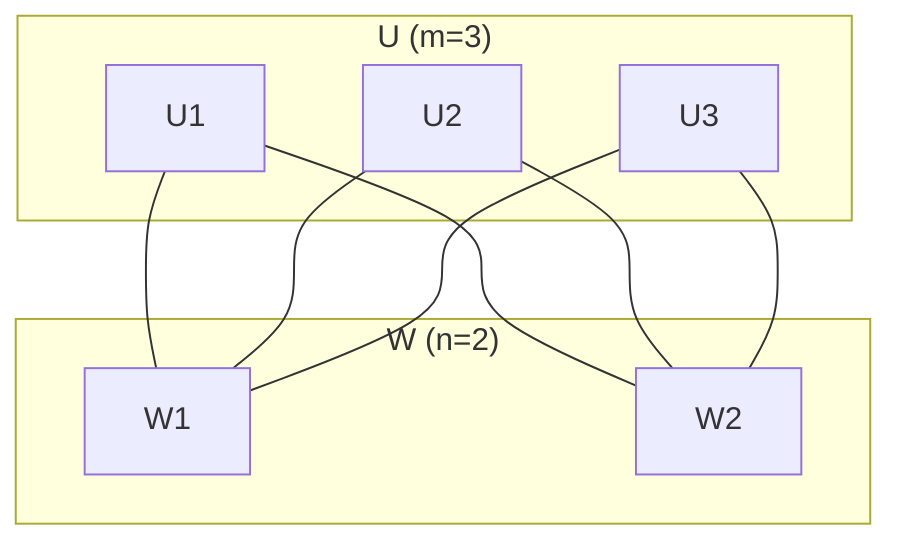
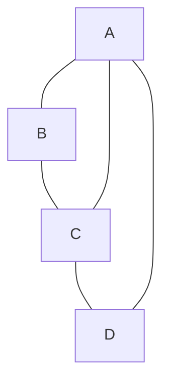

# Gráficas y Juegos - Gráficas

## 1.9 Gráficas bipartitas.

---

### Definición Formal

Una gráfica $G = (V, E)$ es **bipartita** si existe una partición de $V$ en dos conjuntos disjuntos $U$ y $W$ tal que:

- $V = U \cup W$ con $U \cap W = \emptyset$
- Toda arista $e \in E$ conecta un vértice de $U$ con un vértice de $W$

Es decir, no existen aristas entre vértices del mismo conjunto.

### Teorema de Caracterización

Una gráfica es bipartita **si y solo si** no contiene ciclos de longitud impar.

$$G \text{ es bipartita} \iff \nexists \text{ ciclo de longitud impar en } G$$

### Representación Visual



### Gráficas Bipartitas Completas $(K_{m,n})$

Una gráfica bipartita **completa** $K_{m,n}$ tiene:

- $|U| = m$ vértices
- $|W| = n$ vértices
- Todas las posibles aristas entre $U$ y $W$

Número de aristas: $|E| = m \times n$



### Algoritmo de Verificación de Bipartitud

#### Método de BFS/DFS con Coloreado

```python
def es_bipartita(grafica):
    """Verifica si una gráfica es bipartita usando BFS con coloreado"""
    if not grafica.vertices:
        return True

    color = {}  # 0: primer color, 1: segundo color
    cola = collections.deque()

    for vertice in grafica.vertices:
        if vertice not in color:
            color[vertice] = 0
            cola.append(vertice)

            while cola:
                actual = cola.popleft()
                color_actual = color[actual]

                for vecino in grafica.obtener_vecinos(actual):
                    if vecino not in color:
                        color[vecino] = 1 - color_actual  # Color opuesto
                        cola.append(vecino)
                    elif color[vecino] == color_actual:
                        return False  # Conflicto de colores

    return True

def obtener_particion_bipartita(grafica):
    """Obtiene la partición bipartita de una gráfica"""
    if not es_bipartita(grafica):
        return None

    color = {}
    cola = collections.deque([next(iter(grafica.vertices))])
    color[next(iter(grafica.vertices))] = 0

    U = set()
    W = set()

    while cola:
        actual = cola.popleft()
        if color[actual] == 0:
            U.add(actual)
        else:
            W.add(actual)

        for vecino in grafica.obtener_vecinos(actual):
            if vecino not in color:
                color[vecino] = 1 - color[actual]
                cola.append(vecino)

    # Asegurar que todos los vértices están incluidos
    for vertice in grafica.vertices:
        if vertice not in color:
            if len(U) <= len(W):
                U.add(vertice)
            else:
                W.add(vertice)

    return U, W
```

### Emparejamiento (Matching) en Gráficas Bipartitas

Un **emparejamiento** $M \subseteq E$ es un conjunto de aristas sin vértices en común.

#### Emparejamiento Máximo

```python
def emparejamiento_maximo_bipartito(grafica, U, W):
    """Algoritmo de Hopcroft-Karp para emparejamiento máximo (simplificado)"""
    # Implementación simplificada usando DFS
    emparejamiento = {}
    visitados = set()

    def dfs(u):
        for v in grafica.obtener_vecinos(u):
            if v not in visitados:
                visitados.add(v)
                if v not in emparejamiento or dfs(emparejamiento[v]):
                    emparejamiento[v] = u
                    return True
        return False

    for u in U:
        visitados.clear()
        dfs(u)

    return [(emparejamiento[v], v) for v in emparejamiento]
```

### Gráficas Bipartitas Ponderadas y el Problema de Asignación

Para gráficas con pesos en las aristas, buscamos el **emparejamiento perfecto de peso mínimo/máximo**.

#### Algoritmo Húngaro

```python
def algoritmo_hungaro(cost_matrix):
    """Algoritmo Húngaro para el problema de asignación"""
    n = len(cost_matrix)

    # Paso 1: Reducción de filas
    for i in range(n):
        min_val = min(cost_matrix[i])
        for j in range(n):
            cost_matrix[i][j] -= min_val

    # Paso 2: Reducción de columnas
    for j in range(n):
        min_val = min(cost_matrix[i][j] for i in range(n))
        for i in range(n):
            cost_matrix[i][j] -= min_val

    # Pasos 3-5: Encontrar el emparejamiento perfecto
    # (Implementación simplificada)
    asignacion = [-1] * n
    filas_cubiertas = [False] * n
    columnas_cubiertas = [False] * n

    # Lógica compleja para encontrar el emparejamiento óptimo
    # ...

    return asignacion
```

### Aplicaciones en Juegos

#### 1. Sistemas de Emparejamiento de Jugadores

```python
class SistemaEmparejamiento:
    def __init__(self):
        self.jugadores = []
        self.habilidades = {}

    def crear_grafica_emparejamiento(self, jugadores):
        """Crea gráfica bipartita para emparejar equipos"""
        grafica = Grafica()
        equipo_azul = [f"Azul_{i}" for i in range(len(jugadores)//2)]
        equipo_rojo = [f"Rojo_{i}" for i in range(len(jugadores)//2)]

        for azul in equipo_azul:
            for rojo in equipo_rojo:
                # Calcular peso basado en diferencia de habilidades
                habilidad_diff = abs(self.habilidades[azul] - self.habilidades[rojo])
                peso = 100 - habilidad_diff  # Mayor peso para diferencias pequeñas
                grafica.agregar_arista(azul, rojo, peso)

        return grafica, equipo_azul, equipo_rojo

    def emparejar_equipos(self):
        """Empareja jugadores para crear partidas balanceadas"""
        grafica, azul, rojo = self.crear_grafica_emparejamiento(self.jugadores)
        emparejamiento = emparejamiento_maximo_bipartito(grafica, azul, rojo)
        return emparejamiento
```

#### 2. Generación de Niveles con Restricciones

```python
class GeneradorNivelBipartito:
    def __init__(self, ancho, alto):
        self.ancho = ancho
        self.alto = alto

    def generar_nivel_bipartito(self):
        """Genera nivel con estructura bipartita"""
        # Crear dos conjuntos de habitaciones
        habitaciones_tipo_a = []
        habitaciones_tipo_b = []

        for x in range(self.ancho):
            for y in range(self.alto):
                if (x + y) % 2 == 0:
                    habitaciones_tipo_a.append((x, y))
                else:
                    habitaciones_tipo_b.append((x, y))

        # Conectar habitaciones de diferentes tipos
        grafica_nivel = Grafica()
        for room_a in habitaciones_tipo_a:
            for room_b in habitaciones_tipo_b:
                if self.son_adyacentes(room_a, room_b):
                    grafica_nivel.agregar_arista(room_a, room_b)

        return grafica_nivel, habitaciones_tipo_a, habitaciones_tipo_b

    def son_adyacentes(self, room1, room2):
        """Verifica si dos habitaciones son adyacentes"""
        x1, y1 = room1
        x2, y2 = room2
        return abs(x1 - x2) + abs(y1 - y2) == 1
```

### Propiedades Matemáticas

#### Teorema de König

En toda gráfica bipartita, el tamaño del **emparejamiento máximo** es igual al tamaño de la **cubierta mínima de vértices**.

#### Teorema de Hall (Teorema del Matrimonio)

Una gráfica bipartita con conjuntos $U$ y $W$ tiene un emparejamiento que cubre $U$ si y solo si para todo subconjunto $S \subseteq U$:

$$|N(S)| \geq |S|$$

donde $N(S)$ son los vecinos de $S$ en $W$.

### Ejemplos de Gráficas Bipartitas

1. **Árboles**: Todos los árboles son bipartitos
2. **Gráficas sin ciclos impares**
3. **Hipercubos**: $Q_n$ es bipartito para todo $n$
4. **Gráficas de malla par**: Grids con dimensiones pares

### Ejercicios Prácticos

1. Demuestra que todo árbol es bipartito.

2. Implementa un algoritmo que encuentre el ciclo impar más corto en una gráfica no bipartita.

3. Dada la siguiente gráfica, verifica si es bipartita y encuentra la partición:



4. Para $K_{3,3}$:
   - Calcula el número de aristas
   - Encuentra todos los emparejamientos perfectos
   - Verifica el teorema de Hall

### Complejidad Computacional

- Verificar bipartitud: $O(V + E)$
- Emparejamiento máximo bipartito: $O(E\sqrt{V})$ (Hopcroft-Karp)
- Problema de asignación: $O(V^3)$ (Algoritmo Húngaro)
- Detección de ciclos impares: $O(V + E)$
