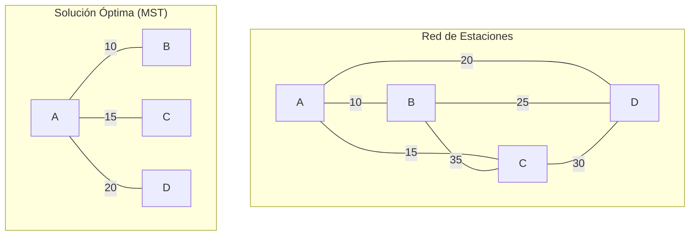
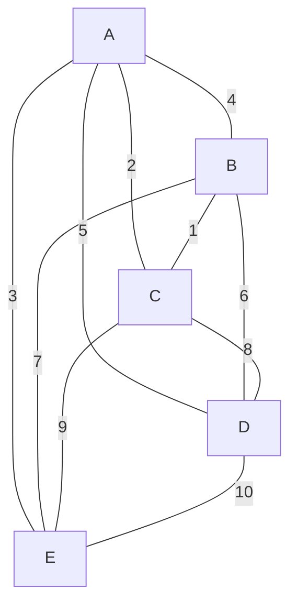

# Gráficas y Juegos - Árboles

## 2.1 El problema de las vías ferroviarias.

---

### Definición del Problema

El **problema de las vías ferroviarias** es un problema clásico de teoría de gráficas que busca determinar si es posible conectar $n$ estaciones de tren con $n-1$ vías (sin ciclos) de manera que se minimice la longitud total de las vías mientras se garantiza la conectividad entre todas las estaciones.

Matemáticamente, buscamos un **árbol de expansión mínima** (Minimum Spanning Tree - MST) en una gráfica completa ponderada donde:

- Vértices: Estaciones de tren
- Aristas: Posibles vías entre estaciones
- Peso: Longitud/costo de construir la vía

### Formulación Matemática

Dada una gráfica conexa ponderada $G = (V, E, w)$ donde $w: E \rightarrow \mathbb{R}^+$, encontrar un árbol $T = (V, E')$ con $E' \subseteq E$ que minimice:

$$w(T) = \sum_{e \in E'} w(e)$$

### Algoritmos para el Problema

#### 1. Algoritmo de Prim

```python
def prim_ferrocarril(estaciones, distancias):
    """Algoritmo de Prim para el problema de vías ferroviarias"""
    n = len(estaciones)
    # Inicializar estructuras
    costo_minimo = [float('inf')] * n
    predecesor = [-1] * n
    en_arbol = [False] * n

    # Empezar desde la primera estación
    costo_minimo[0] = 0

    for _ in range(n):
        # Encontrar la estación con costo mínimo no incluida
        u = -1
        for i in range(n):
            if not en_arbol[i] and (u == -1 or costo_minimo[i] < costo_minimo[u]):
                u = i

        en_arbol[u] = True

        # Actualizar costos de las estaciones adyacentes
        for v in range(n):
            if (not en_arbol[v] and distancias[u][v] > 0 and
                distancias[u][v] < costo_minimo[v]):
                costo_minimo[v] = distancias[u][v]
                predecesor[v] = u

    # Construir la red de vías
    vias = []
    for i in range(1, n):
        vias.append((estaciones[predecesor[i]], estaciones[i], distancias[predecesor[i]][i]))

    return vias, sum(costo_minimo)

# Ejemplo de uso
estaciones = ['A', 'B', 'C', 'D']
distancias = [
    [0, 10, 15, 20],
    [10, 0, 35, 25],
    [15, 35, 0, 30],
    [20, 25, 30, 0]
]

vias_optimas, longitud_total = prim_ferrocarril(estaciones, distancias)
```

#### 2. Algoritmo de Kruskal

```python
def kruskal_ferrocarril(estaciones, distancias):
    """Algoritmo de Kruskal para el problema de vías ferroviarias"""
    class UnionFind:
        def __init__(self, n):
            self.parent = list(range(n))
            self.rank = [0] * n

        def find(self, x):
            if self.parent[x] != x:
                self.parent[x] = self.find(self.parent[x])
            return self.parent[x]

        def union(self, x, y):
            rx, ry = self.find(x), self.find(y)
            if rx == ry:
                return False
            if self.rank[rx] < self.rank[ry]:
                self.parent[rx] = ry
            elif self.rank[rx] > self.rank[ry]:
                self.parent[ry] = rx
            else:
                self.parent[ry] = rx
                self.rank[rx] += 1
            return True

    n = len(estaciones)
    uf = UnionFind(n)
    aristas = []

    # Crear lista de todas las aristas
    for i in range(n):
        for j in range(i + 1, n):
            if distancias[i][j] > 0:
                aristas.append((distancias[i][j], i, j))

    # Ordenar aristas por peso
    aristas.sort()

    vias = []
    longitud_total = 0

    for peso, u, v in aristas:
        if uf.union(u, v):
            vias.append((estaciones[u], estaciones[v], peso))
            longitud_total += peso
            if len(vias) == n - 1:
                break

    return vias, longitud_total
```

### Representación Visual del Problema



Kruskal toma A-B (10), A-C (15) y A-D (20), con longitud total 45. Las demás aristas cerrarían ciclos: B-D (25), por ejemplo, formaría el ciclo A-B-D-A.

### Análisis de Complejidad

| Algoritmo | Complejidad   | Aplicación         |
| --------- | ------------- | ------------------ |
| Prim      | $O(n^2)$      | Gráficas densas    |
| Kruskal   | $O(e \log e)$ | Gráficas dispersas |
| Borůvka   | $O(e \log n)$ | Gráficas grandes   |

### Variantes del Problema

#### 1. Con Restricciones Presupuestarias

Maximizar la conectividad con un presupuesto limitado:

```python
def mst_presupuesto(estaciones, distancias, presupuesto_max):
    """MST con restricción de presupuesto"""
    vias, costo_total = prim_ferrocarril(estaciones, distancias)

    if costo_total <= presupuesto_max:
        return vias, costo_total
    else:
        # Encontrar solución subóptima dentro del presupuesto
        return mst_aproximado(estaciones, distancias, presupuesto_max)
```

#### 2. Con Puntos de Interconexión Obligatorios

```python
def mst_con_obligatorios(estaciones, distancias, obligatorias):
    """MST que debe incluir ciertas vías obligatorias"""
    # Primero incluir las vías obligatorias
    uf = UnionFind(len(estaciones))
    vias = []
    costo_total = 0

    for u, v in obligatorias:
        idx_u = estaciones.index(u)
        idx_v = estaciones.index(v)
        if uf.union(idx_u, idx_v):
            costo_total += distancias[idx_u][idx_v]
            vias.append((u, v, distancias[idx_u][idx_v]))

    # Completar con el algoritmo de Kruskal normal
    # ... (continuación similar a Kruskal)

    return vias, costo_total
```

### Aplicación en Juegos: Sistema de Caminos

```python
class SistemaViasFerroviarias:
    def __init__(self, ciudades, terreno):
        self.ciudades = ciudades
        self.terreno = terreno
        self.distancias = self.calcular_distancias()

    def calcular_distancias(self):
        """Calcula distancias considerando el terreno"""
        n = len(self.ciudades)
        distancias = [[0] * n for _ in range(n)]

        for i in range(n):
            for j in range(i + 1, n):
                # Distancia euclidiana modificada por tipo de terreno
                dist = self.distancia_con_terreno(
                    self.ciudades[i].posicion,
                    self.ciudades[j].posicion
                )
                distancias[i][j] = distancias[j][i] = dist

        return distancias

    def distancia_con_terreno(self, pos1, pos2):
        """Calcula distancia considerando dificultad del terreno"""
        dx = pos2[0] - pos1[0]
        dy = pos2[1] - pos1[1]
        distancia_base = math.sqrt(dx*dx + dy*dy)

        # Ajustar por tipo de terreno (montañas, ríos, etc.)
        factor_terreno = self.obtener_factor_terreno(pos1, pos2)

        return distancia_base * factor_terreno

    def construir_red_optima(self, presupuesto=None):
        """Construye la red óptima de vías"""
        if presupuesto:
            return mst_presupuesto(self.ciudades, self.distancias, presupuesto)
        else:
            return prim_ferrocarril(self.ciudades, self.distancias)

    def visualizar_red(self, vias):
        """Genera visualización de la red de vías"""
        # Implementación para visualizar en el juego
        for origen, destino, longitud in vias:
            self.dibujar_via(origen, destino, longitud)
```

### Teoremas Relacionados

#### Teorema del Árbol de Expansión Mínima

Para cualquier gráfica conexa ponderada, existe exactamente un árbol de expansión mínima si todos los pesos son distintos.

#### Propiedad del Ciclo

Para cualquier ciclo en una gráfica, si una arista pesa estrictamente más que todas las demás del ciclo, no pertenece a ningún MST. Con empates, solo se garantiza que existe un MST que no la contiene.

### Ejemplo Práctico

Supongamos 5 estaciones con las siguientes distancias:



La solución óptima sería: A-C (2), B-C (1), A-E (3), A-D (5) con longitud total 11.

### Ejercicios

1. Implementa el algoritmo de Borůvka para el problema de vías ferroviarias.

2. Modifica el algoritmo de Prim para que considere diferentes costos de construcción según el tipo de terreno.

3. Demuestra que si una arista de un ciclo pesa estrictamente más que las demás aristas del ciclo, nunca pertenece a un MST.

4. Para 6 estaciones, encuentra el MST manualmente y verifica con el algoritmo.

### Optimizaciones para Juegos en Tiempo Real

```python
def mst_incremental(estaciones_existentes, nueva_estacion, distancias):
    """Conecta una nueva estación con la vía más barata disponible.

    Cuidado: el resultado es un árbol generador, pero NO necesariamente un MST.
    La nueva estación puede abaratar conexiones entre estaciones existentes;
    por ejemplo, si queda en medio de dos estaciones lejanas, conviene unirlas
    a través de ella. Para obtener el MST correcto basta calcular el MST de la
    gráfica formada por las n - 1 vías del MST anterior más las n vías nuevas,
    lo que cuesta O(n log n) con Kruskal en lugar de recalcular todo.
    """
    # Encontrar la arista mínima que conecta la nueva estación
    min_peso = float('inf')
    mejor_conexion = None

    for i, estacion in enumerate(estaciones_existentes):
        peso = distancias[i][-1]  # Última posición es la nueva estación
        if peso < min_peso:
            min_peso = peso
            mejor_conexion = i

    # Añadir esta arista al MST existente
    return mejor_conexion, min_peso
```
