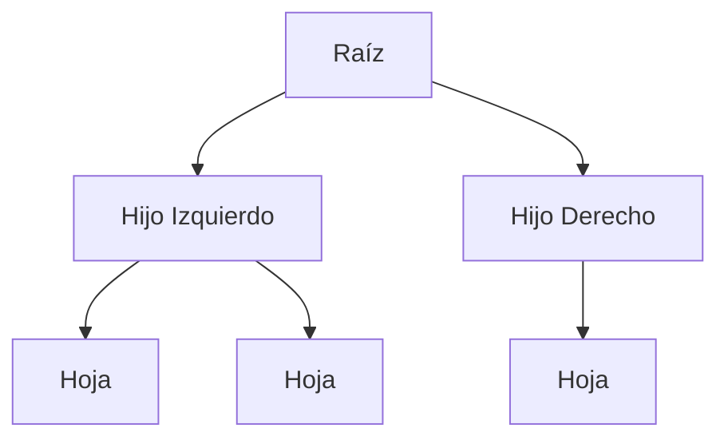
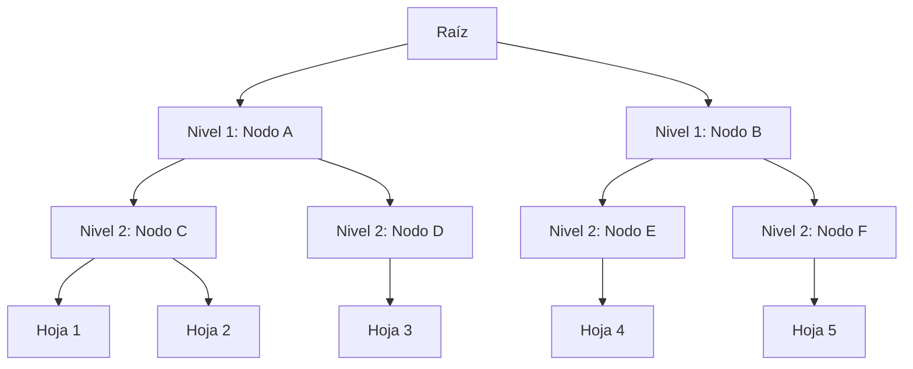

# Gráficas y Juegos - Árboles

## 2.2 Árboles.

---

### Definición Formal

Un **árbol** es una gráfica conexa y acíclica. Equivalentemente, es una gráfica con exactamente un camino entre cualquier par de vértices.

**Propiedades equivalentes:** Para una gráfica $G$ con $n$ vértices, las siguientes son equivalentes:

1. $G$ es un árbol
2. $G$ es conexa y tiene $n-1$ aristas
3. $G$ es acíclica y tiene $n-1$ aristas
4. $G$ es conexa y mínimamente conexa (eliminar cualquier arista la desconecta)
5. $G$ es acíclica y maximalmente acíclica (añadir cualquier arista crea un ciclo)

### Estructura de Datos para Árboles

```python
class NodoArbol:
    def __init__(self, valor, hijos=None):
        self.valor = valor
        self.hijos = hijos if hijos is not None else []
        self.padre = None
        # Para árboles binarios
        self.izquierdo = None
        self.derecho = None

    def agregar_hijo(self, nodo_hijo):
        self.hijos.append(nodo_hijo)
        nodo_hijo.padre = self

    def es_hoja(self):
        return len(self.hijos) == 0

    def altura(self):
        if self.es_hoja():
            return 0
        return 1 + max(hijo.altura() for hijo in self.hijos)

    def profundidad(self):
        if self.padre is None:
            return 0
        return 1 + self.padre.profundidad()

class Arbol:
    def __init__(self, raiz=None):
        self.raiz = raiz
        self.nodos = {}

    def agregar_nodo(self, valor, padre_valor=None):
        nuevo_nodo = NodoArbol(valor)
        self.nodos[valor] = nuevo_nodo

        if padre_valor is not None and padre_valor in self.nodos:
            self.nodos[padre_valor].agregar_hijo(nuevo_nodo)
        elif self.raiz is None:
            self.raiz = nuevo_nodo

        return nuevo_nodo

    def es_arbol_binario(self):
        def verificar_nodo(nodo):
            if len(nodo.hijos) > 2:
                return False
            for hijo in nodo.hijos:
                if not verificar_nodo(hijo):
                    return False
            return True

        return verificar_nodo(self.raiz)
```

### Tipos de Árboles

#### 1. Árbol Binario

Cada nodo tiene como máximo dos hijos.



#### 2. Árbol Binario de Búsqueda (ABB)

Para todo nodo $x$:

- Todos los valores en el subárbol izquierdo son $\leq x$
- Todos los valores en el subárbol derecho son $\geq x$

#### 3. Árbol AVL

Árbol binario de búsqueda balanceado donde, en cada nodo, las alturas de los subárboles izquierdo y derecho difieren en como máximo 1.

#### 4. Árbol Rojo-Negro

Árbol binario de búsqueda que garantiza balance mediante reglas de coloreado.

### Recorridos de Árboles

#### Recorrido en Preorden

```python
def preorden(nodo):
    if nodo is None:
        return []
    resultado = [nodo.valor]
    for hijo in nodo.hijos:
        resultado.extend(preorden(hijo))
    return resultado
```

#### Recorrido en Inorden (para árboles binarios)

```python
def inorden(nodo):
    if nodo is None:
        return []
    resultado = []
    if nodo.izquierdo:
        resultado.extend(inorden(nodo.izquierdo))
    resultado.append(nodo.valor)
    if nodo.derecho:
        resultado.extend(inorden(nodo.derecho))
    return resultado
```

#### Recorrido en Postorden

```python
def postorden(nodo):
    if nodo is None:
        return []
    resultado = []
    for hijo in nodo.hijos:
        resultado.extend(postorden(hijo))
    resultado.append(nodo.valor)
    return resultado
```

#### Recorrido por Niveles (BFS)

```python
import collections

def recorrido_niveles(raiz):
    if raiz is None:
        return []

    resultado = []
    cola = collections.deque([raiz])

    while cola:
        nivel_actual = []
        for _ in range(len(cola)):
            nodo = cola.popleft()
            nivel_actual.append(nodo.valor)
            for hijo in nodo.hijos:
                cola.append(hijo)
        resultado.append(nivel_actual)

    return resultado
```

### Árbol de Expansión Mínima (MST)

Dada una gráfica conexa ponderada $G = (V, E, w)$, un árbol de expansión mínima $T$ es un subgrafo que:

- Conecta todos los vértices
- Es un árbol
- Minimiza $\sum_{e \in T} w(e)$

#### Algoritmo de Prim

```python
def prim_mst(grafica):
    n = len(grafica.vertices)
    costo = [float('inf')] * n
    padre = [-1] * n
    en_arbol = [False] * n

    costo[0] = 0

    for _ in range(n):
        u = min((i for i in range(n) if not en_arbol[i]), key=lambda i: costo[i])
        en_arbol[u] = True

        for v, peso in grafica.vecinos(u):
            if not en_arbol[v] and peso < costo[v]:
                costo[v] = peso
                padre[v] = u

    return [(padre[i], i, costo[i]) for i in range(1, n)]
```

### Aplicaciones en Juegos

#### 1. Árboles de Decisión para IA

```python
class ArbolDecision:
    def __init__(self, estado, accion=None, padre=None):
        self.estado = estado
        self.accion = accion
        self.padre = padre
        self.hijos = []
        self.utilidad = 0
        self.visitas = 0

    def expandir(self, acciones_validas):
        for accion in acciones_validas:
            nuevo_estado = self.simular_accion(self.estado, accion)
            hijo = ArbolDecision(nuevo_estado, accion, self)
            self.hijos.append(hijo)

    def mejor_accion(self):
        return max(self.hijos, key=lambda h: h.utilidad/h.visitas if h.visitas > 0 else 0).accion
```

#### 2. Quadtree para Detección de Colisiones

```python
class Quadtree:
    def __init__(self, x, y, ancho, alto, capacidad=4):
        self.bounds = (x, y, ancho, alto)
        self.capacidad = capacidad
        self.objetos = []
        self.dividido = False
        self.noroeste = None
        self.noreste = None
        self.suroeste = None
        self.sureste = None

    def insertar(self, objeto):
        if not self.contiene(objeto):
            return False

        if len(self.objetos) < self.capacidad:
            self.objetos.append(objeto)
            return True

        if not self.dividido:
            self.dividir()

        return (self.noroeste.insertar(objeto) or
                self.noreste.insertar(objeto) or
                self.suroeste.insertar(objeto) or
                self.sureste.insertar(objeto))

    def consultar_rango(self, rango):
        objetos_en_rango = []
        if not self.intersecta(rango):
            return objetos_en_rango

        for objeto in self.objetos:
            if self.en_rango(objeto, rango):
                objetos_en_rango.append(objeto)

        if self.dividido:
            objetos_en_rango.extend(self.noroeste.consultar_rango(rango))
            objetos_en_rango.extend(self.noreste.consultar_rango(rango))
            objetos_en_rango.extend(self.suroeste.consultar_rango(rango))
            objetos_en_rango.extend(self.sureste.consultar_rango(rango))

        return objetos_en_rango
```

### Propiedades Matemáticas

#### Fórmula de Cayley

El número de árboles distintos con $n$ vértices etiquetados es $n^{n-2}$.

#### Número de Hojas

En cualquier árbol con $n \geq 2$ vértices, hay al menos 2 hojas.

#### Diámetro de un Árbol

La distancia más larga entre cualquier par de vértices.

### Algoritmos Avanzados

#### Algoritmo de Huffman para Compresión

```python
def huffman(frecuencias):
    from heapq import heapify, heappop, heappush

    heap = [[peso, [simbolo, ""]] for simbolo, peso in frecuencias.items()]
    heapify(heap)

    while len(heap) > 1:
        lo = heappop(heap)
        hi = heappop(heap)
        for par in lo[1:]:
            par[1] = '0' + par[1]
        for par in hi[1:]:
            par[1] = '1' + par[1]
        heappush(heap, [lo[0] + hi[0]] + lo[1:] + hi[1:])

    return sorted(heappop(heap)[1:], key=lambda p: (len(p[-1]), p))
```

#### Árbol de Sufijos

```python
class NodoSufijo:
    def __init__(self):
        self.hijos = {}
        self.inicio = -1
        self.fin = -1
        self.enlace_sufijo = None

class ArbolSufijos:
    def __init__(self, texto):
        self.texto = texto
        self.raiz = NodoSufijo()
        self.construir_arbol()

    def construir_arbol(self):
        # Construcción ingenua, O(n^2) o peor: inserta los sufijos uno por uno.
        # NO es el algoritmo de Ukkonen, que construye el árbol en O(n), y esta
        # versión simplificada no divide aristas, así que no es un árbol de
        # sufijos completo; sirve solo para ilustrar la idea.
        n = len(self.texto)
        for i in range(n):
            self.agregar_sufijo(i, n)

    def agregar_sufijo(self, inicio, fin):
        actual = self.raiz
        for i in range(inicio, fin):
            car = self.texto[i]
            if car not in actual.hijos:
                nuevo_nodo = NodoSufijo()
                nuevo_nodo.inicio = i
                nuevo_nodo.fin = fin
                actual.hijos[car] = nuevo_nodo
                return
            actual = actual.hijos[car]
```

### Ejercicios Prácticos

1. Implementa un árbol binario de búsqueda con operaciones de inserción, búsqueda y eliminación.

2. Calcula el diámetro de un árbol usando BFS dos veces.

3. Implementa el algoritmo de Kruskal para encontrar el MST de una gráfica.

4. Crea un árbol de decisión simple para un juego de tres en raya.

### Complejidad Computacional

| Operación   | Árbol Binario | ABB    | AVL         |
| ----------- | ------------- | ------ | ----------- |
| Búsqueda    | $O(n)$        | $O(h)$ | $O(\log n)$ |
| Inserción   | $O(1)$, dado el nodo padre | $O(h)$ | $O(\log n)$ |
| Eliminación | $O(1)$, dado el nodo y su padre | $O(h)$ | $O(\log n)$ |
| Recorrido   | $O(n)$        | $O(n)$ | $O(n)$      |

### Visualización de Árboles



### Aplicaciones en Gráficas 3D

#### Árbol BSP (Binary Space Partitioning)

```python
class BSPNode:
    def __init__(self, poligono):
        self.poligono = poligono
        self.delante = None
        self.detras = None

    @staticmethod
    def construir_bsp(poligonos):
        if not poligonos:
            return None

        raiz = BSPNode(poligonos[0])
        delante = []
        detras = []

        for poly in poligonos[1:]:
            lado = clasificar_poligono(raiz.poligono, poly)
            if lado == "DELANTE":
                delante.append(poly)
            elif lado == "DETRAS":
                detras.append(poly)
            else:
                # Dividir el polígono
                delante_poly, detras_poly = dividir_poligono(raiz.poligono, poly)
                delante.append(delante_poly)
                detras.append(detras_poly)

        raiz.delante = BSPNode.construir_bsp(delante)
        raiz.detras = BSPNode.construir_bsp(detras)
        return raiz
```
