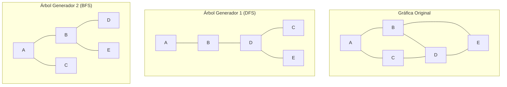

# Gráficas y Juegos - Árboles

## 2.3 Árboles generadores.

---

### Definición Formal

Un **árbol generador** (spanning tree) de una gráfica conexa $G = (V, E)$ es un subgrafo $T = (V, E')$ que:

- Es un árbol (conexo y acíclico)
- Contiene todos los vértices de $G$
- $E' \subseteq E$

Para una gráfica con $n$ vértices, todo árbol generador tiene exactamente $n-1$ aristas.

### Propiedades Fundamentales

1. **Existencia**: Toda gráfica conexa tiene al menos un árbol generador
2. **Minimalidad**: Los árboles generadores son subgráficas conexas minimales
3. **Ciclos**: Añadir cualquier arista de $G$ no en $T$ crea exactamente un ciclo

### Teorema de Cayley

El número de árboles generadores distintos de una gráfica completa $K_n$ es:

$$t(K_n) = n^{n-2}$$

### Algoritmos para Encontrar Árboles Generadores

#### 1. Búsqueda en Profundidad (DFS)

```python
def arbol_generador_dfs(grafica, inicio):
    """Genera un árbol generador usando DFS"""
    visitados = set()
    arbol = Grafica(grafica.vertices)
    padre = {}

    def dfs(vertice):
        visitados.add(vertice)
        for vecino in grafica.obtener_vecinos(vertice):
            if vecino not in visitados:
                arbol.agregar_arista(vertice, vecino)
                padre[vecino] = vertice
                dfs(vecino)

    dfs(inicio)
    return arbol, padre

# Ejemplo de uso
grafica = Grafica(['A', 'B', 'C', 'D', 'E'])
grafica.agregar_arista('A', 'B')
grafica.agregar_arista('A', 'C')
grafica.agregar_arista('B', 'D')
grafica.agregar_arista('C', 'D')
grafica.agregar_arista('D', 'E')

arbol_dfs, padres = arbol_generador_dfs(grafica, 'A')
```

#### 2. Búsqueda en Amplitud (BFS)

```python
def arbol_generador_bfs(grafica, inicio):
    """Genera un árbol generador usando BFS"""
    visitados = set()
    arbol = Grafica(grafica.vertices)
    cola = collections.deque([inicio])
    visitados.add(inicio)

    while cola:
        actual = cola.popleft()
        for vecino in grafica.obtener_vecinos(actual):
            if vecino not in visitados:
                visitados.add(vecino)
                arbol.agregar_arista(actual, vecino)
                cola.append(vecino)

    return arbol

# Ejemplo de uso
arbol_bfs = arbol_generador_bfs(grafica, 'A')
```

### Árbol de Expansión Mínima (MST)

Para gráficas ponderadas, buscamos el árbol generador con peso mínimo total.

#### Algoritmo de Prim

```python
def prim_mst(grafica):
    """Algoritmo de Prim para MST"""
    n = len(grafica.vertices)
    costo = [float('inf')] * n
    padre = [-1] * n
    en_arbol = [False] * n
    vertices = list(grafica.vertices)

    costo[0] = 0

    for _ in range(n):
        # Encontrar vértice con mínimo costo no incluido
        u = -1
        for i in range(n):
            if not en_arbol[i] and (u == -1 or costo[i] < costo[u]):
                u = i

        en_arbol[u] = True

        # Actualizar costos de vecinos
        for v in range(n):
            peso = grafica.peso(vertices[u], vertices[v])
            if (not en_arbol[v] and peso > 0 and peso < costo[v]):
                costo[v] = peso
                padre[v] = u

    # Construir el MST
    mst = Grafica(grafica.vertices)
    for i in range(1, n):
        mst.agregar_arista(vertices[padre[i]], vertices[i], costo[i])

    return mst, sum(costo[1:])
```

#### Algoritmo de Kruskal

```python
def kruskal_mst(grafica):
    """Algoritmo de Kruskal para MST"""
    class UnionFind:
        def __init__(self, n):
            self.parent = list(range(n))
            self.rank = [0] * n

        def find(self, x):
            if self.parent[x] != x:
                self.parent[x] = self.find(self.parent[x])
            return self.parent[x]

        def union(self, x, y):
            rx, ry = self.find(x), self.find(y)
            if rx == ry:
                return False
            if self.rank[rx] < self.rank[ry]:
                self.parent[rx] = ry
            elif self.rank[rx] > self.rank[ry]:
                self.parent[ry] = rx
            else:
                self.parent[ry] = rx
                self.rank[rx] += 1
            return True

    n = len(grafica.vertices)
    uf = UnionFind(n)
    aristas = []
    vertices = list(grafica.vertices)

    # Recoger todas las aristas con pesos
    for i in range(n):
        for j in range(i + 1, n):
            peso = grafica.peso(vertices[i], vertices[j])
            if peso > 0:
                aristas.append((peso, i, j))

    # Ordenar aristas por peso
    aristas.sort()

    mst = Grafica(grafica.vertices)
    peso_total = 0

    for peso, u, v in aristas:
        if uf.union(u, v):
            mst.agregar_arista(vertices[u], vertices[v], peso)
            peso_total += peso
            if len(mst.aristas) == n - 1:
                break

    return mst, peso_total
```

### Visualización de Árboles Generadores



Ambos parten de A y revisan los vecinos en orden alfabético. DFS baja A → B → D, luego desde D visita C y regresa para visitar E. BFS descubre primero B y C, los vecinos de A, y luego D y E, los vecinos de B.

### Aplicaciones en Juegos

#### 1. Generación de Laberintos

```python
class GeneradorLaberinto:
    def __init__(self, filas, columnas):
        self.filas = filas
        self.columnas = columnas
        self.grafica = self._crear_grafica_rejilla()

    def _crear_grafica_rejilla(self):
        """Crea una gráfica de rejilla completamente conectada"""
        grafica = Grafica()

        # Crear vértices
        for i in range(self.filas):
            for j in range(self.columnas):
                grafica.agregar_vertice((i, j))

        # Conectar celdas adyacentes con pesos aleatorios
        for i in range(self.filas):
            for j in range(self.columnas):
                if i > 0:
                    peso = random.randint(1, 100)
                    grafica.agregar_arista((i, j), (i-1, j), peso)
                if j > 0:
                    peso = random.randint(1, 100)
                    grafica.agregar_arista((i, j), (i, j-1), peso)

        return grafica

    def generar_laberinto(self):
        """Genera un laberinto perfecto usando MST"""
        mst, _ = kruskal_mst(self.grafica)
        return mst

    def laberinto_a_mapa(self, mst):
        """Convierte el MST a representación de mapa"""
        mapa = [['#' for _ in range(self.columnas*2+1)]
                for _ in range(self.filas*2+1)]

        for i in range(self.filas):
            for j in range(self.columnas):
                x, y = i*2+1, j*2+1
                mapa[x][y] = ' '

                # Verificar conexiones en el MST
                if (i, j) in mst.vertices:
                    for vecino in mst.obtener_vecinos((i, j)):
                        di, dj = vecino[0]-i, vecino[1]-j
                        mapa[x+di][y+dj] = ' '

        return mapa
```

#### 2. Redes de Comunicación en Juegos Multijugador

```python
class RedJuego:
    def __init__(self, jugadores):
        self.jugadores = jugadores
        self.grafica_completa = self._crear_grafica_completa()

    def _crear_grafica_completa(self):
        """Crea gráfica completa con latencias entre jugadores"""
        grafica = Grafica(self.jugadores)

        for i, j1 in enumerate(self.jugadores):
            for j2 in self.jugadores[i+1:]:
                latencia = self._calcular_latencia(j1, j2)
                grafica.agregar_arista(j1, j2, latencia)

        return grafica

    def _calcular_latencia(self, jugador1, jugador2):
        """Calcula latencia estimada entre dos jugadores"""
        # Simulación basada en ubicación geográfica
        return random.randint(10, 200)

    def optimizar_red(self):
        """Encuentra la topología óptima usando MST"""
        mst, latencia_total = prim_mst(self.grafica_completa)
        return mst, latencia_total

    def encontrar_ruta_optima(self, origen, destino):
        """Encuentra la ruta dentro del MST.

        Cuidado: no es la ruta de menor latencia total; para eso se usa Dijkstra
        sobre la gráfica completa. El camino en el MST minimiza la latencia del
        peor salto, el máximo de las aristas del camino (camino minimax).
        """
        mst, _ = self.optimizar_red()
        return self._bfs_camino(mst, origen, destino)

    def _bfs_camino(self, grafica, origen, destino):
        """BFS para encontrar camino en árbol"""
        cola = collections.deque([(origen, [origen])])
        visitados = set()

        while cola:
            actual, camino = cola.popleft()
            if actual == destino:
                return camino

            for vecino in grafica.obtener_vecinos(actual):
                if vecino not in visitados:
                    visitados.add(vecino)
                    cola.append((vecino, camino + [vecino]))

        return None
```

### Conteo de Árboles Generadores

#### Fórmula de Kirchhoff (Matrix-Tree Theorem)

Para una gráfica $G$, el número de árboles generadores es:

$$t(G) = \det(L_{ii})$$

donde $L$ es la matriz laplaciana y $L_{ii}$ es $L$ eliminando la fila y columna $i$.

```python
import numpy as np

def numero_arboles_generadores(grafica):
    """Calcula el número de árboles generadores usando Kirchhoff"""
    n = len(grafica.vertices)
    L = np.zeros((n, n))
    vertices = list(grafica.vertices)

    # Construir matriz laplaciana
    for i in range(n):
        grado = len(grafica.obtener_vecinos(vertices[i]))
        L[i][i] = grado

        for j in range(i+1, n):
            if grafica.existe_arista(vertices[i], vertices[j]):
                L[i][j] = -1
                L[j][i] = -1

    # Calcular determinante de L_{ii}; det devuelve un flotante, se redondea
    L_reducida = L[1:, 1:]
    return round(np.linalg.det(L_reducida))
```

### Árbol Generador Mínimo Euclidiano

Para puntos en el plano, el MST euclidiano minimiza la distancia total.

```python
def mst_euclidiano(puntos):
    """MST para puntos en el plano euclidiano"""
    n = len(puntos)
    grafica = Grafica(range(n))

    # Calcular todas las distancias euclidianas
    for i in range(n):
        for j in range(i+1, n):
            dist = ((puntos[i][0]-puntos[j][0])**2 +
                    (puntos[i][1]-puntos[j][1])**2)**0.5
            grafica.agregar_arista(i, j, dist)

    return kruskal_mst(grafica)
```

### Ejercicios Prácticos

1. Implementa el algoritmo de Borůvka para encontrar MST.

2. Demuestra que para cualquier gráfica conexa, el número de árboles generadores es al menos 1.

3. Encuentra todos los árboles generadores distintos de $K_3$.

4. Implementa una visualización interactiva de los algoritmos de Prim y Kruskal.

### Propiedades Avanzadas

#### Teorema del Árbol Generador Mínimo Único

Si todos los pesos de las aristas son distintos, el MST es único.

#### Algoritmo de Reverse-Delete

```python
def reverse_delete_mst(grafica):
    """Algoritmo Reverse-Delete para MST"""
    mst = grafica.copiar()
    aristas_ordenadas = sorted(grafica.aristas,
                             key=lambda e: grafica.peso(e[0], e[1]),
                             reverse=True)

    for u, v in aristas_ordenadas:
        mst.eliminar_arista(u, v)
        if not es_conexa(mst):
            mst.agregar_arista(u, v)  # Restaurar si desconecta

    return mst
```
