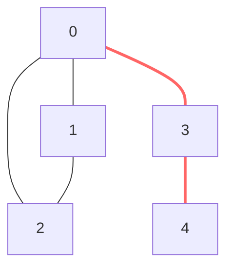

# Gráficas y Juegos - Conexidad

## 3.2 Vértices de corte y puentes.

---

### 1. Introducción

En la teoría de grafos, la **conexidad** no solo se refiere a si un grafo está conectado o no, sino también a qué tan "robusta" es esa conexión. Los **vértices de corte** (o puntos de articulación) y los **puentes** (o aristas de corte) son elementos críticos cuya eliminación aumenta el número de componentes conectados en un grafo. Identificarlos es crucial para analizar la vulnerabilidad y resiliencia de redes (redes de computadoras, redes sociales, mapas de juegos).

### 2. Definiciones Fundamentales

#### Grafo No Dirigido Conexo

Un grafo no dirigido $G = (V, E)$ es **conexo** si para todo par de vértices $u, v \in V$ existe un camino entre $u$ y $v$.

#### Vértice de Corte (Punto de Articulación)

Un vértice $v \in V$ es un **vértice de corte** si su remoción (junto con todas las aristas incidentes) desconecta el grafo $G$, es decir, aumenta el número de componentes conectados.

#### Puente (Arista de Corte)

Una arista $e \in E$ es un **puente** si su remoción desconecta el grafo $G$, aumentando el número de componentes conectados.

**Observación importante:** Si un puente conecta dos vértices, es muy probable que uno o ambos de sus vértices extremos sean vértices de corte (a menos que sean vértices hoja).

### 3. Teoremas y Conceptos Clave para el Algoritmo

El algoritmo clásico para encontrar vértices de corte y puentes utiliza una **Depth-First Search (DFS)** y se basa en dos conceptos:

#### Depth-First Search (DFS)

Un algoritmo para recorrer o buscar en un grafo. Explora lo más profundo posible a lo largo de cada rama antes de retroceder.

#### Tiempo de Descubrimiento (disc)

Un contador que registra el momento en que un vértice es visitado por primera vez por el algoritmo DFS.

#### Low Link (low)

Para un vértice $u$, $low[u]$ es el menor valor de $disc$ entre todos los vértices a los que se puede llegar desde $u$ siguiendo:

1.  El árbol DFS (aristas tree) **y luego**
2.  **Una** arista de retroceso (back edge).

Intuitivamente, $low[u]$ indica el vértice más "alto" (el descubierto más temprano) en el árbol DFS al que se puede "escapar" desde el subárbol con raíz en $u$.

#### Criterios de Identificación

1.  **Vértice de Corte (para vértice raíz):**
    La raíz del árbol DFS es un vértice de corte **si y solo si** tiene **más de un hijo** en el árbol DFS.

2.  **Vértice de Corte (para vértice no raíz):**
    Un vértice $u$ (no raíz) es un vértice de corte **si y solo si** existe al menos un hijo $v$ de $u$ en el árbol DFS tal que:

    $$low[v] \geq disc[u]$$

    Esto significa que **desde $v$ no se puede escapar** a un ancestro de $u$ usando una arista de retroceso.

3.  **Puente:**
    Una arista $(u, v)$ (donde $u$ es el padre de $v$ en el árbol DFS) es un puente **si y solo si**:

    $$low[v] > disc[u]$$

    Esto significa que **desde $v$ no se puede escapar ni siquiera a $u$**; la arista $(u, v)$ es el único enlace.

### 4. Algoritmo de Búsqueda de Vértices de Corte y Puentes

A continuación, se presenta la implementación del algoritmo basado en DFS.

```python
class Graph:
    def __init__(self, vertices):
        self.V = vertices
        self.graph = [[] for _ in range(vertices)]
        self.time = 0
        self.articulation_points = []  # Lista para almacenar vértices de corte
        self.bridges = []  # Lista para almacenar puentes

    def add_edge(self, u, v):
        self.graph[u].append(v)
        self.graph[v].append(u)

    def find_cut_vertices_and_bridges(self):
        # Inicializar arrays
        disc = [-1] * self.V  # Tiempo de descubrimiento
        low = [-1] * self.V   # Valor low
        parent = [-1] * self.V # Padre en el árbol DFS
        visited = [False] * self.V
        ap = [False] * self.V  # Articulation Point

        # Función DFS recursiva
        def dfs(u, visited, disc, low, parent, ap):
            children = 0
            visited[u] = True
            disc[u] = self.time
            low[u] = self.time
            self.time += 1

            for v in self.graph[u]:
                if not visited[v]:
                    children += 1
                    parent[v] = u
                    dfs(v, visited, disc, low, parent, ap)
                    # Actualizar el low del padre después de volver de la recursión
                    low[u] = min(low[u], low[v])

                    # (1) Verificar si 'u' es un vértice de corte (no raíz)
                    if parent[u] != -1 and low[v] >= disc[u]:
                        ap[u] = True
                        self.articulation_points.append(u)

                    # (2) Verificar si la arista (u, v) es un puente
                    if low[v] > disc[u]:
                        self.bridges.append((u, v))

                elif v != parent[u]: # Es una arista de retroceso (back edge)
                    low[u] = min(low[u], disc[v])

            # (3) Verificar si la raíz es un vértice de corte
            if parent[u] == -1 and children > 1:
                ap[u] = True
                self.articulation_points.append(u)

        # Llamar a DFS para todos los vértices no visitados (por si el grafo es disconexo)
        for i in range(self.V):
            if not visited[i]:
                dfs(i, visited, disc, low, parent, ap)

        # Eliminar duplicados de la lista de puntos de articulación
        self.articulation_points = list(set(self.articulation_points))
        return self.articulation_points, self.bridges

# --- EJEMPLO DE USO ---
if __name__ == "__main__":
    # Crear un grafo de ejemplo
    g = Graph(5)
    g.add_edge(1, 0)
    g.add_edge(0, 2)
    g.add_edge(2, 1)
    g.add_edge(0, 3)
    g.add_edge(3, 4)

    aps, bridges = g.find_cut_vertices_and_bridges()

    print("Vértices de corte (puntos de articulación):", aps)
    print("Puentes:", bridges)
```

### 5. Ejemplo Visual y Diagrama

Considere el grafo del ejemplo de código:

- Vértices: 0, 1, 2, 3, 4
- Aristas: (0,1), (0,2), (1,2), (0,3), (3,4)



**Análisis del diagrama:**

- **Vértice 0:** Es un vértice de corte (color morado). Si se elimina, el grafo se divide en dos componentes: el triángulo {1,2} y la cadena {3,4}.
- **Vértice 3:** Es un vértice de corte (color morado). Si se elimina, el grafo se divide en el componente {0,1,2} y el vértice aislado {4}.
- **Arista (0,3):** Es un puente (línea roja). Si se elimina, se desconecta el componente {3,4} del {0,1,2}.
- **Arista (3,4):** Es un puente (línea roja). Si se elimina, se desconecta el vértice {4} del resto del grafo.

**Nota:** El triángulo formado por los vértices 0, 1, 2 es un **ciclo**, lo que lo hace robusto. Ningún vértice dentro de él es de corte, y ninguna de sus aristas es un puente.

### 6. Aplicaciones en Gráficas y Juegos

- **Diseño de Niveles (Level Design):** Identificar vértices de corte ayuda a encontrar "cuellos de botella" en un mapa. Un jugador que controle un vértice de corte puede dominar el flujo del juego.
- **Análisis de Redes:** En juegos multijugador masivos (MMOs), identificar puentes y vértices de corte ayuda a diagnosticar puntos de falla críticos en la topología de red que, si fallan, dividen la red.
- **AI y Pathfinding:** Los puentes suelen ser caminos obligatorios entre áreas. La IA puede asignar un mayor costo estratégico a atravesar un puente, ya que es un punto vulnerable y predecible.
- **Generación Procedural:** Al generar mundos o mazmorras de forma procedural, es crucial asegurar la conexidad. Los algoritmos pueden verificar y "fortificar" los vértices de corte y puentes para evitar que el mundo se fragmente fácilmente.
