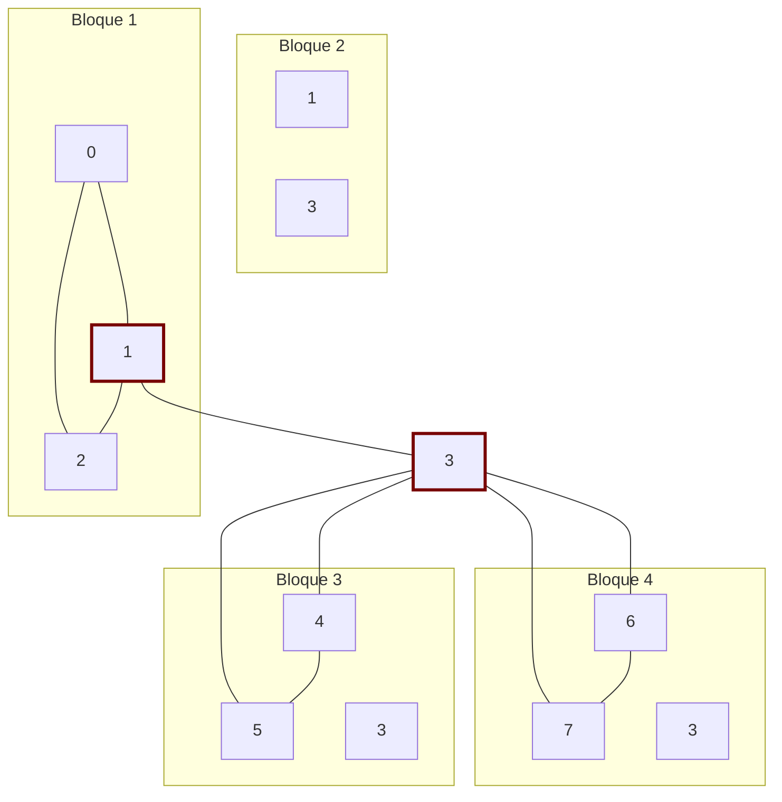
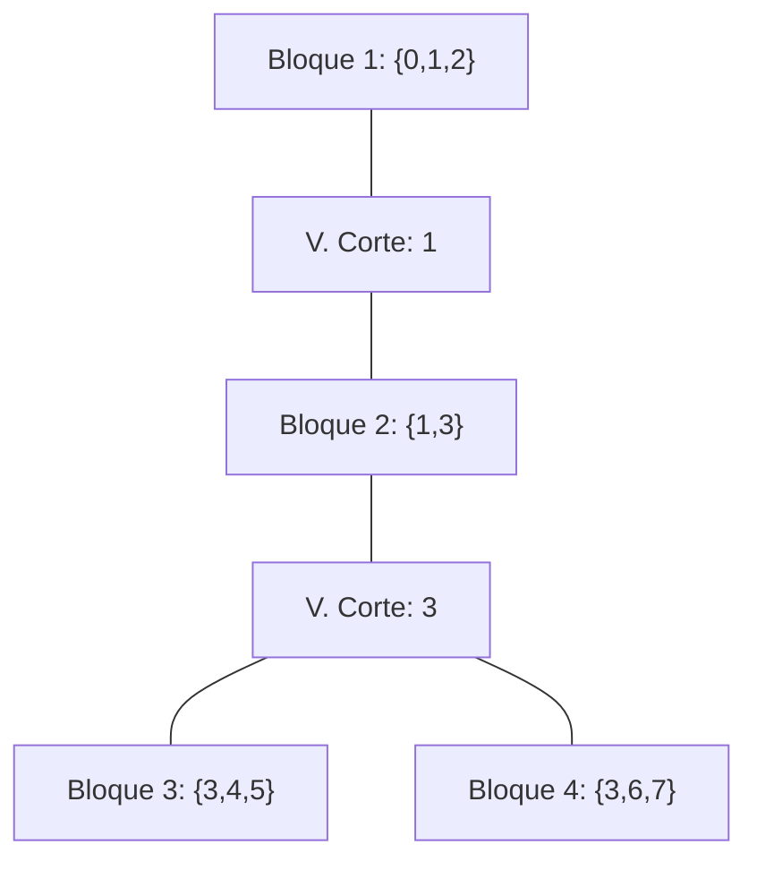

# Gráficas y Juegos - Conexidad

## 3.3 Bloques.

---

### 1. Introducción a los Bloques

En teoría de grafos, un **bloque** (también llamado **componente biconexo** o **componente 2-conexo**) es un subgrafo conexo maximal que no contiene ningún **vértice de corte**. Esto significa que un bloque es una parte del grafo, lo más grande posible, que permanece conexa aunque se elimine cualquiera de sus vértices. Un bloque es un vértice aislado, una arista que es puente, o una subgráfica 2-conexa maximal.

Los bloques son importantes porque nos permiten descomponer un grafo conexo en subestructuras más simples y robustas, facilitando el análisis de su conectividad.

### 2. Definiciones Formales

#### Grafo Biconexo (2-Conexo)

Un grafo conexo $G$ es **biconexo** si no contiene vértices de corte. Es decir, la eliminación de cualquier vértice $v \in V(G)$ no desconecta el grafo.

#### Bloque

Un **bloque** $B$ de un grafo $G$ es un subgrafo biconexo maximal. Maximal significa que no existe otro subgrafo biconexo $B'$ en $G$ que contenga propiamente a $B$.

#### Descomposición en Bloques

Cualquier grafo conexo $G$ puede ser descompuesto en una colección de bloques $\{B_1, B_2, \ldots, B_k\}$ que son subgrafos de $G$ tales que:

1.  Cada bloque es biconexo.
2.  La unión de todos los bloques es $G$.
3.  La intersección de cualquier par de bloques distintos es vacía o contiene exactamente un vértice, y este vértice es necesariamente un **vértice de corte** de $G$.

### 3. Relación entre Vértices de Corte y Bloques

Los vértices de corte son fundamentales para entender la estructura de bloques de un grafo:

- Un **vértice de corte** pertenece a **múltiples bloques**.
- Un **vértice que no es de corte** pertenece a **exactamente un bloque**.
- Una **arista** pertenece a **exactamente un bloque**.

La descomposición en bloques revela la "estructura en árbol" de un grafo. Si contraemos cada bloque a un solo vértice, los vértices de corte forman la estructura que conecta estos bloques, resultando en un **árbol de bloques**.

### 4. Algoritmo para Descomposición en Bloques

El algoritmo utiliza DFS y una pila para rastrear las aristas y construir los bloques. Se basa en los mismos conceptos de $disc$ y $low$ usados para encontrar vértices de corte.

```python
class Graph:
    def __init__(self, vertices):
        self.V = vertices
        self.graph = [[] for _ in range(vertices)]
        self.time = 0
        self.blocks = []  # Lista que almacenará los bloques (listas de vértices)
        self.stack = []   # Pila para almacenar aristas durante el DFS

    def add_edge(self, u, v):
        self.graph[u].append(v)
        self.graph[v].append(u)

    def find_blocks(self):
        disc = [-1] * self.V
        low = [-1] * self.V
        parent = [-1] * self.V
        visited = [False] * self.V

        def dfs(u, visited, disc, low, parent):
            children = 0
            visited[u] = True
            disc[u] = self.time
            low[u] = self.time
            self.time += 1

            for v in self.graph[u]:
                if not visited[v]:
                    children += 1
                    parent[v] = u
                    self.stack.append((u, v))  # Empujar arista al stack
                    dfs(v, visited, disc, low, parent)

                    low[u] = min(low[u], low[v])

                    # Si 'u' es raíz con hijos O si no es raíz y low[v] >= disc[u]
                    if (parent[u] == -1 and children > 1) or (parent[u] != -1 and low[v] >= disc[u]):
                        block = set()
                        # Pop del stack hasta llegar a la arista (u, v)
                        while self.stack[-1] != (u, v):
                            edge = self.stack.pop()
                            block.add(edge[0])
                            block.add(edge[1])
                        # Pop de la arista (u, v) también
                        edge = self.stack.pop()
                        block.add(edge[0])
                        block.add(edge[1])
                        self.blocks.append(block)

                elif v != parent[u] and disc[v] < disc[u]:
                    self.stack.append((u, v))  # Empujar arista de retroceso
                    low[u] = min(low[u], disc[v])

        for i in range(self.V):
            if not visited[i]:
                dfs(i, visited, disc, low, parent)

                # Procesar cualquier bloque restante en el stack después del DFS
                if self.stack:
                    block = set()
                    while self.stack:
                        edge = self.stack.pop()
                        block.add(edge[0])
                        block.add(edge[1])
                    self.blocks.append(block)

        return self.blocks

# --- EJEMPLO DE USO ---
if __name__ == "__main__":
    g = Graph(8)
    g.add_edge(0, 1)
    g.add_edge(1, 2)
    g.add_edge(2, 0)  # Forma un ciclo/bloque: {0,1,2}
    g.add_edge(1, 3)
    g.add_edge(3, 4)
    g.add_edge(4, 5)
    g.add_edge(5, 3)  # Forma un ciclo/bloque: {3,4,5}
    g.add_edge(3, 6)
    g.add_edge(6, 7)
    g.add_edge(7, 3)  # Forma un ciclo/bloque: {3,6,7}

    blocks = g.find_blocks()
    print("Bloques encontrados (vértices en cada bloque):")
    for i, block in enumerate(blocks):
        print(f"Bloque {i+1}: {sorted(block)}")
```

**Salida esperada:**

```
Bloques encontrados (vértices en cada bloque):
Bloque 1: [3, 4, 5]
Bloque 2: [3, 6, 7]
Bloque 3: [1, 3]
Bloque 4: [0, 1, 2]
```

Los bloques salen en el orden en que el DFS los termina de explorar, de las hojas hacia la raíz: primero los triángulos que cuelgan de 3, luego la arista (1,3) y al final el bloque de la raíz 0. En el resto de la página se numeran en el orden inverso.

El vértice 1 y el vértice 3 son vértices de corte que conectan los diferentes bloques.

### 5. Visualización de la Descomposición en Bloques

Considere el grafo del ejemplo anterior con 8 vértices.



**Análisis del diagrama:**

- **Vértices de corte:** 1 y 3 (resaltados con borde rojo).
- **Bloque 1:** El triángulo formado por los vértices {0, 1, 2}. Es biconexo.
- **Bloque 2:** Realmente es solo la arista (1,3). Aunque una sola arista se considera técnicamente un bloque, conecta el vértice de corte 1 con el vértice de corte 3.
- **Bloque 3:** El triángulo formado por los vértices {3, 4, 5}.
- **Bloque 4:** El triángulo formado por los vértices {3, 6, 7}.

### 6. Árbol de Bloques (Block-Cut Tree)

La descomposición en bloques nos permite construir un nuevo grafo llamado **árbol de bloques** o **block-cut tree**. Este árbol $T$ tiene:

- **Vértices de $T$:** Dos tipos: (1) los **bloques** de $G$ y (2) los **vértices de corte** de $G$.
- **Aristas de $T$:** Conectan un vértice de corte $c$ a un bloque $B$ si y solo si $c \in B$.

Para el grafo del ejemplo, el árbol de bloques sería:



Este árbol captura perfectamente cómo los bloques están interconectados a través de los vértices de corte.

### 7. Aplicaciones en Gráficas y Juegos

- **Análisis de Redes de Flujo:** En juegos de estrategia, los bloques representan regiones "seguras" o "fortificadas" dentro de un mapa. Los vértices de corte representan "pasos" o "puertas" estratégicas que conectan estas regiones. Controlar un vértice de corte significa controlar el acceso a múltiples regiones.

- **Optimización de Redes:** En el diseño de niveles multijugador, entender la estructura de bloques ayuda a crear mapas balanceados. Demasiados vértices de corte pueden hacer que el mapa se sienta fragmentado, mientras que muy pocos pueden hacer que se sienta como una sola "sala" sin puntos de control estratégicos.

- **Pathfinding y AI:** La IA puede usar el árbol de bloques para planificación de alto nivel. En lugar de calcular caminos en todo el grafo, puede primero navegar por el árbol de bloques para decidir qué regiones atravesar, y luego encontrar un camino detallado dentro de un bloque individual, que al ser biconexo es más simple de navegar.

- **Generación Procedural de Niveles:** Un algoritmo puede generar un árbol de bloques deseado primero (la estructura de alto nivel del mapa) y luego "rellenar" cada bloque con una topología interna que sea biconexa (por ejemplo, una malla o un ciclo), garantizando que el mapa resultante tenga la conectividad estratégica deseada.
