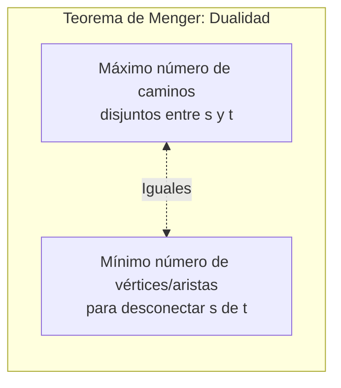
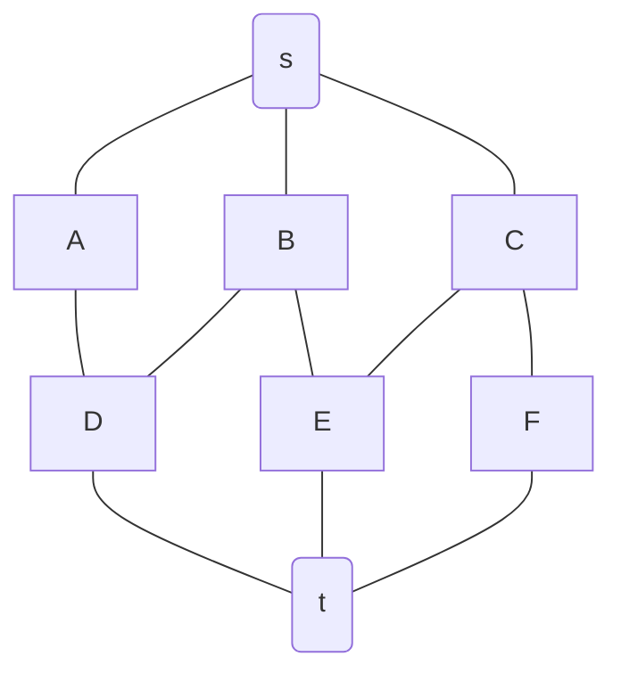

# Gráficas y Juegos - Conexidad

## 3.4 Teorema de Menger.

---

### 1. Introducción al Teorema de Menger

El **Teorema de Menger** (1927), formulado por Karl Menger, es un resultado fundamental en la teoría de grafos que establece una profunda dualidad entre la **conexidad** de un grafo y el número de **caminos disjuntos** que conectan pares de vértices. Este teorema proporciona una caracterización combinatoria de la k-conexidad y tiene aplicaciones cruciales en el diseño de redes robustas y en algoritmos de flujo.

### 2. Definiciones Previas

#### Caminos Vertex-Disjoint (Disjuntos en Vértices)

Dos o más caminos entre un par de vértices $s$ y $t$ son **disjuntos en vértices** si no comparten ningún vértice interno. Pueden compartir los vértices terminales $s$ y $t$.

#### Caminos Edge-Disjoint (Disjuntos en Aristas)

Dos o más caminos entre un par de vértices $s$ y $t$ son **disjuntos en aristas** si no comparten ninguna arista.

#### Conjunto de Separación (Vertex Cut)

Un **conjunto de separación** $S$ para dos vértices $s$ y $t$ es un conjunto de vértices tal que al removerlos del grafo $G$, $s$ y $t$ quedan en componentes conexas distintas. Un conjunto de separación $s-t$ **mínimo** es el de menor cardinalidad posible.

#### Conjunto de Corte de Aristas (Edge Cut)

Un **conjunto de corte de aristas** $C$ para dos vértices $s$ y $t$ es un conjunto de aristas tal que al removerlas del grafo $G$, $s$ y $t$ quedan desconectados. Un conjunto de corte $s-t$ **mínimo** es el de menor cardinalidad posible.

### 3. Enunciados del Teorema de Menger

El teorema tiene dos versiones principales, que son duales por el teorema de max-flow min-cut.

#### Versión para Vértices (Vertex Version)

Sea $G$ un grafo finito, no dirigido y sean $s$ y $t$ dos vértices no adyacentes. El **número máximo de caminos disjuntos en vértices** entre $s$ y $t$ es igual al **tamaño del conjunto de separación $s-t$ mínimo**.

$$ \text{max \# caminos } s\text{-}t \text{ (vertex-disjoint)} = \text{min } |S| \text{ donde } S \text{ es un } s\text{-}t \text{ separator} $$

#### Versión para Aristas (Edge Version)

Sea $G$ un grafo finito y sean $s$ y $t$ dos vértices distintos. El **número máximo de caminos disjuntos en aristas** entre $s$ y $t$ es igual al **tamaño del conjunto de corte de aristas $s-t$ mínimo**.

$$ \text{max \# caminos } s\text{-}t \text{ (edge-disjoint)} = \text{min } |C| \text{ donde } C \text{ es un } s\text{-}t \text{ edge cut} $$

### 4. Visualización del Teorema

Consideremos un grafo $G$ y dos vértices $s$ y $t$. El teorema establece una igualdad entre dos conceptos aparentemente diferentes.



**Ejemplo Gráfico:**
En el siguiente grafo, encontramos entre $s$ y $t$:

- **3** caminos disjuntos en vértices (y por lo tanto también en aristas).
- El conjunto de separación mínimo tiene tamaño **3** ( p. ej., ${a, b, c}$ ).
- El conjunto de corte de aristas mínimo tiene tamaño **3**.



### 5. Implementación usando Max-Flow Min-Cut

El Teorema de Menger está íntimamente ligado al Teorema de Max-Flow Min-Cut. Podemos encontrar el número máximo de caminos disjuntos transformando el problema en un problema de flujo máximo.

#### Para Caminos Disjuntos en Vértices

1.  Transformar el grafo $G$ en una **red de flujo** $G'$ dirigida.
2.  Dividir cada vértice $v$ ( excepto $s$ y $t$ ) en dos vértices: $ v_{in} $ y $ v_{out} $.
3.  Conectar $v_{in}$ a $v_{out}$ con una arista de capacidad 1.
4.  Para cada arista $(u, v)$ en $G$, agregar una arista de capacidad infinita (o 1) de $u_{out}$ a $v_{in}$ y de $v_{out}$ a $u_{in}$.
5.  El flujo máximo de $s$ a $t$ en $G'$ es igual al número máximo de caminos disjuntos en vértices en $G$.

#### Para Caminos Disjuntos en Aristas

1.  Transformar el grafo $G$ en una red de flujo $G'$ dirigida.
2.  Asignar capacidad 1 a cada arista.
3.  El flujo máximo de $s$ a $t$ en $G'$ es igual al número máximo de caminos disjuntos en aristas en $G$.

```python
import networkx as nx
import matplotlib.pyplot as plt

def max_vertex_disjoint_paths(graph, source, target):
    """
    Calcula el número máximo de caminos disjuntos en vértices entre source y target
    usando la transformación a un problema de flujo.
    """
    # Crear un grafo dirigido para la red de flujo
    flow_network = nx.DiGraph()

    # Para cada vértice en el grafo original, agregar dos vértices (in y out) y un enlace de capacidad 1 entre ellos
    for node in graph.nodes():
        if node != source and node != target:
            flow_network.add_edge(f"{node}_in", f"{node}_out", capacity=1)

    # Agregar aristas originales (transformadas)
    for (u, v) in graph.edges():
        if u == source:
            if v == target:
                # Arista directa s-t
                flow_network.add_edge(source, target, capacity=1)
            else:
                # Desde s hasta el nodo 'in' del vértice v
                flow_network.add_edge(source, f"{v}_in", capacity=1)
        elif v == source:
            if u == target:
                flow_network.add_edge(source, target, capacity=1)
            else:
                flow_network.add_edge(source, f"{u}_in", capacity=1)
        elif u == target:
            # Desde el nodo 'out' del vértice v hasta t
            flow_network.add_edge(f"{v}_out", target, capacity=1)
        elif v == target:
            flow_network.add_edge(f"{u}_out", target, capacity=1)
        else:
            # Para aristas entre vértices internos, conectar u_out -> v_in y v_out -> u_in
            flow_network.add_edge(f"{u}_out", f"{v}_in", capacity=1)
            flow_network.add_edge(f"{v}_out", f"{u}_in", capacity=1)

    # Calcular el flujo máximo desde el source hasta el target
    flow_value, _ = nx.maximum_flow(flow_network, source, target)
    return int(flow_value)

# --- EJEMPLO DE USO ---
if __name__ == "__main__":
    # Crear un grafo de ejemplo
    G = nx.Graph()
    edges = [('s', 'a'), ('s', 'b'), ('s', 'c'),
             ('a', 'd'), ('b', 'd'), ('b', 'e'),
             ('c', 'e'), ('c', 'f'),
             ('d', 't'), ('e', 't'), ('f', 't')]
    G.add_edges_from(edges)

    # Calcular el número máximo de caminos disjuntos en vértices
    num_paths = max_vertex_disjoint_paths(G, 's', 't')
    print(f"Número máximo de caminos disjuntos en vértices entre 's' y 't': {num_paths}")

    # NetworkX tiene una función incorporada para caminos disjuntos en aristas
    num_edge_disjoint_paths = nx.maximum_flow_value(G, 's', 't', capacity=1)
    print(f"Número máximo de caminos disjuntos en aristas entre 's' y 't': {num_edge_disjoint_paths}")
```

### 6. Aplicaciones en Gráficas y Juegos

- **Diseño de Redes Robustas:** En juegos multijugador, la infraestructura de red subyacente puede modelarse como un grafo. El Teorema de Menger indica el **mínimo número de enrutadores o conexiones que deben fallar** para que un jugador ( nodo $s$ ) se desconecte del servidor ( nodo $t$ ). Esto ayuda a diseñar redes tolerantes a fallos.

- **Análisis de Mapas y Niveles:** En un juego de estrategia, el mapa puede representarse como un grafo donde los vértices son ubicaciones estratégicas y las aristas son caminos. El número de caminos disjuntos entre la base del jugador y la del enemigo ( $s$ y $t$ ) indica cuántas rutas de ataque simultáneas existen. El tamaño del conjunto de separación mínimo indica cuántos "puntos de control" o "cuellos de botella" deben ser defendidos para bloquear todos los ataques.

- **Sistemas de Invulnerabilidad:** En juegos RPG o de aventuras, un "jefe final" podría ser invulnerable hasta que el jugador destruya un cierto número de "objetos de poder" (vértices de un conjunto de separación) que lo protegen. El Teorema de Menger determinaría el número mínimo de estos objetos que deben ser destruidos para "desconectar" la invulnerabilidad del jefe.

- **Algoritmos de Flujo y Pathfinding:** La conexión con el problema de flujo máximo significa que algoritmos eficientes como **Ford-Fulkerson** o **Edmonds-Karp** pueden usarse para calcular la conectividad entre dos puntos en un grafo que representa un mundo de juego, lo cual es crucial para la IA para evaluar la criticidad de posiciones y planear ataques o defensas.
